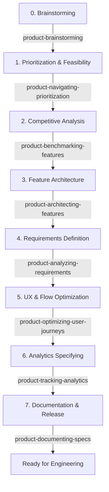

# Antigravity Expert Skills

A premium suite of **23 custom agent skills** organized into dedicated category domains designed to automate and guide product development, mobile growth, game engineering, and software architecture workflows inside Google Antigravity and Claude Code workspace environments.

These skills are located under the categorized `skills/` directory and mapped to the standard customization root at `.agents/skills/` and registered via `.agents/skills.json`. This structure enables clean repository organization on GitHub while remaining fully auto-discoverable by agent runtimes.

---

## 🗂️ Categories Overview

The skills are organized into five core functional domains:

```
skills/
├── product-management/        # 12 skills: End-to-end Product Development Lifecycle (PDLC)
├── growth-monetization/       #  2 skills: App Store Optimization, monetization & growth engines
├── game-development/         #  5 skills: 3D assets, Unity mobile architecture & game UI/UX
├── software-engineering/      #  4 skills: Clean architecture, tech stack & agent meta-tooling
└── frontend-engineering/      #  4 skills: Specialized frontend ideation, research & architecture suite
```

---

## 🔄 The Product Development Lifecycle (PDLC)

When a new feature or idea is proposed, the **[product-orchestrating](skills/product-management/product-orchestrating/SKILL.md)** skill guides you step-by-step through the following development lifecycle:



---

## 📦 Skills Catalog

### 1. 📊 Product Management (`skills/product-management/`)

| Skill Directory | Purpose | Key Trigger Keywords |
|---|---|---|
| 🎛️ **[product-orchestrating](skills/product-management/product-orchestrating)** | Master coordinator for the end-to-end PDLC and reference routing. | `orchestrate lifecycle`, `features help` |
| 💡 **[product-brainstorming](skills/product-management/product-brainstorming)** | Brainstorm concepts, user personas, value proposition mapping, and product hooks. | `brainstorm`, `value proposition`, `hook model` |
| 📊 **[product-navigating-prioritization](skills/product-management/product-navigating-prioritization)** | Evaluate features backlog and MVP boundaries using RICE and MoSCoW. | `RICE framework`, `MoSCoW`, `prioritize backlog` |
| 🔍 **[product-benchmarking-features](skills/product-management/product-benchmarking-features)** | Benchmark against competitor features to find gaps and define USPs. | `competitor analysis`, `USP`, `market gaps` |
| 🗺️ **[product-architecting-features](skills/product-management/product-architecting-features)** | Design modular workflows, user flows, and layout mapping. | `feature modularization`, `WBS`, `user journey` |
| 📝 **[product-analyzing-requirements](skills/product-management/product-analyzing-requirements)** | Author user stories, Gherkin-style Acceptance Criteria, and functional specifications. | `user stories`, `acceptance criteria`, `Gherkin` |
| 📈 **[product-analyzing-business](skills/product-management/product-analyzing-business)** | Map business process logic, stakeholder requirements, and calculate ROI metrics. | `business requirements`, `ROI models`, `KPIs` |
| 🎨 **[product-optimizing-user-journeys](skills/product-management/product-optimizing-user-journeys)** | Audit conversion funnels, reduce onboarding friction, and tune UX copy. | `UX audit`, `friction reduction`, `onboarding flow` |
| 🏷️ **[product-tracking-analytics](skills/product-management/product-tracking-analytics)** | Design Google Analytics 4 (GA4) custom dimensions and event-tracking schemas. | `GA4`, `event tracking`, `tracking plan` |
| 🗄️ **[product-documenting-specs](skills/product-management/product-documenting-specs)** | Publish specifications into folder structures with authority & status badges. | `documentation index`, `specs publishing`, `docs/` |
| 💵 **[product-costs-pricing](skills/product-management/product-costs-pricing)** | Analyze API execution costs, plan pricing models, and verify profit margins. | `pricing tiers`, `execution costs`, `profit margins` |
| 🔬 **[product-deepsearch](skills/product-management/product-deepsearch)** | Conduct high-fidelity, verified deep web research using Chromium and subagents. | `deep research`, `verified research`, `market study` |

### 2. 📈 Growth & Monetization (`skills/growth-monetization/`)

| Skill Directory | Purpose | Key Trigger Keywords |
|---|---|---|
| 🚀 **[growth-pm](skills/growth-monetization/growth-pm)** | Mobile Growth Product Manager & Monetization framework: paywalls, onboarding, LinUCB & SKAN. | `growth audit`, `paywall optimization`, `retention loop` |
| 🖼️ **[product-aso-screenshot-creator](skills/growth-monetization/product-aso-screenshot-creator)** | Plan, structure, and generate high-converting, ASO-optimized App Store and Google Play screenshots. | `ASO screenshots`, `store graphics`, `screenshot layout` |

### 3. 🎮 Game Development & 3D (`skills/game-development/`)

| Skill Directory | Purpose | Key Trigger Keywords |
|---|---|---|
| 🕹️ **[unity-expert](skills/game-development/unity-expert)** | Master suite covering Unity mobile architecture, URP shaders, zero-GC pooling & haptics. | `unity architecture`, `URP shader`, `zero GC pooling` |
| 🎨 **[3d-asset-creator](skills/game-development/3d-asset-creator)** | Complete AI 3D asset pipeline: concept generation, Meshy AI, Blender polish & Unity sync. | `create 3d asset`, `meshy ai`, `blender fbx` |
| 📱 **[game-ui-designer-developer](skills/game-development/game-ui-designer-developer)** | AAA Game UI/UX design, FSM Canvas navigation, spring juice, shaders & technical art. | `game ui design`, `canvas fsm`, `hud shaders` |
| 🏎️ **[mobile-3d-game-architect](skills/game-development/mobile-3d-game-architect)** | React Native + Three.js mobile 3D game architecture, 60fps render loop & memory management. | `rn threejs game`, `mobile 3d engine`, `expo three` |
| 🕹️ **[mobile-game-ui-designer-developer](skills/game-development/mobile-game-ui-designer-developer)** | React Native + Three.js game UI/UX, responsive safe-area layout, HUD & touch controls. | `rn game ui`, `threejs hud`, `game canvas layout` |

### 4. ⚙️ Software Engineering & Meta (`skills/software-engineering/`)

| Skill Directory | Purpose | Key Trigger Keywords |
|---|---|---|
| 💻 **[product-frontend-clean-architecture-development](skills/software-engineering/product-frontend-clean-architecture-development)** | Write modular, clean, and scalable frontend code adhering to Clean Architecture principles. | `develop frontend screen`, `clean architecture component`, `modular structure` |
| ⚙️ **[product-selecting-development-technology](skills/software-engineering/product-selecting-development-technology)** | Standalone developer/architect utility to select technology stack components and frameworks. | `tech stack`, `ADR`, `database selection` |
| 🤖 **[product-sub-agent-creator](skills/software-engineering/product-sub-agent-creator)** | Decompose complex features and refactorings across coordinated parallel subagents. | `subagent orchestration`, `parallel agents`, `task division` |
| 🔧 **[product-antigravity-skill-activate](skills/software-engineering/product-antigravity-skill-activate)** | Meta-skill to configure, register, and activate custom skills in Antigravity. | `activate skill`, `configure skill`, `register skill` |

### 5. 💻 Frontend Engineering (`skills/frontend-engineering/`)

| Skill Directory | Purpose | Key Trigger Keywords |
|---|---|---|
| 💡 **[product-brainstorming](skills/frontend-engineering/product-brainstorming)** | Brainstorm concepts, user personas, value proposition mapping, and product hooks for frontend interfaces. | `brainstorm`, `value proposition`, `hook model` |
| 🔬 **[product-deepsearch](skills/frontend-engineering/product-deepsearch)** | Conduct high-fidelity web and UI/UX benchmark research using Chromium and subagents. | `deep research`, `verified research`, `market study` |
| 💻 **[product-frontend-clean-architecture-development](skills/frontend-engineering/product-frontend-clean-architecture-development)** | Master Frontend Clean Architecture orchestrator with **6 dedicated subskills** (Presentation, Domain, Infrastructure, State Orchestration, Performance & Ergonomics, Quality & Security). | `develop frontend screen`, `clean architecture component`, `modular structure`, `audit frontend architecture` |
| 🤖 **[product-sub-agent-creator](skills/frontend-engineering/product-sub-agent-creator)** | Decompose complex frontend features across coordinated parallel subagents. | `subagent orchestration`, `parallel agents`, `task division` |

---

## 🚀 How to Use

### 1. Auto-Loading in Antigravity & Claude Code
Skills are organized in `skills/<category>/<skill-name>` and exposed via `.agents/skills/` symlinks and `.agents/skills.json`. Simply run your Antigravity agent or Claude Code CLI inside this workspace directory, and the skills will be discovered automatically.

### 2. Triggering the Orchestrator
To begin planning or managing a new feature, prompt the agent:
> *"Orchestrate the development lifecycle for the new feature [Feature Name]."*

### 3. Running Individual Skills
If you want to use a specific skill directly without the full orchestrator:
> *"Run product-benchmarking-features to compare my feature with Competitor A"*
> *"Run unity-expert to optimize our mobile endless runner road generation"*
> *"Create a GA4 tracking plan using product-tracking-analytics"*

---

## 🛠️ Verification & Quality Check
The files in this repository are validated against the CLI skill-development rules (YAML frontmatter, trigger descriptions, line limits, and relative link resolution). You can run the audit script anytime:
```bash
python3 skills/product-management/product-orchestrating/scripts/check_skills.py
```
