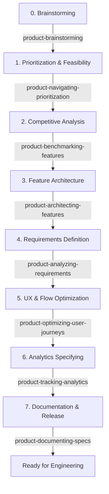

# Antigravity Expert Skills

A premium suite of **16 custom product-facing agent skills** designed to automate and guide product development workflows inside Google Antigravity and Claude Code workspace environments.

These skills are located under the root `skills/` directory and mapped to the standard customization root at `.agents/skills/` using a symbolic link. This allows the files to be fully visible and browsable on GitHub while remaining auto-discoverable by the local agent CLI.

---

## 🔄 The Product Development Lifecycle (PDLC)

When a new feature or idea is proposed, the **[product-orchestrating](skills/product-orchestrating/SKILL.md)** skill guides you step-by-step through the following development lifecycle:



---

## 📦 Skills Directory

Here is the complete catalog of skills contained in this repository:

| Skill Directory | Purpose | Key Trigger Keywords |
|---|---|---|
| 🎛️ **[product-orchestrating](skills/product-orchestrating)** | Master coordinator for the end-to-end PDLC and reference routing. | `orchestrate lifecycle`, `features help` |
| 💡 **[product-brainstorming](skills/product-brainstorming)** | Brainstorm concepts, user personas, value proposition mapping, and product hooks. | `brainstorm`, `value proposition`, `hook model` |
| 📊 **[product-navigating-prioritization](skills/product-navigating-prioritization)** | Evaluate features backlog and MVP boundaries using RICE and MoSCoW. | `RICE framework`, `MoSCoW`, `prioritize backlog` |
| 🔍 **[product-benchmarking-features](skills/product-benchmarking-features)** | Benchmark against competitor features to find gaps and define USPs. | `competitor analysis`, `USP`, `market gaps` |
| 🗺️ **[product-architecting-features](skills/product-architecting-features)** | Design modular workflows, user flows, and layout mapping. | `feature modularization`, `WBS`, `user journey` |
| 📝 **[product-analyzing-requirements](skills/product-analyzing-requirements)** | Author user stories, Gherkin-style Acceptance Criteria, and functional specifications. | `user stories`, `acceptance criteria`, `Gherkin` |
| ⚙️ **[product-selecting-development-technology](skills/product-selecting-development-technology)** | Standalone developer/architect utility to select technology stack components, databases, and frameworks by reading files in `docs/`. | `tech stack`, `ADR`, `database selection` |
| 📈 **[product-analyzing-business](skills/product-analyzing-business)** | Map business process logic, stakeholder requirements, and calculate ROI metrics. | `business requirements`, `ROI models`, `KPIs` |
| 🎨 **[product-optimizing-user-journeys](skills/product-optimizing-user-journeys)** | Audit conversion funnels, reduce onboarding friction, and tune UX copy. | `UX audit`, `friction reduction`, `onboarding flow` |
| 🏷️ **[product-tracking-analytics](skills/product-tracking-analytics)** | Design Google Analytics 4 (GA4) custom dimensions and event-tracking schemas. | `GA4`, `event tracking`, `tracking plan` |
| 🗄️ **[product-documenting-specs](skills/product-documenting-specs)** | Publish specifications into folder structures with authority & status badges. | `documentation index`, `specs publishing`, `docs/` |
| 💻 **[product-frontend-clean-architecture-development](skills/product-frontend-clean-architecture-development)** | Write modular, clean, and scalable frontend code adhering to Clean Architecture principles. | `develop frontend screen`, `clean architecture component`, `modular structure` |
| 🔧 **[product-antigravity-skill-activate](skills/product-antigravity-skill-activate)** | Meta-skill to configure, register, and activate custom skills in Antigravity. | `activate skill`, `configure skill`, `register skill` |
| 🖼️ **[product-aso-screenshot-creator](skills/product-aso-screenshot-creator)** | Plan, structure, and generate high-converting, ASO-optimized App Store and Google Play screenshots. | `ASO screenshots`, `store graphics`, `screenshot layout` |
| 💵 **[product-costs-pricing](skills/product-costs-pricing)** | Analyze API execution costs, plan pricing models, and verify profit margins. | `pricing tiers`, `execution costs`, `profit margins` |
| 🔬 **[product-deepsearch](skills/product-deepsearch)** | Conduct high-fidelity, verified deep web research using Chromium and subagents. | `deep research`, `verified research`, `market study` |

---

## 🚀 How to Use

### 1. Auto-Loading in Antigravity
Since this repository includes a symbolic link mapping the unhidden `skills/` directory to `.agents/skills/`, **no manual installation is required**. Simply run your Antigravity agent or Claude Code CLI inside this workspace directory, and the skills will be loaded automatically.

### 2. Triggering the Orchestrator
To begin planning or managing a new feature, prompt the agent:
> *"Orchestrate the development lifecycle for the new feature [Feature Name]."*

### 3. Running Individual Skills
If you want to use a specific skill directly without the full orchestrator:
> *"Run product-benchmarking-features to compare my feature with Competitor A"*
> *"Create a GA4 tracking plan using product-tracking-analytics"*

---

## 🛠️ Verification & Quality Check
The files in this repository have been validated against the CLI skill-development rules (including YAML formatting, trigger descriptions, and the 500-line limit). You can re-run the verification script by executing:
```bash
python3 skills/product-orchestrating/scripts/check_skills.py
```

---

## 🔗 Repository Reference
*   **GitHub Repos main branch:** `https://github.com/alperencinar/antigravity-expert-skills.git`
