# Advanced Subscription App Monetization, Dynamic Paywalls, Web-to-App Architectures, and Modern AdTech & Privacy Ecosystem

> **Authoritative Technical & Strategic Guide for Mobile App Product Leaders, Monetization Engineers, and Growth Architects**  
> *Version: 2.5 (2026 Edition) • Scope: iOS, Android, Web-to-App, Server-Side Systems, and Quantitative Growth Modeling*

---

## Table of Contents
1. [Executive Summary & The Modern Subscription Paradigm](#1-executive-summary--the-modern-subscription-paradigm)
2. [Mobile Subscription Economics & Funnel Diagnostics](#2-mobile-subscription-economics--funnel-diagnostics)
   - [2.1 The End-to-End Subscription Lifecycle Pipeline](#21-the-end-to-end-subscription-lifecycle-pipeline)
   - [2.2 Core Metric Hierarchy & Diagnostic Benchmarks](#22-core-metric-hierarchy--diagnostic-benchmarks)
   - [2.3 Mathematical LTV Forecasting Models](#23-mathematical-ltv-forecasting-models)
   - [2.4 Price Elasticity & Monomial Pricing Frameworks](#24-price-elasticity--monomial-pricing-frameworks)
   - [2.5 Involuntary vs. Voluntary Churn Mechanics & Recovery Engines](#25-involuntary-vs-voluntary-churn-mechanics--recovery-engines)
3. [Advanced Paywall Strategies, Placements, and Psychographics](#3-advanced-paywall-strategies-placements-and-psychographics)
   - [3.1 Paywall Placement Taxonomy & Structural Frameworks](#31-paywall-placement-taxonomy--structural-frameworks)
   - [3.2 Cognitive Biases & Psychographic Monetization Levers](#32-cognitive-biases--psychographic-monetization-levers)
   - [3.3 Personalization Engines & Downselling Matrices](#33-personalization-engines--downselling-matrices)
4. [Tooling, Infrastructure, and Dynamic Server-Driven Paywall Architecture](#4-tooling-infrastructure-and-dynamic-server-driven-paywall-architecture)
   - [4.1 Ecosystem Architecture & Separation of Concerns](#41-ecosystem-architecture--separation-of-concerns)
   - [4.2 Modern In-App Purchase Mechanics (StoreKit 2 & GPBL 6/7)](#42-modern-in-app-purchase-mechanics-storekit-2--gpbl-67)
   - [4.3 Server-Driven UI (SDUI) & Zero-Code Remote Paywall Deployment](#43-server-driven-ui-sdui--zero-code-remote-paywall-deployment)
   - [4.4 Placement-Based Integration Patterns & Robust Fallbacks](#44-placement-based-integration-patterns--robust-fallbacks)
5. [Web-to-App Funnel Architectures & Cross-Platform Monetization](#5-web-to-app-funnel-architectures--cross-platform-monetization)
   - [5.1 The Strategic Rationale & Unit Economics of Web Arbitrage](#51-the-strategic-rationale--unit-economics-of-web-arbitrage)
   - [5.2 The High-Converting Web Onboarding Quiz Engine](#52-the-high-converting-web-onboarding-quiz-engine)
   - [5.3 Web Checkout & Payment Infrastructure (Stripe / Wallets)](#53-web-checkout--payment-infrastructure-stripe--wallets)
   - [5.4 Cross-Platform Identity Resolution & Deferred Deep Linking Handoff](#54-cross-platform-identity-resolution--deferred-deep-linking-handoff)
6. [Modern AdTech, Attribution, & Privacy Ecosystem](#6-modern-adtech-attribution--privacy-ecosystem)
   - [6.1 Post-ATT Mobile Advertising Landscape & AdAttributionKit](#61-post-att-mobile-advertising-landscape--adattributionkit)
   - [6.2 Android Privacy Reality: GAID Continuity Post-Sandbox Pivot](#62-android-privacy-reality-gaid-continuity-post-sandbox-pivot)
   - [6.3 Modern Media Mix Modeling (MMM) & Causal Incrementality](#63-modern-media-mix-modeling-mmm--causal-incrementality)
   - [6.4 Blended ROAS (MER) & Holistic Portfolio Diagnostics](#64-blended-roas-mer--holistic-portfolio-diagnostics)
   - [6.5 Custom Product Pages (CPPs) & Narrative Continuity](#65-custom-product-pages-cpps--narrative-continuity)
7. [The Ultimate Mobile Monetization Playbook & Architecture Blueprint](#7-the-ultimate-mobile-monetization-playbook--architecture-blueprint)
   - [7.1 End-to-End Reference Architecture Diagram](#71-end-to-end-reference-architecture-diagram)
   - [7.2 Step-by-Step Scaling Blueprint](#72-step-by-step-scaling-blueprint)
   - [7.3 Top 10 Anti-Patterns & Critical Pitfalls to Avoid](#73-top-10-anti-patterns--critical-pitfalls-to-avoid)
   - [7.4 Executive Metric Reference Matrix](#74-executive-metric-reference-matrix)

---

## 1. Executive Summary & The Modern Subscription Paradigm

Mobile subscription apps have undergone a seismic evolutionary shift over the last decade. The era of loose attribution, unchecked user acquisition arbitrage, generic hardcoded paywalls, and passive monetization has been permanently replaced by an intensely disciplined, mathematically rigorous, and multi-platform growth ecosystem.

Modern subscription businesses must operate as synchronized multi-engine organizations:
1. **Dynamic Native Monetization Engine:** Leveraging Server-Driven UI (SDUI) paywalls, automated multi-variant A/B testing, real-time psychographic pricing, and behavioral trigger placements without waiting for app store review cycles.
2. **Web-to-App Arbitrage Engine:** Bypassing the 15–30% platform tax through personalized web onboarding quizzes, instant Stripe/checkout processing, immediate T+2 cash-flow recycling, and deterministic cross-platform identity resolution.
3. **Privacy-First Growth & Attribution Engine:** Navigating Apple's App Tracking Transparency (ATT), AdAttributionKit (AAK), and SKAdNetwork 4.0/5.0 paradigms alongside Google advertising infrastructure, triangulated with Bayesian Media Mix Modeling (Google Meridian, Meta Robyn) and causal geo-lift incrementality experiments.

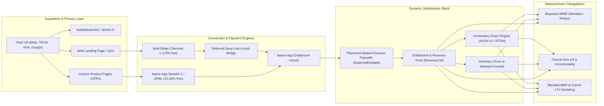

---

## 2. Mobile Subscription Economics & Funnel Diagnostics

### 2.1 The End-to-End Subscription Lifecycle Pipeline

The subscription growth lifecycle is governed by an integrated pipeline. Leakage at any stage compounds exponentially across the customer lifetime value curve:

```
[Ad Impression]
      │
      ▼  CTR (Click-Through Rate: 1.5% - 4.5%)
[App Store / Web Page Impression]
      │
      ▼  Page CVR / Install Rate (25% - 45%)
[App Install / First Open]
      │
      ▼  Onboarding Completion Rate (65% - 85%)
[Paywall View (Day 0)]
      │
      ├───────────────────────────────┐
      ▼  Trial Start CVR (4% - 14%)   ▼  Direct-to-Paid CVR (1.5% - 4.0%)
[Free Trial Initiated]          [Instant Paid Subscriber]
      │                               │
      ▼  Trial-to-Paid (35% - 65%)    │
[First Paid Billing (M0 / Y0)] ◄──────┘
      │
      ▼  First Renewal Rate (M1: 60-80% | Y1: 25-45%)
[Cohort Retention & Expansion (M2...Mn)]
      │
      ▼  Involuntary / Voluntary Recovery (10-25% Salvaged)
[Net Realized Cohort LTV]
```

---

### 2.2 Core Metric Hierarchy & Diagnostic Benchmarks

Industry data compiled across leading subscription platforms (including analysis of over 115,000 subscription applications) reveals sharp contrasts between structural monetization choices:

| Metric | Top Decile (P90) | Median (P50) | Bottom Decile (P10) | Diagnostic Notes & Industry Drivers |
| :--- | :--- | :--- | :--- | :--- |
| **Paywall Views / DAU ($P_{DAU}$)** | $\ge 45\%$ | $18\% - 25\%$ | $< 8\%$ | Measures monetization visibility. Low values indicate passive "settings menu" placement. |
| **Day 0 Onboarding Paywall CVR** | $\ge 12.5\%$ | $4.5\% - 7.0\%$ | $< 2.0\%$ | Measures onboarding resonance, clear pricing, and value communication. |
| **Download-to-Paid (Day 35)** | $\ge 8.5\%$ | $2.5\% - 4.0\%$ | $< 1.0\%$ | Hard paywall apps achieve **10.7%** median vs **2.1%** for pure freemium (5x advantage). |
| **Trial-to-Paid Conversion ($CR_{T \to P}$)** | $\ge 68\%$ | $42\% - 50\%$ | $< 28\%$ | Highly dependent on trial duration: 3-day trials face severe Day 0 shock (~55% canceled Day 0). |
| **Monthly Plan Renewal (M1 $\to$ M2)** | $\ge 82\%$ | $68\% - 74\%$ | $< 52\%$ | M1 is the sharpest cliff. Stabilizes to 85-92% monthly retention from M3 onwards. |
| **Annual Plan Renewal (Y1 $\to$ Y2)** | $\ge 48\%$ | $28\% - 36\%$ | $< 18\%$ | Freemium vs hard paywalls converge to ~27-28% year-one retention. |
| **Revenue Per Install (RPI at D60)** | $\$3.50+$ | $\$0.60 - \$1.20$ | $<\$0.15$ | Hard paywalls generate **8–9x higher RPI** over freemium due to immediate Day 0 conversion. |

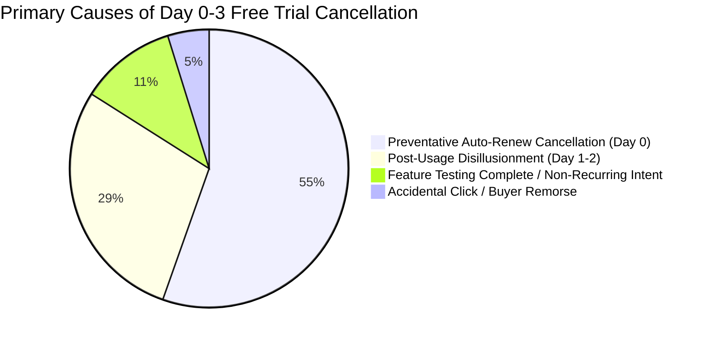

---

### 2.3 Mathematical LTV Forecasting Models

Lifetime Value (LTV) is the fundamental anchor for all Paid User Acquisition. Relying on simple linear extrapolations leads to massive capital misallocation. Subscription LTV must be modeled using actuarial survival curves, parametric retention mechanics, and discounted cash flow adjustments.

#### 1. The Continuous Survival & Discounted Cash Flow Formulation

The theoretical continuous LTV of a cohort acquired at time $t=0$ over time horizon $T$ is expressed as:

$$\text{LTV}(T) = \int_{0}^{T} \Big( \text{ARPU}(t) \cdot S(t) \cdot (1 - \text{COGS}) - \text{Refunds}(t) \Big) \cdot e^{-\delta t} \, dt$$

Where:
- $S(t) = P(\text{Subscriber Active at time } t)$ is the cohort survival function.
- $\text{ARPU}(t)$ is the average revenue per active user at time $t$ (factoring in plan mixes, upgrades, cross-sells, and tier transitions).
- $\text{COGS}$ is the direct delivery cost: App store processing cut ($\alpha_{store} \in [0.15, 0.30]$), Web Stripe fees ($\alpha_{stripe} \approx 0.029 + \frac{\$0.30}{\text{Price}}$), third-party API/LLM inference tokens, and hosting infrastructure.
- $\delta$ is the continuous financial discount rate / cost of capital ($\delta = \ln(1 + r)$).

#### 2. Discrete Cohort Survival (Shifted Beta Geometric - sBG Model)

For contractual subscription apps (fixed monthly/annual renewals), the retention curve exhibits heterogeneity: user churn rates decrease over time as uncommitted users leave, leaving a loyal core. The **Shifted Beta Geometric (sBG)** distribution model of Fader and Hardie is the gold-standard parametric approach for contractual subscription churn.

Under the sBG model, individual churn probabilities $\theta$ follow a Beta distribution across the customer population:

$$f(\theta | \alpha, \beta) = \frac{\theta^{\alpha - 1} (1 - \theta)^{\beta - 1}}{B(\alpha, \beta)}, \quad \alpha > 0, \, \beta > 0$$

The probability that a customer cancels at period $t$ (conditional on reaching period $t-1$) is:

$$P(T = t | \alpha, \beta) = \frac{B(\alpha + 1, \beta + t - 1)}{B(\alpha, \beta)} = \frac{\alpha}{\alpha + \beta + t - 1} \prod_{i=1}^{t-1} \frac{\beta + i - 1}{\alpha + \beta + i - 1}$$

The cohort survival function $S(t)$ simplifies to:

$$S(t | \alpha, \beta) = \prod_{i=1}^t \left( 1 - \frac{\alpha}{\alpha + \beta + i - 1} \right) = \frac{B(\alpha, \beta + t)}{B(\alpha, \beta)} = \frac{\Gamma(\alpha + \beta) \Gamma(\beta + t)}{\Gamma(\beta) \Gamma(\alpha + \beta + t)}$$

Where $\Gamma(x)$ is the Gamma function and $B(\alpha, \beta)$ is the Beta function.

```python
import numpy as np
from scipy.optimize import minimize
from scipy.special import betaln

def sbg_log_likelihood(params, retention_data):
    """
    Computes negative log-likelihood of shifted Beta-Geometric (sBG) model.
    params: [alpha, beta]
    retention_data: array of survival rates S(1), S(2), ..., S(k)
    """
    alpha, beta = params
    if alpha <= 0 or beta <= 0:
        return 1e12
    
    k = len(retention_data)
    t = np.arange(1, k + 1)
    
    # Log survival probabilities: ln(S(t)) = betaln(alpha, beta + t) - betaln(alpha, beta)
    log_S = betaln(alpha, beta + t) - betaln(alpha, beta)
    model_S = np.exp(log_S)
    
    # Mean Squared Error or Multinomial log-likelihood vs observed survival
    loss = np.sum((model_S - retention_data) ** 2)
    return loss

def fit_sbg_model(observed_retention):
    initial_guess = [1.0, 1.0]
    bounds = [(1e-5, None), (1e-5, None)]
    res = minimize(sbg_log_likelihood, initial_guess, args=(observed_retention,), bounds=bounds)
    alpha_hat, beta_hat = res.x
    return alpha_hat, beta_hat

def project_sbg_ltv(alpha, beta, price_per_period, cogs_rate, periods=36, discount_rate=0.01):
    t = np.arange(1, periods + 1)
    log_S = betaln(alpha, beta + t) - betaln(alpha, beta)
    survival = np.exp(log_S)
    
    # Cumulative Discounted Net Cash Flow
    net_margin = price_per_period * (1 - cogs_rate)
    discount_factors = 1.0 / ((1.0 + discount_rate) ** t)
    period_revenues = net_margin * survival * discount_factors
    cumulative_ltv = np.cumsum(period_revenues)
    return survival, cumulative_ltv
```

#### 3. Payback Period & Customer Acquisition Cost (CAC) Thresholds

The break-even payback period $T_{payback}$ determines capital efficiency and cash recycling speed:

$$T_{payback} = \min \left\{ t \in \mathbb{R}^+ \;\middle|\; \sum_{i=1}^{\lfloor t \rfloor} \text{Net Margin}_i \cdot S(i) \cdot (1 - \text{RefundRate}) \ge \text{Blended eCAC} \right\}$$

> [!IMPORTANT]
> **The 12-Month Rule of Thumb:** For venture-backed and bootstrapped mobile apps alike, a healthy direct-to-consumer model requires $T_{payback} \le 6 \text{ to } 9 \text{ months}$. For annual upfront plans, $T_{payback} = 0 \text{ months}$ (Day 0 profitability), allowing immediate reinvestment into acquisition channels.

---

### 2.4 Price Elasticity & Monomial Pricing Frameworks

The optimal price point maximizes total net revenue rather than conversion volume. The Point Price Elasticity of Demand $\epsilon_p$ is:

$$\epsilon_p = \frac{\partial Q / Q}{\partial P / P} = \frac{\partial \ln Q}{\partial \ln P}$$

```
If |ε| < 1.0  (Inelastic):  A 10% price increase reduces volume by < 10% -> TOTAL REVENUE INCREASES.
If |ε| = 1.0  (Unitary):    A 10% price increase reduces volume by = 10% -> TOTAL REVENUE CONSTANT.
If |ε| > 1.0  (Elastic):    A 10% price increase reduces volume by > 10% -> TOTAL REVENUE DECREASES.
```

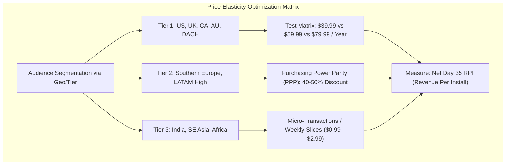

#### Monomial Revenue Maximization Equation

For a constant-elasticity demand curve $Q(P) = k \cdot P^{-\beta}$ (where $\beta = -\epsilon_p > 1$):

$$\text{Revenue}(P) = P \cdot Q(P) = k \cdot P^{1 - \beta}$$

When incorporating variable marginal delivery cost $c$ per subscriber (e.g. AI API costs):

$$\Pi(P) = (P - c) \cdot k \cdot P^{-\beta}$$

Setting the first derivative $\frac{d\Pi}{dP} = 0$:

$$\frac{d\Pi}{dP} = k \cdot P^{-\beta} + (P - c) \cdot k \cdot (-\beta) P^{-\beta - 1} = 0$$

$$1 - \beta \frac{P - c}{P} = 0 \implies P^* = c \cdot \left( \frac{\beta}{\beta - 1} \right) = c \cdot \left( \frac{\epsilon_p}{\epsilon_p + 1} \right)$$

---

### 2.5 Involuntary vs. Voluntary Churn Mechanics & Recovery Engines

Total churn is divided into two fundamentally different failure modes:

$$\text{Total Churn Rate} = \text{Involuntary Churn (Payment Failures)} + \text{Voluntary Churn (Customer Decisions)}$$

```
                                  ┌────────────────────────────────────────────────────────┐
                                  │                     TOTAL CHURN                        │
                                  └───────────────────────────┬────────────────────────────┘
                                                              │
                              ┌───────────────────────────────┴───────────────────────────────┐
                              ▼                                                               ▼
             ┌─────────────────────────────────┐                             ┌─────────────────────────────────┐
             │       INVOLUNTARY CHURN         │                             │        VOLUNTARY CHURN          │
             │   (Technical / Billing Failures)│                             │ (User-Initiated Cancellations)  │
             └────────────────┬────────────────┘                             └────────────────┬────────────────┘
                              │                                                               │
     ┌────────────────────────┼────────────────────────┐             ┌────────────────────────┼────────────────────────┐
     ▼                        ▼                        ▼             ▼                        ▼                        ▼
[Insufficient            [Expired Cards /         [3DS / SCA    [Perceived Value         [Price Sensitivity /     [Completed Goal /
   Funds]                   Bank Rejections]       Failures]       Deficit]                 Budget Cut]              No Longer Needed]
     │                        │                        │             │                        │                        │
     ▼                        ▼                        ▼             ▼                        ▼                        ▼
  Apple/Google             Card Account             Smart          In-App Feature           Dynamic Pause /          Targeted Exit
  Grace Period             Updater (CAU)            Retries        Onboarding Re-engagement Micro-Downsells          Survey Offers
```

#### 1. Involuntary Churn Architecture & Store Protocols

Involuntary churn accounts for **30% to 45%** of all subscription drops in mature apps.

*   **Apple App Store Server Notifications v2 (ASSN v2):**
    *   `DID_FAIL_TO_RENEW`: Triggered the moment a payment fails. The payload contains `is_in_billing_retry_period` and `grace_period_expires_date`.
    *   `GRACE_PERIOD_EXPIRED`: Emitted if the 16-day grace period lapses without a successful charge. The app must restrict premium entitlements immediately.
    *   `OFFER_REDEEMED`: Used to track win-back and retention offers accepted in-app or via deep link.
*   **Google Play Real-Time Developer Notifications (RTDN):**
    *   `SUBSCRIPTION_IN_GRACE_PERIOD`: Allows user access while Google retries billing for up to 21 days.
    *   `SUBSCRIPTION_ON_HOLD`: Grace period expired; user is placed on hold (entitlement revoked) for up to 30 days while Google continues retrying.
    *   `SUBSCRIPTION_RECOVERED`: Instant notification to restore entitlements without user intervention.

#### 2. Voluntary Churn Mitigation & Cancellation Funnels

Directly routing a cancellation request to `settings://` without intervention forfeits salvageable revenue. High-performing apps implement a multi-stage **Cancellation Interception Flow**:

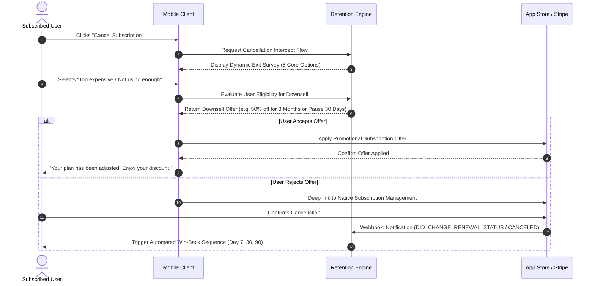

---

## 3. Advanced Paywall Strategies, Placements, and Psychographics

### 3.1 Paywall Placement Taxonomy & Structural Frameworks

Monetization efficiency is determined by **where, when, and how** paywalls are presented across the user lifecycle.

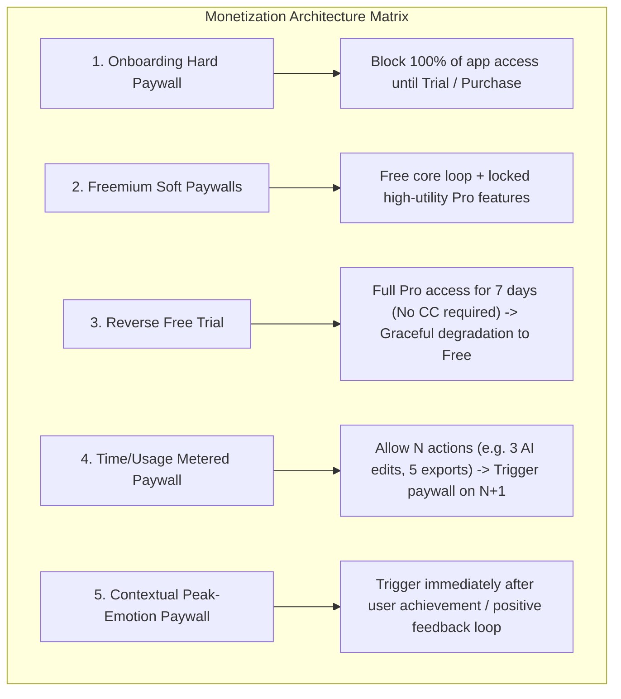

#### Comparison of Structural Placement Models

| Placement Paradigm | Primary Strengths | Critical Vulnerabilities | Ideal Product Categories |
| :--- | :--- | :--- | :--- |
| **Onboarding Hard Paywall** | Maximum Top-of-Funnel Conversion; Day 0 Cash Collection; High RPI. | High Day 0 bounce rate ($>70\%$ drop); negative App Store reviews if value isn't clear. | Utilities, Fast AI Tools, Fitness, Calorie Trackers, Language Learning. |
| **Freemium Soft Paywall** | High organic virality; large active user base; high Word-of-Mouth (WoM). | "Freemium Trap" where users never encounter paywalls; extremely low D35 Paid CVR ($1-2\%$). | Social, Habit Trackers, Productivity Suites, Note-Taking. |
| **Reverse Free Trial** | Eliminates Day 0 credit card friction; creates powerful endowment effect during 7-day Pro usage. | Engineering complexity; requiring robust downgrade state machines; attribution lag. | B2B Mobile SaaS, Creative Pro Tools, High-Retention Audio/Reading Apps. |
| **Contextual / Emotion Triggers** | High willingness-to-pay (WTP) at moment of completed value creation. | Lower total impression volume if users don't complete the core loop. | Video/Photo Editors, Generative AI, Document Scanners, PDF Signers. |

---

### 3.2 Cognitive Biases & Psychographic Monetization Levers

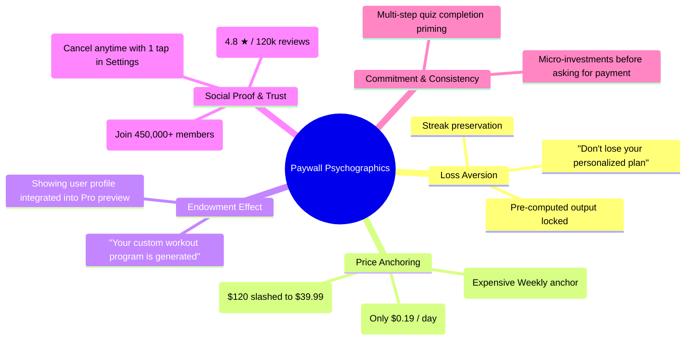

#### 1. The Decoy Effect & Price Anchoring Mathematics

A classic 3-tier paywall structure exploits asymmetric dominance:

*   **Option A (Decoy):** Weekly Subscription at $\$9.99/\text{week}$ ($\$519.48/\text{year}$ normalized).
*   **Option B (Anchor):** Monthly Subscription at $\$24.99/\text{month}$ ($\$299.88/\text{year}$ normalized).
*   **Option C (Target):** Annual Subscription at $\$59.99/\text{year}$ ($\$1.15/\text{week}$ — highlighted with **"Save 88% — Most Popular"**).

By anchoring the user against the $\$9.99/\text{week}$ option, the $\$59.99/\text{year}$ option is perceived not as an expense, but as an immediate $\$460$ discount.

```
┌────────────────────────────────────────────────────────────────────────┐
│                        CHOOSE YOUR PRO PLAN                            │
├───────────────────┬────────────────────────────────┬───────────────────┤
│      WEEKLY       │      ANNUAL (BEST VALUE)       │      MONTHLY      │
│                   │   ┌────────────────────────┐   │                   │
│      $9.99        │   │   🔥 SAVE 88% TODAY    │   │      $24.99       │
│      / week       │   └────────────────────────┘   │      / month      │
│                   │            $59.99              │                   │
│ ($519.48 / year)  │            / year              │ ($299.88 / year)  │
│                   │        ($1.15 / week)          │                   │
├───────────────────┼────────────────────────────────┼───────────────────┤
│    [ Select ]     │       [ START FREE TRIAL ]     │    [ Select ]     │
└───────────────────┴────────────────────────────────┴───────────────────┘
   🔒 Cancel anytime in Apple ID Settings • No commitment • 3-Day Trial
```

---

### 3.3 Personalization Engines & Downselling Matrices

When a user rejects the primary annual offer during onboarding, high-growth monetization engines trigger a context-aware fallback sequence rather than routing immediately to the free home screen:

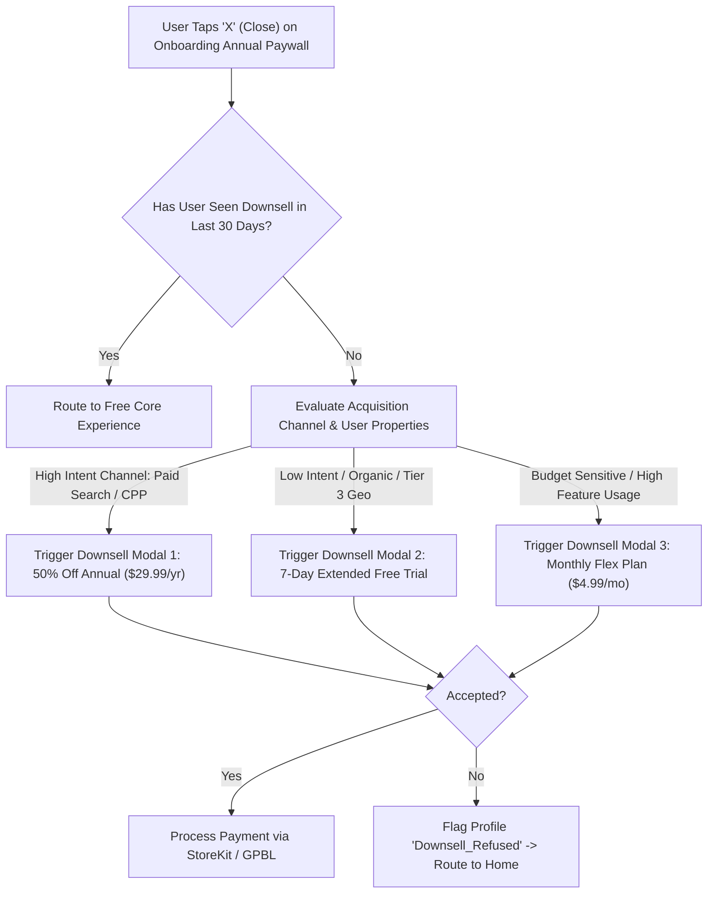

---

## 4. Tooling, Infrastructure, and Dynamic Server-Driven Paywall Architecture

### 4.1 Ecosystem Architecture & Separation of Concerns

Scaling a multi-million-dollar subscription portfolio requires decoupling the **Entitlement Truth Layer** from the **Presentation & Experimentation Layer**.

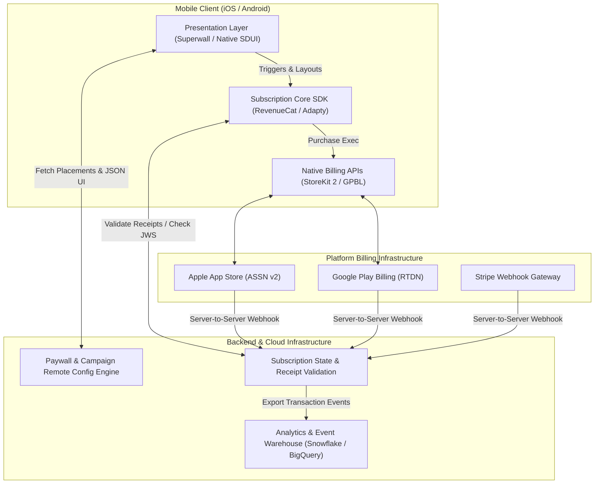

#### Infrastructure Architectural Comparison

| Platform / Tool | Core Primary Function | Paywall Rendering Engine | Strengths | Ideal Use Case |
| :--- | :--- | :--- | :--- | :--- |
| **RevenueCat** | Single Source of Truth for Entitlements & Subscriptions. | Hybrid (Paywalls V2 SDK / Web Paywalls). | Flawless cross-platform receipt validation, accurate churn analytics, webhooks to MMPs. | Backend subscription backbone for all apps. |
| **Superwall** | Dynamic Presentation & Behavioral Paywall Experimentation. | Server-Driven Native & Hybrid UI. | Instant remote paywall updating, complex trigger logic, zero App Store releases. | High-velocity monetization teams running 20+ A/B tests weekly. |
| **Adapty** | All-in-One Paywall Builder & Subscription Infrastructure. | Native Paywall Builder (No WebViews). | Integrated visual paywall builder, predictive LTV modeling, unified SDK footprint. | Teams wanting a single vendor for both presentation and backend truth. |
| **Qonversion** | Data Infrastructure & Mobile Event Pipelines. | Remote Configuration / Native UI. | Fast postback streaming to MMPs, cross-device user tracking, ad revenue tracking. | Ad-heavy hybrid monetization apps. |

---

### 4.2 Modern In-App Purchase Mechanics (StoreKit 2 & GPBL 6/7)

#### Apple StoreKit 2 Modern Swift Implementation

StoreKit 2 uses Swift Concurrency and signed JSON Web Signatures (JWS) for transaction verification on-device and server-side:

```swift
import Foundation
import StoreKit

public actor SubscriptionManager: ObservableObject {
    public static let shared = SubscriptionManager()
    
    @Published public private(set) var activeEntitlements: Set<String> = []
    private var updateListenerTask: Task<Void, Error>? = nil
    
    private init() {
        // Start listening for transaction updates outside the direct purchase flow
        updateListenerTask = listenForTransactions()
        Task {
            await refreshEntitlements()
        }
    }
    
    deinit {
        updateListenerTask?.cancel()
    }
    
    /// Continuous transaction listener for asynchronous store events (e.g. Ask to Buy, Revocations, Renewals)
    private func listenForTransactions() -> Task<Void, Error> {
        return Task.detached {
            for await result in Transaction.updates {
                do {
                    let transaction = try self.verifyTransaction(result)
                    await self.refreshEntitlements()
                    await transaction.finish()
                } catch {
                    print("Transaction verification failed: \(error.localizedDescription)")
                }
            }
        }
    }
    
    /// Purchases a given Product and verifies the cryptographic JWS payload
    public func purchase(_ product: Product) async throws -> Transaction? {
        let result = try await product.purchase()
        
        switch result {
        case .success(let verification):
            let transaction = try verifyTransaction(verification)
            await refreshEntitlements()
            await transaction.finish()
            return transaction
            
        case .userCancelled:
            return nil
            
        case .pending:
            // Transaction requires parental approval or SCA challenge
            return nil
            
        @unknown default:
            return nil
        }
    }
    
    /// Verifies that the signed JWS transaction was issued by Apple
    private func verifyTransaction<T>(_ result: VerificationResult<T>) throws -> T {
        switch result {
        case .unverified(_, let error):
            throw StoreKitError.verificationFailed(error)
        case .verified(let safe):
            return safe
        }
    }
    
    /// Scans all active entitlements currently assigned to the user
    public func refreshEntitlements() async {
        var entitlements = Set<String>()
        
        for await result in Transaction.currentEntitlements {
            guard case .verified(let transaction) = result else { continue }
            
            // Check if transaction has not been revoked or expired
            if transaction.revocationDate == nil {
                if let expirationDate = transaction.expirationDate, expirationDate > Date() {
                    entitlements.insert(transaction.productID)
                } else if transaction.expirationDate == nil {
                    // Non-expiring lifetime purchase
                    entitlements.insert(transaction.productID)
                }
            }
        }
        
        self.activeEntitlements = entitlements
    }
}

public enum StoreKitError: Error {
    case verificationFailed(VerificationResult<Transaction>.VerificationError)
}
```

---

### 4.3 Server-Driven UI (SDUI) & Zero-Code Remote Paywall Deployment

Hardcoding paywall view controllers inside application binaries creates severe operational drag: every price change, copy tweak, layout test, or seasonal promo requires a full engineering sprint and App Store review.

Modern architecture uses **Server-Driven Dynamic Paywalls**:

```json
{
  "$schema": "https://schemas.monetization.internal/paywall/v3.json",
  "paywall_id": "pw_onboarding_annual_anchor_v4",
  "version": 42,
  "experiment_id": "exp_q3_price_elasticity_us",
  "variant_id": "variant_c_decoy",
  "theme": {
    "background_type": "video",
    "background_asset_url": "https://cdn.app.com/video/hero_workout_compressed.mp4",
    "primary_color": "#FF3B30",
    "surface_color": "#1C1C1E",
    "text_primary": "#FFFFFF"
  },
  "layout": {
    "header": {
      "title": "Unlock Your Ultimate Transformation",
      "subtitle": "Join over 450,000 members crushing their fitness goals.",
      "rating_badge": { "score": 4.9, "count": "120k reviews" }
    },
    "features_list": [
      { "icon": "sparkles", "title": "Unlimited AI Custom Workouts", "subtitle": "Adapts dynamically to your recovery" },
      { "icon": "chart_bar", "title": "Advanced Metabolic Tracking", "subtitle": "Real-time energy expenditure" },
      { "icon": "lock_open", "title": "Access to 500+ HD Video Masterclasses", "subtitle": "Learn from world-class coaches" }
    ],
    "tier_selector": {
      "default_selected_id": "annual_pro_tier",
      "items": [
        {
          "id": "weekly_tier",
          "store_product_id": "com.app.pro.weekly",
          "title": "Weekly Flex",
          "price_subtitle": "$9.99 / week",
          "badge": null,
          "is_decoy": true
        },
        {
          "id": "annual_pro_tier",
          "store_product_id": "com.app.pro.annual_trial",
          "title": "Annual Pro",
          "price_subtitle": "$59.99 / year ($1.15/wk)",
          "badge": "SAVE 88% • 3 DAYS FREE",
          "is_highlighted": true
        }
      ]
    },
    "cta_button": {
      "text": "Start 3-Day Free Trial",
      "subtext": "Then $59.99/year. Cancel anytime in Settings.",
      "action": "trigger_store_purchase",
      "haptic_feedback": "impact_heavy"
    }
  }
}
```

---

### 4.4 Placement-Based Integration Patterns & Robust Fallbacks

Instead of calling `showPaywall()` directly in view controllers, instrument code with semantic **Placements**:

```swift
import UIKit
import SuperwallKit
import RevenueCat

final class FeatureViewController: UIViewController {
    
    @IBAction func didTapExportVideo(_ sender: UIButton) {
        // Evaluate placement triggers remotely without client code updates
        Superwall.shared.register(placement: "export_4k_tapped", params: [
            "video_duration_sec": 120,
            "export_resolution": "4K",
            "user_export_count": 4
        ]) { [weak self] in
            // Paywall Gating Closure: Executed ONLY if user is subscribed
            // OR if the placement was configured remotely as "Free Access"
            self?.executeExportPipeline()
        }
    }
    
    private func executeExportPipeline() {
        print("Starting 4K render pipeline...")
    }
}
```

> [!TIP]
> **Zero-Downtime Fallback Rule:** Always package an offline, hardcoded local fallback paywall bundled inside the app binary. If the device is offline or the remote config CDN times out (>1500ms), the SDK renders the pre-compiled local paywall to ensure no purchase opportunity is missed.

---

## 5. Web-to-App Funnel Architectures & Cross-Platform Monetization

### 5.1 The Strategic Rationale & Unit Economics of Web Arbitrage

Leading subscription apps (Noom, Flo, BetterMe, Babbel, MadMuscles, Simple) generate **50% to 80%** of their total top-line subscription revenue via the Web, completely circumventing native App Store IAP.

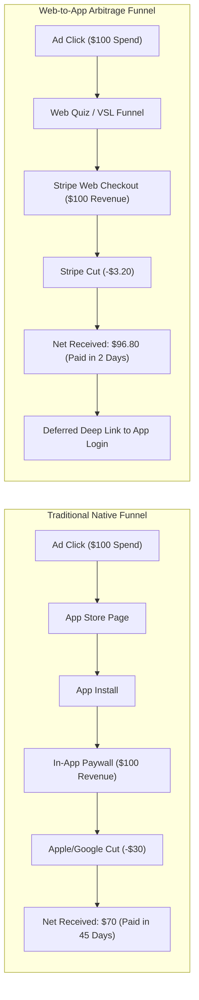

#### Strategic Advantages of Web-to-App

1. **Massive Margin Expansion:** Merchant-of-record/Stripe fees average **~2.9% + $0.30** compared to Apple/Google's **15% to 30%** take rate. Net margin increases by $+12\text{ to }+27\%$ on every transaction.
2. **Immediate Cash Flow Acceleration:** Stripe operates on a rolling **T+2 day payout schedule**. In contrast, Apple and Google pay out on 30 to 45-day net cycles. Faster cash access enables **3–5x faster ad spend reinvestment cycles**.
3. **Unrestricted First-Party Tracking:** Web environments allow direct integration with the Meta Pixel, Conversions API (CAPI), TikTok Pixel, Google Ads Enhanced Conversions, and first-party cookies—completely bypassing Apple's in-app ATT restrictions.
4. **Flexible Subscription & Upsell Mechanics:** On the web, apps can deploy multi-item checkouts, one-click post-purchase upsells (e.g., customized meal plan PDF guide for \$19.99), flexible billing terms, and custom refund/retention policies.

---

### 5.2 The High-Converting Web Onboarding Quiz Engine

High-performing web funnels use interactive, multi-step psychological quizzes (15–25 questions) rather than a direct checkout page:

```
[Ad Impression: "Discover Your Metabolic Age"]
         │
         ▼
[Question 1-5: Low-Friction Biometrics (Age, Gender, Height, Weight)]
         │
         ▼
[Question 6-12: Pain Points & Obstacles (Energy crashes, Time constraints, Past failures)]
         │
         ▼
[Question 13-18: Goal Definition (Target weight, Milestone target dates, Motivation drivers)]
         │
         ▼
[Synthetic Analysis Interstitial ("Calculating your metabolic profile... Please wait")]
         │  (6-8 second dynamic animated progress bar building perceived value)
         ▼
[Personalized Goal Trajectory Chart ("You will reach 72kg by November 14")]
         │
         ▼
[Lead Capture: Email & Phone Number]
         │
         ▼
[Customized Web Paywall with Urgency Countdown Timer (15:00 min discount lock)]
         │
         ▼
[Stripe Checkout / Apple Pay on Web / PayPal / Klarna]
```

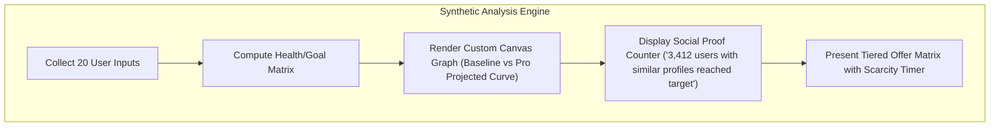

---

### 5.3 Web Checkout & Payment Infrastructure (Stripe / Wallets)

To maximize conversion, the checkout must support **One-Click Mobile Wallets** (Apple Pay on Web, Google Pay, Link) alongside traditional credit cards:

```typescript
// Server-Side Node.js / Express Route: Create Stripe Checkout Session for Web Funnel
import Stripe from 'stripe';
import express, { Request, Response } from 'express';

const stripe = new Stripe(process.env.STRIPE_SECRET_KEY!, {
  apiVersion: '2024-06-20',
});

export const createWebSubscriptionCheckout = async (req: Request, res: Response) => {
  try {
    const { email, planTier, leadSource, campaignId, anonymousWebId } = req.body;

    // Resolve or create Stripe Customer
    const customer = await stripe.customers.create({
      email,
      metadata: {
        anonymous_web_id: anonymousWebId,
        lead_source: leadSource,
        campaign_id: campaignId,
      },
    });

    const session = await stripe.checkout.sessions.create({
      payment_method_types: ['card', 'link'],
      customer: customer.id,
      line_items: [
        {
          price: planTier === 'annual' ? 'price_annual_pro_59' : 'price_monthly_pro_24',
          quantity: 1,
        },
      ],
      mode: 'subscription',
      subscription_data: {
        trial_period_days: planTier === 'annual' ? 3 : undefined,
        metadata: {
          anonymous_web_id: anonymousWebId,
          campaign_id: campaignId,
        },
      },
      success_url: `https://app.domain.com/onboarding/success?session_id={CHECKOUT_SESSION_ID}&email=${encodeURIComponent(email)}`,
      cancel_url: `https://app.domain.com/onboarding/checkout?canceled=true`,
      allow_promotion_codes: true,
    });

    return res.status(200).json({ checkoutUrl: session.url });
  } catch (error: any) {
    return res.status(500).json({ error: error.message });
  }
};
```

---

### 5.4 Cross-Platform Identity Resolution & Deferred Deep Linking Handoff

The biggest point of failure in Web-to-App funnels is the **Post-Purchase Mobile App Handoff**. If a user pays on the web, downloads the app from the store, and is presented with a generic registration wall or locked paywall, churn spikes immediately.

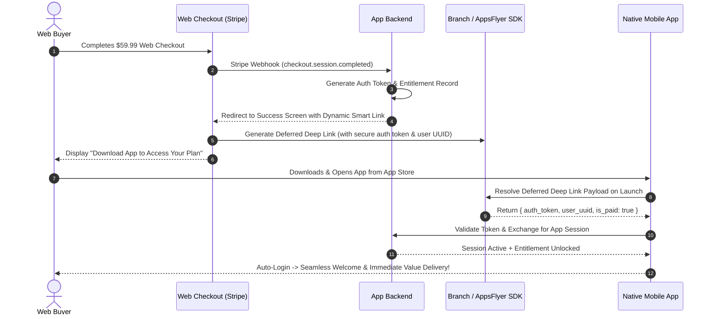

---

## 6. Modern AdTech, Attribution, & Privacy Ecosystem

### 6.1 Post-ATT Mobile Advertising Landscape & AdAttributionKit

Apple's App Tracking Transparency (ATT) eliminated widespread access to the deterministic Identifier for Advertisers (IDFA). In response, Apple introduced **AdAttributionKit (AAK)**, unifying and expanding SKAdNetwork (SKAN 4.0/5.0).

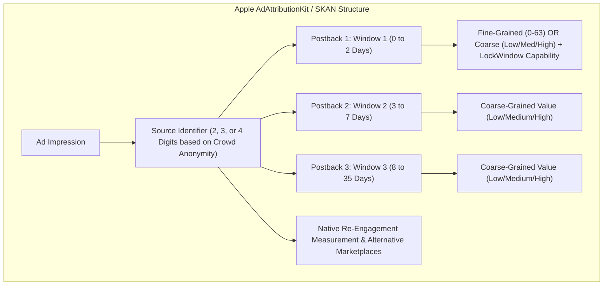

#### Key Mechanics of Modern AdAttributionKit

1. **Crowd Anonymity Tiers (0 to 3):** Apple dynamically adjusts the granularity of postback data based on install volume per campaign.
   - *Tier 0 (Lowest volume):* Zero conversion values returned (null postback).
   - *Tier 1:* Coarse conversion value only (Low, Medium, High). 2-digit source ID.
   - *Tier 2:* Fine conversion value (0–63) in Postback 1. 3-digit source ID.
   - *Tier 3 (Highest volume):* Fine conversion value (0–63) in Postback 1. Full 4-digit source ID (enabling creative/placement-level tracking).
2. **The `lockWindow` Capability:** Allows developers to "freeze" a measurement window early (e.g., locking Window 1 immediately when a user starts a trial on Day 1), triggering the postback within 24–48 hours instead of waiting the full window duration.
3. **Native Re-engagement Attribution:** AdAttributionKit tracks deep-linked interactions from existing users back into the app.

---

### 6.2 Android Privacy Reality: GAID Continuity Post-Sandbox Pivot

> [!NOTE]
> **Android Attribution Reality:** Following Google's cancellation of the Privacy Sandbox for Android initiative, the Android mobile ecosystem continues to rely on the **Google Advertising ID (GAID)** for deterministic device-level attribution. Unlike iOS, Android campaigns can still leverage granular user-level postbacks and deterministic MMP routing.

---

### 6.3 Modern Media Mix Modeling (MMM) & Causal Incrementality

Relying purely on ad network self-reported ROAS leads to severe over-attribution (e.g., ad networks claiming credit for users who would have converted organically). Modern growth teams employ **Triangulation Measurement**:

```
                              ┌────────────────────────────────────────┐
                              │     TRIANGULATED MEASUREMENT STACK     │
                              └───────────────────┬────────────────────┘
                                                  │
                 ┌────────────────────────────────┼────────────────────────────────┐
                 ▼                                ▼                                ▼
   ┌───────────────────────────┐    ┌───────────────────────────┐    ┌───────────────────────────┐
   │    ATTRIBUTION (MMP)      │    │  MEDIA MIX MODELING (MMM) │    │  CAUSAL INCREMENTALITY    │
   │  (AdAttributionKit / GAID)│    │ (Google Meridian / Robyn) │    │ (Geo-Lift & Matched Pairs)│
   ├───────────────────────────┤    ├───────────────────────────┤    ├───────────────────────────┤
   │ Real-time, granular click │    │ Top-down, privacy-safe    │    │ Gold-standard ground truth│
   │ & install event tracking  │    │ macro econometric models  │    │ for true ad-spend lift    │
   └─────────────┬─────────────┘    └─────────────┬─────────────┘    └─────────────┬─────────────┘
                 │                                │                                │
                 └────────────────────────────────┼────────────────────────────────┘
                                                  ▼
                                ┌───────────────────────────────────┐
                                │     CALIBRATED CAPITAL ALLOCATION │
                                └───────────────────────────────────┘
```

#### 1. Mathematical Formulations for MMM (Adstock & Saturation)

Advertising impacts consumer behavior with carryover effects (Adstock) and diminishing returns (Saturation).

##### Adstock Geometric Decay Formulation:

$$A(t) = X(t) + \theta \cdot A(t - 1), \quad \theta \in [0, 1)$$

Where $X(t)$ is media spend at period $t$, and $\theta$ is the retention rate of ad awareness.

##### Hill Function for Diminishing Returns (Saturation):

$$\text{Effect}(A(t)) = \frac{A(t)^S}{K^S + A(t)^S}$$

Where:
- $K$ is the half-saturation point (spend level where response reaches 50% of maximum).
- $S$ is the Hill shape parameter (controlling curvature and inflection steepness).

```python
import numpy as np

def geometric_adstock(spend, decay_rate=0.6):
    """
    Computes geometric adstock decay over a time-series spend vector.
    """
    adstocked_spend = np.zeros_like(spend, dtype=np.float64)
    for t in range(len(spend)):
        if t == 0:
            adstocked_spend[t] = spend[t]
        else:
            adstocked_spend[t] = spend[t] + decay_rate * adstocked_spend[t - 1]
    return adstocked_spend

def hill_saturation(adstocked_spend, half_saturation_k=5000.0, slope_s=1.2):
    """
    Applies Hill function to compute non-linear saturated revenue response.
    """
    return (adstocked_spend ** slope_s) / (half_saturation_k ** slope_s + adstocked_spend ** slope_s)
```

#### 2. Causal Geo-Lift & Incrementality Calibration

MMM models are correlational and must be calibrated against **Causal Geo-Lift Experiments**:
1. Select $N$ matched geographic regions (e.g., designated market areas - DMAs) using synthetic control algorithms.
2. Maintain baseline spend in Control DMAs; increase or turn off spend by $\Delta \text{Spend}$ in Treatment DMAs for 4–6 weeks.
3. Calculate true Incremental Return on Ad Spend (iROAS):

$$\text{iROAS} = \frac{\Delta \text{Revenue}_{\text{Treatment}} - \Delta \text{Revenue}_{\text{Synthetic Control}}}{\Delta \text{AdSpend}}$$

4. Feed the empirical iROAS into the Bayesian prior distribution of Google Meridian or Meta Robyn models.

---

### 6.4 Blended ROAS (MER) & Holistic Portfolio Diagnostics

Because platform-reported metrics diverge from cash reality, growth architects anchor performance on **Marketing Efficiency Ratio (MER)**:

$$\text{MER} = \frac{\text{Total Net Realized Gross Revenue (App Store + Web)}}{\text{Total Paid Acquisition Ad Spend (All Channels)}}$$

$$\text{Blended eCAC} = \frac{\text{Total Paid Ad Spend}}{\text{Total New Paying Subscribers (Organic + Paid)}}$$

```
MER Health Benchmark Bands:
• MER < 1.0x: Burning capital. Unsustainable unless backed by high M12 retention (>40%).
• MER 1.2x - 1.6x: Healthy scaling band for high-growth venture-backed subscription apps.
• MER > 2.2x: Under-investing in acquisition. Growth velocity is constrained; scale budget.
```

---

### 6.5 Custom Product Pages (CPPs) & Narrative Continuity

A major conversion leak is the "Creative Disconnect": an ad highlights a specific feature (e.g., "Intermittent Fasting Timer"), but the user lands on a generic App Store product page highlighting workout videos.

**Custom Product Pages (CPPs)** on iOS (and Custom Store Listings on Google Play) allow marketers to create up to 35 tailored App Store page variants matching specific ad creatives:

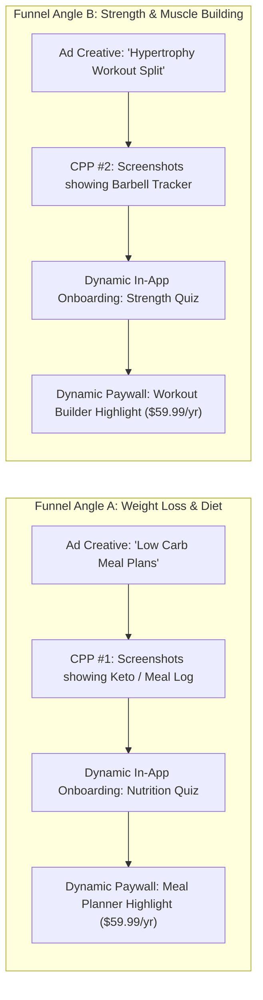

---

## 7. The Ultimate Mobile Monetization Playbook & Architecture Blueprint

### 7.1 End-to-End Reference Architecture Diagram

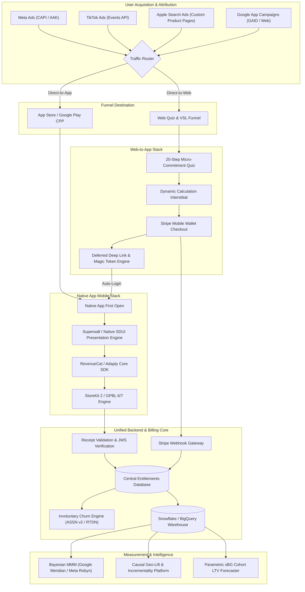

---

### 7.2 Step-by-Step Scaling Blueprint

```
STAGE 1: Zero to $10k MRR (Foundation & Product-Market Fit)
├── Set up RevenueCat for unified StoreKit 2 & GPBL entitlement tracking.
├── Deploy an Onboarding Hard Paywall offering an Annual plan with a 3-day free trial.
├── Implement a basic Decoy structure ($9.99/wk vs $59.99/yr).
└── Run Apple Search Ads (ASA) and Meta Ads to establish baseline CVR metrics.

STAGE 2: $10k to $100k MRR (Experimentation & Optimization)
├── Integrate Superwall or Adapty to unblock remote dynamic paywall A/B testing.
├── Implement Placement Architecture across key in-app high-intent trigger moments.
├── Build out Involuntary Churn Recovery: Apple Billing Grace Period & ASSN v2 listeners.
├── Implement Cancellation Intercept Flows with 50% discount downsells.
└── Launch Custom Product Pages (CPPs) aligned with distinct creative ad hooks.

STAGE 3: $100k to $1M+ MRR (Enterprise Multi-Engine Scale)
├── Deploy the Web-to-App Funnel: 20-question quiz, Stripe Checkout, deferred deep linking.
├── Set up First-Party Data pipelines: Meta CAPI, TikTok Events API, and server webhooks.
├── Deploy Bayesian Media Mix Modeling (Google Meridian / Meta Robyn) for macro budgeting.
├── Run quarterly Causal Geo-Lift incrementality tests to calibrate ad-network attribution.
└── Implement Country-Specific Purchasing Power Parity (PPP) pricing matrices globally.
```

---

### 7.3 Top 10 Anti-Patterns & Critical Pitfalls to Avoid

> [!CAUTION]
> 1. **The Freemium Trap:** Placing paywalls exclusively behind deep settings menus. If less than 20% of your DAU encounters a paywall weekly, you do not have a monetization problem—you have a visibility failure.
> 2. **Relying Exclusively on In-Platform Ad ROAS:** Meta and TikTok claim credit for overlapping conversions. Always evaluate performance via Blended MER and incrementality testing.
> 3. **The 3-Day Trial Cancellation Cliff:** Neglecting Day 0 trial drop-off. Over 50% of trialists cancel within 24 hours to prevent recurring billing; deliver core value within the first 60 seconds.
> 4. **Hardcoding Paywalls in App Builds:** Forcing engineers to rebuild and resubmit binary updates for minor price or copy changes destroys testing velocity.
> 5. **Ignoring Involuntary Churn:** Failing to enable Apple Billing Grace Period and Google Account Hold sacrifices 5% to 12% of total recurring revenue each billing cycle.
> 6. **Broken Web-to-App Handoffs:** Forcing web customers to re-register or manually restore purchases inside the app after checkout triggers severe immediate refund requests.
> 7. **Linear LTV Extrapolation:** Assuming subscriber retention decays linearly rather than following an actuarial Shifted Beta-Geometric (sBG) curve causes over-spending on early acquisition cohorts.
> 8. **Ignoring Purchasing Power Parity (PPP):** Charging a flat $59.99/year worldwide destroys conversion in Tier 2/3 markets (India, Brazil, Southeast Asia).
> 9. **Over-Complicating Onboarding Quizzes with Low Value:** Asking 30 questions without dynamic visual progress loaders or personalized output charts leads to quiz drop-off without building purchase intent.
> 10. **Lack of Cryptographic Receipt Validation:** Relying on client-side StoreKit purchase confirmation without server-side JWS/RTDN validation opens apps to local binary tampering.

---

### 7.4 Executive Metric Reference Matrix

| Metric | Calculation / Formula | Target Healthy Range | Strategic Action if Under-Performing |
| :--- | :--- | :--- | :--- |
| **Paywall Impression Density ($P_{DAU}$)** | $\frac{\text{Unique Paywall Views (Day } t\text{)}}{\text{Total Active Users (DAU Day } t\text{)}}$ | $20\% - 45\%$ | Add contextual trigger placements to core feature loops. |
| **Onboarding Start-Trial CVR** | $\frac{\text{Trials Started in Onboarding}}{\text{Total Onboarding Paywall Impressions}}$ | $6.0\% - 14.0\%$ | Test price anchoring, dynamic video backgrounds, and social proof badges. |
| **Trial-to-Paid Conversion ($CR_{T \to P}$)** | $\frac{\text{First Paid Invoices}}{\text{Total Free Trials Started}}$ | $45\% - 65\%$ | Add Day 2 push/email reminders; highlight trial end-date clarity; improve Day 0 time-to-value. |
| **Month 1 Renewal Rate ($R_{M1}$)** | $\frac{\text{Subscribers Active at Month 1}}{\text{Subscribers Paid at Month 0}}$ | $70\% - 85\%$ | Introduce habit-forming streak loops; send weekly value recap summaries. |
| **Year 1 Renewal Rate ($R_{Y1}$)** | $\frac{\text{Subscribers Renewed at Year 1}}{\text{Subscribers Paid at Year 0}}$ | $28\% - 45\%$ | Run pre-renewal engagement campaigns 30 days prior to billing; offer annual loyalty perks. |
| **Marketing Efficiency Ratio (MER)** | $\frac{\text{Total Net Realized Revenue}}{\text{Total Ad Acquisition Spend}}$ | $1.3\text{x} - 2.0\text{x}$ | Reallocate spend away from saturated channels using Bayesian MMM recommendations. |
| **Web-to-App Transition CVR** | $\frac{\text{Native App Logins from Web Buyers}}{\text{Total Successful Web Stripe Checkouts}}$ | $\ge 88\%$ | Implement SMS magic links, instant QR codes, and streamlined deferred deep linking. |

---

## 8. Conclusion & The Next Horizon

Mobile subscription monetization has transformed from an isolated growth experiment into a sophisticated multi-platform discipline combining behavioral economics, client-side server-driven rendering, serverless webhook orchestration, and econometric modeling.

By pairing **high-converting web onboarding quizzes** that bypass platform fees with **dynamic, remotely configured native paywalls** and **triangulated privacy-preserving measurement**, mobile businesses build sustainable growth engines capable of scaling efficiently in today's privacy-first landscape.
