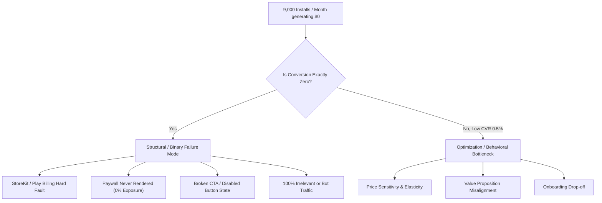
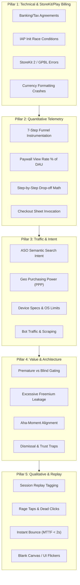
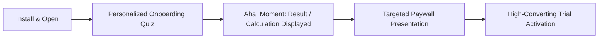
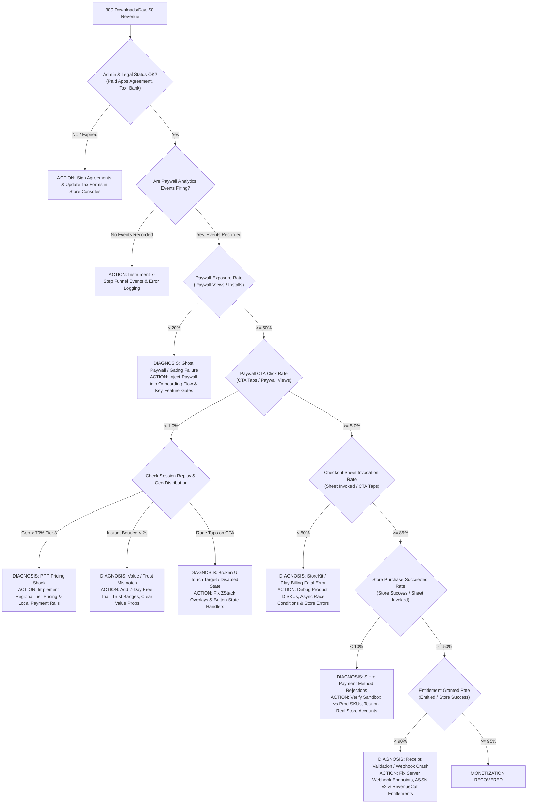

# The Zero-Dollar Monetization Forensic Diagnostic Playbook: Systematic Root-Cause Investigation Framework for Mobile Apps

> **Authoritative Technical Guide for Mobile Product Managers, Growth Engineers, and Monetization Architects**  
> *Version: 1.0 (2026 Edition) • Scope: iOS (StoreKit 2), Android (Google Play Billing v6/v7), Cross-Platform Infrastructure, Funnel Telemetry, ASO Intent & Behavioral Replay*

---

## Table of Contents
1. [Executive Summary & The "300 Downloads/Day, $0 Revenue" Anomaly](#1-executive-summary--the-300-downloadsday-0-revenue-anomaly)
   - [1.1 The Statistical Impossibility of Random Zero Conversion](#11-the-statistical-impossibility-of-random-zero-conversion)
   - [1.2 The Diagnostic Mindset: Hard Blockers vs. Optimization Bottlenecks](#12-the-diagnostic-mindset-hard-blockers-vs-optimization-bottlenecks)
2. [The 5-Pillar Forensic Diagnostic Framework](#2-the-5-pillar-forensic-diagnostic-framework)
   - [2.1 Pillar 1: Technical & StoreKit / Google Play Billing Forensics](#21-pillar-1-technical--storekit--google-play-billing-forensics)
     - [2.1.1 Store Agreements, Tax, & Banking Blackouts](#211-store-agreements-tax--banking-blackouts)
     - [2.1.2 IAP Initialization Race Conditions & Product Fetching Latency](#212-iap-initialization-race-conditions--product-fetching-latency)
     - [2.1.3 Identifier Mismatches, SKU Misconfigurations & Missing Entitlements](#213-identifier-mismatches-sku-misconfigurations--missing-entitlements)
     - [2.1.4 StoreKit 2 & BillingClient Error Parsing](#214-storekit-2--billingclient-error-parsing)
     - [2.1.5 Receipt Validation & Server-Side Webhook Failures](#215-receipt-validation--server-side-webhook-failures)
     - [2.1.6 Locale Currency Parsing & Formatting Crashes](#216-locale-currency-parsing--formatting-crashes)
   - [2.2 Pillar 2: Quantitative Telemetry & Funnel Drop-Off Forensics](#22-pillar-2-quantitative-telemetry--funnel-drop-off-forensics)
     - [2.2.1 The 7-Step Conversion Pipeline Architecture](#221-the-7-step-conversion-pipeline-architecture)
     - [2.2.2 Micro-Conversion Mathematical Model](#222-micro-conversion-mathematical-model)
     - [2.2.3 Forensic Funnel Benchmark Matrix: Healthy vs. Degraded vs. Broken](#223-forensic-funnel-benchmark-matrix-healthy-vs-degraded-vs-broken)
     - [2.2.4 Diagnostic Drop-Off Signatures](#224-diagnostic-drop-off-signatures)
   - [2.3 Pillar 3: Traffic Quality, ASO, & Intent Congruence](#23-pillar-3-traffic-quality-aso--intent-congruence)
     - [2.3.1 Semantic Search Intent & Expectation Mismatch](#231-semantic-search-intent--expectation-mismatch)
     - [2.3.2 Geographic Breakdown & Purchasing Power Parity (PPP) Failure](#232-geographic-breakdown--purchasing-power-parity-ppp-failure)
     - [2.3.3 Device Tiering, Performance Constraints & OS Compatibility](#233-device-tiering-performance-constraints--os-compatibility)
     - [2.3.4 Organic Fraud, Bot Scraping, & Non-Human Traffic Spikes](#234-organic-fraud-bot-scraping--non-human-traffic-spikes)
   - [2.4 Pillar 4: Value-to-Paywall Timing & Architecture](#24-pillar-4-value-to-paywall-timing--architecture)
     - [2.4.1 The Premature Hard Gate vs. Excessive Freemium Leakage](#241-the-premature-hard-gate-vs-excessive-freemium-leakage)
     - [2.4.2 The "Aha! Moment" Synchronization Model](#242-the-aha-moment-synchronization-model)
     - [2.4.3 Paywall Information Architecture & Trust Friction](#243-paywall-information-architecture--trust-friction)
     - [2.4.4 The Dismissal UX & Dark Pattern Backfire](#244-the-dismissal-ux--dark-pattern-backfire)
   - [2.5 Pillar 5: Qualitative & Session Replay Forensics](#25-pillar-5-qualitative--session-replay-forensics)
     - [2.5.1 Observability Stack Setup (UXCam, PostHog, Smartlook)](#251-observability-stack-setup-uxcam-posthog-smartlook)
     - [2.5.2 Rage Taps, Dead Clicks, & Unresponsive Gestures](#252-rage-taps-dead-clicks--unresponsive-gestures)
     - [2.5.3 The "Instant Bounce" Signature (MTTF < 2.0s)](#253-the-instant-bounce-signature-mttf--20s)
     - [2.5.4 Paywall Render Flickers & Blank Canvas Failures](#254-paywall-render-flickers--blank-canvas-failures)
3. [The End-to-End Diagnostic Decision Tree & Root-Cause Matrix](#3-the-end-to-end-diagnostic-decision-tree--root-cause-matrix)
   - [3.1 Visual Diagnostic Flowchart](#31-visual-diagnostic-flowchart)
   - [3.2 The Master Root-Cause Resolution Matrix](#32-the-master-root-cause-resolution-matrix)
4. [Quantitative Telemetry Schema & Production SQL Diagnostic Queries](#4-quantitative-telemetry-schema--production-sql-diagnostic-queries)
   - [4.1 Comprehensive Event Tracking Plan](#41-comprehensive-event-tracking-plan)
   - [4.2 SQL Query 1: End-to-End Funnel Conversion & Bottleneck Isolation](#42-sql-query-1-end-to-end-funnel-conversion--bottleneck-isolation)
   - [4.3 SQL Query 2: Paywall Exposure & DAU Coverage Penetration](#43-sql-query-2-paywall-exposure--dau-coverage-penetration)
   - [4.4 SQL Query 3: Technical Store Failure & Error Code Breakdown](#44-sql-query-3-technical-store-failure--error-code-breakdown)
   - [4.5 SQL Query 4: Geographic Purchasing Power & Regional Funnel Decay](#45-sql-query-4-geographic-purchasing-power--regional-funnel-decay)
   - [4.6 SQL Query 5: Session Duration, Time-to-Paywall & UI Latency Profiling](#46-sql-query-5-session-duration-time-to-paywall--ui-latency-profiling)
5. [The 72-Hour Rapid Remediation Protocol](#5-the-72-hour-rapid-remediation-protocol)
   - [5.1 Phase 1 (Hours 0–12): Technical Triage & Store Configuration Hotfix](#51-phase-1-hours-012-technical-triage--store-configuration-hotfix)
   - [5.2 Phase 2 (Hours 12–24): Telemetry & Observability Injection](#52-phase-2-hours-1224-telemetry--observability-injection)
   - [5.3 Phase 3 (Hours 24–48): Regional Pricing, ASO & Intent Alignment](#53-phase-3-hours-2448-regional-pricing-aso--intent-alignment)
   - [5.4 Phase 4 (Hours 48–72): High-Converting Paywall Architecture Deployment](#54-phase-4-hours-4872-high-converting-paywall-architecture-deployment)
6. [Production-Ready Code Reference Implementations](#6-production-ready-code-reference-implementations)
   - [6.1 Swift / StoreKit 2 & RevenueCat Resilient Paywall Engine](#61-swift--storekit-2--revenuecat-resilient-paywall-engine)
   - [6.2 Kotlin / Google Play Billing Library v7 Resilient Engine](#62-kotlin--google-play-billing-library-v7-resilient-engine)
7. [Summary & Verification Checklist](#7-summary--verification-checklist)

---

## 1. Executive Summary & The "300 Downloads/Day, $0 Revenue" Anomaly

### 1.1 The Statistical Impossibility of Random Zero Conversion

Consider a mobile application maintaining an organic acquisition velocity of **300 downloads per day** ($\approx 9,000$ downloads per month). In standard consumer mobile categories (Productivity, Utilities, Health & Fitness, Photo/Video, Lifestyle, Education), industry empirical baseline conversion benchmarks dictate:

- **Paywall View Rate (% of New Installs):** $55\% - 75\%$ ($4,950 - 6,750$ paywall exposures/month)
- **Paywall-to-Trial / Purchase Conversion Rate:** $2.5\% - 6.0\%$
- **Expected Monthly Conversions:** $120 - 400$ paying users or trial starts/month
- **Expected Baseline Gross Revenue (at standard $\$39.99$/year or $\$4.99$/week packaging):** $\$1,200 - $\$5,000$ monthly run rate.

```
       300 Daily Downloads (9,000 / month)
                       │
                       ▼
       65% Paywall Exposure (5,850 Views)
                       │
                       ▼
         3.5% Baseline CVR (205 Starts)
                       │
                       ▼
           Expected: $1,500 - $4,500 MRR
           Actual:   $0.00 (ZERO)
```

To understand why a realized conversion count of $k = 0$ across $n = 9,000$ installs is an alarming structural failure rather than a minor conversion rate optimization (CRO) deficit, we model the conversion event under a standard Binomial Distribution:

$$P(K = k) = \binom{n}{k} p^k (1 - p)^{n - k}$$

Assuming an underperforming, low-converting application baseline where $p = 0.015$ (a 1.5% install-to-purchase conversion rate):

$$P(K = 0) = (1 - 0.015)^{9000} = (0.985)^{9000} \approx 1.23 \times 10^{-59}$$

Even under a severely depressed conversion rate assumption of $p = 0.001$ (0.10%, or 1 conversion in 1,000 downloads):

$$P(K = 0) = (1 - 0.001)^{9000} = (0.999)^{9000} \approx 0.000122 \quad (0.012\%)$$

> [!CAUTION]
> A flat **$0.00 revenue across 9,000 organic installs is not a statistical anomaly or an unoptimized pricing tier.** It is definitive empirical proof of a **binary failure mode**: a critical technical blocker, a total break in the analytics/entitlement pipeline, a completely blocked paywall render, or a 100% traffic-intent dislocation.

### 1.2 The Diagnostic Mindset: Hard Blockers vs. Optimization Bottlenecks

Growth engineers and product managers frequently fall into the trap of applying soft CRO tactics (e.g., changing CTA colors from blue to green, altering headline copy, or discounting prices from $\$49.99$ to $\$29.99$) to problems that are fundamentally structural.



The diagnostic protocol requires systematically peeling back 5 forensic layers, beginning with low-level runtime execution and ending with qualitative behavioral observation.

---

## 2. The 5-Pillar Forensic Diagnostic Framework



---

### 2.1 Pillar 1: Technical & StoreKit / Google Play Billing Forensics

Technical failures represent over **60% of observed $0 monetization root causes** in indie and early-stage commercial applications. When the operating system's billing daemon fails to return products or complete transactions, the UI fails silently without reporting an error to high-level product analytics.

#### 2.1.1 Store Agreements, Tax, & Banking Blackouts
Apple App Store Connect and Google Play Console enforce hard administrative blocks on in-app purchases:

- **Apple Paid Applications Agreement:** If the legal entity has not signed the latest Paid Applications Agreement, updated bank account tax forms (W-8BEN-E / W-9), or accepted updated store terms, Apple's StoreKit daemon silently returns an empty product array (`products = []`) for all production builds while continuing to work perfectly in Xcode Sandbox!
- **Google Play Financial Profile:** Incomplete Google Payments Merchant Profile setup or suspended merchant accounts result in `BillingResponseCode.BILLING_UNAVAILABLE` or `FEATURE_NOT_SUPPORTED`.

#### 2.1.2 IAP Initialization Race Conditions & Product Fetching Latency
A common architectural flaw occurs when the application triggers the paywall view before the billing SDK has completed its asynchronous handshake with the store daemon.

```
App Launch
   │
   ├──────────────────────────────┐
   ▼                              ▼
UI Engine                  Billing SDK (RevenueCat / StoreKit 2)
   │                              │
Loads Root View (200ms)    `Purchases.configure()` (Async)
   │                              │
Shows Paywall (400ms)      Querying Apple Daemon (1,200ms)
   │                              │
   ▼                              ▼
Products Array: [] (EMPTY!)  Products Received (1,400ms - TOO LATE)
   │
   ▼
UI Renders Blank / Disabled CTA
User Taps 'Continue' -> Nothing Happens
User Quits -> $0 Revenue
```

If the UI layer reads `offerings.current` before the asynchronous promise resolves, the paywall renders with empty price strings (e.g., `$ --.--` or blank text) and the primary CTA button remains in a disabled state (`isButtonEnabled = false` or `products.isEmpty`).

#### 2.1.3 Identifier Mismatches, SKU Misconfigurations & Missing Entitlements
- **Bundle ID / Package Name Mismatch:** The bundle ID in the Xcode project does not match the App Store Connect identifier where products are registered.
- **Product ID Typo / Prefix Omission:** The product ID in code is `com.app.subscription.annual` while App Store Connect expects `com.app.subscription.yearly`.
- **Subscription Group Inconsistency:** On iOS, placing mutually exclusive tiers into different Subscription Groups causes StoreKit to treat them as independent parallel subscriptions, triggering confusing native alerts.
- **Missing Entitlement Mapping:** The user successfully completes the purchase, StoreKit issues a valid transaction, but the app's entitlement engine (e.g., RevenueCat entitlement ID `premium_access`) does not have the SKU attached in the dashboard, resulting in zero access unlock and transaction rollback.

#### 2.1.4 StoreKit 2 & BillingClient Error Parsing
Production code must inspect and log native billing engine error codes. The table below details critical StoreKit 2 and Google Play Billing Library (GPBL v6/v7) error codes that cause binary conversion failures:

| Engine | Error Code / Enum | Root Cause Mechanism | Diagnostic Signature |
| :--- | :--- | :--- | :--- |
| **StoreKit 2** | `StoreKitError.networkError` | Device cannot reach Apple StoreKit daemon. Common on captive Wi-Fi or behind strict corporate VPNs. | Products fail to load; spinner hangs infinitely. |
| **StoreKit 2** | `Product.PurchaseError.productUnavailable` | SKU exists in code but is inactive, not approved for sale, or removed in App Store Connect. | Checkout sheet never appears on CTA click. |
| **StoreKit 2** | `StoreKitError.notAvailableInStorefront` | Product is not configured for sale in the user's active App Store region/country. | Fatal drop-off in specific non-US geographic cohorts. |
| **StoreKit 2** | `Transaction.unverified` | JWS (JSON Web Signature) cryptographic signature verification fails on client-side receipt. | Payment succeeds in Apple modal, but user remains locked out. |
| **Google Play** | `BILLING_UNAVAILABLE` (Code 3) | Google Play Store app is outdated, disabled, or user is not logged into a Google account. | Play Billing sheet fails to launch entirely. |
| **Google Play** | `ITEM_UNAVAILABLE` (Code 4) | In-app product SKU is not active or not published to the matching track (Internal/Closed/Production). | Immediate `Purchase failed` toast on button press. |
| **Google Play** | `DEVELOPER_ERROR` (Code 5) | Missing Google Play Billing permission in `AndroidManifest.xml` or wrong initialization parameters. | `startConnection` returns fatal status code. |

#### 2.1.5 Receipt Validation & Server-Side Webhook Failures
For applications utilizing server-side validation or third-party wrappers (RevenueCat, Superwall, Adapty, Qonversion):
- **Apple App Store Server Notifications (ASSN v2) Endpoint Failure:** The server endpoint returns HTTP 403/500 to Apple's notification daemon, blocking webhook updates.
- **Clock Drift & Token Expiry:** Server clock skew exceeds 300 seconds, invalidating Apple Root CA JWT verification.
- **Network Security Config (Android):** Cleartext traffic blocked or missing certificate pinning configuration preventing the app from talking to the receipt verification backend.

#### 2.1.6 Locale Currency Parsing & Formatting Crashes
When formatting prices across diverse regions, naive string operations or unhandled nil unwrapping in Swift / Kotlin can cause hard application crashes or blank UI labels:

```swift
// ANTI-PATTERN: Fatal runtime crash or blank string on non-US locales
let priceString = "$" + String(product.price) 

// PRO-PATTERN: Robust localized formatting
Text(product.displayPrice) // Native StoreKit 2
// Or via Decimal formatStyle:
Text(product.price, format: .currency(code: product.priceFormatStyle.currencyCode))
```

In Android Jetpack Compose, failing to handle `ProductDetails.SubscriptionOfferDetails` containing multiple pricing phases (e.g., free trial phase followed by recurring phase) causes `IndexOutOfBoundsException` when accessing `pricingPhases.pricingPhaseList[0]`.

---

### 2.2 Pillar 2: Quantitative Telemetry & Funnel Drop-Off Forensics

#### 2.2.1 The 7-Step Conversion Pipeline Architecture
To identify the exact failure point, every mobile onboarding and monetization flow must be segmented into seven distinct, instrumented steps:

```
[Step 1: First Open]
       │
       ▼  R_onboarding = (Step 2 / Step 1)
[Step 2: Onboarding Completed]
       │
       ▼  R_exposure = (Step 3 / Step 2)
[Step 3: Paywall Viewed]
       │
       ▼  CTR = (Step 4 / Step 3)
[Step 4: CTA Tapped / Product Selected]
       │
       ▼  R_sheet = (Step 5 / Step 4)
[Step 5: Native Sheet Presented]
       │
       ▼  R_store = (Step 6 / Step 5)
[Step 6: Store Purchase Succeeded]
       │
       ▼  R_grant = (Step 7 / Step 6)
[Step 7: Entitlement Granted]
```

#### 2.2.2 Micro-Conversion Mathematical Model
The total cumulative conversion probability $P(\text{Conversion})$ is the product of all conditional micro-conversion probabilities:

$$P(\text{Conversion}) = P(S_1) \times \prod_{i=2}^{7} P(S_i \mid S_{i-1})$$

Where:
- $P(S_1) = 1.0$ (App First Open)
- $P(S_2 \mid S_1) = R_{\text{onboarding}}$ (Onboarding Completion Rate)
- $P(S_3 \mid S_2) = R_{\text{exposure}}$ (Paywall Impression Rate)
- $P(S_4 \mid S_3) = \text{CTR}_{\text{paywall}}$ (Paywall Click-Through Rate)
- $P(S_5 \mid S_4) = R_{\text{sheet}}$ (Native Checkout Sheet Invocation Rate)
- $P(S_6 \mid S_5) = R_{\text{store}}$ (Store Authorization Rate)
- $P(S_7 \mid S_6) = R_{\text{grant}}$ (Entitlement Verification Rate)

If **any single conditional probability $P(S_i \mid S_{i-1}) \to 0$**, total conversion collapses to zero.

#### 2.2.3 Forensic Funnel Benchmark Matrix: Healthy vs. Degraded vs. Broken

The following benchmark table provides the mathematical thresholds required to categorize funnel health:

| Pipeline Stage | Metric Definition | Healthy App Benchmark | Degraded Funnel | Broken / Zero-Dollar Failure |
| :--- | :--- | :--- | :--- | :--- |
| **Step 1 $\to$ Step 2** | Onboarding Completion Rate | $75.0\% - 90.0\%$ | $40.0\% - 65.0\%$ | $< 20.0\%$ (Crash or infinite loop) |
| **Step 2 $\to$ Step 3** | Paywall Exposure Rate (% of Installs) | $65.0\% - 85.0\%$ | $25.0\% - 50.0\%$ | **$0.0\% - 5.0\%$ (Paywall hidden)** |
| **Step 3 $\to$ Step 4** | Paywall CTA Click-Through Rate | $8.0\% - 22.0\%$ | $2.0\% - 6.0\%$ | **$< 0.5\%$ (Unresponsive button/Zero value)** |
| **Step 4 $\to$ Step 5** | Native Checkout Sheet Invocation | $95.0\% - 99.0\%$ | $70.0\% - 85.0\%$ | **$0.0\%$ (StoreKit/GPBL invocation dead)** |
| **Step 5 $\to$ Step 6** | Store Purchase Authorization | $60.0\% - 80.0\%$ | $25.0\% - 45.0\%$ | **$0.0\%$ (Store rejection / Card failure)** |
| **Step 6 $\to$ Step 7** | Entitlement Verification & Unlock | $98.5\% - 100.0\%$ | $85.0\% - 95.0\%$ | **$0.0\%$ (Server validation crash)** |

#### 2.2.4 Diagnostic Drop-Off Signatures

By plotting telemetry along this 7-step pipeline, four classic "Zero-Dollar Signatures" emerge:

```
Signature A: The "Ghost Paywall" (Exposure Failure)
Installs (100%) ──► Onboarding (85%) ──► Paywall Views (0%) [CRITICAL DROP]

Signature B: The "Broken Trigger" (Technical Invocation Failure)
Paywall Views (100%) ──► CTA Taps (15%) ──► Native Sheet (0%) [CRITICAL DROP]

Signature C: The "Trust / Value Wall" (Intent / Value Failure)
Paywall Views (100%) ──► CTA Taps (0.02%) [CRITICAL DROP]

Signature D: The "Validation Black Hole" (Entitlement Failure)
Native Sheet (100%) ──► Store Succeeded (70%) ──► Entitlement (0%) [CRITICAL DROP]
```

- **Signature A (Ghost Paywall):** Users complete onboarding but are routed directly to the free home screen without ever seeing a paywall. Paywall exposure rate is near 0%.
- **Signature B (Broken Trigger):** Users tap the CTA button, but no native Apple/Google payment dialog appears. The billing SDK is uninitialized or encountering an unhandled exception.
- **Signature C (Trust/Value Wall):** Users view the paywall, spend 2–3 seconds scanning, and immediately dismiss. Zero taps on CTA. Indicates massive price shock, missing trial terms, or irrelevant traffic.
- **Signature D (Validation Black Hole):** Users complete payment via Apple/Google, but the app fails to unlock the feature, leading to instant refund requests and $0 recognized revenue.

---

### 2.3 Pillar 3: Traffic Quality, ASO, & Intent Congruence

When technical systems and paywall triggers function normally, zero monetization is frequently caused by a total mismatch between user acquisition intent and monetization reality.

#### 2.3.1 Semantic Search Intent & Expectation Mismatch
Organic traffic on the App Store and Google Play is heavily driven by search queries. If an application ranks for keywords associated with zero-cost expectations, conversion collapses:

```
Search Query: "free pdf scanner no subscription"
               │
               ▼
App Metadata: "PDF Scanner - 100% Free Document Cam"
               │
               ▼
User Download -> First Open
               │
               ▼
Paywall Appears: "$9.99 / Week or Cannot Scan"
               │
               ▼
Outcome: Immediate Bounce (1-star review, 0 conversions)
```

- **Keyword Intent Typology:**
  - *Transactional / Commercial Intent:* "best habit tracker app", "macro calculator subscription", "professional audio editor". (High Willingness to Pay: $WTP$).
  - *Informational / Zero-Cost Intent:* "free wallpaper maker", "open source vpn", "no paywall notes". ($WTP \to 0$).
- **Creative & Screenshot Bait-and-Switch:** If App Store screenshots showcase advanced features without highlighting that they belong to the Pro tier, users feel deceived when encountering an onboarding paywall.

#### 2.3.2 Geographic Breakdown & Purchasing Power Parity (PPP) Failure
A volume of 300 downloads per day distributed across Tier 3 and developing economies behaves completely differently from Tier 1 organic volume.

```
Total: 300 Downloads / Day
├── 72% Tier 3: India, Pakistan, Nigeria, Indonesia, Brazil, Egypt
│     └── Median Disposable Income: < $300 / mo
│     └── Default SKU: $49.99 / year ($4.16 / mo = 1.4% of monthly income!)
│     └── Credit Card Penetration: < 4%
│     └── Result: 0 Conversions
│
├── 20% Tier 2: Eastern Europe, Latin America, Southeast Asia
│     └── Moderate WTP, requires localized payment methods (Pix, UPI)
│
└── 8% Tier 1: USA, UK, Germany, Canada, Japan, Australia
      └── Only 24 downloads / day. At 2.5% CVR, expected conversions = 0.6 / day.
      └── High variance leads to multi-week dry spells of $0.
```

If the pricing model is a flat **$\$49.99/\text{year}$** or **$\$9.99/\text{week}$** without Purchasing Power Parity (PPP) localization, Tier 3 users face an insurmountable financial barrier. Furthermore, in countries like India, Brazil, and Indonesia, users predominantly rely on local rails (UPI, Pix, Boleto, DANA, GoPay) rather than international credit cards linked to their Apple/Google IDs.

#### 2.3.3 Device Tiering, Performance Constraints & OS Compatibility
- **Low-End Android Device Constraints:** In developing markets, organic traffic frequently runs on devices with $\le 2\text{GB}$ RAM and Android Go edition. If the paywall utilizes high-memory Lottie animations, 4K background video loops, or heavy blur shaders, the device triggers an Out-Of-Memory (OOM) crash or a 15-second UI freeze, causing the user to kill the task before the CTA renders.
- **Legacy OS Versions:** StoreKit 2 APIs (iOS 15.0+) running on iOS 14 fallbacks that were never properly tested.

#### 2.3.4 Organic Fraud, Bot Scraping, & Non-Human Traffic Spikes
Occasionally, an organic spike of 300 downloads/day is not human traffic:
- **Automated Security / Vulnerability Scanners:** Scraper bots scanning the store for vulnerable APIs download, launch once in an emulated environment, and disconnect within 500ms.
- **ASO Keyword Farm Bots:** Automated devices cycling through rankings to artificially inflate keyword positions.
- **Diagnostic Indicator:** If telemetry reveals session lengths $< 1.0\text{s}$, zero touch/tap coordinates, screen resolutions of $0\times 0$, and identical device models (`x86_64` simulator strings), the traffic is non-human.

---

### 2.4 Pillar 4: Value-to-Paywall Timing & Architecture

#### 2.4.1 The Premature Hard Gate vs. Excessive Freemium Leakage

Monetization architectures sit on a spectrum between two fatal extremes:

```
[ FATAL EXTREME 1 ]                                                [ FATAL EXTREME 2 ]
Premature Hard Gate                                           Excessive Freemium Leakage
────────────────────────────────────────────────────────────────────────────────────────
• Hard paywall on Screen 1 before value.                       • 100% of core value is free.
• User has not experienced UI or capability.                   • Pro features are hidden 4 layers deep.
• No trust established; no free trial clarity.                 • No usage limits or feature gates hit.
• 98% immediate bounce & uninstall.                            • 0% of users ever encounter paywall.
```

#### 2.4.2 The "Aha! Moment" Synchronization Model
Users convert when the perception of value exceeds the friction of price ($V_{\text{perceived}} > P_{\text{friction}}$).

$$\text{Willingness to Convert} = \int_{0}^{t_{\text{paywall}}} \text{Value Generation Rate} \, dt - \text{Cognitive Friction}$$

If the paywall is presented at $t = 0$ (before value generation), $V_{\text{perceived}} = 0$, resulting in negative net utility.



- **Anti-Pattern (Premature Blind Wall):** Splash screen $\to$ Login $\to$ $\$59.99/\text{year}$ Paywall (No close button). User quits immediately.
- **Anti-Pattern (Freemium Black Hole):** User creates 50 notes, exports 10 PDFs, uses the app daily for 3 weeks without ever seeing a single premium prompt or limit.
- **Best Practice (The Value Bridge):** Onboarding collects user goals $\to$ builds customized plan $\to$ presents paywall with personalized summary $\to$ provides prominent free trial with zero-cost upfront commitment.

#### 2.4.3 Paywall Information Architecture & Trust Friction
A paywall that generates 0 conversions often suffers from severe trust deficits:
- **Hidden Free Trial Terms:** Failing to explicitly state *"No Payment Now. Cancel anytime before Day 7 in Settings"*. Users assume they will be charged instantly upon clicking.
- **Misleading Pricing Micro-Copy:** Displaying "$1.99/week" in giant text without clarifying that it is billed annually at "$103.48/year". Users feel deceived at the native checkout sheet and abort.
- **Missing Trust Elements:** Absence of Apple App Store security badges, customer support email, terms of service, and privacy policy links (which also risks App Store rejection).

#### 2.4.4 The Dismissal UX & Dark Pattern Backfire
- **The Invisible Close Button:** Delaying the 'X' button by 8 seconds or using 2% contrast gray text on a black background. Instead of forcing conversion, this triggers immediate app termination and deletion.
- **The Accidental Trap:** If users cannot easily dismiss the paywall to explore the free version, retention collapses to zero, destroying any downstream opportunity for re-engagement or win-back campaigns.

---

### 2.5 Pillar 5: Qualitative & Session Replay Forensics

Quantitative data shows *where* the funnel drops; qualitative session replay shows *why* users fail to complete the transaction.

#### 2.5.1 Observability Stack Setup (UXCam, PostHog, Smartlook)
Integrating a session replay tool (e.g., UXCam, PostHog, Smartlook, LogRocket) allows engineers to inspect high-fidelity reconstructions of user interactions, touch heatmaps, and frame rendering.

```
Instrumentation Strategy:
1. Initialize Replay SDK at App Launch.
2. Mask sensitive PII (passwords, credit card inputs, personal text fields).
3. Tag sessions with User Properties: `has_seen_paywall`, `iap_error_count`, `device_country`.
4. Create an automated funnel filter: `Sessions where 'paywall_viewed' = true AND 'purchase_completed' = false`.
```

#### 2.5.2 Rage Taps, Dead Clicks, & Unresponsive Gestures
- **Rage Taps (3+ taps within 500ms on a single UI element):**
  - Occurs when users furiously tap the "Start Free Trial" CTA button because it fails to respond.
  - *Technical Root Cause:* The button's `onTapGesture` / `setOnClickListener` is attached to a ViewModel waiting on an unresolved Coroutine or Task, or the view is covered by an invisible transparent overlay (`ZStack` layering bug).
- **Dead Clicks:**
  - Users tap on non-interactive feature bullet points or tier comparison cards expecting them to toggle or expand.

#### 2.5.3 The "Instant Bounce" Signature (MTTF < 2.0s)
- **Mean Time to Failure / Exit (MTTF):** Measuring the exact duration from `paywall_viewed` to `app_backgrounded` or `paywall_dismissed`.
- If the median time spent on the paywall is **$< 1.5\text{ seconds}$**, users are not reading the value proposition. They are either:
  1. Reflexively hunting for the close button to access the core app.
  2. Bouncing due to immediate visual shock (aggressive full-screen pricing).

#### 2.5.4 Paywall Render Flickers & Blank Canvas Failures
- **SwiftUI Re-render Loop:** State mutations inside `onAppear` triggering infinite view recreation, causing the paywall to flicker violently at 60Hz.
- **Asset Loading Blockers:** Remote images or paywall SDUI JSON payloads failing to load, leaving a pure white canvas with no text, buttons, or price labels.

---

## 3. The End-to-End Diagnostic Decision Tree & Root-Cause Matrix

### 3.1 Visual Diagnostic Flowchart



### 3.2 The Master Root-Cause Resolution Matrix

The matrix below maps metric anomalies directly to technical root causes, impact levels, diagnostic proofs, and engineering remediations:

| Symptom / Metric Signature | Primary Root Cause | Severity | Forensic Verification Method | Engineering Remediation Protocol |
| :--- | :--- | :--- | :--- | :--- |
| **Paywall Views = 0** despite high installs | Paywall never triggered in code or gated behind unreachable screen. | **CRITICAL** | Inspect `paywall_viewed` count in Amplitude/PostHog. Check view routing in App Coordinator. | Insert paywall as the final mandatory step of the initial onboarding sequence. |
| **CTA Taps > 0**, but **Sheet Invocations = 0** | Billing SDK race condition or unhandled product fetch failure. | **CRITICAL** | Check client error logs for `products.isEmpty` or `BILLING_UNAVAILABLE`. | Refactor IAP initialization to pre-fetch offerings on launch; add loading skeleton state. |
| **CTA Taps < 0.2%**, MTTF < 1.8s | Severe price shock, zero-cost intent traffic, or missing free trial terms. | **HIGH** | Review ASO keywords in App Store Connect. Run session replay on paywall exits. | Add 7-day free trial; localize pricing to country PPP; align ASO screenshots with Pro features. |
| **Rage Taps on CTA**, Sheet = 0 | Disabled button state or unhandled gesture recognizer overlay. | **CRITICAL** | PostHog Rage Tap Heatmaps on `#paywall-cta-button`. | Remove blocking invisible views in layout hierarchy; bind CTA directly to purchase method. |
| **Sheet Invocations > 0**, Store Success = 0 | Inactive SKUs in App Store Connect, missing Paid App contract, or test account bug. | **CRITICAL** | Log `SKErrorDomain` / `BillingResponseCode`. Verify App Store Agreements tab. | Accept Apple Paid Applications Agreement; ensure SKUs are in "Ready to Submit" / "Approved" state. |
| **Store Success > 0**, Entitlements = 0 | Webhook failure, server clock drift, or unmapped RevenueCat entitlement. | **CRITICAL** | Inspect RevenueCat / Server Webhook logs for HTTP 500 or unattached product IDs. | Map product SKU to entitlement identifier in billing dashboard; verify ASSN v2 secret key. |
| **100% Traffic from Tier 3**, $0 Revenue | Extreme currency/pricing disparity ($49.99/yr in countries with $250 median monthly wage). | **HIGH** | Segment downloads by `device_country`. Compare GDP per capita vs product price. | Implement localized pricing tiers ($9.99/yr for Tier 3); offer hybrid ad-rewarded fallback model. |
| **App Crashes on Paywall Open** | Unhandled locale currency parsing or memory exhaustion on low-end devices. | **CRITICAL** | Inspect Crashlytics for `Fatal Exception: NSInvalidArgumentException` or OOM kills. | Use native `product.displayPrice`; compress paywall assets; remove heavy video loop backgrounds. |

---

## 4. Quantitative Telemetry Schema & Production SQL Diagnostic Queries

### 4.1 Comprehensive Event Tracking Plan

To enable automated forensic queries, the application must emit the following standardized event taxonomy:

```
Telemetry Event Schema Hierarchy:
├── app_first_open (session_id, user_id, device_model, os_version, country, app_version)
├── onboarding_step_completed (step_index, step_name, time_spent_ms)
├── onboarding_completed (total_time_ms)
├── paywall_viewed (paywall_id, placement, offering_id, products_available, load_time_ms)
├── paywall_cta_clicked (paywall_id, product_id_selected, price_local, currency)
├── checkout_sheet_presented (product_id, store_engine)
├── checkout_sheet_dismissed (product_id, time_to_dismiss_ms)
├── purchase_succeeded (product_id, transaction_id, store_currency, price_usd)
├── purchase_failed (product_id, error_code, error_domain, error_message)
└── entitlement_granted (entitlement_id, product_id, is_trial)
```

### 4.2 SQL Query 1: End-to-End Funnel Conversion & Bottleneck Isolation

*Engine: PostgreSQL / DuckDB / BigQuery / Snowflake / ClickHouse*

```sql
WITH funnel_cohort AS (
    SELECT 
        user_id,
        country,
        device_model,
        MIN(CASE WHEN event_name = 'app_first_open' THEN event_timestamp END) AS t_first_open,
        MIN(CASE WHEN event_name = 'onboarding_completed' THEN event_timestamp END) AS t_onboarding,
        MIN(CASE WHEN event_name = 'paywall_viewed' THEN event_timestamp END) AS t_paywall,
        MIN(CASE WHEN event_name = 'paywall_cta_clicked' THEN event_timestamp END) AS t_cta,
        MIN(CASE WHEN event_name = 'checkout_sheet_presented' THEN event_timestamp END) AS t_sheet,
        MIN(CASE WHEN event_name = 'purchase_succeeded' THEN event_timestamp END) AS t_purchase,
        MIN(CASE WHEN event_name = 'entitlement_granted' THEN event_timestamp END) AS t_entitlement
    FROM app_analytics_events
    WHERE event_timestamp >= CURRENT_TIMESTAMP - INTERVAL '30 days'
    GROUP BY user_id, country, device_model
),
aggregated_funnel AS (
    SELECT 
        COUNT(t_first_open) AS step1_installs,
        COUNT(t_onboarding) AS step2_onboarded,
        COUNT(t_paywall) AS step3_paywall_views,
        COUNT(t_cta) AS step4_cta_clicks,
        COUNT(t_sheet) AS step5_sheets_presented,
        COUNT(t_purchase) AS step6_purchases,
        COUNT(t_entitlement) AS step7_entitled
    FROM funnel_cohort
)
SELECT 
    step1_installs,
    step2_onboarded,
    ROUND(100.0 * step2_onboarded / NULLIF(step1_installs, 0), 2) AS onboarding_cvr_pct,
    step3_paywall_views,
    ROUND(100.0 * step3_paywall_views / NULLIF(step2_onboarded, 0), 2) AS paywall_exposure_pct,
    step4_cta_clicks,
    ROUND(100.0 * step4_cta_clicks / NULLIF(step3_paywall_views, 0), 2) AS cta_ctr_pct,
    step5_sheets_presented,
    ROUND(100.0 * step5_sheets_presented / NULLIF(step4_cta_clicks, 0), 2) AS sheet_invocation_pct,
    step6_purchases,
    ROUND(100.0 * step6_purchases / NULLIF(step5_sheets_presented, 0), 2) AS store_auth_pct,
    step7_entitled,
    ROUND(100.0 * step7_entitled / NULLIF(step6_purchases, 0), 2) AS entitlement_grant_pct,
    ROUND(100.0 * step7_entitled / NULLIF(step1_installs, 0), 4) AS overall_conversion_pct
FROM aggregated_funnel;
```

---

### 4.3 SQL Query 2: Paywall Exposure & DAU Coverage Penetration

Identifies whether active users are ever exposed to the monetization layer during daily engagement.

```sql
WITH daily_activity AS (
    SELECT 
        DATE(event_timestamp) AS activity_date,
        user_id,
        MAX(CASE WHEN event_name = 'paywall_viewed' THEN 1 ELSE 0 END) AS saw_paywall,
        COUNT(event_id) AS total_events
    FROM app_analytics_events
    WHERE event_timestamp >= CURRENT_TIMESTAMP - INTERVAL '14 days'
    GROUP BY DATE(event_timestamp), user_id
)
SELECT 
    activity_date,
    COUNT(DISTINCT user_id) AS total_dau,
    COUNT(DISTINCT CASE WHEN saw_paywall = 1 THEN user_id END) AS paywall_exposed_dau,
    ROUND(100.0 * COUNT(DISTINCT CASE WHEN saw_paywall = 1 THEN user_id END) / COUNT(DISTINCT user_id), 2) AS dau_paywall_penetration_pct
FROM daily_activity
GROUP BY activity_date
ORDER BY activity_date DESC;
```

---

### 4.4 SQL Query 3: Technical Store Failure & Error Code Breakdown

Isolates StoreKit 2 and Google Play Billing technical exceptions to pinpoint failing API calls.

```sql
SELECT 
    JSON_EXTRACT_SCALAR(properties, '$.error_domain') AS error_domain,
    JSON_EXTRACT_SCALAR(properties, '$.error_code') AS error_code,
    JSON_EXTRACT_SCALAR(properties, '$.error_message') AS error_message,
    JSON_EXTRACT_SCALAR(properties, '$.product_id') AS product_id,
    COUNT(*) AS failure_count,
    ROUND(100.0 * COUNT(*) / SUM(COUNT(*)) OVER (), 2) AS pct_of_total_errors
FROM app_analytics_events
WHERE event_name = 'purchase_failed'
  AND event_timestamp >= CURRENT_TIMESTAMP - INTERVAL '30 days'
GROUP BY 1, 2, 3, 4
ORDER BY failure_count DESC;
```

---

### 4.5 SQL Query 4: Geographic Purchasing Power & Regional Funnel Decay

Segments downloads, paywall impressions, CTA clicks, and purchases by country to isolate geographic pricing shock.

```sql
SELECT 
    country,
    COUNT(DISTINCT CASE WHEN event_name = 'app_first_open' THEN user_id END) AS total_installs,
    COUNT(DISTINCT CASE WHEN event_name = 'paywall_viewed' THEN user_id END) AS paywall_views,
    COUNT(DISTINCT CASE WHEN event_name = 'paywall_cta_clicked' THEN user_id END) AS cta_clicks,
    COUNT(DISTINCT CASE WHEN event_name = 'purchase_succeeded' THEN user_id END) AS purchases,
    ROUND(100.0 * COUNT(DISTINCT CASE WHEN event_name = 'paywall_cta_clicked' THEN user_id END) / 
          NULLIF(COUNT(DISTINCT CASE WHEN event_name = 'paywall_viewed' THEN user_id END), 0), 2) AS paywall_ctr_pct,
    ROUND(100.0 * COUNT(DISTINCT CASE WHEN event_name = 'purchase_succeeded' THEN user_id END) / 
          NULLIF(COUNT(DISTINCT CASE WHEN event_name = 'app_first_open' THEN user_id END), 0), 3) AS install_to_paid_cvr_pct
FROM app_analytics_events
WHERE event_timestamp >= CURRENT_TIMESTAMP - INTERVAL '30 days'
GROUP BY country
HAVING COUNT(DISTINCT CASE WHEN event_name = 'app_first_open' THEN user_id END) >= 50
ORDER BY total_installs DESC;
```

---

### 4.6 SQL Query 5: Session Duration, Time-to-Paywall & UI Latency Profiling

Calculates latency between app launch, paywall rendering, and product fetching to detect race conditions.

```sql
WITH latency_analysis AS (
    SELECT 
        session_id,
        user_id,
        CAST(JSON_EXTRACT_SCALAR(properties, '$.load_time_ms') AS FLOAT64) AS paywall_load_duration_ms,
        CAST(JSON_EXTRACT_SCALAR(properties, '$.products_available') AS INT64) AS product_count,
        TIMESTAMP_DIFF(
            MIN(CASE WHEN event_name = 'paywall_viewed' THEN event_timestamp END),
            MIN(CASE WHEN event_name = 'app_first_open' THEN event_timestamp END),
            SECOND
        ) AS seconds_to_first_paywall
    FROM app_analytics_events
    WHERE event_timestamp >= CURRENT_TIMESTAMP - INTERVAL '14 days'
    GROUP BY session_id, user_id, properties
)
SELECT 
    COUNT(*) AS total_sessions,
    ROUND(AVG(paywall_load_duration_ms), 2) AS avg_paywall_load_ms,
    ROUND(AVG(seconds_to_first_paywall), 2) AS avg_seconds_to_paywall,
    COUNT(CASE WHEN product_count = 0 THEN 1 END) AS zero_products_loaded_count,
    ROUND(100.0 * COUNT(CASE WHEN product_count = 0 THEN 1 END) / COUNT(*), 2) AS zero_product_failure_rate_pct
FROM latency_analysis;
```

---

## 5. The 72-Hour Rapid Remediation Protocol

When confronted with $0 revenue, execute this rapid 4-phase protocol across a strict 72-hour timeline:

```
[ Hour 0 ───────────────── Hour 12 ───────────────── Hour 24 ───────────────── Hour 48 ───────────────── Hour 72 ]
     │                         │                         │                         │                         │
  Phase 1                   Phase 2                   Phase 3                   Phase 4                   Validation
  Technical Triage          Telemetry &               Regional Pricing,         High-Converting Paywall   First Paid
  & Admin Clear             Observability             ASO & PPP Align           Architecture Deploy       Conversion
```

---

### 5.1 Phase 1 (Hours 0–12): Technical Triage & Store Configuration Hotfix

1. **App Store Connect & Google Play Console Administrative Audit:**
   - Log into Apple App Store Connect $\to$ *Agreements, Tax, and Banking*. Verify that the **Paid Applications Agreement** status is active (Green). Sign all pending addenda.
   - Verify Tax Information (W-8BEN/W-9) and active Bank Account routing numbers.
   - Log into Google Play Console $\to$ *Settings* $\to$ *Payments Profile*. Ensure merchant status is active and verified.
2. **SKU & Product Status Verification:**
   - Confirm all in-app subscription SKUs are in the **"Ready to Submit"** or **"Approved"** state.
   - Confirm in-app subscriptions are attached to the current binary release version.
   - Verify that test accounts (TestFlight / Internal Testing Track) can successfully load products using real store environment configurations.
3. **Local StoreKit Configuration Inspection:**
   - Ensure production builds are NOT pointing to a local `.storekit` mock file.
   - Confirm that `StoreKit 2` transaction listeners are instantiated immediately at `App.init()` on the main execution thread.

---

### 5.2 Phase 2 (Hours 12–24): Telemetry & Observability Injection

1. **Deploy Missing Telemetry Hotfix:**
   - Instrument the standardized 7-step analytics schema (`app_first_open` through `entitlement_granted`).
   - Add explicit payload parameters: `error_domain`, `error_code`, `products_loaded_count`, `currency_code`, `display_price`.
2. **Session Replay Integration:**
   - Enable UXCam, PostHog, or Smartlook session recording for $100\%$ of new onboarding sessions.
   - Create automated alerts for any session triggering `purchase_failed` or `products_loaded_count = 0`.
3. **Log Aggregation Hook:**
   - Route all StoreKit 2 and Google Play Billing exception callbacks to Datadog / Sentry / Firebase Crashlytics as non-fatal exceptions.

---

### 5.3 Phase 3 (Hours 24–48): Regional Pricing, ASO & Intent Alignment

1. **Implement Purchasing Power Parity (PPP) Pricing Matrix:**
   - For Tier 3 regions (India, Brazil, Southeast Asia, Nigeria, Egypt), deploy localized price tiers:
     - Tier 1 (US/EU/UK): $\$39.99/\text{year}$ or $\$4.99/\text{week}$
     - Tier 2 (LATAM/Eastern Europe): $\$19.99/\text{year}$ or $\$1.99/\text{week}$
     - Tier 3 (India/Indonesia/Pakistan): $\$9.99/\text{year}$ or ₹799/year
2. **ASO Metadata Correction:**
   - Remove misleading "100% Free" or "No Subscription Required" copy from App Store titles, subtitles, and keyword fields.
   - Update App Store screenshots to clearly badge advanced features with a "PRO" or "Premium" badge, setting accurate pre-install expectations.

---

### 5.4 Phase 4 (Hours 48–72): High-Converting Paywall Architecture Deployment

1. **Implement the "Risk-Free Trial" Paywall Pattern:**
   - Deploy a prominent **7-Day Free Trial** on the annual SKU.
   - Add explicit Timeline Visualizer:
     - *Today:* Full instant Pro access ($0.00).
     - *Day 5:* Reminder notification sent.
     - *Day 7:* Billed at $\$39.99/\text{year}$. Cancel anytime before in App Store Settings.
2. **Mandatory Onboarding Placement:**
   - Position the paywall as the final step of the initial user onboarding flow, immediately following personalized quiz generation or setup.
   - Provide a visible, high-contrast close button ('X') in the top-right corner to maintain user trust and avoid forced-lockout abandonment.
3. **Resilient Asynchronous Fallback Mechanism:**
   - If the remote billing SDK takes $> 1,500\text{ms}$ to fetch offerings, render a clean loading skeleton instead of empty text or disabled buttons.

---

## 6. Production-Ready Code Reference Implementations

### 6.1 Swift / StoreKit 2 & RevenueCat Resilient Paywall Engine

The following production-ready Swift / SwiftUI implementation guarantees:
1. Thread-safe initialization without launch race conditions.
2. Graceful loading and skeleton states while fetching products.
3. Detailed telemetry logging of StoreKit 2 error codes.
4. Robust fallback handling preventing empty price rendering.

```swift
import SwiftUI
import StoreKit
import RevenueCat

// MARK: - Paywall View State
enum PaywallState {
    case loading
    case loaded(Package)
    case error(String)
}

// MARK: - Paywall View Model
@MainActor
final class ResilientPaywallViewModel: ObservableObject {
    @Published private(set) var state: PaywallState = .loading
    @Published var isPurchasing: Bool = false
    @Published var purchaseErrorMessage: String?
    
    init() {
        fetchOfferings()
    }
    
    func fetchOfferings() {
        state = .loading
        
        Purchases.shared.getOfferings { [weak self] (offerings, error) in
            guard let self = self else { return }
            
            if let error = error as? RevenueCat.ErrorCode {
                self.logTelemetryError(code: "\(error.errorCode)", domain: "RevenueCat", message: error.localizedDescription)
                self.state = .error("Unable to load subscription plans. Please check your connection.")
                return
            }
            
            guard let currentOffering = offerings?.current,
                  let primaryPackage = currentOffering.annual ?? currentOffering.availablePackages.first else {
                self.logTelemetryError(code: "EMPTY_OFFERING", domain: "AppLogic", message: "No active offerings configured")
                self.state = .error("No products available at this time.")
                return
            }
            
            self.state = .loaded(primaryPackage)
            self.trackEvent(name: "paywall_viewed", properties: [
                "offering_id": currentOffering.identifier,
                "product_id": primaryPackage.storeProduct.productIdentifier,
                "price_local": "\(primaryPackage.storeProduct.price)",
                "currency": primaryPackage.storeProduct.currencyCode ?? "USD"
            ])
        }
    }
    
    func purchasePrimaryPackage() {
        guard case .loaded(let package) = state else { return }
        
        isPurchasing = true
        purchaseErrorMessage = nil
        
        trackEvent(name: "paywall_cta_clicked", properties: [
            "product_id": package.storeProduct.productIdentifier,
            "price": "\(package.storeProduct.price)"
        ])
        
        trackEvent(name: "checkout_sheet_presented", properties: [
            "product_id": package.storeProduct.productIdentifier
        ])
        
        Purchases.shared.purchase(package: package) { [weak self] (transaction, customerInfo, error, userCancelled) in
            guard let self = self else { return }
            self.isPurchasing = false
            
            if userCancelled {
                self.trackEvent(name: "checkout_sheet_dismissed", properties: [
                    "product_id": package.storeProduct.productIdentifier,
                    "reason": "user_cancelled"
                ])
                return
            }
            
            if let error = error {
                self.purchaseErrorMessage = error.localizedDescription
                self.logTelemetryError(code: "\(error.errorCode)", domain: "RevenueCatPurchase", message: error.localizedDescription)
                self.trackEvent(name: "purchase_failed", properties: [
                    "product_id": package.storeProduct.productIdentifier,
                    "error_code": "\(error.errorCode)",
                    "error_message": error.localizedDescription
                ])
                return
            }
            
            if customerInfo?.entitlements["pro_access"]?.isActive == true {
                self.trackEvent(name: "purchase_succeeded", properties: [
                    "product_id": package.storeProduct.productIdentifier,
                    "transaction_id": transaction?.transactionIdentifier ?? "unknown"
                ])
                self.trackEvent(name: "entitlement_granted", properties: [
                    "entitlement_id": "pro_access",
                    "product_id": package.storeProduct.productIdentifier
                ])
                // Dismiss paywall & unlock navigation
            } else {
                self.logTelemetryError(code: "ENTITLEMENT_NOT_ACTIVE", domain: "AppValidation", message: "Purchase succeeded but entitlement inactive")
                self.purchaseErrorMessage = "Purchase completed, but entitlement could not be verified. Please restore purchases."
            }
        }
    }
    
    private func trackEvent(name: String, properties: [String: String]) {
        // Analytics Hook (PostHog, Amplitude, Mixpanel)
        print("[Analytics] \(name): \(properties)")
    }
    
    private func logTelemetryError(code: String, domain: String, message: String) {
        print("[Telemetry Error] Domain: \(domain), Code: \(code), Message: \(message)")
    }
}

// MARK: - SwiftUI Resilient Paywall View
struct ResilientPaywallView: View {
    @StateObject private var viewModel = ResilientPaywallViewModel()
    @Environment(\.dismiss) private var dismiss
    
    var body: some View {
        ZStack {
            Color(UIColor.systemBackground).ignoresSafeArea()
            
            VStack(spacing: 24) {
                // Header with high-contrast dismissal button
                HStack {
                    Spacer()
                    Button(action: { dismiss() }) {
                        Image(systemName: "xmark.circle.fill")
                            .font(.system(size: 28))
                            .foregroundColor(.secondary)
                    }
                    .accessibilityLabel("Close Paywall")
                }
                .padding(.horizontal)
                
                // Value Proposition Section
                VStack(spacing: 8) {
                    Text("Unlock Unlimited Access")
                        .font(.system(size: 28, weight: .bold))
                        .multilineTextAlignment(.center)
                    
                    Text("Start your 7-day free trial. Cancel anytime with zero commitment.")
                        .font(.body)
                        .foregroundColor(.secondary)
                        .multilineTextAlignment(.center)
                        .padding(.horizontal)
                }
                
                Spacer()
                
                // Dynamic State Presentation
                switch viewModel.state {
                case .loading:
                    VStack(spacing: 16) {
                        ProgressView()
                            .scaleEffect(1.4)
                        Text("Loading secure subscription options...")
                            .font(.footnote)
                            .foregroundColor(.secondary)
                    }
                    .frame(height: 120)
                    
                case .loaded(let package):
                    VStack(spacing: 12) {
                        // Trial Timeline Visualizer
                        VStack(alignment: .leading, spacing: 8) {
                            TimelineRow(day: "Today", detail: "Instant Pro access unlocked ($0.00)")
                            TimelineRow(day: "Day 5", detail: "Trial ending reminder notification")
                            TimelineRow(day: "Day 7", detail: "Billed at \(package.storeProduct.localizedPriceString)/year")
                        }
                        .padding()
                        .background(Color(UIColor.secondarySystemBackground))
                        .cornerRadius(12)
                        
                        // Primary CTA Button
                        Button(action: { viewModel.purchasePrimaryPackage() }) {
                            HStack {
                                if viewModel.isPurchasing {
                                    ProgressView().tint(.white)
                                } else {
                                    Text("Start 7-Day Free Trial")
                                        .font(.headline)
                                        .foregroundColor(.white)
                                }
                            }
                            .frame(maxWidth: .infinity)
                            .frame(height: 56)
                            .background(Color.blue)
                            .cornerRadius(16)
                        }
                        .disabled(viewModel.isPurchasing)
                        
                        if let error = viewModel.purchaseErrorMessage {
                            Text(error)
                                .font(.caption)
                                .foregroundColor(.red)
                                .multilineTextAlignment(.center)
                        }
                    }
                    .padding(.horizontal)
                    
                case .error(let message):
                    VStack(spacing: 12) {
                        Image(systemName: "exclamationmark.triangle.fill")
                            .font(.system(size: 36))
                            .foregroundColor(.orange)
                        Text(message)
                            .font(.subheadline)
                            .foregroundColor(.secondary)
                            .multilineTextAlignment(.center)
                        Button("Retry", action: { viewModel.fetchOfferings() })
                            .font(.headline)
                    }
                    .padding(.horizontal)
                }
                
                Spacer()
                
                // Trust & Compliance Badges
                HStack(spacing: 16) {
                    Button("Terms of Service") {}
                    Text("•")
                    Button("Privacy Policy") {}
                    Text("•")
                    Button("Restore Purchases") {}
                }
                .font(.caption2)
                .foregroundColor(.secondary)
            }
            .padding(.vertical)
        }
    }
}

struct TimelineRow: View {
    let day: String
    let detail: String
    
    var body: some View {
        HStack(alignment: .top, spacing: 12) {
            Image(systemName: "checkmark.circle.fill")
                .foregroundColor(.green)
                .font(.subheadline)
            VStack(alignment: .leading) {
                Text(day).font(.caption.bold())
                Text(detail).font(.caption2).foregroundColor(.secondary)
            }
        }
    }
}
```

---

### 6.2 Kotlin / Google Play Billing Library v7 Resilient Engine

The following Kotlin implementation demonstrates robust initialization, connection retry with exponential backoff, and product querying for Google Play Billing Library v7:

```kotlin
package com.app.monetization

import android.app.Activity
import android.content.Context
import com.android.billingclient.api.*
import kotlinx.coroutines.*
import kotlinx.coroutines.flow.MutableStateFlow
import kotlinx.coroutines.flow.StateFlow

sealed class BillingUiState {
    object Loading : BillingUiState()
    data class Success(val productDetails: ProductDetails, val offerToken: String) : BillingUiState()
    data class Error(val message: String, val responseCode: Int) : BillingUiState()
}

class PlayBillingManager(
    private val context: Context,
    private val coroutineScope: CoroutineScope
) : PurchasesUpdatedListener, BillingClientStateListener {

    private val _uiState = MutableStateFlow<BillingUiState>(BillingUiState.Loading)
    val uiState: StateFlow<BillingUiState> = _uiState

    private var billingClient: BillingClient = BillingClient.newBuilder(context)
        .setListener(this)
        .enablePendingPurchases()
        .build()

    private var retryCount = 0
    private val maxRetries = 3

    init {
        startBillingConnection()
    }

    private fun startBillingConnection() {
        billingClient.startConnection(this)
    }

    override fun onBillingSetupFinished(billingResult: BillingResult) {
        if (billingResult.responseCode == BillingClient.BillingResponseCode.OK) {
            retryCount = 0
            querySubscriptionProducts()
        } else {
            handleBillingError("Billing setup failed", billingResult.responseCode)
        }
    }

    override fun onBillingServiceDisconnected() {
        if (retryCount < maxRetries) {
            val backoffDelay = (1000L * (1 shl retryCount))
            retryCount++
            coroutineScope.launch {
                delay(backoffDelay)
                startBillingConnection()
            }
        } else {
            _uiState.value = BillingUiState.Error("Service unavailable. Please restart app.", BillingClient.BillingResponseCode.SERVICE_DISCONNECTED)
        }
    }

    private fun querySubscriptionProducts() {
        val productList = listOf(
            QueryProductDetailsParams.Product.newBuilder()
                .setProductId("annual_pro_subscription")
                .setProductType(BillingClient.ProductType.SUBS)
                .build()
        )

        val params = QueryProductDetailsParams.newBuilder()
            .setProductList(productList)
            .build()

        billingClient.queryProductDetailsAsync(params) { billingResult, productDetailsList ->
            if (billingResult.responseCode == BillingClient.BillingResponseCode.OK && productDetailsList.isNotEmpty()) {
                val details = productDetailsList.first()
                val offerToken = details.subscriptionOfferDetails?.firstOrNull()?.offerToken ?: ""
                _uiState.value = BillingUiState.Success(details, offerToken)
            } else {
                handleBillingError("No products found in Play Store", billingResult.responseCode)
            }
        }
    }

    fun launchPurchaseFlow(activity: Activity) {
        val currentState = _uiState.value
        if (currentState is BillingUiState.Success) {
            val productDetailsParamsList = listOf(
                BillingFlowParams.ProductDetailsParams.newBuilder()
                    .setProductDetails(currentState.productDetails)
                    .setOfferToken(currentState.offerToken)
                    .build()
            )

            val billingFlowParams = BillingFlowParams.newBuilder()
                .setProductDetailsParamsList(productDetailsParamsList)
                .build()

            billingClient.launchBillingFlow(activity, billingFlowParams)
        }
    }

    override fun onPurchasesUpdated(billingResult: BillingResult, purchases: MutableList<Purchase>?) {
        when (billingResult.responseCode) {
            BillingClient.BillingResponseCode.OK -> {
                purchases?.forEach { purchase ->
                    handlePurchaseValidation(purchase)
                }
            }
            BillingClient.BillingResponseCode.USER_CANCELED -> {
                // User dismissed native Google Play bottom sheet
            }
            else -> {
                handleBillingError("Purchase failed", billingResult.responseCode)
            }
        }
    }

    private fun handlePurchaseValidation(purchase: Purchase) {
        if (purchase.purchaseState == Purchase.PurchaseState.PURCHASED) {
            if (!purchase.isAcknowledged) {
                val acknowledgePurchaseParams = AcknowledgePurchaseParams.newBuilder()
                    .setPurchaseToken(purchase.purchaseToken)
                    .build()
                billingClient.acknowledgePurchase(acknowledgePurchaseParams) { ackResult ->
                    if (ackResult.responseCode == BillingClient.BillingResponseCode.OK) {
                        // Unlock Entitlement locally and notify backend
                    }
                }
            }
        }
    }

    private fun handleBillingError(message: String, responseCode: Int) {
        _uiState.value = BillingUiState.Error(message, responseCode)
    }
}
```

---

## 7. Summary & Verification Checklist

To formally certify that an application has eliminated zero-monetization vulnerabilities, verify all items in this diagnostic checklist:

```
[ ] 1. Administrative Status
    [ ] Apple Paid Applications Agreement signed and active.
    [ ] Google Payments Merchant profile verified with banking details.
    [ ] Tax forms (W-8BEN / W-9) submitted and accepted.

[ ] 2. Technical & SDK Verification
    [ ] StoreKit 2 / Google Play Billing initialized at App Launch on Main Thread.
    [ ] SKUs in code match App Store Connect / Play Console character-for-character.
    [ ] Products successfully queried and rendered on clean production/TestFlight installs.
    [ ] Asynchronous loading state implemented (no empty text, no disabled CTAs without spinners).
    [ ] Server webhook notifications (ASSN v2 / Google RTDN) returning HTTP 200 OK.

[ ] 3. Telemetry & Analytics
    [ ] Standardized 7-step conversion funnel events actively emitting to analytics.
    [ ] Error code parameters logged for 100% of failed purchase attempts.
    [ ] Session recording (UXCam/PostHog) capturing paywall views and touch interactions.

[ ] 4. Funnel & Architecture
    [ ] Paywall presented as mandatory final step of onboarding flow (Exposure Rate >= 65%).
    [ ] 7-Day Free Trial clearly communicated with full billing transparency.
    [ ] Prominent, accessible dismissal button ('X') available (no forced dark-pattern traps).
    [ ] Purchasing Power Parity (PPP) pricing implemented for Tier 2 and Tier 3 regions.
```

By systematically applying this 5-Pillar Forensic Framework, product and engineering teams can rapidly diagnose root-cause blockers, deploy targeted hotfixes, and restore natural monetization velocity to organic mobile traffic.
