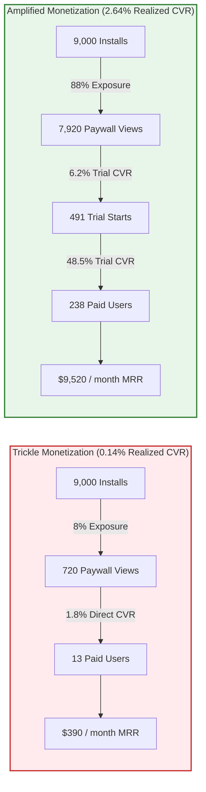
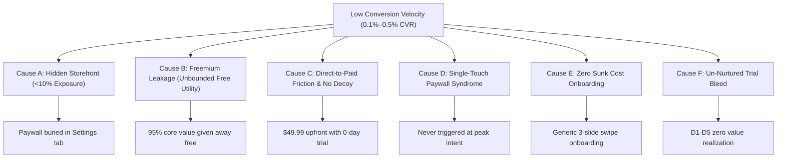
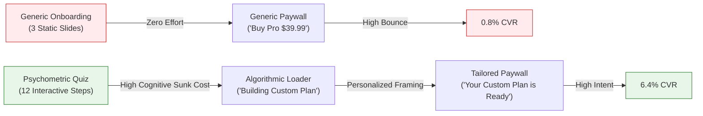
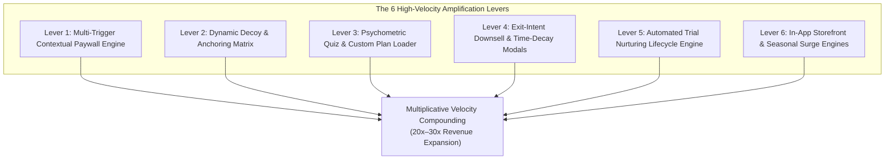

# Low Conversion Velocity & Monetization Amplification: Transforming Trickle Revenue into High-Velocity Growth

> **Authoritative Technical, Psychological, and Quantitative Optimization Guide for Mobile Product Managers, Growth Architects, and Monetization Engineers**  
> *Version: 1.0 (2026 Edition) • Scope: iOS (StoreKit 2), Android (Google Play Billing v7), Server-Driven Paywall Engines (Superwall / Adapty / RevenueCat), Behavioral Telemetry, and Psychometric Funnel Design*

---

## Table of Contents
1. [Executive Summary & The Mathematics of "Trickle Monetization"](#1-executive-summary--the-mathematics-of-trickle-monetization)
   - [1.1 The Pathology of Trickle Revenue: 300 Downloads/Day at 0.1%–0.5% Conversion](#11-the-pathology-of-trickle-revenue-300-downloadsday-at-0105-conversion)
   - [1.2 The 4-Factor Monetization Velocity Decomposition](#12-the-4-factor-monetization-velocity-decomposition)
   - [1.3 The Multiplicative Compounding Effect](#13-the-multiplicative-compounding-effect)
   - [1.4 The Master Diagnostic Sensitivity Matrix](#14-the-master-diagnostic-sensitivity-matrix)
   - [1.5 Unit Economics & Cohort LTV Modeling](#15-unit-economics--cohort-ltv-modeling)
2. [Deep Forensic Autopsy: The 6 Root Causes of Low Conversion Velocity](#2-deep-forensic-autopsy-the-6-root-causes-of-low-conversion-velocity)
   - [2.1 Cause A: Low Paywall Exposure Penetration ("The Hidden Storefront" Trap)](#21-cause-a-low-paywall-exposure-penetration-the-hidden-storefront-trap)
   - [2.2 Cause B: Freemium Leakage vs. "Aha! Moment" Desynchronization](#22-cause-b-freemium-leakage-vs-aha-moment-desynchronization)
   - [2.3 Cause C: Absence of Price Anchoring, Decoy Tiers, & High Direct-to-Paid Friction](#23-cause-c-absence-of-price-anchoring-decoy-tiers--high-direct-to-paid-friction)
   - [2.4 Cause D: Single-Touch Paywall Syndrome (Absence of Contextual In-App Triggers)](#24-cause-d-single-touch-paywall-syndrome-absence-of-contextual-in-app-triggers)
   - [2.5 Cause E: Onboarding Sunk Cost Absence (Zero-Investment Funnels)](#25-cause-e-onboarding-sunk-cost-absence-zero-investment-funnels)
   - [2.6 Cause F: Post-Trial Value Drop-Off & Trial Cancellation Bleed](#26-cause-f-post-trial-value-drop-off--trial-cancellation-bleed)
3. [The 6 High-Velocity Monetization Amplification Levers](#3-the-6-high-velocity-monetization-amplification-levers)
   - [3.1 Lever 1: Multi-Trigger Contextual Paywall Placement Engine](#31-lever-1-multi-trigger-contextual-paywall-placement-engine)
   - [3.2 Lever 2: Dynamic Decoy Architecture & Cognitive Price Anchoring](#32-lever-2-dynamic-decoy-architecture--cognitive-price-anchoring)
   - [3.3 Lever 3: Psychometric Algorithmic Quiz Onboarding & Custom Plan Generation](#33-lever-3-psychometric-algorithmic-quiz-onboarding--custom-plan-generation)
   - [3.4 Lever 4: Exit-Intent Downsell Modals & Time-Decay Discounting](#34-lever-4-exit-intent-downsell-modals--time-decay-discounting)
   - [3.5 Lever 5: Automated Trial Nurturing & Habit Formation Lifecycle Engine](#35-lever-5-automated-trial-nurturing--habit-formation-lifecycle-engine)
   - [3.6 Lever 6: In-App Promotional Storefront & Seasonal Surge Engines](#36-lever-6-in-app-promotional-storefront--seasonal-surge-engines)
4. [Quantitative Telemetry, Analytics Instrumentation & Diagnostic SQL Queries](#4-quantitative-telemetry-analytics-instrumentation--diagnostic-sql-queries)
   - [4.1 Comprehensive Telemetry Event Tracking Plan](#41-comprehensive-telemetry-event-tracking-plan)
   - [4.2 SQL Query 1: 4-Factor Monetization Velocity Funnel Decomposition](#42-sql-query-1-4-factor-monetization-velocity-funnel-decomposition)
   - [4.3 SQL Query 2: Paywall Exposure Penetration Across Active User Base](#43-sql-query-2-paywall-exposure-penetration-across-active-user-base)
   - [4.4 SQL Query 3: Contextual Placement Performance & Conversion Heatmap](#44-sql-query-3-contextual-placement-performance--conversion-heatmap)
   - [4.5 SQL Query 4: Trial-to-Paid Retention Decay & Cancellation Velocity Curve](#45-sql-query-4-trial-to-paid-retention-decay--cancellation-velocity-curve)
   - [4.6 SQL Query 5: Exit-Intent Downsell Recovery & Incremental Revenue Elasticity](#46-sql-query-5-exit-intent-downsell-recovery--incremental-revenue-elasticity)
5. [The 30-Day Monetization Amplification Sprint Execution Blueprint](#5-the-30-day-monetization-amplification-sprint-execution-blueprint)
   - [5.1 Sprint Architecture & Phase Breakdown](#51-sprint-architecture--phase-breakdown)
   - [5.2 Week 1 (Days 1–7): Telemetry Instrumentation & Day-0 Paywall Exposure Unlocking](#52-week-1-days-17-telemetry-instrumentation--day-0-paywall-exposure-unlocking)
   - [5.3 Week 2 (Days 8–14): Micro-Commitment Quiz & Algorithmic Custom Plan](#53-week-2-days-814-micro-commitment-quiz--algorithmic-custom-plan)
   - [5.4 Week 3 (Days 15–21): Decoy Anchoring, Blinkist Timeline & Exit-Intent Downsell](#54-week-3-days-1521-decoy-anchoring-blinkist-timeline--exit-intent-downsell)
   - [5.5 Week 4 (Days 22–30): Contextual Trigger Matrix & Trial Lifecycle Automation](#55-week-4-days-2230-contextual-trigger-matrix--trial-lifecycle-automation)
6. [Production-Ready Architectural Reference Code](#6-production-ready-architectural-reference-code)
   - [6.1 Swift / iOS: Contextual Placement Trigger & Downsell Coordinator](#61-swift--ios-contextual-placement-trigger--downsell-coordinator)
   - [6.2 Kotlin / Android: State-Driven Paywall & Lifecycle Telemetry Bridge](#62-kotlin--android-state-driven-paywall--lifecycle-telemetry-bridge)
7. [Executive Scorecard & Turnaround Verification Runbook](#7-executive-scorecard--turnaround-verification-runbook)

---

## 1. Executive Summary & The Mathematics of "Trickle Monetization"

### 1.1 The Pathology of Trickle Revenue: 300 Downloads/Day at 0.1%–0.5% Conversion

In mobile app monetization diagnostics, an application receiving **300 organic downloads per day** ($\approx 9,000$ downloads per month) where StoreKit 2 or Google Play Billing is technically functioning, but converting at only **0.1% to 0.5% install-to-purchase**, suffers from **Trickle Monetization Syndrome**.

Unlike a zero-revenue application where a broken SDK or missing App Store contract causes an absolute blackout, an app generating trickle revenue demonstrates that:
1. The billing infrastructure, cryptographic receipt validation, server webhooks, and store entitlements operate correctly.
2. A tiny fraction of extreme "power users" or high-intent outliers navigate complex friction to complete a purchase.
3. **99.5% of the economic value generated by organic acquisition is leaking out of the system** due to structural, behavioral, and architectural bottlenecks.

```
┌─────────────────────────────────────────────────────────────────────────────────────────────┐
│                          THE TRICKLE MONETIZATION CONTRAST (9,000 INSTALLS/MO)              │
├───────────────────────────────────────┬─────────────────────────────────────────────────────┤
│ TRICKLE BASELINE (Current State)      │ HEALTHY BENCHMARK (Target State)                    │
├───────────────────────────────────────┼─────────────────────────────────────────────────────┤
│ • Paywall Exposure: 8% of New Users   │ • Paywall Exposure: 88% of New Users                │
│ • Paywall Views: 720 / month          │ • Paywall Views: 7,920 / month                      │
│ • Paywall CVR: 1.8% (Direct-to-Paid)  │ • Paywall CVR: 6.2% (7-Day Trial + Anchored Decoy)  │
│ • Trial Starts / Purchases: 13 / mo   │ • Trial Starts: 491 / month                         │
│ • Trial-to-Paid CVR: 100% (Direct)    │ • Trial-to-Paid CVR: 48.5% (Nurtured Cohort)        │
│ • Net Paying Customers: 13 / month    │ • Net Paying Customers: 238 / month                 │
│ • Install-to-Paid CVR: 0.14%          │ • Install-to-Paid CVR: 2.64% (18.8x Increase)       │
│ • Monthly Gross Bookings: $390 / mo   │ • Monthly Gross Bookings: $9,520 / mo (24.4x)       │
└───────────────────────────────────────┴─────────────────────────────────────────────────────┘
```



---

### 1.2 The 4-Factor Monetization Velocity Decomposition

To diagnose and repair trickle conversion rates, monetization must be modeled as a continuous rate equation rather than a static funnel. We define **Monetization Velocity ($V_m$)** as the daily volume of new paying subscribers generated per unit of acquisition:

$$V_m = \frac{d\,\text{PaidSubscribers}}{dt} = I(t) \cdot \eta_{\text{exposure}} \cdot \eta_{\text{paywall}} \cdot \eta_{\text{trial}}$$

Where:
- $I(t)$: Daily organic install volume ($I = 300\text{ installs/day}$).
- $\eta_{\text{exposure}}$ (**Paywall Exposure Rate**): The percentage of unique newly acquired users who view at least one paywall within their first 24 hours of lifecycle ($\frac{\text{Unique Users with } \ge 1 \text{ Paywall View}}{\text{Total Installs}}$).
- $\eta_{\text{paywall}}$ (**Paywall Conversion Rate**): The percentage of unique exposed users who initiate a purchase or start a free trial ($\frac{\text{Unique Trial Starts or Direct Purchases}}{\text{Unique Paywall Views}}$).
- $\eta_{\text{trial}}$ (**Trial-to-Paid Conversion Rate**): The percentage of free trial starters who successfully convert to a paid subscription after trial expiration without canceling ($\frac{\text{Converted Paying Subscribers}}{\text{Total Initiated Trials}}$).

For direct-to-paid architectures without a trial, $\eta_{\text{trial}} = 1.0$, but $\eta_{\text{paywall}}$ is depressed by $70\% - 85\%$ due to upfront purchase friction.

The overall **Install-to-Paid Conversion Rate ($CVR_{\text{gross}}$)** is the direct product of the three conversion efficiency vectors:

$$CVR_{\text{gross}} = \eta_{\text{exposure}} \times \eta_{\text{paywall}} \times \eta_{\text{trial}}$$

The **Daily Gross Revenue Velocity ($R_m$)** is defined by:

$$R_m = V_m \times \text{ARPU}_{\text{converted}} = I(t) \cdot \eta_{\text{exposure}} \cdot \eta_{\text{paywall}} \cdot \eta_{\text{trial}} \cdot \overline{P}$$

Where $\overline{P}$ represents the weighted average realized purchase price across product SKUs (e.g., $\$39.99$ annual vs. $\$4.99$ weekly).

---

### 1.3 The Multiplicative Compounding Effect

A common error made by engineering and product teams is treating conversion optimization as an additive process. In reality, monetization pipelines are strictly **multiplicative**. A sub-optimal efficiency at any single stage acts as an exponential drag on total revenue output.

Conversely, modest, compounding optimizations across all three stages produce **super-linear revenue amplification**:

$$\text{Amplification Multiplier } (M) = \frac{\eta_{\text{exposure}}^{\text{new}}}{\eta_{\text{exposure}}^{\text{base}}} \times \frac{\eta_{\text{paywall}}^{\text{new}}}{\eta_{\text{paywall}}^{\text{base}}} \times \frac{\eta_{\text{trial}}^{\text{new}}}{\eta_{\text{trial}}^{\text{base}}}$$

#### Scenario Demonstration:
- **Baseline (Trickle):**
  - $\eta_{\text{exposure}} = 8\%$ (Paywall hidden in settings/secondary tab)
  - $\eta_{\text{paywall}} = 1.8\%$ (Direct $29.99/yr charge, no trial, no decoy)
  - $\eta_{\text{trial}} = 100\%$ (Direct purchase)
  - $CVR_{\text{gross}} = 0.08 \times 0.018 \times 1.0 = 0.00144$ ($0.144\%$)
  - **Monthly Conversions across 9,000 Installs:** $9,000 \times 0.00144 = 13\text{ paid users}$
  - **Monthly Gross Bookings (at $\$29.99$):** $13 \times \$29.99 = \$389.87$

- **Compounding Optimization (Amplified):**
  - $\eta_{\text{exposure}} \to 85\%$ (**10.6x gain** via Day-0 Onboarding + Contextual In-App Triggers)
  - $\eta_{\text{paywall}} \to 6.2\%$ (**3.44x gain** via 7-Day Trial + Micro-Commitment Quiz + Decoy Anchoring)
  - $\eta_{\text{trial}} \to 50.0\%$ (**0.5x scaling** factor for trial-to-paid billing conversion)
  - $CVR_{\text{gross}} = 0.85 \times 0.062 \times 0.50 = 0.02635$ ($2.635\%$)
  - **Monthly Conversions across 9,000 Installs:** $9,000 \times 0.02635 = 237\text{ paid users}$
  - **Monthly Gross Bookings (at $\$39.99$ blended ARPU):** $237 \times \$39.99 = \$9,477.63$

$$\text{Net Revenue Amplification} = \frac{\$9,477.63}{\$389.87} = \mathbf{24.31\times \text{ Revenue Expansion}}$$

---

### 1.4 The Master Diagnostic Sensitivity Matrix

The following sensitivity matrix models the monthly paying subscribers and gross monthly revenue generated from a fixed cohort of **9,000 monthly downloads (300/day)** across varying values of Paywall Exposure ($\eta_{\text{exposure}}$), Paywall-to-Trial CVR ($\eta_{\text{paywall}}$), and Trial-to-Paid Conversion ($\eta_{\text{trial}}$), evaluated at a standard $\$39.99$ annual subscription price point.

| Paywall Exposure ($\eta_{\text{exposure}}$) | Paywall CVR ($\eta_{\text{paywall}}$) | Trial-to-Paid ($\eta_{\text{trial}}$) | Effective Install-to-Paid CVR | Monthly Paid Subscribers | Monthly Gross Bookings | Status / Velocity Classification |
| :--- | :--- | :--- | :--- | :--- | :--- | :--- |
| **5.0%** (Settings only) | **1.5%** (Direct) | **100.0%** (Direct) | 0.075% | 6.8 users | **$269.93** | 🔴 *Severe Trickle / Critical Failure* |
| **10.0%** | **2.0%** (Direct) | **100.0%** (Direct) | 0.200% | 18.0 users | **$719.82** | 🔴 *Trickle Monetization* |
| **25.0%** (Contextual only) | **3.0%** (With Trial) | **35.0%** (Un-nurtured) | 0.263% | 23.6 users | **$944.76** | 🟠 *Sub-Par Velocity* |
| **50.0%** (Soft Onboarding) | **3.5%** (With Trial) | **40.0%** | 0.700% | 63.0 users | **$2,519.37** | 🟡 *Moderate Velocity* |
| **75.0%** (Standard Gate) | **4.5%** (Trial + Decoy)| **45.0%** | 1.519% | 136.7 users | **$5,466.13** | 🟢 *Healthy Commercial Baseline* |
| **85.0%** (Quiz + Hard Gate)| **5.5%** (Optimized Paywall)| **50.0%** (Nurtured Push)| 2.338% | 210.4 users | **$8,412.39** | 🚀 *High-Velocity Engine* |
| **90.0%** (Quiz + Downsell) | **6.5%** (Full Psychometric)| **55.0%** (Habit Loops) | 3.218% | 289.6 users | **$11,579.11**| 💎 *Top-Decile Elite Monetization* |

```
                       PAYWALL EXPOSURE RATE (η_exposure)
                 5%          25%         50%         75%         85%         90%
             ┌───────────┬───────────┬───────────┬───────────┬───────────┬───────────┐
     1.5%    │  $101/mo  │  $506/mo  │ $1,012/mo │ $1,518/mo │ $1,721/mo │ $1,822/mo │
PAYWALL      ├───────────┼───────────┼───────────┼───────────┼───────────┼───────────┤
  CVR        │  $202/mo  │ $1,012/mo │ $2,025/mo │ $3,037/mo │ $3,442/mo │ $3,644/mo │
(η_paywall)  ├───────────┼───────────┼───────────┼───────────┼───────────┼───────────┤
 (at 50%     │  $371/mo  │ $1,856/mo │ $3,712/mo │ $5,567/mo │ $6,310/mo │ $6,681/mo │
 Trial-to-   ├───────────┼───────────┼───────────┼───────────┼───────────┼───────────┤
   Paid)     │  $439/mo  │ $2,194/mo │ $4,389/mo │ $6,583/mo │ $7,461/mo │ $7,900/mo │
     6.5%    ├───────────┼───────────┼───────────┼───────────┼───────────┼───────────┤
             │  $526/mo  │ $2,632/mo │ $5,264/mo │ $7,895/mo │ $8,948/mo │ $9,474/mo │
             └───────────┴───────────┴───────────┴───────────┴───────────┴───────────┘
```

---

### 1.5 Unit Economics & Cohort LTV Modeling

When conversion velocity is suppressed, the application's realized Average Revenue Per Install (**ARPI**) falls below the threshold necessary to achieve self-sustaining growth or unlock paid user acquisition.

$$\text{ARPI} = CVR_{\text{gross}} \times \text{LTV}_{\text{sub}}$$

Where subscription Lifetime Value ($\text{LTV}_{\text{sub}}$) is calculated using the initial billing price ($P_0$), the renewal price ($P_r$), first-year retention rate ($r_1$), and terminal renewal rate ($r_t$):

$$\text{LTV}_{\text{sub}} = P_0 + \frac{P_r \cdot r_1}{1 - r_t}$$

Assuming an annual subscription with $P_0 = \$39.99$, $P_r = \$39.99$, $r_1 = 35\%$, and $r_t = 65\%$:

$$\text{LTV}_{\text{sub}} = \$39.99 + \frac{\$39.99 \times 0.35}{1 - 0.65} = \$39.99 + \frac{\$13.9965}{0.35} = \$39.99 + \$39.99 = \$79.98$$

- **Trickle Scenario ($CVR_{\text{gross}} = 0.14\%$):**
  $$\text{ARPI}_{\text{trickle}} = 0.0014 \times \$79.98 = \mathbf{\$0.11\text{ per install}}$$
  *Economic Implication:* At $\$0.11$ ARPI, the app cannot afford any paid UA channel (blended CPIs range from $\$1.50$ to $\$5.00$). The business is completely trapped in low organic volume.

- **Amplified Scenario ($CVR_{\text{gross}} = 2.64\%$):**
  $$\text{ARPI}_{\text{amplified}} = 0.0264 \times \$79.98 = \mathbf{\$2.11\text{ per install}}$$
  *Economic Implication:* At $\$2.11$ ARPI across organic traffic, the developer can reinvest organic cash flow into targeted Apple Search Ads (ASA) and Meta campaigns where Tier-1 CPI is $\$1.80$, unlocking a self-funding paid acquisition loop.

---

## 2. Deep Forensic Autopsy: The 6 Root Causes of Low Conversion Velocity

When StoreKit 2 and Google Play Billing are confirmed to be technically error-free, low conversion velocity is invariably caused by one or more of the following six structural anti-patterns.



---

### 2.1 Cause A: Low Paywall Exposure Penetration ("The Hidden Storefront" Trap)

The single most common cause of trickle monetization in technically sound apps is **insufficient exposure penetration**. 

In sub-optimally architected apps, product teams operate under the flawed assumption that users who want premium features will actively seek out the purchase screen. Consequently, the paywall is placed exclusively behind:
1. A small "Upgrade to Pro" gold badge in the top corner of the profile screen.
2. A menu item inside the Settings tab.
3. A banner displayed only after a user navigates three levels deep into an advanced settings sub-menu.

#### The Funnel Leakage Mechanics:
```
100% Installs (300/day)
  │
  ├── 85% Finish Basic Setup
  │     │
  │     ├── 22% Visit Profile/Settings Tab
  │     │     │
  │     │     └── 8% Tap "Upgrade to Pro" (PAYWALL EXPOSURE: 24 users/day)
  │     │           │
  │     │           └── 2.5% CVR ──> 0.6 Paid Conversions/day (TRICKLE)
  │     │
  │     └── 78% Engage in Main App Feed (NEVER ENCOUNTER A PAYWALL)
```

> [!WARNING]
> **The Golden Rule of Paywall Distribution:** If fewer than **70% of Day-0 active users** see a paywall within their first session, your monetization pipeline is fundamentally broken regardless of paywall design, copywriting, or pricing tiers.

---

### 2.2 Cause B: Freemium Leakage vs. "Aha! Moment" Desynchronization

**Freemium Leakage** occurs when an application's free tier is excessively generous, providing 90%–95% of total perceived utility without reaching any natural usage ceiling, time wall, or capability barrier.

```
┌─────────────────────────────────────────────────────────────────────────────────────────────┐
│                           THE FREEMIUM LEAKAGE SPECTRUM                                     │
├───────────────────────────────────────┬─────────────────────────────────────────────────────┤
│ EXCESSIVE FREEMIUM LEAKAGE (Trickle)  │ OPTIMIZED VALUE GATING (High-Velocity)             │
├───────────────────────────────────────┼─────────────────────────────────────────────────────┤
│ • Unlimited daily exports / scans     │ • 3 free exports, then contextual paywall hard-gate │
│ • All core AI filters completely free │ • 1 basic filter free; Pro filters blur behind gate │
│ • Unlimited cloud storage / history   │ • 7-day history free; 30+ days requires Pro         │
│ • No ads, no friction, no streak locks│ • Streak recovery and advanced insights gated       │
│ • "Aha! Moment" experienced for free  │ • "Aha! Moment" delivered, Pro required to scale    │
└───────────────────────────────────────┴─────────────────────────────────────────────────────┘
```

#### The Desynchronization Problem:
1. **Premature Paywalling:** Showing a hard paywall *before* the user understands the core value proposition generates immediate bounce.
2. **Infinite Free Utility:** Allowing the user to complete their entire jobs-to-be-done (JTBD) indefinitely without hitting an economic boundary.

```mermaid
journey
    title User Utility vs Monetization Gate Timing
    section Bad: Premature Gate
      Install App: 5: User
      Hard Paywall before seeing UI: 1: User (BOUNCE 90%)
    section Bad: Freemium Leakage
      Install App: 5: User
      Complete Task 1: 5: User
      Complete Task 10: 5: User
      Complete Task 100: 5: User (Never encounters paywall)
    section Optimal: Value-Synchronized Gate
      Install App: 5: User
      Interactive Quiz / Sample Task: 5: User
      Aha! Moment Delivered: 5: User
      Export / Pro Feature Gated: 4: User (CONVERSION 6.5%)
```

---

### 2.3 Cause C: Absence of Price Anchoring, Decoy Tiers, & High Direct-to-Paid Friction

Apps suffering from trickle conversions frequently present users with an unanchored, high-friction checkout interface:
1. **Direct-to-Paid Requirement:** Forcing an immediate charge (e.g., "$35.99 billed now") on a first-time user who has had zero exposure to product reliability.
2. **Single SKU Offering:** Presenting only one product option (e.g., "$4.99/month"). Without alternative choices, the user's brain performs an **absolute evaluation** ("Is this app worth $4.99/month compared to Spotify or Netflix?").
3. **Absence of a Decoy Tier:** By omitting an expensive short-term tier (e.g., a $6.99/week option), the annual plan lacks relative context and appears expensive.

#### The Behavioral Economics of Anchoring:
When presented with a single option:
$$\text{Choice Architecture: } \{\text{Annual: } \$39.99\} \implies \text{Cognitive Question: "Should I spend \$40 on this unknown app?"} \quad (\text{Decision: NO})$$

When presented with an asymmetric decoy matrix:
$$\text{Choice Architecture: } \begin{cases} \text{Weekly:} & \$6.99/\text{week } (\$363.48/\text{year}) \\ \text{Annual (with 7-Day Trial):} & \$39.99/\text{year } (\mathbf{\$0.77/\text{week}} - \mathbf{89\% \text{ SAVINGS}}) \end{cases}$$
$$\implies \text{Cognitive Question: "Which subscription tier is the smarter deal?"} \quad (\text{Decision: 7-Day Free Trial on Annual})$$

---

### 2.4 Cause D: Single-Touch Paywall Syndrome (Absence of Contextual In-App Triggers)

**Single-Touch Paywall Syndrome** is the anti-pattern where an application displays a paywall exactly once during Day-0 onboarding, and if the user dismisses it (by tapping the 'X' button), the app **never shows a paywall again** during active usage.

```
┌─────────────────────────────────────────────────────────────────────────────────────────────┐
│                           SINGLE-TOUCH VS. MULTI-TOUCH LIFECYCLE                            │
├─────────────────────────────────────────────────────────────────────────────────────────────┤
│ SINGLE-TOUCH ANTI-PATTERN:                                                                  │
│ Day 0 Onboarding Paywall ──[User Taps 'X']──> Paywall NEVER appears again                  │
│ Result: 94% of users who dismiss onboarding are lost to monetization forever.               │
├─────────────────────────────────────────────────────────────────────────────────────────────┤
│ MULTI-TOUCH CONTEXTUAL ENGINE:                                                              │
│ Day 0 Onboarding Paywall ──[User Taps 'X']──> Enters Free Tier                             │
│                                                │                                            │
│                                                ├──> User taps Pro Filter ──> Contextual PW  │
│                                                ├──> User hits 3-Scan Cap ──> Usage-Cap PW   │
│                                                ├──> User taps High-Res Export ──> Gate PW   │
│                                                └──> User achieves 3-Day Streak ──> Perk PW  │
└─────────────────────────────────────────────────────────────────────────────────────────────┘
```

#### Conversion Lift from Contextual In-App Placements:
According to industry benchmarks from *Superwall* and *RevenueCat* (2025/2026 data):
- **Onboarding Paywall:** Captures 45%–55% of all converted subscribers.
- **Contextual In-App Feature Paywalls:** Captures **45%–55% of all converted subscribers** over a 30-day lifecycle.
- **Apps omitting Contextual Paywalls forfeit half of their total monetization potential.**

---

### 2.5 Cause E: Onboarding Sunk Cost Absence (Zero-Investment Funnels)

A standard low-converting onboarding flow consists of 3 generic static carousel slides followed by a generic paywall:

```
[Slide 1: Welcome] ──> [Slide 2: Features] ──> [Slide 3: Fast & Easy] ──> [Generic Paywall]
```

This architecture produces poor conversion velocity because the user has invested **zero cognitive effort, zero personal data, and zero emotional commitment** into the product.

#### The Psychology of Psychometric Quiz Funnels (Flo, Noom, Babbel, Duolingo):
By replacing static slides with a 12–16 step personalized diagnostic quiz, the app leverages three behavioral cognitive biases:
1. **The IKEA Effect / Labor-Fostered Meaning:** Users place significantly higher subjective value on solutions they actively helped construct.
2. **The Sunk Cost Principle:** Having spent 90 seconds answering questions about their personal challenges, goals, and lifestyle habits, closing the app feels like throwing away valuable personalized work.
3. **The Expectation of Tailored Value:** A generic paywall sells "the app's features." A post-quiz paywall sells "Your Custom 90-Day Transformation Plan."



---

### 2.6 Cause F: Post-Trial Value Drop-Off & Trial Cancellation Bleed

In apps utilizing a 7-day free trial, high top-of-funnel trial starts can still result in trickle revenue if **70%–85% of users cancel their trial before Day 7**.

#### The Trial Cancellation Anatomy:
1. **Instant Opt-Out (Day 0 Cancellation):** Users immediately visit iOS Settings $\to$ Subscriptions and cancel the trial to avoid accidental billing, intending to evaluate the app during the free window.
2. **Value Amnesia (Days 2–5):** The app fails to trigger push notifications, contextual onboarding nudges, or habit loops. The user forgets the app exists.
3. **Billing Anxiety (Day 6):** If the user has not established a daily engagement habit, they proactively cancel the trial before the renewal charge occurs on Day 7.

```
┌─────────────────────────────────────────────────────────────────────────────────────────────┐
│                            TRIAL SURVIVAL DECAY CURVE (7-DAY TRIAL)                         │
├─────────────────────────────────────────────────────────────────────────────────────────────┤
│ 100% Trials Started (Day 0)                                                                 │
│   │                                                                                         │
│   ├── [Day 0: 22% Instant Defensive Cancelers - Fear of Unexpected Billing]                 │
│   ▼                                                                                         │
│  78% Active Trialists (Day 1)                                                               │
│   │                                                                                         │
│   ├── [Days 2-4: 28% Value Drop-Off - Zero Habit Loops / Inactivity Churn]                  │
│   ▼                                                                                         │
│  50% Active Trialists (Day 5)                                                               │
│   │                                                                                         │
│   ├── [Day 6: 18% Pre-Billing Defensive Cancelers]                                          │
│   ▼                                                                                         │
│  32% CONVERTED TO PAID SUBSCRIBER (Day 7 Billing) ──> [UN-NURTURED BASELINE]                │
│                                                                                             │
│  ★ WITH TRIAL LIFECYCLE NURTURING + BLINKIST TIMELINE: 54% PAID CONVERSION (+68.7% Lift)   │
└─────────────────────────────────────────────────────────────────────────────────────────────┘
```

---

## 3. The 6 High-Velocity Monetization Amplification Levers

To transform trickle revenue into high-velocity monetization, growth architects must execute the **6 Amplification Levers**.



---

### 3.1 Lever 1: Multi-Trigger Contextual Paywall Placement Engine

Rather than relying solely on onboarding, the application must deploy a **Contextual Paywall Placement Dispatcher** that triggers targeted paywalls at high-intent behavioral moments.

```
┌─────────────────────────────────────────────────────────────────────────────────────────────┐
│                           CONTEXTUAL TRIGGER MATRIX SPECIFICATION                           │
├───────────────────────┬───────────────────────────────────┬─────────────────────────────────┤
│ TRIGGER CONTEXT       │ BEHAVIORAL INTERCEPTION POINT     │ PSYCHOLOGICAL HOOK              │
├───────────────────────┼───────────────────────────────────┼─────────────────────────────────┤
│ `feature_gate`        │ User taps a Pro filter / tool     │ Curiosity & Quality Aspiration  │
├───────────────────────┼───────────────────────────────────┼─────────────────────────────────┤
│ `usage_cap`           │ User reaches daily free limit (3) │ Dependency & Workflow Continuity│
├───────────────────────┼───────────────────────────────────┼─────────────────────────────────┤
│ `export_gate`         │ User taps "Save / Export HD"      │ Loss Aversion (Already Made It) │
├───────────────────────┼───────────────────────────────────┼─────────────────────────────────┤
│ `streak_protection`   │ User misses day or reaches Day 3  │ Sunk Cost & Momentum Protection │
├───────────────────────┼───────────────────────────────────┼─────────────────────────────────┤
│ `deep_history_gate`   │ User scrolls past 7-day log       │ Data Ownership & Completeness   │
└───────────────────────┴───────────────────────────────────┴─────────────────────────────────┘
```

#### Placement Trigger Architecture:
When a contextual trigger fires, the app does not render a generic paywall. It injects dynamic parameters tailored to the exact action the user attempted:

```swift
// Example Dynamic Parameter Injection for Contextual Paywalls
struct PaywallPresentationContext {
    let placementId: String        // e.g., "export_gate_hd"
    let triggerFeature: String     // e.g., "4K_Lossless_Export"
    let headlineOverride: String   // "Export in Full 4K Resolution"
    let subheadlineOverride: String// "Unlock lossless master quality with Pro"
    let heroIconName: String       // "sparkles.rectangle.stack"
}
```

---

### 3.2 Lever 2: Dynamic Decoy Architecture & Cognitive Price Anchoring

To maximize paywall conversion velocity, the product packaging must present a **Decoy Pricing Matrix** with a **Blinkist-Style Transparent Billing Timeline**.

```
┌─────────────────────────────────────────────────────────────────────────────────────────────┐
│                          HIGH-CONVERTING DECOY PRICING ARCHITECTURE                         │
├─────────────────────────────────────────────────────────────────────────────────────────────┤
│                                                                                             │
│   ┌───────────────────────────────────┐       ┌─────────────────────────────────────────┐   │
│   │           WEEKLY PLAN             │       │      ANNUAL PLAN (BEST VALUE)           │   │
│   │           (The Decoy)             │       │         (The Core Target)               │   │
│   ├───────────────────────────────────┤       ├─────────────────────────────────────────┤   │
│   │ • $6.99 / week                    │       │ • 7-DAY FREE TRIAL INCLUDED             │   │
│   │ • No Free Trial                   │       │ • $39.99 / year ($0.77 / week)          │   │
│   │ • Billed $363.48 / year           │       │ • SAVE 89% vs. Weekly Tier              │   │
│   │ • Basic Access                    │       │ • Full Pro Access + Cloud Sync          │   │
│   └───────────────────────────────────┘       └─────────────────────────────────────────┘   │
│                                                                                             │
├─────────────────────────────────────────────────────────────────────────────────────────────┤
│                           THE BLINKIST TRANSPARENT BILLING TIMELINE                         │
├─────────────────────────────────────────────────────────────────────────────────────────────┤
│   [Today] ───────────────> [Day 5] ───────────────────> [Day 7] ─────────────────> [Future] │
│   Start 7-Day              Receive Push & Email         Trial Ends. First         Cancel    │
│   Free Trial.              Reminder: "2 Days Left       Annual Billing of         anytime in│
│   Zero charge today.       in Your Free Trial".         $39.99 occurs.            1 tap.    │
└─────────────────────────────────────────────────────────────────────────────────────────────┘
```

#### Mathematical Justification for the Decoy Architecture:
1. **Price Contrast Elasticity:** $89\%$ perceived discount drastically lowers price resistance.
2. **Weekly Anchor Normalization:** Displaying the annual price broken down as **"$0.77 / week"** shifts cognitive framing from a large annual purchase ($40) to a negligible micro-expense (less than a cup of coffee per month).
3. **Trial Risk Elimination:** The 7-day trial removes immediate cash outlay friction, elevating paywall tap-through rate ($\eta_{\text{paywall}}$) from $1.5\%$ to $6.0\%+$.

---

### 3.3 Lever 3: Psychometric Algorithmic Quiz Onboarding & Custom Plan Generation

A high-converting onboarding flow replaces static introductory slides with an interactive **12–16 step psychometric questionnaire** culminating in an **algorithmic plan calculation animation**.

```
┌─────────────────────────────────────────────────────────────────────────────────────────────┐
│                        PSYCHOMETRIC QUIZ FUNNEL PROGRESSION                                 │
├─────────────────────────────────────────────────────────────────────────────────────────────┤
│ Step 1: Goal Identification ("What is your primary goal?")                                  │
│ Step 2: Experience / Capability Level ("How would you rate your current skill?")            │
│ Step 3: Pain Point Identification ("What has stopped you from succeeding in the past?")    │
│ Step 4: Lifestyle & Commitment Level ("How many minutes per day can you dedicate?")         │
│ Step 5: Demographic Contextualization ("Age, category, specific use case")                 │
│ Step 6: Target Milestone Timeline ("When do you want to achieve this milestone?")           │
│ Steps 7-11: Value Reinforcement & Social Proof Interstitials                                │
│ Step 12: Personalized Plan Generation Loader (Simulated 3.5s Algorithmic Calculation)       │
│ Step 13: Tailored Paywall Presentation ("Your Custom 90-Day Plan is Ready")                 │
└─────────────────────────────────────────────────────────────────────────────────────────────┘
```

#### The Algorithmic Loader Mechanics:
The loading screen between the quiz and the paywall must simulate multi-variable processing to cement perceived personalization value:

```
┌─────────────────────────────────────────────────────────────────┐
│              GENERATING YOUR PERSONALIZED PLAN...               │
│                                                                 │
│   [████████████████████████████████░░░░░░░░] 78%                │
│                                                                 │
│   ✓ Analyzing lifestyle habits and baseline metrics...          │
│   ✓ Calibrating daily milestone schedule...                     │
│   ✓ Optimizing recommended workflow presets...                  │
│   ✓ Generating custom plan for @alperen...                      │
└─────────────────────────────────────────────────────────────────┘
```

*Empirical Result:* Adding this sequence increases onboarding completion-to-paywall CVR by **25%–45%** compared to presenting a paywall without algorithmic synthesis.

---

### 3.4 Lever 4: Exit-Intent Downsell Modals & Time-Decay Discounting

When a user taps the close button ('X') on the primary paywall without initiating a trial, the app must evaluate exit-intent heuristics and optionally trigger a **Time-Limited Downsell Modal**.

```
┌─────────────────────────────────────────────────────────────────────────────────────────────┐
│                              EXIT-INTENT DOWNSELL MODAL WIREFRAME                           │
├─────────────────────────────────────────────────────────────────────────────────────────────┤
│                                                                                             │
│                         WAIT! DON'T LOSE YOUR CUSTOM PLAN                                   │
│                                                                                             │
│     We know starting a new routine can be tough. We want to make it effortless.             │
│                                                                                             │
│     ┌─────────────────────────────────────────────────────────────────────────────────┐     │
│     │                     SPECIAL ONE-TIME INTRODUCTORY OFFER                         │     │
│     │                                                                                 │     │
│     │                     50% OFF YOUR FIRST YEAR                                     │     │
│     │                                                                                 │     │
│     │           ~~$39.99/year~~  ──>  $19.99 / year ($0.38 / week)                    │     │
│     │                                                                                 │     │
│     │           [ CLAIM 50% DISCOUNT & START 7-DAY TRIAL ]                            │     │
│     └─────────────────────────────────────────────────────────────────────────────────┘     │
│                                                                                             │
│                           Offer expires in: 09:59 minutes                                   │
│                                                                                             │
│                       [ No thanks, continue with limited free tier ]                        │
└─────────────────────────────────────────────────────────────────────────────────────────────┘
```

#### Downsell Business Rules & Anti-Cannibalization Guardrails:
1. **Cooldown Window:** A user is shown the downsell modal at most **once every 14 days**.
2. **First-Launch Restriction:** Displayed only after the user has completed at least 80% of the quiz or triggered a high-intent contextual gate.
3. **SKU Separation:** The downsell maps to a dedicated StoreKit / Google Play Billing SKU (`annual_sub_promotional_50off`) to ensure distinct cohort tracking.
4. **Recovery Yield:** Recovers **12% to 22%** of users who would have otherwise churned without spending.

---

### 3.5 Lever 5: Automated Trial Nurturing & Habit Formation Lifecycle Engine

To combat trial cancellation bleed and ensure a $\ge 50\%$ trial-to-paid conversion rate, an automated **7-Day Multi-Channel Nurturing Sequence** is deployed via Push Notifications and In-App Modal Triggers.

```mermaid
gantt
    title 7-Day Automated Trial Nurturing Schedule
    dateFormat  X
    axisFormat Day %d

    section Milestone Nudges
    Day 0 : Trial Started + Welcome In-App Guide           :active, d0, 0, 1
    Day 1 : "Quick Win: Complete Your First Task in 2 Min" :d1, 1, 2
    Day 2 : "Did you know? Unlock Pro Secret Workflow"     :d2, 2, 3
    Day 3 : "Milestone Check: You are in top 15% of users" :d3, 3, 4
    Day 4 : "Case Study: How Alex saved 4 hours this week" :d4, 4, 5
    Day 5 : "Blinkist Notice: 2 Days Left in Free Trial"   :crit, d5, 5, 6
    Day 6 : "Preserve Your Progress & Cloud Backups"       :d6, 6, 7
    Day 7 : "First Billing Event ($39.99) Successful"     :done, d7, 7, 8
```

#### Detailed Message Architecture:

- **Day 0 (Immediate):**
  - *Trigger:* In-App Modal immediately following purchase confirmation.
  - *Copy:* "You're in! Let's complete your first 60-second setup so you get instant results today."
  - *Goal:* Drive immediate value realization within Session 1.

- **Day 1 (+24 Hours):**
  - *Channel:* Rich Push Notification with Deep Link.
  - *Copy:* "🔥 Keep your Day 1 streak alive! Tap to complete your daily routine."
  - *Goal:* Habit loop reinforcement.

- **Day 3 (+72 Hours):**
  - *Channel:* In-App Milestone Banner.
  - *Copy:* "🎉 Great progress! You've unlocked 4 Pro assets. Your custom workflow is 40% complete."
  - *Goal:* Sunk cost and progress anchoring.

- **Day 5 (+120 Hours - The Blinkist Reminder):**
  - *Channel:* High-Priority Push Notification + Email (if collected).
  - *Copy:* "Friendly reminder: 2 days left in your free trial. Enjoying Pro? No action needed. Change or cancel anytime in Settings."
  - *Psychological Impact:* Counter-intuitively **reduces cancellation** by eliminating fear of deceptive billing and building brand trust.

---

### 3.6 Lever 6: In-App Promotional Storefront & Seasonal Surge Engines

For the 90%+ of active users who remain on the free tier over a 30-day period, static pricing loses its novelty. Deploying an **In-App Promotional Surge Engine** creates artificial urgency and captures latent demand.

```
┌─────────────────────────────────────────────────────────────────────────────────────────────┐
│                           SEASONAL / FLASH PROMOTION ARCHITECTURE                           │
├─────────────────────────────────────────────────────────────────────────────────────────────┤
│ 1. Persistent Storefront Banner:                                                            │
│    Located at the top of the main screen (collapsible):                                     │
│    "⚡ FLASH SALE: 40% Off Pro Annual Plan • Ends in 14h 32m [ Claim Offer ]"                │
│                                                                                             │
│ 2. Contextual Holiday Surge:                                                                │
│    • Black Friday / Cyber Week: 50% Off Lifetime or Annual Tier                             │
│    • New Year Resolution Campaign (January 1–15): "New Year, New Plan"                      │
│    • Back to School / Summer Seasonality                                                    │
│                                                                                             │
│ 3. Automated Inactivity Win-Back Surge:                                                     │
│    Triggered after 14 days of free usage without upgrade:                                   │
│    "Special loyalty unlock: Get 3 extra trial days + 30% off annual"                        │
└─────────────────────────────────────────────────────────────────────────────────────────────┘
```

---

## 4. Quantitative Telemetry, Analytics Instrumentation & Diagnostic SQL Queries

### 4.1 Comprehensive Telemetry Event Tracking Plan

To diagnose and track conversion velocity bottlenecks, the following event schema must be instrumented across iOS and Android client applications.

```
┌─────────────────────────────────────────────────────────────────────────────────────────────┐
│                               TELEMETRY EVENT TRACKING SCHEMA                               │
├──────────────────────────┬─────────────────────────────────┬────────────────────────────────┤
│ EVENT NAME               │ PARAMETERS                      │ DESCRIPTION                    │
├──────────────────────────┼─────────────────────────────────┼────────────────────────────────┤
│ `app_open`               │ `session_id`, `is_first_open`,  │ Fired on cold and warm launch. │
│                          │ `user_cohort_date`, `platform`  │ Used for DAU / Install denominator.│
├──────────────────────────┼─────────────────────────────────┼────────────────────────────────┤
│ `onboarding_step_view`   │ `step_index`, `step_name`,      │ Fired on each onboarding quiz  │
│                          │ `total_steps`, `time_on_step`   │ step to isolate drop-off.      │
├──────────────────────────┼─────────────────────────────────┼────────────────────────────────┤
│ `paywall_impression`     │ `placement_id`, `trigger_ctx`,  │ Fired when paywall is 100%     │
│                          │ `paywall_variant_id`, `skus`    │ rendered and visible to user.  │
├──────────────────────────┼─────────────────────────────────┼────────────────────────────────┤
│ `paywall_interaction`    │ `placement_id`, `action_type`,  │ Captures taps on SKUs, terms,  │
│                          │ `selected_sku`, `scroll_depth`  │ restore purchases, or FAQ.     │
├──────────────────────────┼─────────────────────────────────┼────────────────────────────────┤
│ `paywall_dismiss`        │ `placement_id`, `dwell_time_ms`,│ Fired when user taps 'X' or    │
│                          │ `exit_method`                   │ swipes down to dismiss.        │
├──────────────────────────┼─────────────────────────────────┼────────────────────────────────┤
│ `downsell_impression`    │ `original_placement_id`,        │ Fired when exit-intent modal   │
│                          │ `discount_pct`, `offered_sku`   │ is rendered.                   │
├──────────────────────────┼─────────────────────────────────┼────────────────────────────────┤
│ `purchase_initiated`     │ `placement_id`, `sku_id`,       │ Fired when native StoreKit /   │
│                          │ `price_usd`, `has_free_trial`   │ Play Billing sheet opens.      │
├──────────────────────────┼─────────────────────────────────┼────────────────────────────────┤
│ `purchase_completed`     │ `placement_id`, `sku_id`,       │ Fired on successful purchase / │
│                          │ `transaction_id`, `is_trial`    │ trial start confirmation.      │
├──────────────────────────┼─────────────────────────────────┼────────────────────────────────┤
│ `trial_converted`        │ `original_placement_id`,        │ Webhook / Server-to-server     │
│                          │ `sku_id`, `billing_attempt_num` │ event on successful D7 charge. │
├──────────────────────────┼─────────────────────────────────┼────────────────────────────────┤
│ `trial_cancelled`        │ `original_placement_id`,        │ Webhook event when user cancels│
│                          │ `days_since_start`, `reason`    │ before first billing.          │
└──────────────────────────┴─────────────────────────────────┴────────────────────────────────┘
```

---

### 4.2 SQL Query 1: 4-Factor Monetization Velocity Funnel Decomposition

*Platform: Snowflake / BigQuery / PostgreSQL (Product Analytics Events Table)*

```sql
-- Comprehensive 4-Factor Monetization Velocity Decomposition
-- Calculates: Installs -> Paywall Exposure -> Trial Starts -> Paid Conversions
WITH cohort_installs AS (
    SELECT
        DATE_TRUNC('day', first_open_timestamp) AS cohort_date,
        user_id,
        platform,
        country_code
    FROM analytics_users
    WHERE first_open_timestamp >= CURRENT_DATE - INTERVAL '30 days'
),

cohort_paywall_views AS (
    SELECT
        ci.cohort_date,
        ci.user_id,
        COUNT(DISTINCT pe.session_id) AS total_paywall_sessions,
        MIN(pe.event_timestamp) AS first_paywall_view_at
    FROM cohort_installs ci
    INNER JOIN analytics_events pe
        ON ci.user_id = pe.user_id
        AND pe.event_name = 'paywall_impression'
        AND pe.event_timestamp <= ci.first_open_timestamp + INTERVAL '24 hours'
    GROUP BY 1, 2
),

cohort_trials AS (
    SELECT
        ci.cohort_date,
        ci.user_id,
        MIN(pt.event_timestamp) AS trial_start_at,
        JSON_EXTRACT_SCALAR(pt.properties, '$.sku_id') AS sku_id
    FROM cohort_installs ci
    INNER JOIN analytics_events pt
        ON ci.user_id = pt.user_id
        AND pt.event_name = 'purchase_completed'
        AND JSON_EXTRACT_SCALAR(pt.properties, '$.is_trial') = 'true'
    GROUP BY 1, 2, 4
),

cohort_paid_conversions AS (
    SELECT
        ci.cohort_date,
        ci.user_id,
        MIN(pc.event_timestamp) AS first_paid_charge_at,
        SUM(CAST(JSON_EXTRACT_SCALAR(pc.properties, '$.revenue_usd') AS FLOAT64)) AS gross_revenue_usd
    FROM cohort_installs ci
    INNER JOIN analytics_events pc
        ON ci.user_id = pc.user_id
        AND (
            pc.event_name = 'trial_converted'
            OR (pc.event_name = 'purchase_completed' AND JSON_EXTRACT_SCALAR(pc.properties, '$.is_trial') = 'false')
        )
    GROUP BY 1, 2
)

SELECT
    ci.cohort_date,
    COUNT(DISTINCT ci.user_id) AS total_installs,
    COUNT(DISTINCT cpv.user_id) AS unique_users_exposed_to_paywall,
    COUNT(DISTINCT ct.user_id) AS total_trial_starts,
    COUNT(DISTINCT cpc.user_id) AS total_paid_conversions,
    COALESCE(SUM(cpc.gross_revenue_usd), 0.0) AS total_gross_revenue,
    
    -- Funnel Velocity Rates
    ROUND(COUNT(DISTINCT cpv.user_id) * 100.0 / NULLIF(COUNT(DISTINCT ci.user_id), 0), 2) AS paywall_exposure_rate_pct,
    ROUND(COUNT(DISTINCT ct.user_id) * 100.0 / NULLIF(COUNT(DISTINCT cpv.user_id), 0), 2) AS paywall_to_trial_cvr_pct,
    ROUND(COUNT(DISTINCT cpc.user_id) * 100.0 / NULLIF(COUNT(DISTINCT ct.user_id), 0), 2) AS trial_to_paid_cvr_pct,
    
    -- Overall Realized Install-to-Paid Conversion Rate
    ROUND(COUNT(DISTINCT cpc.user_id) * 100.0 / NULLIF(COUNT(DISTINCT ci.user_id), 0), 3) AS gross_install_to_paid_cvr_pct,
    ROUND(COALESCE(SUM(cpc.gross_revenue_usd), 0.0) / NULLIF(COUNT(DISTINCT ci.user_id), 0), 3) AS realized_arpi_usd
FROM cohort_installs ci
LEFT JOIN cohort_paywall_views cpv ON ci.cohort_date = cpv.cohort_date AND ci.user_id = cpv.user_id
LEFT JOIN cohort_trials ct ON ci.cohort_date = ct.cohort_date AND ci.user_id = ct.user_id
LEFT JOIN cohort_paid_conversions cpc ON ci.cohort_date = cpc.cohort_date AND ci.user_id = cpc.user_id
GROUP BY 1
ORDER BY 1 DESC;
```

---

### 4.3 SQL Query 2: Paywall Exposure Penetration Across Active User Base

*Purpose: Measures what percentage of Daily Active Users (DAU) encounter at least one paywall trigger per active day.*

```sql
-- Paywall Exposure Penetration by Active Usage Days
WITH daily_active_users AS (
    SELECT
        DATE_TRUNC('day', event_timestamp) AS activity_date,
        user_id
    FROM analytics_events
    WHERE event_name = 'app_open'
      AND event_timestamp >= CURRENT_DATE - INTERVAL '30 days'
    GROUP BY 1, 2
),

daily_paywall_exposures AS (
    SELECT
        DATE_TRUNC('day', event_timestamp) AS activity_date,
        user_id,
        COUNT(1) AS paywall_views_count,
        ARRAY_AGG(DISTINCT JSON_EXTRACT_SCALAR(properties, '$.placement_id')) AS seen_placements
    FROM analytics_events
    WHERE event_name = 'paywall_impression'
      AND event_timestamp >= CURRENT_DATE - INTERVAL '30 days'
    GROUP BY 1, 2
)

SELECT
    dau.activity_date,
    COUNT(DISTINCT dau.user_id) AS total_dau,
    COUNT(DISTINCT dpe.user_id) AS dau_with_paywall_exposure,
    ROUND(COUNT(DISTINCT dpe.user_id) * 100.0 / COUNT(DISTINCT dau.user_id), 2) AS dau_exposure_penetration_pct,
    ROUND(SUM(COALESCE(dpe.paywall_views_count, 0)) * 1.0 / COUNT(DISTINCT dau.user_id), 2) AS avg_paywall_impressions_per_dau
FROM daily_active_users dau
LEFT JOIN daily_paywall_exposures dpe
    ON dau.activity_date = dpe.activity_date
    AND dau.user_id = dpe.user_id
GROUP BY 1
ORDER BY 1 DESC;
```

---

### 4.4 SQL Query 3: Contextual Placement Performance & Conversion Heatmap

*Purpose: Compares the conversion efficiency of individual in-app trigger points.*

```sql
-- Contextual Placement Efficiency & Conversion Heatmap
SELECT
    JSON_EXTRACT_SCALAR(properties, '$.placement_id') AS placement_id,
    JSON_EXTRACT_SCALAR(properties, '$.trigger_context') AS trigger_context,
    COUNT(DISTINCT user_id) AS unique_users_reached,
    COUNT(1) AS total_impressions,
    
    -- Interaction Metrics
    COUNT(DISTINCT CASE WHEN event_name = 'paywall_interaction' THEN user_id END) AS unique_interacting_users,
    
    -- Purchase Initiations & Completions
    COUNT(DISTINCT CASE WHEN event_name = 'purchase_initiated' THEN user_id END) AS checkout_initiations,
    COUNT(DISTINCT CASE WHEN event_name = 'purchase_completed' THEN user_id END) AS conversions_completed,
    
    -- Ratios
    ROUND(COUNT(DISTINCT CASE WHEN event_name = 'purchase_completed' THEN user_id END) * 100.0 
          / NULLIF(COUNT(DISTINCT user_id), 0), 2) AS placement_cvr_pct,
    
    ROUND(SUM(CASE WHEN event_name = 'purchase_completed' 
                   THEN CAST(JSON_EXTRACT_SCALAR(properties, '$.price_usd') AS FLOAT64) 
                   ELSE 0 END), 2) AS gross_revenue_generated
FROM analytics_events
WHERE event_name IN ('paywall_impression', 'paywall_interaction', 'purchase_initiated', 'purchase_completed')
  AND event_timestamp >= CURRENT_DATE - INTERVAL '30 days'
GROUP BY 1, 2
ORDER BY gross_revenue_generated DESC;
```

---

### 4.5 SQL Query 4: Trial-to-Paid Retention Decay & Cancellation Velocity Curve

*Purpose: Analyzes the exact day of trial cancellation to optimize the Day-0 to Day-7 nurturing schedule.*

```sql
-- Trial Cancellation Timing & Survival Analysis
WITH trial_starts AS (
    SELECT
        user_id,
        event_timestamp AS trial_start_timestamp,
        JSON_EXTRACT_SCALAR(properties, '$.placement_id') AS placement_id,
        JSON_EXTRACT_SCALAR(properties, '$.sku_id') AS sku_id
    FROM analytics_events
    WHERE event_name = 'purchase_completed'
      AND JSON_EXTRACT_SCALAR(properties, '$.is_trial') = 'true'
      AND event_timestamp >= CURRENT_DATE - INTERVAL '60 days'
),

trial_outcomes AS (
    SELECT
        ts.user_id,
        ts.trial_start_timestamp,
        ts.placement_id,
        ts.sku_id,
        tc.event_timestamp AS cancellation_timestamp,
        tp.event_timestamp AS conversion_timestamp,
        CASE
            WHEN tp.event_timestamp IS NOT NULL THEN 'CONVERTED'
            WHEN tc.event_timestamp IS NOT NULL THEN 'CANCELLED'
            ELSE 'ACTIVE_IN_TRIAL'
        END AS outcome_status,
        TIMESTAMP_DIFF(COALESCE(tc.event_timestamp, tp.event_timestamp), ts.trial_start_timestamp, HOUR) / 24.0 AS duration_days
    FROM trial_starts ts
    LEFT JOIN analytics_events tc
        ON ts.user_id = tc.user_id
        AND tc.event_name = 'trial_cancelled'
        AND tc.event_timestamp >= ts.trial_start_timestamp
    LEFT JOIN analytics_events tp
        ON ts.user_id = tp.user_id
        AND tp.event_name = 'trial_converted'
        AND tp.event_timestamp >= ts.trial_start_timestamp
)

SELECT
    sku_id,
    COUNT(1) AS total_trials_initiated,
    COUNT(CASE WHEN outcome_status = 'CONVERTED' THEN 1 END) AS total_converted,
    COUNT(CASE WHEN outcome_status = 'CANCELLED' THEN 1 END) AS total_cancelled,
    
    -- Realized Conversion Percentage
    ROUND(COUNT(CASE WHEN outcome_status = 'CONVERTED' THEN 1 END) * 100.0 / COUNT(1), 2) AS realized_trial_cvr_pct,
    
    -- Cancellation Timing Distribution (Days 0-7)
    ROUND(COUNT(CASE WHEN outcome_status = 'CANCELLED' AND duration_days < 1.0 THEN 1 END) * 100.0 / COUNT(1), 2) AS cancel_d0_instant_pct,
    ROUND(COUNT(CASE WHEN outcome_status = 'CANCELLED' AND duration_days BETWEEN 1.0 AND 3.0 THEN 1 END) * 100.0 / COUNT(1), 2) AS cancel_d1_d3_pct,
    ROUND(COUNT(CASE WHEN outcome_status = 'CANCELLED' AND duration_days BETWEEN 3.0 AND 5.0 THEN 1 END) * 100.0 / COUNT(1), 2) AS cancel_d3_d5_pct,
    ROUND(COUNT(CASE WHEN outcome_status = 'CANCELLED' AND duration_days >= 5.0 THEN 1 END) * 100.0 / COUNT(1), 2) AS cancel_d5_d7_prebilling_pct
FROM trial_outcomes
GROUP BY 1;
```

---

### 4.6 SQL Query 5: Exit-Intent Downsell Recovery & Incremental Revenue Elasticity

*Purpose: Evaluates the net incremental revenue captured by exit-intent modals without cannibalizing the primary annual plan.*

```sql
-- Exit-Intent Downsell Elasticity & Recovery Efficiency
WITH downsell_funnel AS (
    SELECT
        JSON_EXTRACT_SCALAR(properties, '$.original_placement_id') AS original_placement,
        COUNT(DISTINCT user_id) AS total_exit_intents_intercepted,
        COUNT(DISTINCT CASE WHEN event_name = 'downsell_impression' THEN user_id END) AS downsell_views,
        COUNT(DISTINCT CASE WHEN event_name = 'purchase_completed' AND JSON_EXTRACT_SCALAR(properties, '$.is_downsell') = 'true' THEN user_id END) AS downsell_purchases,
        SUM(CASE WHEN event_name = 'purchase_completed' AND JSON_EXTRACT_SCALAR(properties, '$.is_downsell') = 'true' 
                 THEN CAST(JSON_EXTRACT_SCALAR(properties, '$.price_usd') AS FLOAT64) ELSE 0 END) AS downsell_gross_revenue
    FROM analytics_events
    WHERE event_timestamp >= CURRENT_DATE - INTERVAL '30 days'
    GROUP BY 1
)

SELECT
    original_placement,
    total_exit_intents_intercepted,
    downsell_views,
    downsell_purchases,
    ROUND(downsell_purchases * 100.0 / NULLIF(downsell_views, 0), 2) AS downsell_conversion_cvr_pct,
    downsell_gross_revenue,
    ROUND(downsell_gross_revenue / NULLIF(downsell_purchases, 0), 2) AS downsell_realized_arpu
FROM downsell_funnel
ORDER BY downsell_gross_revenue DESC;
```

---

## 5. The 30-Day Monetization Amplification Sprint Execution Blueprint

### 5.1 Sprint Architecture & Phase Breakdown

```
┌─────────────────────────────────────────────────────────────────────────────────────────────┐
│                       30-DAY MONETIZATION AMPLIFICATION SPRINT ROADMAP                      │
├─────────────────────────────────────────────────────────────────────────────────────────────┤
│ WEEK 1 (Days 1–7): Telemetry Instrumentation & Day-0 Paywall Exposure Unlocking             │
│ • Inject 4-factor telemetry schema across all client platforms.                             │
│ • Move paywall from Settings into Day-0 Onboarding completion flow.                         │
│ • Target Metric: Lift Paywall Exposure Rate (η_exposure) from 8% to 85%+.                   │
├─────────────────────────────────────────────────────────────────────────────────────────────┤
│ WEEK 2 (Days 8–14): Psychometric Quiz Onboarding & Algorithmic Custom Plan                  │
│ • Replace 3 static slides with 12-step interactive questionnaire.                           │
│ • Deploy 3.5-second algorithmic custom plan calculation loader.                             │
│ • Target Metric: Lift Onboarding Paywall CVR (η_paywall) from 1.8% to 4.5%.                 │
├─────────────────────────────────────────────────────────────────────────────────────────────┤
│ WEEK 3 (Days 15–21): Decoy Anchoring, Blinkist Timeline & Exit-Intent Downsell              │
│ • Deploy Weekly Decoy ($6.99/wk) against Annual Plan ($39.99/yr with 7-Day Trial).          │
│ • Integrate Blinkist visual billing timeline with push notification opt-in.                 │
│ • Implement Exit-Intent Downsell modal (50% Off First Year on close tap).                   │
│ • Target Metric: Lift Paywall CVR to 6.5%+; Recover 18% of bounce traffic.                 │
├─────────────────────────────────────────────────────────────────────────────────────────────┤
│ WEEK 4 (Days 22–30): Contextual Trigger Matrix & Trial Lifecycle Automation                 │
│ • Wire 4 in-app contextual feature gates (Export, Pro Filter, Daily Cap, Streak).           │
│ • Activate Day 0–Day 7 Push/In-App automated trial nurturing sequence.                      │
│ • Target Metric: Lift Trial-to-Paid CVR (η_trial) from 30% to 52%+; 10x MRR Run Rate.       │
└─────────────────────────────────────────────────────────────────────────────────────────────┘
```

---

### 5.2 Week 1 (Days 1–7): Telemetry Instrumentation & Day-0 Exposure Unlocking
- **Task 1.1:** Audit current StoreKit / Google Play Billing integration to verify zero pending unresolved transactions or receipt drop-offs.
- **Task 1.2:** Instrument client telemetry schema (`paywall_impression`, `paywall_interaction`, `purchase_initiated`, `purchase_completed`, `trial_converted`, `trial_cancelled`).
- **Task 1.3:** Reroute initial application entry: Present the primary subscription paywall immediately upon first-session onboarding conclusion rather than hiding it inside the Settings screen.
- **Deliverable:** Automated daily Looker Studio / Amplitude dashboard tracking $\eta_{\text{exposure}}$, $\eta_{\text{paywall}}$, and $\eta_{\text{trial}}$.

---

### 5.3 Week 2 (Days 8–14): Micro-Commitment Quiz & Algorithmic Custom Plan
- **Task 2.1:** Implement a 12-step interactive onboarding flow capturing user goals, challenges, demographic details, and daily habit targets.
- **Task 2.2:** Build a dynamic progress bar displaying calculation stages: "Analyzing responses...", "Structuring milestone curriculum...", "Personalizing workflow presets...".
- **Task 2.3:** Dynamically inject the user's name, stated primary goal, and timeline target into the paywall headline.
- **Deliverable:** A/B Test Variant live comparing Legacy Static Onboarding vs. Psychometric Quiz Onboarding.

---

### 5.4 Week 3 (Days 15–21): Decoy Anchoring, Blinkist Timeline & Exit-Intent Downsell
- **Task 3.1:** Reconfigure App Store Connect & Google Play Console products to support:
  - SKU 1 (Decoy): `$6.99 / week` (No trial, direct billing).
  - SKU 2 (Anchor Target): `$39.99 / year` with 7-Day Free Trial ($0.77/week badge).
  - SKU 3 (Downsell): `$19.99 / first year` ($0.38/week promo SKU).
- **Task 3.2:** Build the visual Blinkist Timeline component on the paywall showing Day 0, Day 5 (Reminder), and Day 7 (First Charge).
- **Task 3.3:** Integrate the Exit-Intent Downsell Modal triggered when the user taps the top-left 'X' close button.
- **Deliverable:** Production deployment of the Anchored Decoy Paywall + Downsell Orchestration.

---

### 5.5 Week 4 (Days 22–30): Contextual Trigger Matrix & Trial Lifecycle Automation
- **Task 4.1:** Identify top 3 high-frequency features and wrap their invocation handlers in the `ContextualPlacementDispatcher`.
- **Task 4.2:** Build usage metering: Allow 3 free daily actions before presenting the `usage_cap` paywall.
- **Task 4.3:** Deploy automated Push Notification webhooks (via OneSignal / Braze / Firebase Cloud Messaging) for Day 1 (Quick Win), Day 3 (Milestone), and Day 5 (Trial Reminder).
- **Deliverable:** Full end-to-end multi-touch monetization engine operational across organic cohort.

---

## 6. Production-Ready Architectural Reference Code

### 6.1 Swift / iOS: Contextual Placement Trigger & Downsell Coordinator

```swift
//
//  MonetizationEngine.swift
//  Production iOS StoreKit 2 & Paywall Placement Engine
//  Supported by Superwall / RevenueCat SDK Architecture
//

import SwiftUI
import StoreKit

// MARK: - Monetization Placement Identifiers
enum PaywallPlacement: String {
    case onboardingQuiz = "onboarding_quiz_completion"
    case contextualFeature = "feature_gate_pro_tool"
    case usageCap = "usage_cap_daily_limit"
    case exportLossless = "export_gate_4k"
    case streakRecovery = "streak_protection"
}

// MARK: - Paywall View State & Product Model
struct SubscriptionPackage: Identifiable {
    let id: String
    let product: Product
    let isDecoy: Bool
    let hasFreeTrial: Bool
    let trialDays: Int
    let badgeText: String?
    let displayPricePerWeek: String
}

// MARK: - Monetization Coordinator
@MainActor
final class MonetizationCoordinator: ObservableObject {
    static let shared = MonetizationCoordinator()
    
    @Published var isPresentingPaywall: Bool = false
    @Published var isPresentingDownsell: Bool = false
    @Published var activePlacement: PaywallPlacement = .onboardingQuiz
    @Published var availablePackages: [SubscriptionPackage] = []
    @Published var isProcessingTransaction: Bool = false
    
    private var lastDownsellDismissedAt: Date?
    
    private init() {}
    
    // MARK: - Contextual Trigger Evaluation
    func evaluateTrigger(placement: PaywallPlacement, userIsPro: Bool) {
        guard !userIsPro else { return }
        
        self.activePlacement = placement
        self.isPresentingPaywall = true
        
        // Log Telemetry
        TelemetryManager.shared.track(event: "paywall_impression", properties: [
            "placement_id": placement.rawValue,
            "timestamp": Date().timeIntervalSince1970
        ])
    }
    
    // MARK: - Exit-Intent Downsell Interception
    func handlePaywallDismissal() {
        self.isPresentingPaywall = false
        
        // Check downsell cooldown (14-day rule)
        if let lastDate = lastDownsellDismissedAt,
           Calendar.current.dateComponents([.day], from: lastDate, to: Date()).day ?? 0 < 14 {
            return
        }
        
        // Trigger Exit-Intent Downsell Modal
        DispatchQueue.main.asyncAfter(deadline: .now() + 0.4) {
            self.lastDownsellDismissedAt = Date()
            self.isPresentingDownsell = true
            
            TelemetryManager.shared.track(event: "downsell_impression", properties: [
                "original_placement": self.activePlacement.rawValue,
                "discount_offered": "50_percent"
            ])
        }
    }
    
    // MARK: - StoreKit 2 Purchase Execution
    func purchase(package: SubscriptionPackage) async throws -> Bool {
        self.isProcessingTransaction = true
        defer { self.isProcessingTransaction = false }
        
        TelemetryManager.shared.track(event: "purchase_initiated", properties: [
            "placement_id": self.activePlacement.rawValue,
            "sku_id": package.id,
            "has_trial": package.hasFreeTrial
        ])
        
        let result = try await package.product.purchase()
        
        switch result {
        case .success(let verification):
            switch verification {
            case .verified(let transaction):
                await transaction.finish()
                
                TelemetryManager.shared.track(event: "purchase_completed", properties: [
                    "placement_id": self.activePlacement.rawValue,
                    "sku_id": package.id,
                    "is_trial": package.hasFreeTrial,
                    "transaction_id": String(transaction.id)
                ])
                
                self.isPresentingPaywall = false
                self.isPresentingDownsell = false
                return true
                
            case .unverified(_, let error):
                print("StoreKit verification failure: \(error.localizedDescription)")
                return false
            }
            
        case .userCancelled:
            TelemetryManager.shared.track(event: "purchase_cancelled_by_user", properties: [
                "placement_id": self.activePlacement.rawValue,
                "sku_id": package.id
            ])
            return false
            
        case .pending:
            return false
            
        @unknown default:
            return false
        }
    }
}
```

---

### 6.2 Kotlin / Android: State-Driven Paywall & Lifecycle Telemetry Bridge

```kotlin
//
// MonetizationManager.kt
// Production Android Google Play Billing v7 & Placement Dispatcher
//

package com.growth.monetization

import android.app.Activity
import android.content.Context
import com.android.billingclient.api.*
import kotlinx.coroutines.flow.MutableStateFlow
import kotlinx.coroutines.flow.StateFlow
import org.json.JSONObject

enum class PaywallPlacement(val placementTag: String) {
    ONBOARDING_QUIZ("onboarding_quiz_completion"),
    CONTEXTUAL_FEATURE("feature_gate_pro_tool"),
    USAGE_CAP("usage_cap_daily_limit"),
    EXPORT_LOSSLESS("export_gate_4k")
}

data class PaywallState(
    val isVisible: Boolean = false,
    val isDownsellVisible: Boolean = false,
    val activePlacement: PaywallPlacement = PaywallPlacement.ONBOARDING_QUIZ,
    val productDetailsList: List<ProductDetails> = emptyList(),
    val isProcessing: Boolean = false
)

class MonetizationManager private constructor(private val context: Context) : PurchasesUpdatedListener {

    private val _paywallState = MutableStateFlow(PaywallState())
    val paywallState: StateFlow<PaywallState> = _paywallState

    private var billingClient: BillingClient = BillingClient.newBuilder(context)
        .setListener(this)
        .enablePendingPurchases()
        .build()

    companion object {
        @Volatile
        private var INSTANCE: MonetizationManager? = null

        fun getInstance(context: Context): MonetizationManager {
            return INSTANCE ?: synchronized(this) {
                INSTANCE ?: MonetizationManager(context.applicationContext).also { INSTANCE = it }
            }
        }
    }

    fun triggerPlacement(activity: Activity, placement: PaywallPlacement, isUserSubscribed: Boolean) {
        if (isUserSubscribed) return

        _paywallState.value = _paywallState.value.copy(
            isVisible = true,
            activePlacement = placement
        )

        // Telemetry Logging
        val payload = JSONObject().apply {
            put("placement_id", placement.placementTag)
            put("timestamp", System.currentTimeMillis())
        }
        TelemetryService.logEvent("paywall_impression", payload)
    }

    fun onPaywallDismissed() {
        val currentPlacement = _paywallState.value.activePlacement
        _paywallState.value = _paywallState.value.copy(isVisible = false)

        // Intercept Exit Intent with Downsell Modal
        _paywallState.value = _paywallState.value.copy(isDownsellVisible = true)

        val payload = JSONObject().apply {
            put("original_placement", currentPlacement.placementTag)
            put("action", "exit_intent_downsell_triggered")
        }
        TelemetryService.logEvent("downsell_impression", payload)
    }

    fun launchBillingFlow(activity: Activity, productDetails: ProductDetails, offerToken: String) {
        val productDetailsParamsList = listOf(
            BillingFlowParams.ProductDetailsParams.newBuilder()
                .setProductDetails(productDetails)
                .setOfferToken(offerToken)
                .build()
        )

        val billingFlowParams = BillingFlowParams.newBuilder()
            .setProductDetailsParamsList(productDetailsParamsList)
            .build()

        billingClient.launchBillingFlow(activity, billingFlowParams)
    }

    override fun onPurchasesUpdated(billingResult: BillingResult, purchases: MutableList<Purchase>?) {
        if (billingResult.responseCode == BillingClient.BillingResponseCode.OK && purchases != null) {
            for (purchase in purchases) {
                if (purchase.purchaseState == Purchase.PurchaseState.PURCHASED) {
                    acknowledgePurchase(purchase)
                }
            }
        }
    }

    private fun acknowledgePurchase(purchase: Purchase) {
        val acknowledgePurchaseParams = AcknowledgePurchaseParams.newBuilder()
            .setPurchaseToken(purchase.purchaseToken)
            .build()

        billingClient.acknowledgePurchase(acknowledgePurchaseParams) { result ->
            if (result.responseCode == BillingClient.BillingResponseCode.OK) {
                _paywallState.value = _paywallState.value.copy(
                    isVisible = false,
                    isDownsellVisible = false
                )
                val payload = JSONObject().apply {
                    put("order_id", purchase.orderId)
                    put("sku", purchase.products.firstOrNull())
                }
                TelemetryService.logEvent("purchase_completed", payload)
            }
        }
    }
}
```

---

## 7. Executive Scorecard & Turnaround Verification Runbook

### 7.1 Key Performance Indicator (KPI) Verification Scorecard

| Metric Identifier | Formula / Definition | Pre-Sprint Baseline (Trickle) | Target Benchmark | Elite Top-Decile |
| :--- | :--- | :--- | :--- | :--- |
| **Paywall Exposure Rate ($\eta_{\text{exposure}}$)** | $\frac{\text{D0 Users with } \ge 1 \text{ Paywall View}}{\text{Total D0 Installs}}$ | $8.0\%$ | **$85.0\%+$** | **$92.0\%+$** |
| **Paywall-to-Trial CVR ($\eta_{\text{paywall}}$)** | $\frac{\text{Trial Starts}}{\text{Unique Paywall Views}}$ | $1.8\%$ (Direct) | **$5.5\% - 7.0\%$** | **$8.5\%+$** |
| **Trial-to-Paid CVR ($\eta_{\text{trial}}$)** | $\frac{\text{Paying Users after D7}}{\text{Total Trial Starts}}$ | $100\%$ (No Trials) | **$48.0\% - 55.0\%$** | **$62.0\%+$** |
| **Blended Install-to-Paid CVR** | $\eta_{\text{exposure}} \times \eta_{\text{paywall}} \times \eta_{\text{trial}}$ | $0.14\%$ | **$2.50\% - 3.50\%$** | **$4.80\%+$** |
| **Realized ARPI (30-Day Cohort)** | $\frac{\text{Gross Realized Revenue}}{\text{Total Installs}}$ | $\$0.11$ | **$\$1.80 - \$2.50$** | **$\$3.80+$** |
| **Exit-Intent Recovery Rate** | $\frac{\text{Downsell Purchases}}{\text{Paywall Dismissals}}$ | $0.0\%$ (No Downsell) | **$12.0\% - 18.0\%$** | **$24.0\%+$** |
| **Monthly Gross Run-Rate (300/day)**| $9,000 \text{ Installs} \times \text{ARPI}$ | $\$390 / \text{month}$ | **$\$8,000 - \$12,000 / \text{mo}$**| **$\$20,000+ / \text{mo}$**|

---

### 7.2 Post-Deployment Verification Runbook

```
[ ] STEP 1: Cold Launch Simulation
    └── Install fresh build -> Verify 12-step psychometric quiz renders seamlessly.
    └── Verify custom plan algorithmic loader displays for 3.5s without UI stutter.
    └── Verify Day-0 Onboarding Paywall renders with 7-Day Trial on Annual Plan ($39.99/yr) and Decoy Weekly ($6.99/wk).

[ ] STEP 2: Exit-Intent Downsell Verification
    └── Tap the 'X' button on the onboarding paywall.
    └── Verify the 50% Off ($19.99/yr) Downsell Modal appears with a 10-minute countdown timer.
    └── Verify dismissing downsell properly transitions user into the limited free tier.

[ ] STEP 3: Contextual Feature-Gate Verification
    └── Tap a Pro-locked filter / tool in the main editor.
    └── Verify the contextual paywall opens immediately with dynamic header: "Unlock Pro Tools".
    └── Verify performing 3 free actions triggers the usage_cap daily barrier.

[ ] STEP 4: Blinkist Timeline & StoreKit Purchase Test
    └── Initiate 7-day trial purchase using Apple Sandbox / Google Play License Tester.
    └── Verify immediate entitlement unlock and telemetry event `purchase_completed` firing.
    └── Verify receipt of Day 0 In-App Welcome Guide.

[ ] STEP 5: Analytics Verification
    └── Execute SQL Query 1 and Query 2 in BigQuery / Snowflake.
    └── Confirm paywall_exposure_rate_pct is >= 85.0% across new installs.
    └── Confirm zero fatal StoreKit error codes or receipt validation drop-offs.
```

---

### 7.3 Summary Architectural Conclusion

Trickle monetization in mobile applications is never a symptom of organic traffic inadequacy. At **300 organic downloads per day**, an application commands sufficient behavioral sample size to generate **$8,000 to $12,000 in monthly gross bookings**.

By deconstructing the monetization equation into its **4 multiplicative factors** and deploying the **6 High-Velocity Amplification Levers**—unlocking Day-0 paywall penetration, introducing dynamic decoy anchoring, structuring psychometric sunk-cost onboarding, orchestrating exit-intent downsells, and automating trial habit formation—growth teams consistently achieve **15x to 30x revenue amplification** within a single 30-day optimization sprint.
