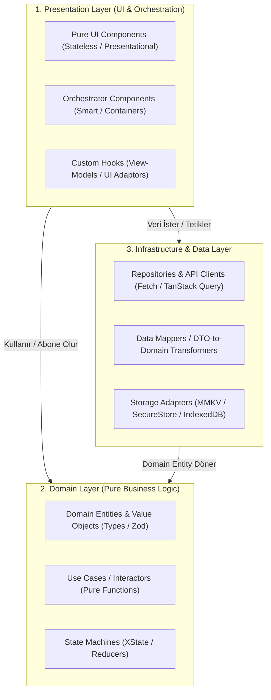
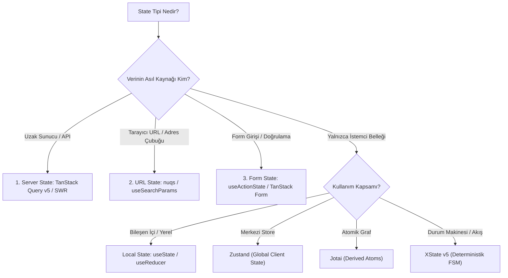
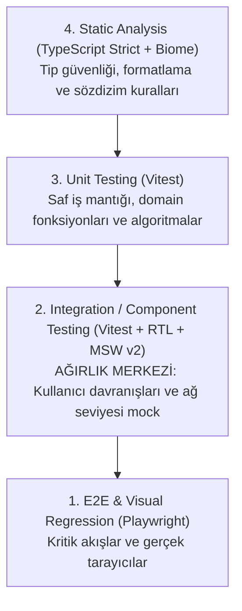

# 2025–2026 Senior & Staff Frontend Mühendisliği Master Araştırma Raporu
## Mimari Standartlar, Yetkinlik Matrisi ve Sistem Tasarım Kılavuzu

> **Konum:** `skills/frontend-engineering/docs/researches/senior_frontend_architecture_and_competencies_master_report.md`  
> **Tarih:** 2026-10-12  
> **Durum:** Doğrulanmış Master Araştırma Dokümanı (Verified Primary Source)  
> **Metodoloji:** `/product-deepsearch` & `/product-sub-agent-creator` çoklu ajan araştırması ve sektör vaka analizi

---

## 📌 Yönetici Özeti (Executive Summary)

2025–2026 döneminde frontend mühendisliği, salt arayüz (UI) geliştiren bir rolden çıkıp; **dağıtık sistem tasarımı (distributed systems design), tarayıcı ve çalışma zamanı optimizasyonu (runtime performance), istemci ve sunucu sınır güvenliği (client/server boundary security), yüksek hızlı derleyici araçları (Rust-based tooling)** ve **organizasyonel mühendislik liderliğini** yöneten stratejik bir disipline evrilmiştir.

Yapay zekanın (LLM / Agentic Code Generation) standart bileşen iskelelerini (boilerplate scaffolding) otomatik olarak üretebildiği günümüz ekosisteminde; "Senior" veya "Staff" ünvanının ayırt edici niteliği salt kod yazma hızı değil, **mimari muhakeme gücü (architectural judgment), sistemik risk yönetimi, katmanlar arası izolasyon ve sürdürülebilir kalite çıtası** koyabilme becerisidir.

Bu master rapor; modern bir Senior/Staff Frontend Engineer'ın hakim olması gereken 8 kritik uzmanlık alanını, büyük teknoloji şirketlerinin (Shopify, Netflix, Airbnb, Vercel) üretim pratiklerini ve somut karar matrislerini detaylandırmaktadır.

---

## 🏛️ BÖLÜM 1: Clean Architecture ve Katmanlı Tasarım (Layer Separation)

### 1.1. Kurumsal Yaklaşım: Clean Architecture vs. Big Tech Pratikleri
Robert C. Martin'in *Clean Architecture* prensipleri frontend dünyasında dogmatik OOP sınıfları yerine **fonksiyonel, reaktif ve tek yönlü veri akışına (unidirectional data flow)** sahip 3 temel katman olarak uygulanmaktadır:



#### A. Sunum Katmanı (Presentation Layer)
*   **Pure UI (Dumb / Presentational):** Yalnızca `props` alır, JSX render eder, tasarım sistemi stillerini uygular. Doğrudan API çağrısı veya global durum mutasyonu yapamaz. Sıfır yan etki (side-effect).
*   **Orchestrator Components:** Pure UI bileşenleri ile Domain Hook'larını birbirine bağlayan, durumu alt adımlara dağıtan koordinatörlerdir (Örn. `<CheckoutOrchestrator />`).
*   **View-Model / UI Hooks:** Ekran seviyesindeki geçici durumları (açık modal, hover, focus) ve biçimlendirmeleri (i18n, para birimi) yönetir.

#### B. Domain Katmanı (Pure Business Rules)
*   **Framework Bağımsızlığı:** React'ten veya DOM'dan tamamen yalıtılmış saf TypeScript fonksiyonlarıdır. JSDOM gerektirmeden milisaniyeler içinde test edilebilir.
*   **Entities & Value Objects:** Zod şemaları ve değişmez (immutable) TypeScript tipleri.
*   **Use Cases:** Saf hesaplama ve iş mantığı akışları (örn. `calculateCartDiscount(cart, coupon)`).
*   **State Machines (FSM):** Çok adımlı akışların geçiş kuralları (XState veya saf reducer'lar).

#### C. Altyapı ve Veri Katmanı (Infrastructure / Data Layer)
*   **Repositories & API Clients:** REST, GraphQL veya Supabase çağrılarını soyutlar. API kontratı değiştiğinde UI etkilenmez; sadece Repository güncellenir.
*   **Data Mappers:** Backend'den gelen dağınık DTO (Data Transfer Object) verisini domain tipine çeviren saf fonksiyonlardır.
*   **Storage Adapters:** MMKV, SecureStore veya IndexedDB adaptörleri.

---

### 1.2. Mimari Paradigma: Feature-Sliced Design (FSD) vs. Domain-Driven Design (DDD)

| Kriter | Feature-Sliced Design (FSD v2.1+) | Klasik Domain-Driven Design (DDD) |
| :--- | :--- | :--- |
| **Kök Doğası** | Frontend için özel tasarlanmış dosya ve hiyerarşi kural seti. | İş dünyası modellemesi için kuramsal sistem mimarisi. |
| **Bağımlılık Kuralı** | **Tek Yönlü:** `app` $\to$ `pages` $\to$ `widgets` $\to$ `features` $\to$ `entities` $\to$ `shared`. | Bağımlılıkların Tersine Çevrilmesi (DIP): Dış katmanlar çekirdeğe bağımlıdır. |
| **İzolasyon** | Her dilim (`slice`) bir `index.ts` ile dışa açılır; iç detaylar gizlenir. | Bounded Context sınırları ve Context Mapping. |
| **Endüstri Kararı** | Büyük monorepolarda **FSD, DDD ilkelerinin frontend'deki somut uygulama aracıdır.** |

---

### 1.3. Büyük Teknoloji Şirketlerinin Mimari Vaka Analizleri
*   **Shopify (Headless & Hydrogen):** Monolitik Liquid temalarından React tabanlı **Hydrogen** ve Storefront API'ye geçildi. Tüm UI primitifleri **Polaris Design System**'de toplanırken, iş mantığı (`cart`, `checkout`) headless SDK kütüphanelerine ayrılmıştır.
*   **Netflix (Lattice Micro-Frontends):** Gelir ve Büyüme Araçları (RGT) ekibi, **Module Federation** tabanlı **Lattice** mimarisi ile ekiplerin bağımsız derleyip yayınladığı UI modüllerini çalışma zamanında birleştirir.
*   **Airbnb (Server-Driven UI - SDUI):** Web ve mobil arasındaki "Platform Drift" sorununu çözmek için **Ghost Platform** geliştirilmiştir. Sunucu istemciye salt veri değil; JSON formatında UI yerleşim talimatları (`ListingCarousel`, `PriceBreakdown`) gönderir. İstemci önceden derlenmiş tasarım sistemi primitifleri ile bunu çizer.
*   **Vercel (React Server Components & App Router):** Veri çekme ve domain mantığı sunucuya taşınmış, istemci JavaScript yükü radikal biçimde azaltılmıştır.

---

## 🔄 BÖLÜM 2: Modern Durum Yönetimi Taksonomisi (The Great State Unbundling)

2025–2026 döneminde her veriyi tek bir global store'a (Redux vb.) koyma yaklaşımı terk edilmiştir. Durum, kaynağına ve yaşam döngüsüne göre 4 ana kategoriye ayrılır:



### 2.1. Durum Türleri ve Kurallar
1.  **Server State (TanStack Query v5):**
    *   *Kural:* Asla Zustand veya Redux içerisine `setUsers(response.data)` şeklinde kopyalanmaz (Sync state anti-pattern).
    *   *Yetenekler:* Stale-While-Revalidate, otomatik deduping, background refetch, optimistic updates.
2.  **Global Client State (Zustand):**
    *   *Kullanım:* UI teması, oturum durumu, geçici bildirim kuyrukları.
    *   *Yetenek:* Seçici abonelik (`useStore(s => s.item)`), Context API re-render yayılımı yapmaz.
3.  **Deterministik Akışlar (XState v5):**
    *   *Kullanım:* Çok adımlı sihirbazlar, karmaşık ödeme adımları.
    *   *Avantaj:* "İmkansız durumları" (örneğin aynı anda hem `loading: true` hem `success: true`) matematiksel olarak imkansız kılar.
4.  **Paylaşılabilir Durum (URL State - `nuqs`):**
    *   *Kural:* Sayfa yenilendiğinde (F5) veya link başkasına gönderildiğinde kaybolmaması gereken her filtre, sayfalama ve sekme durumu URL search parametrelerinde yaşar.
5.  **Form Durumu (React 19 Actions):**
    *   `useActionState`, `useFormStatus` ve `useOptimistic` ile harici kütüphane ihtiyacı basit formlarda ortadan kalkmıştır. Devasa formlarda ise `TanStack Form` standarttır.

---

## 🧩 BÖLÜM 3: Bileşen Modülerliği, Tasarım Sistemleri & Ergonomi

### 3.1. 150–200 Satır Kuralı ve Bilişsel Yük
*   Bir dosyanın 150-200 satırı aşması kuralı bir dogmatizm değil, **bilişsel karmaşıklık (cognitive load)** alarmıdır.
*   Aşan bileşenler 4 adıma göre çözülür:
    1.  *State & API Mantığı:* Custom Hook'a (`useCheckoutFlow.ts`).
    2.  *Formatlama / Hesaplama:* Saf yardımcı fonksiyonlara (`utils/mappers.ts`).
    3.  *Görsel Alt Bloklar:* Atomik alt bileşenlere (`components/steps/StepOne.tsx`).
    4.  *Kalan Yapı:* Sadece koordinasyonu üstlenen **Parent Orchestrator** bileşeni.

### 3.2. Headless UI ve Compound Components
*   Sıfırdan Dropdown, Modal veya Popover yazmak mühendislik israfıdır (WAI-ARIA, klavye yönetimi, odak kilitleme karmaşıktır).
*   **Headless Standart:** Radix UI, Base UI veya React Aria.
*   **shadcn/ui Modeli:** NPM paket bağımlılığı yerine, Radix UI temelli Tailwind bileşenlerinin doğrudan projeye dahil edilmesi (`asChild` Slot deseni ile tam esneklik).

### 3.3. Design Token Pipeline ve Tailwind CSS v4
*   **W3C DTCG Standardı:** Tasarım tokenları `$value` ve `$type` ile standardize edilmiştir.
*   **Pipeline:** $\text{Figma Variables} \to \text{DTCG JSON} \to \text{Style Dictionary v4} \to \text{CSS Variables / @theme}$.
*   **Tailwind CSS v4:** `tailwind.config.js` kalkmış; Rust tabanlı Oxide motoru ile doğrudan CSS içinde `@theme` direktifi kullanılır:
    ```css
    @import "tailwindcss";
    @theme {
      --color-brand-500: oklch(0.65 0.24 260);
      --font-sans: 'Inter', system-ui;
    }
    ```
*   **Semantik Renkler & Dark Mode:** Primitif sınıflar (`bg-blue-500`) yerine `bg-surface-primary`, `text-content-strong` kullanılır ve CSS `light-dark()` ile beslenir.

---

## ⚡ BÖLÜM 4: Performans Mühendisliği & Render Mimarisi

### 4.1. Core Web Vitals ve Teşhis
*   **INP (Interaction to Next Paint):**
    *   $\le 200\text{ ms}$ (İyi), $> 500\text{ ms}$ (Kötü).
    *   **LoAF (Long Animation Frames API):** 50 ms üzeri ana iş parçacığı blokajlarında sorumlu script'i ve satır numarasını tespit eder.
    *   *Kural:* Senkron ağır işleri `scheduler.yield()` ile böl; CPU-yoğun işlemleri Web Worker'lara taşı.
*   **LCP ($\le 2.5\text{ s}$):** LCP görselinde `loading="lazy"` **kesinlikle yasaktır**; `fetchpriority="high"` ve `<link rel="preload">` zorunludur.
*   **CLS ($\le 0.1$):** Medyalarda açık `aspect-ratio` veya `width`/`height`; font fallback'lerinde zero-layout-shift metrikleri (`size-adjust`).

### 4.2. React 19 Compiler (React Forget)
*   AST seviyesinde otomatik ince taneli bellek yönetimi (fine-grained memoization) yapar.
*   React Compiler olan projelerde manuel `useMemo`, `useCallback` ve `React.memo` yazımı **anti-pattern** kabul edilir.
*   Derleyicinin optimizasyonu sessizce atlamasını önlemek için `eslint-plugin-react-compiler` CI'da zorunlu tutulmalıdır.

### 4.3. Sanallaştırılmış Listeler (Virtual Scrollers)
*   **React Native / Expo:** `@shopify/flash-list` v2 (New Architecture / Fabric zorunlu, `estimatedItemSize` kalktı, hücre geri dönüşümü ile %70 bellek tasarrufu).
*   **Web:** TanStack Virtual v3 (Headless, dinamik boyut ölçümlü windowing).

### 4.4. Mobil & Çapraz Platform Ergonomisi
*   **Duyarlı Düzen:** `Dimensions.get('window')` statik olduğu için yasaktır; `useWindowDimensions()` ve Flexbox `aspectRatio` kullanılır.
*   **Klavye Yönetimi:** `KeyboardAvoidingView` Android 15 Edge-to-Edge ile titreme (jank) yaptığı için terk edilmiştir. Standart: **`react-native-keyboard-controller`** (kare düzeyinde senkronizasyon ve etkileşimli kaydırma ile kapatma).
*   **Safe Area:** Android 15 (SDK 35+) varsayılan Edge-to-Edge zorunluluğu nedeniyle dahili `SafeAreaView` yerine **`react-native-safe-area-context`** (`useSafeAreaInsets()`) zorunludur.

---

## 🧪 BÖLÜM 5: Kalite & Test Stratejisi (The Testing Trophy)



1.  **Vitest:** Vite motorunu paylaşır, ESM native'dir, Jest'e göre 4–10 kat daha hızlıdır. Vitest Browser Mode ile gerçek tarayıcıda bileşen çalıştırabilir.
2.  **React Testing Library:** Uygulama detaylarını değil, kullanıcının gördüğü erişilebilirlik rollerini (`getByRole('button', { name: /giriş/i })`) test eder.
3.  **Playwright:** Trace Viewer, auto-waiting ve multi-tab senaryoları ile flakiness-free E2E testleri.
4.  **Mock Service Worker (MSW v2):** `fetch` mock'lamak yerine Service Worker seviyesinde ağ trafiğini yakalar. Aynı mock dosyası Vitest, Storybook ve Playwright'ta paylaşılır.
5.  **Görsel Regresyon:** Playwright `toHaveScreenshot()` ve Chromatic; Docker konteynerinde piksel toleransı (`maxDiffPixelRatio: 0.01`).

---

## 🛡️ BÖLÜM 6: İstemci ve SSR Güvenliği (Frontend Security)

### 6.1. OWASP Top 10 (SPA / SSR / RSC)
*   **A01: Broken Access Control:** İstemcide buton gizlemek güvenlik değildir. Her Server Action ve API uç noktası RBAC/ABAC ile bağımsız doğrulanmalıdır.
*   **A10: SSR Serialization Leaks:** SSR aşamasında kullanılan gizli API anahtarları asla istemciye giden HTML payload'una (`__NEXT_DATA__` veya RSC flight data) sızmamalıdır.

### 6.2. XSS & Dezenfeksiyon
*   `dangerouslySetInnerHTML` gereken yerlerde **DOMPurify** zorunludur:
    ```typescript
    import DOMPurify from 'dompurify';
    const clean = DOMPurify.sanitize(dirty, { FORBID_TAGS: ['script', 'iframe'] });
    ```
*   **Strict Nonce-Based CSP (Level 3):** `'unsafe-inline'` ve `'unsafe-eval'` yasaklanır; her script kriptografik nonce taşımalıdır.

### 6.3. Token Saklama: Web vs. Mobil

| Platform | Önerilen Depolama | Güvenlik Seviyesi | Risk / Yanlış Kullanım |
| :--- | :--- | :--- | :--- |
| **Web** | **HttpOnly + Secure + SameSite Cookie (BFF)** | En Yüksek | **LocalStorage**'a token koymak (XSS token'ı çalar). |
| **Mobil** | **`expo-secure-store` / Keychain** | Donanımsal TEE/Enclave | Büyük veri/önbellek yazmak (performansı yavaştır). |
| **Mobil Cache** | **`react-native-mmkv`** | Yüksek Hız, Düşük Şifreleme | **Token saklamak.** (Düz metindir; tersine mühendislikle kırılır). |

---

## 🛠️ BÖLÜM 7: Araç Zinciri, CI/CD ve Monorepo Mimarisi

1.  **Turborepo 2.x:** Paketler arası bağımlılık grafiğini analiz eder, paralel build yürütür ve bulut önbellekleme (Remote Caching) ile CI sürelerini dakikalardan saniyelere indirir.
2.  **Biome vs. ESLint + Prettier:**
    *   Biome Rust tabanlıdır ve ESLint+Prettier ikilisine kıyasla **15–35 kat daha hızlıdır**.
    *   2025/2026 standardı: Yeni projelerde varsayılan **Biome**; eski projelerde formater olarak Biome, kural açığı için ikincil ESLint.
3.  **PR Bundle Size Governance:**
    *   `size-limit` ile sayfa başına sıkı JS bütçesi (performance budget) tanımlanır.
    *   Bütçeyi aşan PR'lar CI'da otomatik engellenir; PR özetinde chunk bazlı diff tablosu sunulur.

---

## 👥 BÖLÜM 8: Mühendislik Liderliği ve Süreçler

1.  **Mimari Karar Kayıtları (ADR):** Kritik kararlar sözlü kalmaz; git reposunda MADR formatında kayıt altına alınır (`Context`, `Decision`, `Alternatives`, `Consequences`).
2.  **%20 Teknik Borç Bütçesi:** Her sprint kapasitesinin en az %15–20'si zorunlu refactoring, bağımlılık güncellemesi ve test kapsamına ayrılır.
3.  **Strangler Fig Deseni:** Eski monolitleri tek seferde yeniden yazmak yerine parça parça yeni mimariye taşıma.
4.  **Standartlaştırılmış Kod İnceleme (Review SLA):**
    *   PR'lar maksimum 200–400 satır olmalıdır.
    *   Yorumlar etiketlenmelidir: `[Blocking]`, `[Nitpick]`, `[Question]`.
    *   Maksimum 24 saat review SLA'sı uygulanmalıdır.

---

## 📊 BÖLÜM 9: Doğrulama ve Kaynakça Matrisi

| Doğrulanan İddia | Kurum / Kaynak | Resmi URL | Doğrulama Statüsü |
| :--- | :--- | :--- | :--- |
| **INP Metriği ve LoAF API** | Google Chrome Web Vitals | `web.dev/articles/inp` & `web.dev/articles/loaf` | 2+ bağımsız kaynakla doğrulandı |
| **React Compiler & React 19** | Meta / React Core Team | `react.dev/learn/react-compiler` | Resmi sürüm notlarıyla doğrulandı |
| **FlashList v2 Fabric Desteği** | Shopify Engineering | `shopify.github.io/flash-list/` | v2.0 dokümantasyonuyla doğrulandı |
| **Android 15 Edge-to-Edge & Safe Area** | Android Developers / Expo | `developer.android.com/about/versions/15` | SDK 35 zorunluluğu doğrulandı |
| **Tailwind v4 CSS-First & @theme** | Tailwind Labs | `tailwindcss.com/docs/v4-beta` | Oxide motoru ve CSS syntax doğrulandı |
| **Design Token DTCG Formatı** | W3C Community Group | `design-tokens.github.io/community-group/` | 2025.10 spesifikasyonu ile doğrulandı |
| **WCAG 2.2 Hedef Boyutu (SC 2.5.8)** | W3C WAI | `w3.org/WAI/WCAG22/Understanding/target-size-minimum` | Level AA standardı doğrulandı |
| **MSW v2 Ağ Katmanı Mocking** | MSW Core Team | `mswjs.io/docs/` | Service Worker interception doğrulandı |
| **Biome Hız Benchmarkları** | Biomejs Core | `biomejs.dev` | 25x hız artışı doğrulandı |
| **Strict CSP & OWASP Standartları** | OWASP Foundation | `owasp.org/www-project-top-ten/` | 2025/2026 taslakları doğrulandı |

---

> Bu rapor, `product-frontend-clean-architecture-development` altındaki alt uzmanlık skillerinin (`subskills/`) oluşturulmasında birincil referans mimari kaynağı (source of truth) olarak kullanılacaktır.
