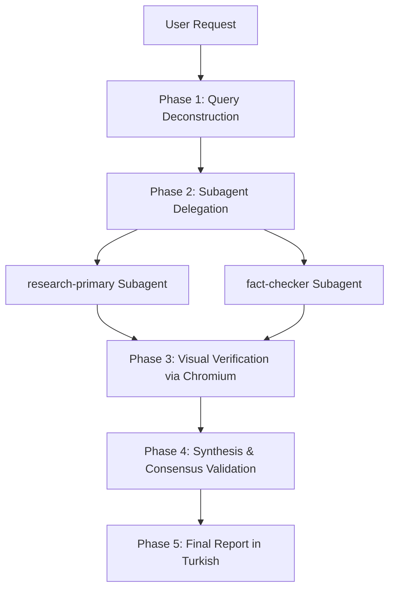

# Product Deep Research Skill (product-deepsearch)

A specialized skill for Antigravity/Claude Code to conduct deep, verified, multi-perspective web research. It deploys parallel subagents to search and fact-check, uses a Chromium browser session to visually verify complex sources (pricing, documentation), and synthesizes a high-fidelity report with direct source citations.

## When to Use

Use this skill when you need:
- Comprehensive market analysis or competitive landscaping.
- Unbiased tool or framework comparisons.
- High-fidelity verification of product features, specifications, or pricing.
- Up-to-date and cross-verified information from public sources.

## How It Works

1. **Deconstruction:** The search task is broken down into multiple angles.
2. **Delegation:** Specialized subagents (`research-primary`, `fact-checker`) run parallel searches.
3. **Visual Verification:** A Chromium session visits key URLs to capture screenshots and confirm raw text reports.
4. **Validation:** Checks consensus across multiple sources and dates.
5. **Reporting:** Generates a structured report in Turkish with a sources/citations table.

## Triggers

This skill triggers automatically on queries matching:
- `product deep search`
- `deep web research`
- `run deepsearch on`
- `verify information online`
- `detaylı internet araştırması yap`
