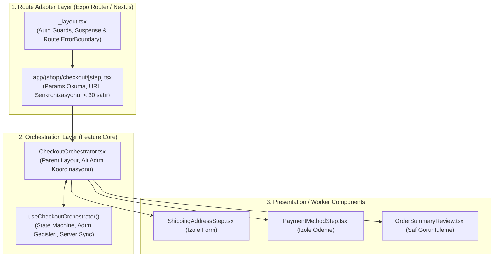

# Modern Frontend Presentation Layer Mimarisi (2025–2026 Standartları)
## Kapsamlı Teknik Araştırma ve Mimari Kılavuz

> **Konum:** `skills/frontend-engineering/product-frontend-clean-architecture-development/subskills/frontend-layer-presentation/researches/presentation_layer_architecture_deep_research.md`  
> **Tarih:** 2026-10-12  
> **Durum:** Doğrulanmış Birincil Araştırma Kaynağı (Verified Primary Research)  
> **Metodoloji:** `/product-deepsearch` & `/product-sub-agent-creator` çoklu ajan araştırması

---

## 📌 Yönetici Özeti (Executive Summary)

Modern frontend ve mobil mimarilerinde (React 19+, React Native New Architecture / Fabric, Expo Router v4+, Next.js App Router 15+), UI sunum katmanı basit bir "veri göster ve tıklama dinle" yapısının çok ötesine geçmiştir. Vercel, Shopify, Airbnb ve Stripe gibi endüstri liderlerinin geliştirdiği güncel pratikler; tekil devasa bileşenlerin ("monolithic components") oluşturduğu bakım krizlerini, aşırı parçalanmanın doğurduğu **Shotgun Surgery** (dağınık cerrahi) anti-pattern'ini, dosya sistemi tabanlı yönlendiricilerin getirdiği sınır karmaşasını ve erişilebilirlik (A11y) buzdağını çözmeyi hedefler.

Bu rapor; sunum katmanı mühendisliğini somut metrikler, üretim düzeyinde kod kalıpları, WAI-ARIA mekanizmaları ve tasarım jetonu entegrasyonu ile detaylandırmaktadır.

---

## 🏛️ BÖLÜM 1: Orchestrator vs. Child Deseni (Üretim Mimarisi)



### 1.1. Container/Presenter'dan Hook-Presenter & Parent Orchestrator'a Evrim
1. **Klasik Container/Presenter Sınırı:**
   - Container, UI bileşenine 20–30 prop geçerdi (prop-drilling). Alt bileşenler soyutlandıkça arayüz şişerdi.
2. **Hook-Presenter Tuzağı ("God Hook" Sorunu):**
   - Tüm ekran mantığını tek bir `useCheckout()` içine koymak, hook'un içinde onlarca `useState` ve `useEffect` yaratmasına yol açar.
   - Herhangi bir minör state değiştiğinde, onu tüketen tüm bileşenler baştan render olur (Re-render cascade).
3. **2025–2026 Modern Parent Orchestrator Deseni:**
   - **Orchestrator:** Ekranın genel akışını, adım geçişlerini, analitik tetikleyicilerini ve hata sınırlarını yönetir. Kendi içinde ham UI stilleri barındırmaz; yalnızca iskeleti ve alt bileşenlerin orkestrasyonunu üstlenir.
   - **Hook-Presenter:** Her bir alt adım, yalnızca kendi alanına ait doğrulama ve biçimlendirmeyi içeren izole bir hook kullanır.
   - **State Machine:** Akış durumu (Flow State), adımlar arası geçiş kurallarını garantiye alan deterministik bir durum makinesi tarafından yönetilir.

---

### 1.2. Type-Safe Çok Adımlı Akış Orkestratörü (Üretim Deseni)

```tsx
// types.ts
export type CheckoutStep = 'shipping' | 'payment' | 'review';

export type CheckoutFlowState =
  | { step: 'shipping'; data: Partial<ShippingAddress> }
  | { step: 'payment'; shipping: ShippingAddress; data: Partial<PaymentDetails> }
  | { step: 'review'; shipping: ShippingAddress; payment: PaymentDetails };
```

```tsx
// CheckoutOrchestrator.tsx
export const CheckoutOrchestrator: React.FC = () => {
  const { state, isSubmitting, handleShippingSubmit, handlePaymentSubmit, handleFinalOrder } =
    useCheckoutOrchestrator();

  return (
    <View style={styles.container}>
      <CheckoutProgressBar currentStep={state.step} />
      <View style={styles.content}>
        {state.step === 'shipping' && (
          <ShippingStepView initialValues={state.data} onSubmit={handleShippingSubmit} />
        )}
        {state.step === 'payment' && (
          <PaymentStepView shippingAddress={state.shipping} onSubmit={handlePaymentSubmit} />
        )}
        {state.step === 'review' && (
          <ReviewStepView
            shipping={state.shipping}
            payment={state.payment}
            loading={isSubmitting}
            onConfirm={handleFinalOrder}
          />
        )}
      </View>
    </View>
  );
};
```

---

## 📏 BÖLÜM 2: 150-200 Satır Kuralı ve Bilişsel Karmaşıklık (Cognitive Complexity)

### 2.1. Statik Analiz Eşikleri ve Metrikler

| Metrik | Eşik Değeri | Araç / Kural | Açıklama |
| :--- | :--- | :--- | :--- |
| **Cyclomatic Complexity** | $> 10$ (Uyarı), $> 12$ (Hata) | `eslint: complexity` | Bağımsız kod yürütme yollarının sayısı. |
| **Cognitive Complexity** | $> 15$ (Hata) | `sonarjs/cognitive-complexity` | Zihinsel anlama yükü; iç içe ternary ve if yapılarını cezalandırır. |
| **Nesting Depth** | $> 3$ (Mantık), $> 4$ (JSX) | `max-depth` / `react/jsx-max-depth` | Blok yuvalama derinliği. |
| **File Line Count** | $> 200$ satır | `eslint: max-lines` | Toplam dosya boyutu. |

### 2.2. "Shotgun Surgery" (Dağınık Cerrahi) Tuzağı
Sırf satır sayısını 100'ün altında tutmak için bir formu anlamsızca 6 farklı küçük dosyaya bölmek (`HeaderTitle.tsx`, `HeaderSubtitle.tsx`, `FieldWrapper.tsx`...) bir anti-pattern'dir. Tasarımda bir input değiştiğinde 6 dosya açılmak zorunda kalınır.

**Altın Kural (Cohesion over Line Count):** Birlikte değişen şeyler birlikte kalmalıdır. JSX'i bölmeden önce her zaman yan etkileri, hesaplamaları ve veri formatlamasını bir **Custom Hook** veya **Utility Mapper**'a taşıyın.

---

## 🧭 BÖLÜM 3: Route Adapter vs. Feature Core Sınırları

```
+-----------------------------------------------------------------------------------------+
| KATMAN             | DOSYA KONUMU             | SORUMLULUK                              |
+-----------------------------------------------------------------------------------------+
| 1. Route Adapter   | app/(shop)/checkout.tsx  | • URL parametrelerini okumak (< 30 st).  |
|                    | app/product/[id].tsx     | • Feature bileşenine prop aktarmak.     |
|                    |                          | • Hiçbir JSX stil/UI barındırmaz.        |
+-----------------------------------------------------------------------------------------+
| 2. Route Layout    | app/(shop)/_layout.tsx   | • Navigatör tanımları (Stack/Tabs).      |
|    & Boundaries    | app/(shop)/error.tsx     | • Route-level Yetkilendirme (Auth Guard).|
|                    | app/(shop)/loading.tsx   | • Suspense & Error Boundaries.          |
+-----------------------------------------------------------------------------------------+
| 3. Feature Core    | src/features/checkout/   | • Router bağımsız UI ve orkestrasyon.   |
|    (Orchestrator & |   ├── CheckoutOrch.tsx   | • Web, mobil, Storybook veya testlerde  |
|     Step Views)    |   └── useCheckout.ts     |   doğrudan taşınabilir/çalıştırılabilir.|
+-----------------------------------------------------------------------------------------+
```

### Route Düzeyinde Auth Guard (FOUC Önleme):
```tsx
// app/(app)/_layout.tsx
export default function AppLayout() {
  const { session, isLoading } = useAuthSession();

  // 1. Oturum kontrolü sürerken alt ağaç asla çizilmez (FOUC önleme)
  if (isLoading) return <FullScreenLoadingSplash />;

  // 2. Yetkisiz kullanıcı deklaratif olarak yönlendirilir
  if (!session) return <Redirect href="/(auth)/login" />;

  // 3. Yetkili kullanıcı: Yalnızca navigatör kabuğunu çiz
  return <Stack screenOptions={{ headerShown: true }} />;
}
```

---

## 🧩 BÖLÜM 4: Headless UI Primitifleri ve WAI-ARIA Mimarisi

### 4.1. "Erişilebilirlik Buzdağı" (The Accessibility Iceberg)
Özel modal yazmanın gizli maliyetleri:
* **Focus Trap:** Modal açıldığında odağın ilk öğeye taşınması, `Tab`/`Shift+Tab` döngüsü ve kapanışta tetiğe geri verilmesi.
* **HTML `inert` Desteği:** Modal arkasındaki ana DOM ağacının ekran okuyuculara tamamen kapatılması.
* **Scroll Lock Layout Shift:** `overflow: hidden` yapılırken kaydırma çubuğu genişliğinin kompanse edilmesi.
* **Roving Tabindex:** Menü ve sekmelerde yalnızca aktif öğenin `tabIndex={0}`, diğerlerinin `tabIndex={-1}` olması ve ok tuşlarıyla (Arrow keys, Home, End) dolaşılması.

### 4.2. Compound Components ve Slot / `asChild` Deseni
`asChild` deseni (Radix UI), fazladan sarmalayıcı DOM düğümü eklemeden prop'ları birleştirir:
* **Ref Birleştirme (`composeRefs`):** Ebeveyn ve çocuğun ref'lerini çakışmadan bağlar.
* **Olay Birleştirme (`composeEventHandlers`):** Çocuk `e.preventDefault()` derse ebeveyn eylemi iptal edilir.

---

## 🎨 BÖLÜM 5: Tasarım Jetonları ve Yerelleştirme Korkulukları

### 5.1. Tailwind CSS v4 (@theme, CSS-First) ve Ham Renklerin Sıfırlanması
Kurumsal projelerde `bg-blue-600` gibi ham sınıfların kullanımını engellemek için `@theme` içinde renk paleti sıfırlanır:

```css
@import "tailwindcss";

@theme {
  --color-*: initial; /* Tüm varsayılan ham paleti kapat */

  /* Yalnızca semantik jetonları üret */
  --color-surface-base: var(--surface-base);
  --color-surface-elevated: var(--surface-elevated);
  --color-content-primary: var(--content-primary);
  --color-action-brand: var(--action-brand);
}
```

### 5.2. Sıfır Hardcoded Metin ve Tip-Güvenli i18n
TypeScript Module Augmentation ile var olmayan çeviri anahtarları derleme zamanında engellenir:

```typescript
declare module 'i18next' {
  interface CustomTypeOptions {
    defaultNS: 'translation';
    resources: { translation: typeof en };
  }
}
```

---

## 📊 BÖLÜM 6: Karar ve Doğrulama Matrisi

| Alan | Kesin Kural (Rule) | İhlal Durumu (Violation) |
| :--- | :--- | :--- |
| **Bileşen Rolü** | Orchestrator akışı yönetir, Child adımları çizer. | Alt bileşenin doğrudan `useRouter()` veya global navigasyonu tetiklemesi. |
| **Dosya Boyutu** | Max 200 satır, Cognitive Complexity $\le 15$. | 400 satırlık monolitik form; iç içe 4 seviyeli ternary zincirleri. |
| **Yönlendirme** | `app/` dosyaları $< 30$ satır ince adaptör olmalıdır. | Sayfa dosyasında hem API çağırmak hem de 300 satır UI render etmek. |
| **Headless Temel** | Modal/Dropdown Radix UI veya Base UI temelli olmalıdır. | `<div>` ve `useState(false)` ile özel erişilemeyen modal yazmak. |
| **Stil Jetonları** | Yalnızca `bg-surface-*`, `text-content-*` semantik sınıfları. | `bg-[#f4f4f4]` veya `bg-blue-500` gibi ham değerlerin yazılması. |
| **Yerelleştirme** | Tüm metinler `t('module.key')` üzerinden çağrılmalı. | JSX içine `<button>Kaydet</button>` şeklinde sabit metin yazılması. |
