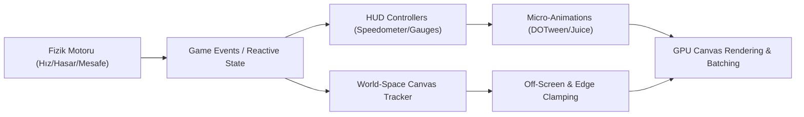
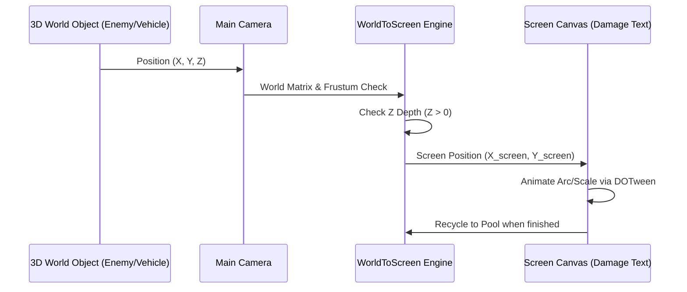
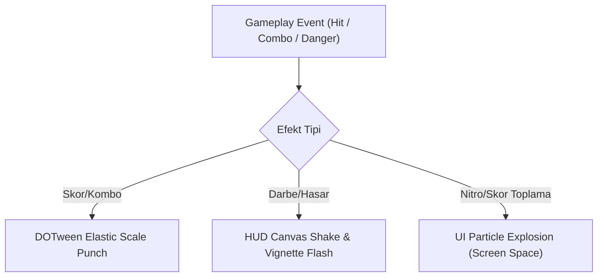

# Dinamik Gameplay HUD ve World-Space UI Mimarisi: AAA ve Mobil Oyun Arayüz Tasarımı

> **Sürüm:** 1.0.0  
> **Hedef Platform:** Unity (URP / Built-in), Mobil (iOS/Android) ve Konsol/PC  
> **Odak Alanları:** Dynamic HUD, Speedometer & Gauges, 3D World-Space UI, Off-Screen Tracking, Micro-Animations, Object Pooling, Performance Optimization

---

## 📋 İçindekiler
1. [Giriş ve Mimari Prensipler](#1-giriş-ve-mimari-prensipler)
2. [Speedometer & Gauge Widgets (Hız ve Ölçer Bileşenleri)](#2-speedometer--gauge-widgets)
   - 2.1 Radial Tachometer (Devir ve Açısal Hız Göstergesi)
   - 2.2 Digital Speedometer (Dijital Hız Sayacı & Yumuşak Yumuşatma)
   - 2.3 Boost / Nitrous Fill Meters (Nitro ve Enerji Çubukları)
3. [3D World-Space Floating UI (Dünya Uzayında Yüzen Arayüz)](#3-3d-world-space-floating-ui)
   - 3.1 3D Transform Pozisyonunu Ekran Ufku ile Eşleme
   - 3.2 Floating Damage Numbers & Score Popups
   - 3.3 Production-Grade `DamageNumberPool.cs`
4. [Directional Hit Indicators & Objective Pins (Yönlü Darbe ve Hedef İğneleri)](#4-directional-hit-indicators--objective-pins)
   - 4.1 Off-Screen Indicator Arrows (Ekran Dışı Hedef Göstergeleri)
   - 4.2 Araç Üstü Sağlık & Stat Barları (Perspective Scaling & Occlusion)
   - 4.3 Production-Grade `WorldToScreenTracker.cs`
5. [Micro-Animations & FX (Mikro-Animasyonlar ve Efekt Sistemleri)](#5-micro-animations--fx)
   - 5.1 DOTween HUD Animasyonları & Juice Matematiksel Formülleri
   - 5.2 UI Particle Systems & Material Shaders
   - 5.3 Low-Health Screen Vignette & Camera Shake
6. [Performans Optimizasyonu & Batching Stratejileri](#6-performans-optimizasyonu--batching-stratejileri)
7. [Özet ve AAA Kalite Kontrol Listesi](#7-özet-ve-aaa-kalite-kontrol-listesi)

---

## 1. Giriş ve Mimari Prensipler

Yüksek tempolu 3D ve mobil oyunlarda (örneğin yarış, arcade escape veya aksiyon oyunları), kullanıcı arayüzü (UI/HUD) sadece bilgi sunan statik bir katman değildir; oyundaki gerilim, hız ve geribildirim (feedback) döngüsünün temel taşıdır.



### Temel UI/UX Katmanlaşması:
1. **Screen-Space Overlay HUD:** Hız göstergeleri, dijital sayaçlar, ekran kenarı efektleri (Vignette), mini-harita.
2. **Screen-Space Camera / Floating UI:** 3D uzaydaki objeleri takip eden dinamik ikonlar, off-screen ok göstergeleri, hasar sayıları.
3. **World-Space Canvas:** Araçların veya objelerin üzerinde 3D dünya koordinatlarına gömülü duran sağlık barları, isim etiketleri.

---

## 2. Speedometer & Gauge Widgets

Yarış ve sürüş mekaniklerinde kullanıcıya hız duygusunu aktaran en önemli bileşen **Tachometer (İbreli Hız/Devir Göstergesi)** ve **Digital Speedometer** bileşenleridir.

```
       [ Radial Tachometer ]                  [ Digital Counter ]
          . - ~ - .                              +---------------+
      . '     |     ' .                          |   1 8 4  KM/H |
    /         |         \                        +---------------+
   |   \      |      /   |                     [ Boost/Nitro Bar ]
   |    \     |     /    |                     [||||||||||||....]  85%
    \     \   |   /     /
      ` .   \ | /   . '
          ` - ~ - `
```

### 2.1 Radial Tachometer (Devir ve Açısal Hız Göstergesi)

İbreli göstergelerde uGUI `Image.type = Image.Type.Filled` (Radial 360/180) veya 3D Transform Rotasyonu ($Z$ ekseninde döndürme) kullanılır.

#### Açısal Eşleme Matematiği:
Hız veya RPM değerini $[v_{min}, v_{max}]$ aralığından $[\theta_{min}, \theta_{max}]$ açı aralığına doğrusal veya non-lineer olarak eşleriz:

$$\theta(v) = \theta_{min} + \left( \frac{v - v_{min}}{v_{max} - v_{min}} \right)^p \cdot (\theta_{max} - \theta_{min})$$

*   $p = 1.0$: Doğrusal eşleme.
*   $p > 1.0$: Düşük hızlarda yumuşak, yüksek hızlarda agresif yükselen non-lineer ibre tepkisi.

#### C# Kod Örneği: `RadialSpeedometer.cs`

```csharp
using UnityEngine;
using UnityEngine.UI;
using TMPro;

public class RadialSpeedometer : MonoBehaviour
{
    [Header("UI Bindings")]
    [SerializeField] private Image needleImage;
    [SerializeField] private Image fillGlowImage;
    [SerializeField] private TextMeshProUGUI speedText;

    [Header("Angle Settings")]
    [SerializeField] private float minAngle = 135f;  // 0 km/h açısı
    [SerializeField] private float maxAngle = -135f; // Max km/h açısı
    [SerializeField] private float maxSpeed = 240f;  // Maksimum hız

    [Header("Smoothing")]
    [SerializeField] private float smoothSpeed = 10f;
    [SerializeField] private AnimationCurve responseCurve = AnimationCurve.Linear(0, 0, 1, 1);

    private float currentSpeed;
    private float targetSpeed;

    public void SetSpeed(float newSpeed)
    {
        targetSpeed = Mathf.Clamp(newSpeed, 0f, maxSpeed);
    }

    private void Update()
    {
        // Hız verisini yumuşak bir şekilde interpüle et (Smooth interpolation)
        currentSpeed = Mathf.Lerp(currentSpeed, targetSpeed, Time.deltaTime * smoothSpeed);

        // Normalized Hız (0.0 - 1.0)
        float normalizedSpeed = currentSpeed / maxSpeed;
        float evaluatedRatio = responseCurve.Evaluate(normalizedSpeed);

        // Açı Hesabı
        float currentAngle = Mathf.Lerp(minAngle, maxAngle, evaluatedRatio);

        // İbre Rotasyonu ($Z$ Ekseninde)
        if (needleImage != null)
        {
            needleImage.transform.localRotation = Quaternion.Euler(0f, 0f, currentAngle);
        }

        // Fill Image (Dolgu) Oranı
        if (fillGlowImage != null)
        {
            fillGlowImage.fillAmount = evaluatedRatio;
        }

        // Dijital Metin Güncellemesi
        if (speedText != null)
        {
            speedText.text = Mathf.RoundToInt(currentSpeed).ToString("D3");
        }
    }
}
```

---

### 2.2 Digital Speedometer (Dijital Hız Sayacı & Yumuşak Yumuşatma)

Dijital hız sayaçlarında ham fizik verisi doğrudan text'e aktarılırsa rakamlar gözü yoracak şekilde hızlı değişir (jitter). Bu sorunu çözmek için `Mathf.SmoothDamp` veya `Exponential Decay` kullanılır.

$$\text{Speed}_{displayed}(t) = \text{Speed}_{displayed}(t-\Delta t) + (1 - e^{-\lambda \Delta t}) \cdot (\text{Speed}_{target} - \text{Speed}_{displayed}(t-\Delta t))$$

```csharp
// SmoothDamp kullanımı ile jitter içermeyen dijital gösterge
private float displaySpeedVelocity;

private void UpdateDigitalCounter(float targetSpeed, float smoothTime = 0.05f)
{
    float currentDisplaySpeed = float.Parse(speedText.text);
    float smoothed = Mathf.SmoothDamp(currentDisplaySpeed, targetSpeed, ref displaySpeedVelocity, smoothTime);
    speedText.text = Mathf.RoundToInt(smoothed).ToString("D3");
}
```

> [!TIP]
> **Text Mesh Pro Font Material Optimization:** Rakamlar değişirken UI Rebuild tetiklememek için `TextMeshProUGUI` nesnesinde **Extra Padding** ve önceden oluşturulmuş **Custom Font Asset (Sadece 0-9 karakterleri içeren TMP Font Sprite Atlas)** kullanılmalıdır.

---

### 2.3 Boost / Nitrous Fill Meters (Nitro ve Enerji Çubukları)

Nitro göstergelerinde doluluk durumuna göre dinamik renk değişimi (Gradient lerp), nitro dolduğunda çakar efekt (Glow pulse) ve kullanım anında sarmaşık bozulma (Chromatic Aberration / Distortion Shader) uygulanır.

```csharp
[SerializeField] private Image boostBarFill;
[SerializeField] private Gradient boostGradient;
[SerializeField] private CanvasGroup boostGlowGroup;

public void UpdateBoostMeter(float boostNormalized, bool isActivelyBoosting)
{
    boostBarFill.fillAmount = boostNormalized;
    boostBarFill.color = boostGradient.Evaluate(boostNormalized);

    if (isActivelyBoosting)
    {
        // Nitro kullanılırken yüksek frekanslı sinüs pulse
        boostGlowGroup.alpha = 0.5f + Mathf.PingPong(Time.time * 8f, 0.5f);
    }
    else
    {
        boostGlowGroup.alpha = boostNormalized >= 1.0f ? Mathf.PingPong(Time.time * 2f, 0.4f) : 0f;
    }
}
```

---

## 3. 3D World-Space Floating UI

3D dünyada gerçekleşen olayları (Hasar sayıları, kombo puanları, skor patlamaları) doğrudan oyuncunun aksiyon aldığı konuma 2D/3D arayüz elemanları olarak tutturma tekniğidir.



---

### 3.1 3D Transform Pozisyonunu Ekran Ufku ile Eşleme

World-Space objelerin ekran koordinatına çevrilmesinde anahtar fonksiyon `Camera.WorldToScreenPoint` veya `Camera.WorldToViewportPoint`'tir.

#### Kamera Arkasında Kalan Objelerin Tespiti (Z Depth Issue):
Bir obje kameranın arkasına geçtiğinde ($Z_{camera} < 0$), `WorldToScreenPoint` koordinatları matris matematiginden dolayı ters dönerek ekranda belirebilir. Bu durumu önlemek için $Z$ derinliği kontrol edilmelidir:

$$\mathbf{P}_{viewport} = \mathbf{V}_{matrix} \cdot \mathbf{P}_{world}$$

If $P_{viewport}.z \le 0 \implies \text{Target is behind camera!}$$

---

### 3.2 Floating Damage Numbers & Score Popups

Hasar rakamları fırlatılırken dinamik bir Bezier eğrisi veya ivmeli yukarı fırlama (Arc trajectory) hesaplanır.

#### Parabolik Süzülme Formülü:
$$Y(t) = Y_0 + V_{initial} \cdot t - \frac{1}{2} g t^2$$
$$Scale(t) = Scale_{max} \cdot \sin(\pi \cdot t)$$

---

### 3.3 Production-Grade `DamageNumberPool.cs`

Garbage Collection (GC) tetiğini sıfıra indiren ve nesne havuzlama (Object Pooling) mantığı ile çalışan production-grade C# script'i:

```csharp
using System.Collections.Generic;
using UnityEngine;
using TMPro;
using DG.Tweening;

public class DamageNumberPool : MonoBehaviour
{
    public static DamageNumberPool Instance { get; private set; }

    [System.Serializable]
    public class DamageStyle
    {
        public string styleKey;
        public Color textColor = Color.white;
        public float fontSize = 36f;
        public float punchScale = 1.4f;
    }

    [Header("Pool Setup")]
    [SerializeField] private GameObject damageTextPrefab;
    [SerializeField] private int initialPoolSize = 30;
    [SerializeField] private Canvas parentCanvas;

    [Header("Styles")]
    [SerializeField] private List<DamageStyle> damageStyles;

    private Queue<GameObject> poolQueue = new Queue<GameObject>();
    private Dictionary<string, DamageStyle> styleDict = new Dictionary<string, DamageStyle>();
    private Camera mainCamera;

    private void Awake()
    {
        if (Instance != null && Instance != this)
        {
            Destroy(gameObject);
            return;
        }
        Instance = this;

        mainCamera = Camera.main;

        foreach (var style in damageStyles)
        {
            styleDict[style.styleKey] = style;
        }

        InitializePool();
    }

    private void InitializePool()
    {
        for (int i = 0; i < initialPoolSize; i++)
        {
            GameObject obj = Instantiate(damageTextPrefab, parentCanvas.transform);
            obj.SetActive(false);
            poolQueue.Enqueue(obj);
        }
    }

    public void SpawnDamageNumber(Vector3 worldPosition, float amount, string styleKey = "Normal")
    {
        // 1. Kameranın arkasında kalıp kalmadığını kontrol et
        Vector3 screenPos = mainCamera.WorldToScreenPoint(worldPosition);
        if (screenPos.z <= 0) return;

        // 2. Havuzdan obje al veya yei oluştur
        GameObject numObj = poolQueue.Count > 0 ? poolQueue.Dequeue() : Instantiate(damageTextPrefab, parentCanvas.transform);
        numObj.transform.position = screenPos;
        numObj.SetActive(true);

        TextMeshProUGUI tmpText = numObj.GetComponent<TextMeshProUGUI>();
        CanvasGroup canvasGroup = numObj.GetComponent<CanvasGroup>();

        if (canvasGroup == null) canvasGroup = numObj.AddComponent<CanvasGroup>();

        // 3. Stil uygula
        if (styleDict.TryGetValue(styleKey, out DamageStyle style))
        {
            tmpText.color = style.textColor;
            tmpText.fontSize = style.fontSize;
        }
        else
        {
            tmpText.color = Color.white;
            tmpText.fontSize = 32f;
        }

        tmpText.text = Mathf.RoundToInt(amount).ToString();

        // 4. DOTween Micro-Animation Sequence
        numObj.transform.localScale = Vector3.one * 0.5f;
        canvasGroup.alpha = 1f;

        Sequence seq = DOTween.Sequence();

        // Rastgele yatay ve dikey açılım
        float randomX = Random.Range(-40f, 40f);
        float floatHeight = Random.Range(60f, 100f);

        seq.Join(numObj.transform.DOMoveX(screenPos.x + randomX, 0.6f).SetEase(Ease.OutQuad));
        seq.Join(numObj.transform.DOMoveY(screenPos.y + floatHeight, 0.6f).SetEase(Ease.OutCubic));
        seq.Join(numObj.transform.DOScale(Vector3.one * (style != null ? style.punchScale : 1.2f), 0.15f).SetLoops(2, LoopType.Yoyo));
        seq.Insert(0.35f, canvasGroup.DOFade(0f, 0.25f));

        seq.OnComplete(() =>
        {
            numObj.SetActive(false);
            poolQueue.Enqueue(numObj);
        });
    }
}
```

---

## 4. Directional Hit Indicators & Objective Pins

Oyuncu ekranının dışında kalan düşmanları, hedefleri veya gelen darbeleri ekran kenarlarında oklayarak gösterme mekanizmasıdır.

```
+---------------------------------------------------+
|  [<- Off-Screen Target]                           |
|                                                   |
|                      ^                            |
|                     / \  [Player Vehicle]         |
|                                                   |
|                                [Objective Pin ->] |
+---------------------------------------------------+
```

---

### 4.1 Off-Screen Indicator Arrows (Ekran Dışı Hedef Göstergeleri)

Bir objenin ekranda olup olmadığını kontrol etmek için **Viewport Coordinates** $[0, 1] \times [0, 1]$ matrisi kullanılır.

#### Viewport Sınır Kontrolü:
$$\text{IsOnScreen} = (P_{vp}.x \ge 0 \land P_{vp}.x \le 1) \land (P_{vp}.y \ge 0 \land P_{vp}.y \le 1) \land (P_{vp}.z > 0)$$

#### Edge Clamping Matematiksel Algoritması:
Ekran merkezini $C = (0.5, 0.5)$ kabul edip yöney vektörünü buluruz:

$$\vec{D} = P_{vp} - C$$

Ekran kenarlarına yapıştırma (Border Clamping):

$$\alpha_x = \frac{\text{Margin}_{x}}{\vert D_x \vert}, \quad \alpha_y = \frac{\text{Margin}_{y}}{\vert D_y \vert}$$
$$\alpha_{clamp} = \min(\alpha_x, \alpha_y)$$
$$P_{clamped} = C + \vec{D} \cdot \alpha_{clamp}$$

Ok dönüş açısı (Rotation Angle):

$$\theta = \text{atan2}(D_y, D_x) \times \frac{180}{\pi}$$

---

### 4.2 Araç Üstü Sağlık & Stat Barları (Perspective Scaling & Occlusion)

Araçların veya 3D objelerin üzerine yerleştirilen barlar mesafe büyüdükçe küçülmeli (Perspective Scaling) ve obje bir engel arkasına girdiğinde gizlenmelidir (Occlusion Check).

#### Perspective Scale Formülü:
$$\text{Scale}(d) = \text{Mathf.Clamp}\left( \frac{k}{d + d_0}, \text{Scale}_{min}, \text{Scale}_{max} \right)$$

---

### 4.3 Production-Grade `WorldToScreenTracker.cs`

Dünya uzayındaki herhangi bir 3D Transform'u ekran sınırlarında takip eden, off-screen okunu döndüren ve mesafe ölçeklemesi yapan modüler C# scripti:

```csharp
using UnityEngine;
using UnityEngine.UI;
using TMPro;

public class WorldToScreenTracker : MonoBehaviour
{
    [Header("Target & Camera")]
    [SerializeField] private Transform targetTransform;
    [SerializeField] private Vector3 worldOffset = new Vector3(0, 2f, 0);
    [SerializeField] private Camera targetCamera;

    [Header("UI Elements")]
    [SerializeField] private RectTransform containerRect;
    [SerializeField] private RectTransform offScreenArrowRect;
    [SerializeField] private TextMeshProUGUI distanceText;
    [SerializeField] private CanvasGroup uiCanvasGroup;

    [Header("Screen Padding Settings")]
    [Range(0.01f, 0.2f)]
    [SerializeField] private float screenMargin = 0.08f; // Ekran kenar boşluğu (percentage)

    [Header("Distance Scaling")]
    [SerializeField] private bool enableDistanceScaling = true;
    [SerializeField] private float referenceDistance = 10f;
    [SerializeField] private float minScale = 0.5f;
    [SerializeField] private float maxScale = 1.2f;

    [Header("Occlusion Check")]
    [SerializeField] private bool checkOcclusion = false;
    [SerializeField] private LayerMask obstacleMask;

    private RectTransform canvasRectTransform;

    private void Awake()
    {
        if (targetCamera == null) targetCamera = Camera.main;
        Canvas parentCanvas = GetComponentInParent<Canvas>();
        if (parentCanvas != null)
        {
            canvasRectTransform = parentCanvas.GetComponent<RectTransform>();
        }
    }

    public void SetTarget(Transform newTarget)
    {
        targetTransform = newTarget;
    }

    private void LateUpdate()
    {
        if (targetTransform == null || targetCamera == null || containerRect == null)
        {
            if (uiCanvasGroup != null) uiCanvasGroup.alpha = 0f;
            return;
        }

        Vector3 targetWorldPos = targetTransform.position + worldOffset;
        Vector3 viewportPos = targetCamera.WorldToViewportPoint(targetWorldPos);
        float distance = Vector3.Distance(targetCamera.transform.position, targetWorldPos);

        // Kamera arkasındaysa koordinatları ters çevir
        bool isBehind = viewportPos.z <= 0;
        if (isBehind)
        {
            viewportPos.x = 1f - viewportPos.x;
            viewportPos.y = 1f - viewportPos.y;
        }

        // Ekran içinde mi?
        bool isOnScreen = !isBehind && 
                          viewportPos.x >= screenMargin && viewportPos.x <= (1f - screenMargin) &&
                          viewportPos.y >= screenMargin && viewportPos.y <= (1f - screenMargin);

        // Occlusion Check (Engellerin Arkasında Kalma Testi)
        if (isOnScreen && checkOcclusion)
        {
            Vector3 camToTarget = targetWorldPos - targetCamera.transform.position;
            if (Physics.Raycast(targetCamera.transform.position, camToTarget.normalized, out RaycastHit hit, distance, obstacleMask))
            {
                if (hit.transform != targetTransform && !hit.transform.IsChildOf(targetTransform))
                {
                    uiCanvasGroup.alpha = Mathf.Lerp(uiCanvasGroup.alpha, 0.2f, Time.deltaTime * 10f);
                }
                else
                {
                    uiCanvasGroup.alpha = Mathf.Lerp(uiCanvasGroup.alpha, 1f, Time.deltaTime * 10f);
                }
            }
        }
        else if (uiCanvasGroup != null)
        {
            uiCanvasGroup.alpha = 1f;
        }

        if (isOnScreen)
        {
            // Ekran İçi Pozisyonlama
            Vector2 screenPos = new Vector2(
                (viewportPos.x - 0.5f) * canvasRectTransform.sizeDelta.x,
                (viewportPos.y - 0.5f) * canvasRectTransform.sizeDelta.y
            );
            containerRect.anchoredPosition = screenPos;

            if (offScreenArrowRect != null) offScreenArrowRect.gameObject.SetActive(false);
        }
        else
        {
            // Ekran Dışı Clamping (Edge Clamping)
            Vector2 directionFromCenter = new Vector2(viewportPos.x - 0.5f, viewportPos.y - 0.5f).normalized;

            float minX = screenMargin - 0.5f;
            float maxX = 0.5f - screenMargin;
            float minY = screenMargin - 0.5f;
            float maxY = 0.5f - screenMargin;

            // Dikdörtgen Sınır Yapıştırma Matematiği
            float scaleX = directionFromCenter.x != 0 ? Mathf.Abs((directionFromCenter.x > 0 ? maxX : minX) / directionFromCenter.x) : float.MaxValue;
            float scaleY = directionFromCenter.y != 0 ? Mathf.Abs((directionFromCenter.y > 0 ? maxY : minY) / directionFromCenter.y) : float.MaxValue;
            float minScaleFactor = Mathf.Min(scaleX, scaleY);

            Vector2 clampedViewport = new Vector2(0.5f, 0.5f) + directionFromCenter * minScaleFactor;

            Vector2 clampedScreenPos = new Vector2(
                (clampedViewport.x - 0.5f) * canvasRectTransform.sizeDelta.x,
                (clampedViewport.y - 0.5f) * canvasRectTransform.sizeDelta.y
            );

            containerRect.anchoredPosition = clampedScreenPos;

            // Off-Screen Okunu Aktifleştir ve Döndür
            if (offScreenArrowRect != null)
            {
                offScreenArrowRect.gameObject.SetActive(true);
                float angle = Mathf.Atan2(directionFromCenter.y, directionFromCenter.x) * Mathf.Rad2Deg;
                offScreenArrowRect.localRotation = Quaternion.Euler(0, 0, angle);
            }
        }

        // Distance Scale Hesaplaması
        if (enableDistanceScaling)
        {
            float scaleFactor = Mathf.Clamp(referenceDistance / distance, minScale, maxScale);
            containerRect.localScale = Vector3.one * scaleFactor;
        }

        // Metin Güncelleme
        if (distanceText != null)
        {
            distanceText.text = $"{Mathf.RoundToInt(distance)}m";
        }
    }
}
```

---

## 5. Micro-Animations & FX

Arayüzün "canlı" ve "tactile" (dokunsal) hissedilmesi için **Juice (Görsel ve İşitsel Tatmin)** ilkeleri uygulanır.



---

### 5.1 DOTween HUD Animasyonları & Juice Matematiksel Formülleri

Metin değiştiğinde veya buton tıklandığında uygulanan **Elastic Punch Scale** sönümlü sinüs dalgasına dayanır:

$$S(t) = 1 + A \cdot e^{-\gamma t} \cdot \cos(\omega t)$$

#### DOTween C# Kullanım Kodları:

```csharp
// Skor Artışında Metin Zıplatma (Text Punch)
public void AnimateScoreText(Transform textTransform)
{
    textTransform.DOKill(true); // Önceki animasyonu sıfırla
    textTransform.localScale = Vector3.one;
    textTransform.DOPunchScale(new Vector3(0.3f, 0.3f, 0f), 0.25f, 8, 1f);
}

// Buton Tıklama Geri Bildirimi (Elastic Bounce)
public void AnimateButtonPress(Transform buttonTransform)
{
    buttonTransform.DOScale(0.9f, 0.08f).SetEase(Ease.OutQuad).OnComplete(() =>
    {
        buttonTransform.DOScale(1.0f, 0.2f).SetEase(Ease.OutElastic);
    });
}
```

---

### 5.2 UI Particle Systems & Material Shaders

UI katmanında parçacık efektleri (örneğin skor toplama patlamaları, yıldızlar, nitro kıvılcımları) için `Canvas` uyumlu Particle System kullanılır.

> [!IMPORTANT]
> **UI Particle Sorting Order Rule:** Particle System'in uGUI Canvas üzerinde doğru render edilmesi için Particle System Renderer bileşeninde `Application` modunda **Renderer Mode: Screen Space - Camera** seçilmeli ve Canvas üzerindeki `Sorting Order` değeri ayarlanmalıdır.

---

### 5.3 Low-Health Screen Vignette & Camera Shake

Oyuncu canı kritik seviyeye düştüğünde ekranda kırmızı pulse atan bir Vignette katmanı aktif edilir.

```csharp
using UnityEngine;
using UnityEngine.UI;
using DG.Tweening;

public class LowHealthVignetteFX : MonoBehaviour
{
    [SerializeField] private Image vignetteImage;
    [SerializeField] private CanvasGroup vignetteCanvasGroup;
    [SerializeField] private RectTransform hudCanvasRect;

    private Tween pulseTween;

    public void TriggerDamageFlash()
    {
        // Anlık kırmızı çakar efekti
        vignetteCanvasGroup.DOKill();
        vignetteCanvasGroup.alpha = 0.8f;
        vignetteCanvasGroup.DOFade(0f, 0.4f).SetEase(Ease.OutQuad);

        // Ekran Titremesi (HUD Shake)
        hudCanvasRect.DOComplete();
        hudCanvasRect.DOShakeAnchorPos(0.3f, strength: new Vector2(15f, 15f), vibrato: 20);
    }

    public void SetCriticalHealthState(bool isCritical)
    {
        if (isCritical)
        {
            if (pulseTween == null || !pulseTween.IsActive())
            {
                pulseTween = vignetteCanvasGroup.DOFade(0.6f, 0.6f)
                    .SetLoops(-1, LoopType.Yoyo)
                    .SetEase(Ease.InOutSine);
            }
        }
        else
        {
            if (pulseTween != null) pulseTween.Kill();
            vignetteCanvasGroup.DOFade(0f, 0.3f);
        }
    }
}
```

---

## 6. Performans Optimizasyonu & Batching Stratejileri

Mobil ve AAA oyunlarında UI performansı, **Draw Call (Süreç Çağrısı)** ve **Canvas Rebuild (Yeniden Yapılandırma)** maliyetlerine doğrudan bağlıdır.

| Optimizasyon Tekniği | Açıklama | Beklenen Kazanç |
| :--- | :--- | :--- |
| **Canvas Splitting (Canvas Ayrıştırma)** | Statik UI elemanlarını ayrı bir Canvas'a, Her frame değişen dinamik elemanları (Speedometer, HP Bar) ayrı bir Dynamic Canvas'a koyun. | Dynamic Canvas değiştiğinde Statik Canvas vertex rebuild işlemi tetiklenmez. %40-60 CPU tasarrufu. |
| **Texture Atlasing (Sprite Atlas)** | HUD ikonlarını, ibre görsellerini tek bir Sprite Atlas'ta toplayın. | Tüm HUD elemanları tek bir Material ile **1 Draw Call** ile çizilir. |
| **Raycast Target Disabling** | Etkileşimde bulunulmayan (`Image`, `TextMeshProUGUI`) nesnelerinde `Raycast Target` seçeneğini kapatın. | `GraphicRaycaster` bileşeninin CPU üzerindeki raycast yükünü sıfırlar. |
| **Layout Rebuilder Avoidance** | `VerticalLayoutGroup` ve `ContentSizeFitter` bileşenlerini `Update()` içinde sürekli çalıştırmaktan kaçının; pozisyonları kod ile manuel hesaplayın. | UI Layout pass yükü ortadan kalkar. |
| **GC-Free Text Updates** | `TextMeshPro` nesnelerine rakam yazarken `SetText("{0:000}", speed)` yöntemi veya `SetCharArray` kullanın. | String allocation kaynaklı GC Spikes engellenir. |

---

## 7. Özet ve AAA Kalite Kontrol Listesi

- [x] **Smooth Gauges:** Hız ve devir ibrelerinde `Mathf.SmoothDamp` veya `Lerp` ile yumuşak geçiş sağlandı mı?
- [x] **Z-Depth Clamping:** Kameranın arkasına geçen 3D hedeflerin ekran göstergeleri doğru şekilde filtreleniyor veya tersyüz engelleniyor mu?
- [x] **Object Pooling:** Floating damage sayılarında 0 GC allocation sağlayan `DamageNumberPool.cs` entegre edildi mi?
- [x] **Edge Clamping:** Off-screen oklar ekran sınırlarında doğru açıyla döndürülüyor ve yapıştırılıyor mu?
- [x] **Juice & Animations:** Skor ve aksiyon anlarında DOTween `DOPunchScale` ve Canvas shake uygulandı mı?
- [x] **Canvas Architecture:** Dynamic ve Static UI katmanları ayrı Canvas'lara bölündü mü?

---
*Doküman `Cardiv` projesi UI/UX mimarisine uygun olarak Game UI Architect standardında hazırlanmıştır.*
