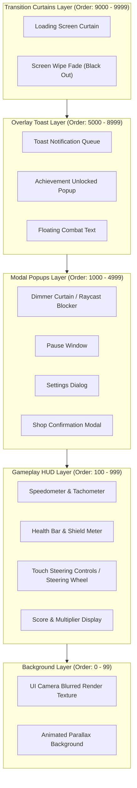
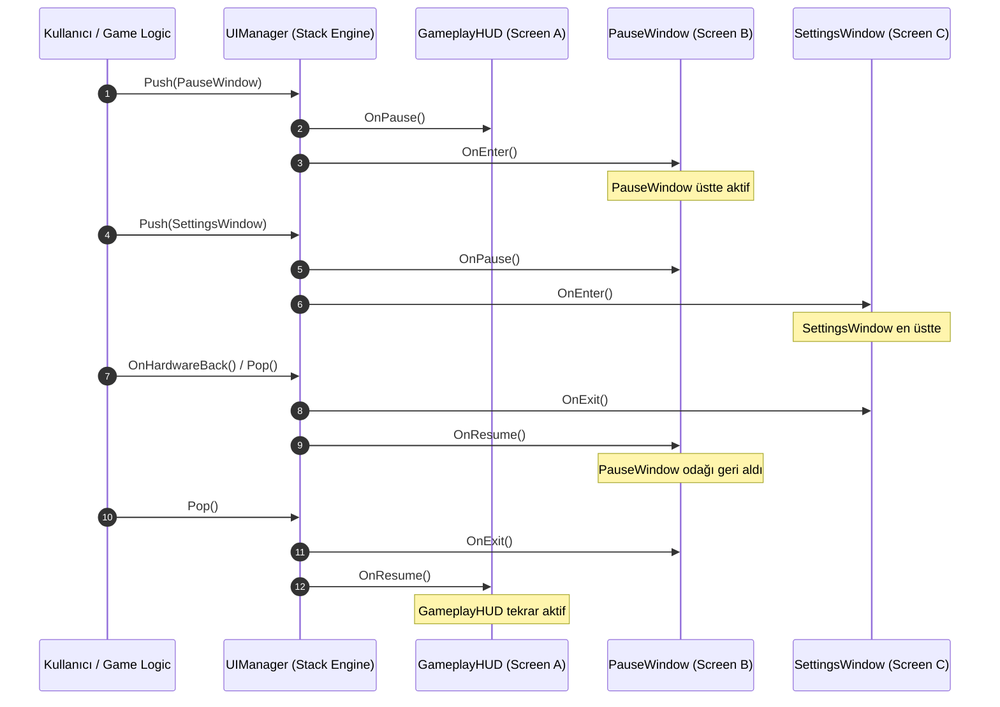
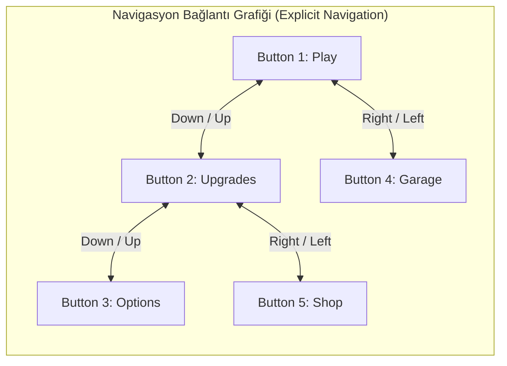

# Modern Oyun UI/UX Mimarisi ve Yığın Tabanlı FSM Navigasyon Sistemi

Bu belge; AAA ve Enterprise mobil/3D oyun projeleri (örn. *CarDiv* ve yüksek tempolu aksiyon/mobil oyunlar) için modüler, yüksek performanslı ve genişletilebilir bir **UI Mimarisi ve Yığın Tabanlı Navigasyon Durum Makinesi (FSM)** teknik kılavuzudur.

---

## 1. Katmanlı Canvas Mimarisi (Layered Canvas Architecture)

Oyun içi kullanıcı arayüzlerinde performans kaybını engellemenin, çizim sıralamasını (Draw Call / Render Order) doğru yönetmenin ve karmaşık UI öğelerinin birbiriyle çakışmasını önlemenin en temel yolu **Katmanlı Canvas Mimarisi** kullanmaktır.

### 1.1 Render Order ve Canvas Rebuild İzolasyonu

Unity UGUI ve modern UI mimarilerinde tek bir devasa Canvas kullanmak ciddi bir performans hatasıdır. Bir UI öğesi değiştiğinde (örneğin bir metin güncellendiğinde veya bir bar dolduğunda), o öğenin bağlı olduğu Canvas altındaki **tüm vertex geometri verisi yeniden üretilir (Canvas Rebuild)**.

Bu nedenle mimarimiz, her biri bağımsız `Sorting Order` değerlerine sahip ve sorumluluk alanlarına göre ayrılmış 5 ana top-level (üst seviye) Canvas katmanından oluşur.

$$\text{Total Draw Calls} = \sum_{k=1}^{n} \text{BatchedDrawCalls}(\text{Layer}_k)$$

Her katman kendi `Canvas` ve `GraphicRaycaster` bileşenine sahiptir. Böylece HUD üzerindeki bir hız göstergesi değiştiğinde arka plan veya modal pencereler rebuild işleminden etkilenmez.

#### Canvas Scaler ve Ekran Ölçekleme Matematiği

Tüm katmanlar tutarlı bir referans çözünürlük (`1920x1080` veya `2560x1440`) üzerinden `Scale With Screen Size` modunda çalışır. `Match Width Or Height` ($m \in [0, 1]$) parametresi logaritmik oranlandırma denklemi ile hesaplanır:

$$\text{ScaleFactor} = \text{WidthRatio}^{1 - m} \times \text{HeightRatio}^{m}$$

Burada:
- $\text{WidthRatio} = \frac{\text{Ekran Genişliği}}{\text{Referans Genişlik}}$
- $\text{HeightRatio} = \frac{\text{Ekran Yüksekliği}}{\text{Referans Yükseklik}}$

$$\log_2(\text{ScaleFactor}) = (1 - m) \cdot \log_2(\text{WidthRatio}) + m \cdot \log_2(\text{HeightRatio})$$

Mobil cihazlardaki farklı en/boy oranlarında (16:9, 19.5:9, 21:9 notch'lu ekranlar) UI elemanlarının kaymaması için $m = 0.5$ (Dengeli) veya dikey oyunlarda $m = 0$ (Width öncelikli) tercih edilir.

---

### 1.2 Beş Ana UI Katmanı

| Katman Adı | Sorting Order Aralığı | Sorumluluk Alanı | Raycast Hedefi | Örnek Elemanlar |
| :--- | :--- | :--- | :--- | :--- |
| **1. Background Layer** | `0` - `99` | Dinamik arka planlar, 3D render texture'lar, bulanıklaştırılmış (blur) görseller. | Pasif (`false`) | Parallax Skybox, Blur Backdrop, Dynamic 3D Car Viewport |
| **2. Gameplay HUD Layer** | `100` - `999` | Kalıcı, modal olmayan oyun içi göstergeler ve kontroller. | Seçici (`true`/`false`) | Hız Göstergesi, Can Barı, Nitro Düğmesi, Mini-map, Skor |
| **3. Modal Popups Layer** | `1000` - `4999` | Odaklanma gerektiren pencereler, diyaloglar ve menüler. | Aktif (`true`) | Duraklatma Menüsü, Ayarlar, Garaj/Mağaza, Envanter |
| **4. Overlay Toast Layer** | `5000` - `8999` | Geçici bildirimler, başarım açılışları, ödül kartları. | Pasif / Tıklanabilir | Achievement Unlocked Toast, Floating Text, Reward Banner |
| **5. Transition Curtains Layer** | `9000` - `9999` | Sahne/Ekran geçiş perdeleri, yükleme ekranları. | Girdi Bloke Eder (`true`) | Black Fade Curtain, Wipe FX, Loading Spinner |

> [!IMPORTANT]
> **Raycast Optimization Rules:**
> Ekrandaki etkileşimsiz tüm `Image` ve `TextMeshProUGUI` bileşenlerinde `Raycast Target = false` yapılmalıdır. Aksi takdirde Unity her dokunuşta binlerce UI elemanı arasında Raycast Kesişim Testi (Bounding Box Intersection) çalıştırır ve CPU üzerinde darboğaz oluşur.

---

### 1.3 Katman Mimarisi Görsel Diagramı



---

## 2. Yığın Tabanlı Modal Navigasyon (Stack-Based Modal Navigation)

Karmaşık oyun kullanıcı arayüzlerinde kullanıcı bir pencereden diğerine geçerken (örn: `Main Menu` $\rightarrow$ `Garage` $\rightarrow$ `Car Upgrade` $\rightarrow$ `Confirmation Modal`) önceki ekranların durumunun saklanması ve **Geri (Back)** tuşuna basıldığında doğru sırayla geri dönülmesi gerekir.

### 2.1 Yığın (Stack) Yönlendirme Algoritması

Navigasyon mimarisi `Stack<IUIScreen>` veri yapısını temel alır:

- **Push(screen)**: Yeni bir ekranı yığının en üstüne ekler.
  - Alttaki aktif ekran `OnPause()` çağrısı alır ve raycast erişimi kilitlenir.
  - Yeni ekran yığına girer ve `OnEnter()` çağrısı alır.
- **Pop()**: En üstteki ekranı kapatır ve yığından çıkarır.
  - Çıkarılan ekran `OnExit()` çağrısı alır ve yok edilir/havuza (pool) döner.
  - Yığındaki bir alttaki ekran `OnResume()` çağrısı alır, görünürlüğü ve odağı geri kazanır.
- **PopToRoot()**: Yığındaki en alt ana ekrana (örn. `MainMenu` veya `GameplayHUD`) kadar tüm modal ekranları sırayla temizler.
- **Replace(screen)**: Aktif ekranı pop ettikten hemen sonra yeni ekranı push eder.



---

### 2.2 Çapraz Platform Donanım ve Girdi Geri-Tuşu (Back-Button) Yönetimi

Farklı platformlarda kullanıcı geri gitmek için farklı girdi mekanizmaları kullanır:

1. **Android**: Fiziksel veya yazılımsal Android Hardware Back tuşu.
2. **iOS**: Ekran sol kenarından sağa kaydırma (Edge Swipe Gesture).
3. **PC / Mac**: klavyedeki `Escape` (`Esc`) tuşu.
4. **Konsol / Gamepad**: Gamepad `B` (Xbox/Nintendo) veya `Circle` (PlayStation) düğmesi.

Mimarimizde `UIManager`, merkezi bir girdi dinleyicisi çalıştırır. Bir geri girdisi algılandığında yığının en üstündeki `IUIScreen` ekranına `OnHardwareBack()` sorgusu gönderilir.

```
Hardware Input Event (Esc / Gamepad B / Android Back)
       │
       ▼
UIManager.HandleBackInput()
       │
       ├─── Stack Boş Mu? ──► YES ──► Oyundan Çıkış Diyaloğu Aç
       │
       ▼ NO
ActiveScreen = Stack.Peek()
       │
       ├─── ActiveScreen.OnHardwareBack() == True? 
       │          │
       │          ├──► YES (Ekran girdiyi kendi tüketti, örn. iç sekme kapattı)
       │          │
       │          └──► NO  ──► UIManager.PopScreen()
```

---

### 2.3 Modal Karartma (Dimmer Backdrop) ve Raycast Blocker Mekanizması

Modal pencereler açıldığında arkadaki UI öğelerinin ve oyun dünyasının tıklanmasını engellemek için **Dimmer Backdrop (Modal Perde)** kullanılır.

1. **Raycast Blocking**: Modal ekran açıldığında bir alt katmandaki CanvasGroup'un `blocksRaycasts` değeri `false` yapılır veya Modal pencerenin arkasına tam ekran `Image` koyularak tıklamalar yutulur.
2. **Dynamic Dimmer Visual**: Siyah renkli `Image` bileşeninin Alpha değeri $0 \rightarrow 0.75$ aralığında 0.2 saniyede smooth olarak tween edilir (`CanvasGroup.alpha`).

---

## 3. Gamepad ve Dokunmatik Odak Yönetimi (Gamepad & Touch Focus Management)

Mobil cihazlarda dokunmatik (Touch), konsol ve bilgisayarda Gamepad / Klavye yönlendirmelerinin sorunsuz çalışması için **Birleşik Odak Yönetim Sistemi (Unified Focus Management System)** gereklidir.

### 3.1 Gamepad / D-Pad Navigasyon Grafiği ve Odak Hafızası

Gamepad ve D-Pad navigasyonunda varsayılan `Selectable.navigation` modları karmaşık arayüzlerde takılmalara neden olur.



#### Odak Hafızası (Screen Focus Memory)
Bir kullanıcı `Pause Menu` -> `Settings` ekranına gidip geri döndüğünde, odak en baştaki butona değil, **en son seçili olan butona** geri dönmelidir. `UIScreenBase` her pencere kapandığında/duraklatıldığında `EventSystem.current.currentSelectedGameObject` değerini belleğe kaydeder.

---

### 3.2 ScrollRect İçinde Otomatik Odak Kaydırma (Auto-Scroll)

Gamepad ile dikey veya yatay bir `ScrollRect` (örneğin araç seçim listesi veya mağaza kataloğu) içerisinde gezinirken, seçilen öğe görüş alanının dışına çıktığında sayfanın otomatik olarak kayması gerekir.

#### Otomatik Kaydırma Matematiksel Formülü

Dikey bir `ScrollRect` için normalized scroll pozisyonu ($V_{\text{normalized}} \in [0, 1]$) hesaplaması:

$$V_{\text{normalized}} = 1.0 - \frac{Y_{\text{element}} - Y_{\text{content\_bottom}}}{Y_{\text{content\_top}} - Y_{\text{content\_bottom}}}$$

Yumuşak kaydırma için **SmoothDamping** kullanılır:

$$V_{\text{current}} = \text{Mathf.SmoothDamp}(V_{\text{current}}, V_{\text{target}}, \text{ref } velocity, \text{smoothTime})$$

---

### 3.3 Dokunmatik Hedef Boyutlandırma Standardı (Touch Target Sizing Rules)

İnsan parmağının ekran üzerindeki ortalama temas alanı **7mm ile 10mm** arasındadır. AAA mobil oyun tasarımında düğmelerin çok küçük olması tıklama hatalarına ve kötü kullanıcı deneyimine (UX friction) yol açar.

#### Ergonomi ve Dokunma Alanı Standartları

| Standart / Platform | Minimum Dokunma Alanı | Fiziksel Ölçü | Önerilen İçerik Boşluğu |
| :--- | :--- | :--- | :--- |
| **Apple HIG** | $44 \times 44\text{ pt}$ | $\sim 8.8\text{ mm}$ | En az $8\text{ pt}$ |
| **Google Material Design** | $48 \times 48\text{ dp}$ | $\sim 9.6\text{ mm}$ | En az $8\text{ dp}$ |
| **AAA Mobile Game Standard** | $48 \times 48\text{ dp}$ (Min $56 \times 56\text{ dp}$) | $\sim 10.0\text{ mm}$ | En az $12\text{ dp}$ |

#### Invisible Raycast Padding Tekniği
Bir icon düğmesinin (örneğin $24 \times 24\text{ pixel}$ boyutundaki bir kapatma 'X' ikonu) görsel boyutunu değiştirmeden dokunma alanını $48 \times 48\text{ dp}$ seviyesine çıkarmak için:

1. Düğme arka planına şeffaf (`Alpha = 0`) bir `Image` koyulur veya
2. Özel `TargetGraphic` genişletici script ile Raycast Bounding Box alanına padding eklenir.

---

## 4. Durum Makinesi (FSM) ve C# UI Navigasyon Mimari Kod Grubu

Aşağıdaki C# kod paketi, Unity projenizde doğrudan kullanabileceğiniz sıfır-GC odaklı, modüler ve production-grade UI mimarisidir.

### 4.1 Ekran Arayüzü: `IUIScreen.cs`

```csharp
using System;
using UnityEngine;

namespace Cardiv.UI.Architecture
{
    /// <summary>
    /// UI Katman Tipleri
    /// </summary>
    public enum UILayerType
    {
        Background = 0,
        GameplayHUD = 100,
        ModalPopup = 1000,
        OverlayToast = 5000,
        TransitionCurtain = 9000
    }

    /// <summary>
    /// Tüm UI Ekranlarının uygulaması gereken temel arayüz.
    /// </summary>
    public interface IUIScreen
    {
        string ScreenId { get; }
        UILayerType LayerType { get; }
        bool IsModal { get; }
        bool BlocksUnderlyingRaycasts { get; }
        GameObject MainGameObject { get; }

        void OnEnter(object data = null);
        void OnExit();
        void OnPause();
        void OnResume();
        
        /// <summary>
        /// Hardware Back tuşuna basıldığında çağrılır.
        /// </summary>
        /// <returns>True ise girdi bu ekran tarafından tüketildi demektir. False ise PopScreen çalışır.</returns>
        bool OnHardwareBack();
    }
}
```

---

### 4.2 Soyut Taban Sınıf: `UIScreenBase.cs`

```csharp
using System;
using System.Collections;
using UnityEngine;
using UnityEngine.EventSystems;
using UnityEngine.UI;

namespace Cardiv.UI.Architecture
{
    [RequireComponent(typeof(CanvasGroup))]
    public abstract class UIScreenBase : MonoBehaviour, IUIScreen
    {
        [Header("Screen Configuration")]
        [SerializeField] private string screenId;
        [SerializeField] private UILayerType layerType = UILayerType.ModalPopup;
        [SerializeField] private bool isModal = true;
        [SerializeField] private bool blocksUnderlyingRaycasts = true;

        [Header("Focus Management")]
        [SerializeField] private Selectable initialFocusSelectable;

        protected CanvasGroup canvasGroup;
        protected GameObject lastSelectedObject;

        public string ScreenId => string.IsNullOrEmpty(screenId) ? gameObject.name : screenId;
        public UILayerType LayerType => layerType;
        public bool IsModal => isModal;
        public bool BlocksUnderlyingRaycasts => blocksUnderlyingRaycasts;
        public GameObject MainGameObject => gameObject;

        protected virtual void Awake()
        {
            canvasGroup = GetComponent<CanvasGroup>();
        }

        public virtual void OnEnter(object data = null)
        {
            gameObject.SetActive(true);
            SetInteractable(true);
            FadeIn();
            RestoreOrSetFocus();
        }

        public virtual void OnExit()
        {
            SaveCurrentFocus();
            SetInteractable(false);
            FadeOut(() =>
            {
                gameObject.SetActive(false);
            });
        }

        public virtual void OnPause()
        {
            SaveCurrentFocus();
            SetInteractable(false);
        }

        public virtual void OnResume()
        {
            SetInteractable(true);
            RestoreOrSetFocus();
        }

        public virtual bool OnHardwareBack()
        {
            // Varsayılan olarak özel durum yoksa girdiyi tüketmez, Pop işlemine izin verir.
            return false;
        }

        protected void SetInteractable(bool interactable)
        {
            if (canvasGroup != null)
            {
                canvasGroup.interactable = interactable;
                canvasGroup.blocksRaycasts = interactable;
            }
        }

        protected virtual void FadeIn()
        {
            if (canvasGroup == null) return;
            StopAllCoroutines();
            StartCoroutine(AnimateCanvasAlpha(canvasGroup.alpha, 1f, 0.15f));
        }

        protected virtual void FadeOut(Action onComplete)
        {
            if (canvasGroup == null)
            {
                onComplete?.Invoke();
                return;
            }
            StopAllCoroutines();
            StartCoroutine(AnimateCanvasAlpha(canvasGroup.alpha, 0f, 0.15f, onComplete));
        }

        private IEnumerator AnimateCanvasAlpha(float start, float target, float duration, Action onComplete = null)
        {
            float elapsed = 0f;
            while (elapsed < duration)
            {
                elapsed += Time.unscaledDeltaTime;
                canvasGroup.alpha = Mathf.Lerp(start, target, elapsed / duration);
                yield return null;
            }
            canvasGroup.alpha = target;
            onComplete?.Invoke();
        }

        private void SaveCurrentFocus()
        {
            if (EventSystem.current != null && EventSystem.current.currentSelectedGameObject != null)
            {
                if (EventSystem.current.currentSelectedGameObject.transform.IsChildOf(transform))
                {
                    lastSelectedObject = EventSystem.current.currentSelectedGameObject;
                }
            }
        }

        private void RestoreOrSetFocus()
        {
            if (EventSystem.current == null) return;

            GameObject targetToSelect = null;

            if (lastSelectedObject != null && lastSelectedObject.activeInHierarchy)
            {
                targetToSelect = lastSelectedObject;
            }
            else if (initialFocusSelectable != null && initialFocusSelectable.gameObject.activeInHierarchy)
            {
                targetToSelect = initialFocusSelectable.gameObject;
            }

            if (targetToSelect != null)
            {
                EventSystem.current.SetSelectedGameObject(targetToSelect);
            }
        }
    }
}
```

---

### 4.3 Yöneticisi Sınıfı: `UIManager.cs`

```csharp
using System;
using System.Collections.Generic;
using UnityEngine;
using UnityEngine.EventSystems;
using UnityEngine.InputSystem; // Modern Input System desteği

namespace Cardiv.UI.Architecture
{
    public class UIManager : MonoBehaviour
    {
        public static UIManager Instance { get; private set; }

        [Header("Layer Containers")]
        [SerializeField] private Transform backgroundLayerParent;
        [SerializeField] private Transform gameplayHudLayerParent;
        [SerializeField] private Transform modalPopupLayerParent;
        [SerializeField] private Transform overlayToastLayerParent;
        [SerializeField] private Transform transitionCurtainLayerParent;

        [Header("Modal Dimmer Settings")]
        [SerializeField] private GameObject modalDimmerPrefab;
        private GameObject activeDimmerInstance;

        // Registered UI Prefabs or Instances
        private readonly Dictionary<string, IUIScreen> screenRegistry = new Dictionary<string, IUIScreen>();
        
        // Stack-based Navigation
        private readonly Stack<IUIScreen> navigationStack = new Stack<IUIScreen>();

        private void Awake()
        {
            if (Instance != null && Instance != this)
            {
                Destroy(gameObject);
                return;
            }
            Instance = this;
            DontDestroyOnLoad(gameObject);

            InitializeDimmer();
        }

        private void Update()
        {
            HandleHardwareBackInput();
        }

        private void InitializeDimmer()
        {
            if (modalDimmerPrefab != null && modalPopupLayerParent != null)
            {
                activeDimmerInstance = Instantiate(modalDimmerPrefab, modalPopupLayerParent);
                activeDimmerInstance.transform.SetAsFirstSibling();
                activeDimmerInstance.SetActive(false);
            }
        }

        public void RegisterScreen(IUIScreen screen)
        {
            if (!screenRegistry.ContainsKey(screen.ScreenId))
            {
                screenRegistry.Add(screen.ScreenId, screen);
                PositionScreenInLayer(screen);
            }
        }

        public void PushScreen(string screenId, object data = null)
        {
            if (!screenRegistry.TryGetValue(screenId, out var targetScreen))
            {
                Debug.LogError($"[UIManager] Ekran bulunamadı: {screenId}");
                return;
            }

            if (navigationStack.Count > 0)
            {
                var topScreen = navigationStack.Peek();
                topScreen.OnPause();
            }

            navigationStack.Push(targetScreen);
            targetScreen.MainGameObject.transform.SetAsLastSibling();
            targetScreen.OnEnter(data);

            UpdateDimmerState();
        }

        public void PopScreen()
        {
            if (navigationStack.Count == 0) return;

            var topScreen = navigationStack.Pop();
            topScreen.OnExit();

            if (navigationStack.Count > 0)
            {
                var nextScreen = navigationStack.Peek();
                nextScreen.OnResume();
            }

            UpdateDimmerState();
        }

        public void PopToRoot()
        {
            while (navigationStack.Count > 1)
            {
                var topScreen = navigationStack.Pop();
                topScreen.OnExit();
            }

            if (navigationStack.Count == 1)
            {
                navigationStack.Peek().OnResume();
            }

            UpdateDimmerState();
        }

        private void HandleHardwareBackInput()
        {
            // Legacy veya New Input System Cancel/Escape Tuşu Algılama
            bool backPressed = Keyboard.current != null && Keyboard.current.escapeKey.wasPressedThisFrame;
            
#if UNITY_ANDROID || UNITY_IOS
            if (Input.GetKeyDown(KeyCode.Escape)) backPressed = true;
#endif

            if (backPressed && navigationStack.Count > 0)
            {
                var topScreen = navigationStack.Peek();
                
                // Ekran girdiyle özel bir işlem yaptı mı (örn. pencere içi alt menü kapattı mı)?
                bool handledByScreen = topScreen.OnHardwareBack();
                
                if (!handledByScreen)
                {
                    PopScreen();
                }
            }
        }

        private void UpdateDimmerState()
        {
            if (activeDimmerInstance == null) return;

            bool hasModalScreen = false;
            foreach (var screen in navigationStack)
            {
                if (screen.IsModal && screen.BlocksUnderlyingRaycasts)
                {
                    hasModalScreen = true;
                    break;
                }
            }

            activeDimmerInstance.SetActive(hasModalScreen);
            if (hasModalScreen)
            {
                // Dimmer'ı en üstteki modalın hemen arkasına konumlandır
                activeDimmerInstance.transform.SetAsLastSibling();
                if (navigationStack.Count > 0)
                {
                    navigationStack.Peek().MainGameObject.transform.SetAsLastSibling();
                }
            }
        }

        private void PositionScreenInLayer(IUIScreen screen)
        {
            Transform parentLayer = screen.LayerType switch
            {
                UILayerType.Background => backgroundLayerParent,
                UILayerType.GameplayHUD => gameplayHudLayerParent,
                UILayerType.ModalPopup => modalPopupLayerParent,
                UILayerType.OverlayToast => overlayToastLayerParent,
                UILayerType.TransitionCurtain => transitionCurtainLayerParent,
                _ => modalPopupLayerParent
            };

            if (parentLayer != null)
            {
                screen.MainGameObject.transform.SetParent(parentLayer, false);
            }
        }
    }
}
```

---

### 4.4 Auto-Scroll Odak Takip Bileşeni: `AutoScrollToFocus.cs`

```csharp
using UnityEngine;
using UnityEngine.EventSystems;
using UnityEngine.UI;

namespace Cardiv.UI.Navigation
{
    [RequireComponent(typeof(ScrollRect))]
    public class AutoScrollToFocus : MonoBehaviour
    {
        [SerializeField] private float scrollSpeed = 10f;
        [SerializeField] private float topPadding = 0.1f;
        [SerializeField] private float bottomPadding = 0.1f;

        private ScrollRect scrollRect;
        private RectTransform scrollTransform;
        private RectTransform contentTransform;

        private void Awake()
        {
            scrollRect = GetComponent<ScrollRect>();
            scrollTransform = scrollRect.GetComponent<RectTransform>();
            contentTransform = scrollRect.content;
        }

        private void Update()
        {
            GameObject currentSelected = EventSystem.current != null ? EventSystem.current.currentSelectedGameObject : null;
            if (currentSelected == null || !currentSelected.transform.IsChildOf(contentTransform)) return;

            RectTransform targetRect = currentSelected.GetComponent<RectTransform>();
            if (targetRect == null) return;

            KeepChildInView(targetRect);
        }

        private void KeepChildInView(RectTransform child)
        {
            Vector3[] childCorners = new Vector3[4];
            Vector3[] viewCorners = new Vector3[4];

            child.GetWorldCorners(childCorners);
            scrollTransform.GetWorldCorners(viewCorners);

            float childBottom = childCorners[0].y;
            float childTop = childCorners[1].y;

            float viewBottom = viewCorners[0].y + (viewCorners[1].y - viewCorners[0].y) * bottomPadding;
            float viewTop = viewCorners[1].y - (viewCorners[1].y - viewCorners[0].y) * topPadding;

            float targetNormalizedPosY = scrollRect.verticalNormalizedPosition;

            if (childBottom < viewBottom)
            {
                float diff = viewBottom - childBottom;
                float contentHeight = contentTransform.rect.height - scrollTransform.rect.height;
                if (contentHeight > 0)
                {
                    targetNormalizedPosY -= (diff / contentHeight);
                }
            }
            else if (childTop > viewTop)
            {
                float diff = childTop - viewTop;
                float contentHeight = contentTransform.rect.height - scrollTransform.rect.height;
                if (contentHeight > 0)
                {
                    targetNormalizedPosY += (diff / contentHeight);
                }
            }

            scrollRect.verticalNormalizedPosition = Mathf.Lerp(
                scrollRect.verticalNormalizedPosition,
                Mathf.Clamp01(targetNormalizedPosY),
                Time.unscaledDeltaTime * scrollSpeed
            );
        }
    }
}
```

---

### 4.5 Dynamic Focus Ring & Visualizer: `FocusVisualizer.cs`

```csharp
using UnityEngine;
using UnityEngine.EventSystems;

namespace Cardiv.UI.Navigation
{
    public class FocusVisualizer : MonoBehaviour
    {
        [SerializeField] private RectTransform focusRingOverlay;
        [SerializeField] private float moveSpeed = 15f;
        [SerializeField] private Vector2 padding = new Vector2(16f, 16f);

        private GameObject lastSelected;

        private void Update()
        {
            GameObject selected = EventSystem.current != null ? EventSystem.current.currentSelectedGameObject : null;

            if (selected == null || !selected.activeInHierarchy)
            {
                if (focusRingOverlay != null) focusRingOverlay.gameObject.SetActive(false);
                return;
            }

            if (selected != lastSelected)
            {
                lastSelected = selected;
                if (focusRingOverlay != null) focusRingOverlay.gameObject.SetActive(true);
            }

            UpdateRingPosition(selected.GetComponent<RectTransform>());
        }

        private void UpdateRingPosition(RectTransform targetRect)
        {
            if (targetRect == null || focusRingOverlay == null) return;

            Vector3 targetWorldPos = targetRect.position;
            Vector2 targetSize = targetRect.rect.size + padding;

            focusRingOverlay.position = Vector3.Lerp(focusRingOverlay.position, targetWorldPos, Time.unscaledDeltaTime * moveSpeed);
            focusRingOverlay.sizeDelta = Vector2.Lerp(focusRingOverlay.sizeDelta, targetSize, Time.unscaledDeltaTime * moveSpeed);
        }
    }
}
```

---

## 5. Özet ve Uygulama Kontrol Listesi (Checklist)

1. **Canvas Ayrışımı**: Her katman kendi `Canvas` ve `GraphicRaycaster` bileşenine sahip mi?
2. **Raycast Temizliği**: HUD ve metin elemanlarının tamamında `Raycast Target = false` mu?
3. **Modal Raycast Blocker**: Üst katmanda modal açıldığında alttaki CanvasGroup'un `blocksRaycasts = false` oluyor mu?
4. **Ergonomik Düğme Boyutları**: Mobil dokunma hedefleri en az $48 \times 48\text{ dp}$ olarak ayarlandı mı?
5. **Gamepad Odak Takibi**: `AutoScrollToFocus` bileşeni ScrollRect listelerine eklendi mi?
6. **Hardware Back Tüketimi**: Android Back / Esc basıldığında FSM doğru ekranı pop ediyor mu?
