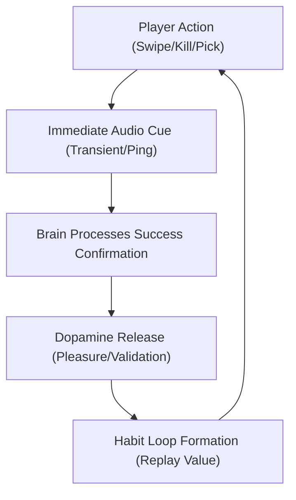

# The Dopamine Loop: How Satisfying Sound Design Drives Player Retention in AAA Games

*An analysis of the neuroscientific principles, behavioral psychology, and iconic sound design techniques used by industry-leading games to build habit-forming feedback loops.*

---

## 1. The Neuroscience of Satisfying Audio Cues

Sound in modern video games is far more than aesthetic decoration; it is a highly engineered system of behavioral reinforcement. AAA titles design audio to interface directly with the human reward system, specifically the neurotransmitter **dopamine**.

### 1.1 Operant Conditioning & Pavlovian Response
Games utilize **operant conditioning**—a method of learning that employs rewards and punishments for behavior.
* **Primary vs. Secondary Reinforcers:** While gameplay progression (leveling up, getting high scores) is the primary reinforcer, a satisfying sound effect acts as a **secondary reinforcer**. 
* **Association:** Over time, the player's brain associates a specific audio frequency (like a cash register *cha-ching* or a metallic *dink*) with success. Eventually, the sound itself triggers the dopamine rush *before* the player even checks their score.

### 1.2 Reward Prediction Error (RPE)
Dopamine is heavily tied to anticipation. When a player performs a challenging action (e.g., threading a tight gap or landing a combo) and receives a crisp, distinct sound, the brain calculates a positive **Reward Prediction Error**—confirming the outcome was successful, releasing dopamine, and validating the player's motor skills.

---

## 2. Anatomy of a "Satisfying" Sound Effect

Satisfying sounds in AAA games are rarely recorded single-track files. They are multi-layered audio assets engineered according to specific auditory properties:

* **Sharp Transients (The "Click"):** The absolute beginning of a sound. A sharp, high-amplitude attack (like metal on metal or a bubble popping) mimics physical impact. The brain processes these sharp transients subcortically, creating an instant feeling of tactility.
* **Harmonic Resonance (The "Sustain"):** Tonal elements that ring out. Triumphant, ascending major-chord intervals (common in *Peggle*) trigger feelings of growth, safety, and accomplishment.
* **Timbral Crunch (The "Bite"):** A slight grit or distortion in the lower-mid frequencies (like breaking wood, crushing glass, or shattering shields) adds weight, making virtual actions feel physically heavy.
* **Dynamic Pitch Variation:** To prevent "ear fatigue" (where hearing the same sound repeatedly becomes annoying), professional engines shift the pitch and volume of common actions by $\pm5-10\%$ dynamically per trigger.

---

## 3. Case Studies: Iconic Satisfying Sounds

| Game | The Sound Effect | Layering & Composition | Psychological Effect |
| :--- | :--- | :--- | :--- |
| **Call of Duty** | The Headshot "Dink" | A crisp, high-frequency metallic ring layered with a wet skull-crunch transient. | Cuts through combat chaos; acts as an instant "adrenaline shot" and skill validator. |
| **Overwatch** | The Elimination "Pip" | A reversed, ascending synthesized audio bell chime. | Uniquely distinguishable; sounds more rewarding as eliminations stack up. |
| **Peggle** | The Peg Hits & Board Clear | Peg hits play a rising pentatonic scale; board clear triggers a massive orchestral blast (*Ode to Joy*). | Maximize "juice"; creates a cascading feeling of order, beauty, and massive reward. |
| **Fortnite** | Shield Crack / Harvest | A heavy, digital ceramic shattering sound. | Instant visual-auditory clarity indicating the opponent is vulnerable; triggers aggressive play. |

---

## 4. Designing the "Juice" for Cardiv

To elevate the gameplay loop of **Cardiv** from a simple lane-runner to an addictive arcade experience, we can translate these AAA principles into the following audio systems:

### 4.1 Dynamic Engine Pitch System (Speed-to-Dopamine)
* **Design:** A looping engine sound whose pitch coefficient $P$ is tied directly to the player's forward velocity $V$.
* **Formula:** 
  \[ P = P_{base} + \left( \frac{V_{current} - V_{min}}{V_{max} - V_{min}} \right) \times P_{range} \]
* **Effect:** As the player survives longer and speed increases, the rising pitch heightens tension and mimics real-world acceleration.

### 4.2 Shield Absorb "Ceramic Crack"
* **Design:** When a shield yuts a side obstacle, replace a silent transition with a heavy, digital/glassy ceramic shatter sound.
* **Effect:** Validates the player's inventory investment (shield collection) and turns a near-miss catastrophe into a rewarding victory.

### 4.3 Danger Zone Heartbeat Tension
* **Design:** Tie a rhythmic, low-frequency heartbeat sound (with increasing frequency as the Danger Phase timer runs out) to the HUD vignette.
* **Effect:** Elevates physical stress and excitement (tension phase), making the transition back to normal (release phase) extremely relieving.

---

> [!TIP]
> **Implementation Best Practice:** Always apply a small random pitch shift (`Random.Range(0.95f, 1.05f)`) to the lane change swoosh and collision sounds in code to keep the auditory feedback feeling organic and fresh over long play sessions.
