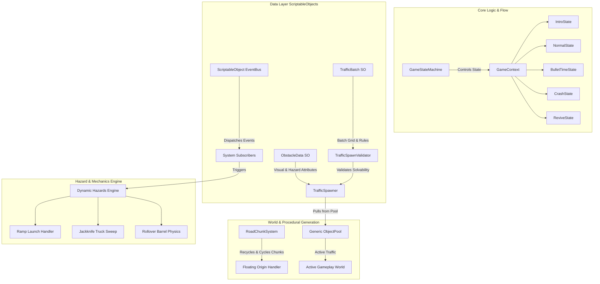
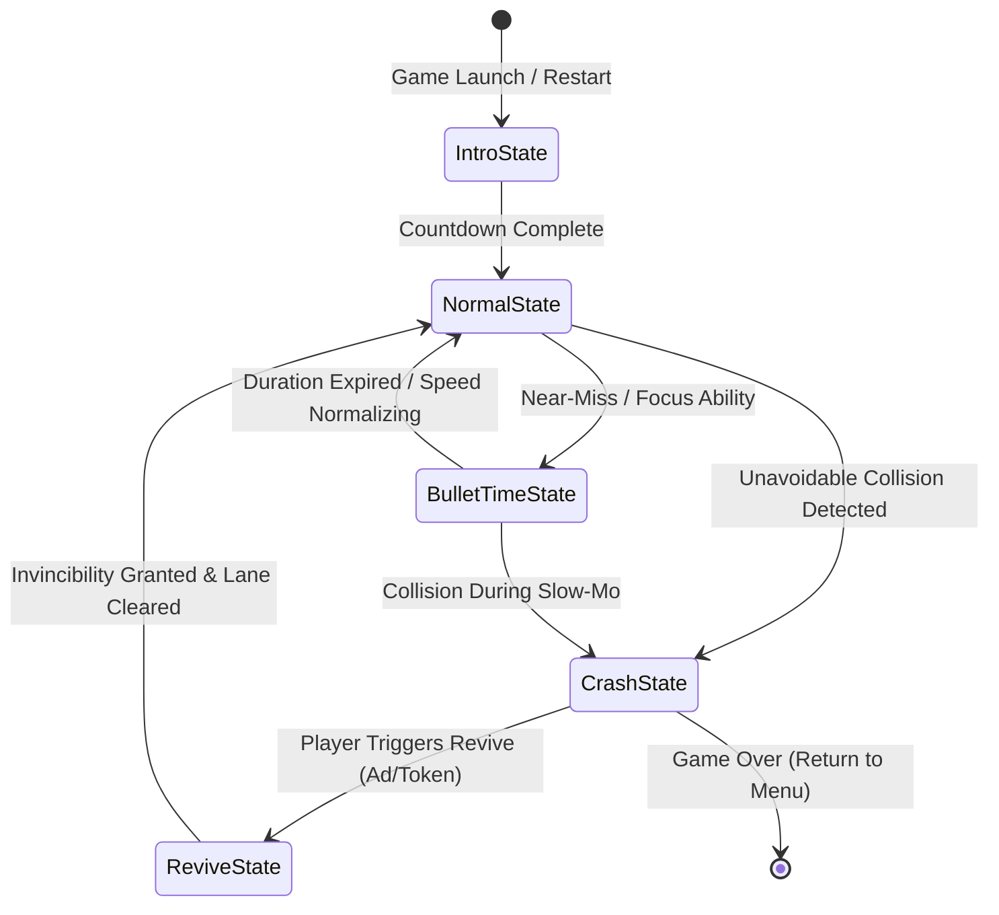
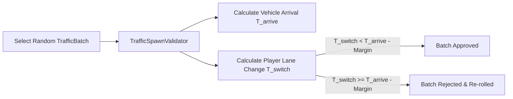
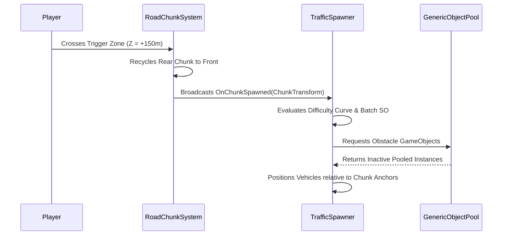

# 🏗️ Modern Unity Mobile Endless Runner Architecture Blueprint
**Benchmark Reference:** *Subway Surfers*, *Temple Run 2*, *Traffic Rider*  
**Target Platform:** iOS & Android (Universal Render Pipeline - URP, Unity 2022/2026 LTS)  
**Author:** Lead Mobile Game Architect  
**Status:** Approved Technical Architecture Document  

---

## Executive Summary & System Topology

Mobile endless runner architecture demands an extreme balance between **60–120 FPS performance**, **zero GC allocation during runtime**, **data-driven designer workflows**, and **high system modularity**. High-speed games like *Subway Surfers* and *Temple Run 2* rely on decoupled, event-driven, data-driven systems rather than monolithic controllers.

This blueprint details a modern, scalable Unity architecture for an endless runner featuring dynamic traffic, multi-lane controls, procedural world generation, and complex dynamic hazards (ramps, jackknifing trucks, rolling obstacles).



---

## 1. State Machine Architecture (Game Loop & Flow)

### 1.1 Architectural Pattern: Context-Aware State Machine
Rather than relying on monolithic `Update()` scripts with messy `enum` switch statements, the game flow uses a **Strict Interface-Driven Finite State Machine (FSM)**. The state machine operates on a shared `GameContext` which houses references to score, speed multipliers, player state, and world controllers.

```csharp
namespace Cardiv.Architecture.States
{
    public interface IGameState
    {
        void Enter(GameContext context);
        void Update(GameContext context, float deltaTime);
        void FixedUpdate(GameContext context, float fixedDeltaTime);
        void Exit(GameContext context);
    }

    public class GameContext
    {
        public PlayerController Player { get; set; }
        public CameraController Camera { get; set; }
        public RoadChunkSystem RoadSystem { get; set; }
        public TrafficSpawner Spawner { get; set; }
        public UIController UI { get; set; }

        public float CurrentSpeed { get; set; }
        public float TargetSpeed { get; set; }
        public float Score { get; set; }
        public int ActiveLane { get; set; }
        public bool IsInvincible { get; set; }
    }
}
```

### 1.2 State Transition Matrix & Flow



### 1.3 Concrete State Implementations

#### A. `IntroState` (Setup & Warmup)
* **Responsibility:** Pre-warms object pools, positions player at origin, animates intro camera fly-through, and executes 3-2-1 countdown.
* **Logic:** Disables player swipe controls, runs chunk spawner in idle loop.

#### B. `NormalState` (Core Loop)
* **Responsibility:** Main gameplay loop running at target game speed ($V_{player}$).
* **Logic:** Updates score based on $Z_{distance} \times Multiplier$, ticks progressive speed curves, handles swipe inputs, and monitors near-miss conditions.

#### C. `BulletTimeState` (Slow-Motion Matrix Effect)
* **Responsibility:** Triggered during extreme close-calls or player focus abilities.
* **Logic:** Manipulates `Time.timeScale` smoothly using an animation curve. Adjusts audio pitch using `AudioMixer.SetFloat("Pitch", timeScale)`.
```csharp
public class BulletTimeState : IGameState
{
    private float _duration = 1.5f;
    private float _timer;
    private float _targetTimeScale = 0.3f;

    public void Enter(GameContext context)
    {
        _timer = _duration;
        Time.timeScale = _targetTimeScale;
        Time.fixedDeltaTime = 0.02f * Time.timeScale; // Retain physics fidelity
        context.UI.ShowBulletTimeVFX(true);
    }

    public void Update(GameContext context, float deltaTime)
    {
        _timer -= Time.unscaledDeltaTime;
        if (_timer <= 0f)
        {
            context.StateMachine.ChangeState<NormalState>();
        }
    }

    public void Exit(GameContext context)
    {
        Time.timeScale = 1.0f;
        Time.fixedDeltaTime = 0.02f;
        context.UI.ShowBulletTimeVFX(false);
    }
}
```

#### D. `CrashState` (Impact & Crumple Physics)
* **Responsibility:** Instantly stops forward movement, applies vehicle crumple / ragdoll impact, triggers camera hitstop shake, and displays game over / revive prompt.
* **Logic:** Freezes chunk scrolling, disables player lane inputs, calculates crash intensity.

#### E. `ReviveState` (Second Chance Cycle)
* **Responsibility:** Activated when player consumes a revive item or views a rewarded ad.
* **Logic:** Clears active obstacles in a $50m$ radius ahead of player, sets `IsInvincible = true` for $3.0$ seconds (blinking shader effect), and smoothly transitions back to `NormalState`.

---

## 2. ScriptableObject-Driven Obstacle & Batch Configuration

### 2.1 Data Architecture
Rather than hardcoding spawn positions in procedural scripts, obstacles and traffic layouts are configured in **Data-Driven ScriptableObjects**. This allows level designers to construct hand-crafted challenge matrices that are deterministically validated before runtime spawning.

```csharp
namespace Cardiv.Architecture.Data
{
    public enum LaneIndex { Left = -1, Center = 0, Right = 1 }
    public enum ObstacleType { StaticBarrier, Sedans, Truck, Ramp, DynamicJackknife }

    [CreateAssetMenu(fileName = "ObstacleData", menuName = "Cardiv/Data/Obstacle Data")]
    public class ObstacleData : ScriptableObject
    {
        public string obstacleId;
        public GameObject prefab;
        public ObstacleType type;
        public Vector3 colliderSize;
        public bool isDynamic;
        public float baseSpeed;
        public LaneIndex[] allowedLanes;
    }

    [System.Serializable]
    public struct LaneSlot
    {
        public LaneIndex lane;
        public ObstacleData obstacle;
        public float zLocalOffset;
    }

    [CreateAssetMenu(fileName = "TrafficBatch", menuName = "Cardiv/Data/Traffic Batch")]
    public class TrafficBatch : ScriptableObject
    {
        public string batchId;
        public int difficultyRating; // 1 to 10 scale
        public float totalZLength;   // Pattern longitudinal footprint
        public LaneSlot[] slots;
        public float minPlayerSpeedRequired;
    }
}
```

### 2.2 Mathematical Solvability Validator (`TrafficSpawnValidator`)

To guarantee that procedurally selected traffic batches never create an **unwinnable wall-to-wall blocking scenario**, every batch is validated against a mathematical solver before being pushed to the active queue.



#### Solvability Equations:
1. **Time to Impact ($T_{arrive}$):**
   $$T_{arrive} = \frac{\Delta Z}{V_{player} - V_{traffic}}$$
   *Where $\Delta Z$ is relative distance between player and obstacle, $V_{player}$ is player velocity, and $V_{traffic}$ is obstacle velocity.*

2. **Required Lane Change Time ($T_{switch}$):**
   $$T_{switch} = |Lane_{target} - Lane_{current}| \times T_{single\_lane\_switch}$$

3. **Validation Guarantee Condition:**
   $$T_{switch} < T_{arrive} - \epsilon_{reaction}$$
   *Where $\epsilon_{reaction}$ is safety buffer (typically $0.35s$ for mobile tap input latency).*

```csharp
namespace Cardiv.Architecture.Validation
{
    public static class TrafficSpawnValidator
    {
        private const float SINGLE_LANE_SWITCH_TIME = 0.18f; // Seconds per lane shift
        private const float SAFETY_MARGIN = 0.35f;            // Reaction time buffer

        public static bool IsBatchSolvable(TrafficBatch batch, float playerSpeed, LaneIndex currentLane)
        {
            // Iterate across all lanes to ensure at least ONE valid escape path exists
            for (int targetLane = -1; targetLane <= 1; targetLane++)
            {
                int laneDistance = Mathf.Abs(targetLane - (int)currentLane);
                float timeToShift = laneDistance * SINGLE_LANE_SWITCH_TIME;

                bool laneBlocked = false;
                foreach (var slot in batch.slots)
                {
                    if ((int)slot.lane == targetLane && slot.obstacle != null)
                    {
                        float relativeSpeed = playerSpeed - slot.obstacle.baseSpeed;
                        if (relativeSpeed <= 0) continue; // Traffic moving faster than player

                        float timeToReach = slot.zLocalOffset / relativeSpeed;
                        if (timeToShift >= (timeToReach - SAFETY_MARGIN))
                        {
                            laneBlocked = true;
                            break;
                        }
                    }
                }

                if (!laneBlocked) return true; // Found at least one safe escape route!
            }

            return false; // All lanes lead to unavoidable collision!
        }
    }
}
```

---

## 3. Decoupled Traffic Spawner & Road Chunk System

### 3.1 Road Chunk Cycling System & Floating Origin

In endless runners, advancing millions of units on the $Z$-axis causes **Floating-Point Degradation** (mesh jittering, physics instability).

#### Architectural Solutions:
1. **World Scrolling (Player Stationary on Z):** Environment moves backward toward player at speed $-V_{player}$. (Best for simple runners).
2. **Periodic Floating Origin Reset:** Player moves in positive $Z$. When $Z > 1000m$, system shifts Player, Active Chunks, and Traffic back by $-1000m$ in a single frame.

```csharp
namespace Cardiv.Architecture.World
{
    public class FloatingOriginHandler : MonoBehaviour
    {
        [SerializeField] private float resetThreshold = 1000f;

        public event System.Action<Vector3> OnOriginShifted;

        public void CheckAndShiftOrigin(Vector3 playerPosition)
        {
            if (playerPosition.z >= resetThreshold)
            {
                Vector3 shiftVector = new Vector3(0, 0, -playerPosition.z);
                
                // Shift all root transform objects
                transform.position += shiftVector;
                
                // Broadcast to active pooled objects and physics agents
                OnOriginShifted?.Invoke(shiftVector);
            }
        }
    }
}
```

### 3.2 Decoupled Spawner Architecture
The `RoadChunkSystem` and `TrafficSpawner` are strictly decoupled using a **Spatial Trigger & Event Listener pattern**. The chunk system handles mesh terrain geometry, while the spawner listens to chunk activation triggers to stream obstacles.



### 3.3 Zero-GC Generic Object Pool Implementation

To achieve zero garbage collection spikes during 60–120 FPS mobile gameplay, standard `Instantiate()` and `Destroy()` calls are replaced with a high-performance **Generic C# Object Pool** utilizing pre-allocated arrays and `ReadOnlySpan<T>`.

```csharp
namespace Cardiv.Architecture.Pooling
{
    public class ZeroGCObjectPool<T> where T : Component
    {
        private readonly T _prefab;
        private readonly T[] _pool;
        private readonly Stack<int> _inactiveIndices;
        private readonly Transform _parent;

        public ZeroGCObjectPool(T prefab, int initialCapacity, Transform parent = null)
        {
            _prefab = prefab;
            _parent = parent;
            _pool = new T[initialCapacity];
            _inactiveIndices = new Stack<int>(initialCapacity);

            for (int i = 0; i < initialCapacity; i++)
            {
                T instance = Object.Instantiate(_prefab, _parent);
                instance.gameObject.SetActive(false);
                _pool[i] = instance;
                _inactiveIndices.Push(i);
            }
        }

        public T Get(Vector3 position, Quaternion rotation)
        {
            if (_inactiveIndices.Count == 0)
            {
                Debug.LogWarning($"[ObjectPool] Capacity exhausted for {_prefab.name}. Expanding pool.");
                // Growth logic can be implemented here if strictly needed
                return null;
            }

            int index = _inactiveIndices.Pop();
            T obj = _pool[index];
            obj.transform.SetPositionAndRotation(position, rotation);
            obj.gameObject.SetActive(true);
            return obj;
        }

        public void Release(T obj)
        {
            for (int i = 0; i < _pool.Length; i++)
            {
                if (_pool[i] == obj)
                {
                    obj.gameObject.SetActive(false);
                    _inactiveIndices.Push(i);
                    return;
                }
            }
        }
    }
}
```

---

## 4. Scalable Event System for Dynamic Hazards

Dynamic hazards add high-octane flavor to endless runners (*e.g., launching off car transport ramps, jackknifing semi-trucks sweeping across lanes, rolling barrels*). To avoid spaghetti code in the player script, dynamic hazards use an **Interface-Driven Dynamic Hazard Architecture (`IDynamicHazard`)**.

### 4.1 Hazard Event Bus & Interface Specification

```csharp
namespace Cardiv.Architecture.Hazards
{
    public interface IDynamicHazard
    {
        string HazardId { get; }
        bool IsActive { get; }
        void TriggerHazard(GameContext context);
        void ResetHazard();
    }

    // ScriptableObject Channel for Event-Driven Coupling
    [CreateAssetMenu(fileName = "HazardEventChannel", menuName = "Cardiv/Events/Hazard Channel")]
    public class HazardEventChannel : ScriptableObject
    {
        public event System.Action<IDynamicHazard> OnHazardTriggered;
        public event System.Action<IDynamicHazard> OnHazardEnded;

        public void RaiseHazardTriggered(IDynamicHazard hazard) => OnHazardTriggered?.Invoke(hazard);
        public void RaiseHazardEnded(IDynamicHazard hazard) => OnHazardEnded?.Invoke(hazard);
    }
}
```

---

### 4.2 Dynamic Hazard Implementations

#### A. Ramp Launch Mechanics
When the player drives onto a ramp vehicle or incline obstacle:
1. Detects ramp collider via tag or `IDynamicHazard` layer trigger.
2. Overrides normal gravity and applies vertical velocity trajectory ($V_y = \sqrt{2 \cdot g \cdot h_{target}}$).
3. Transitions player state to `AirborneState` with special stunt animations and aerial near-miss multipliers.

```csharp
public class RampHazard : MonoBehaviour, IDynamicHazard
{
    [SerializeField] private float launchForce = 12f;
    [SerializeField] private float jumpDuration = 0.85f;
    
    public string HazardId => "Ramp_Launch";
    public bool IsActive { get; private set; }

    public void TriggerHazard(GameContext context)
    {
        IsActive = true;
        context.Player.ExecuteRampLaunch(launchForce, jumpDuration);
    }

    public void ResetHazard() => IsActive = false;

    private void OnTriggerEnter(Collider other)
    {
        if (other.TryGetComponent<IPlayerContextHolder>(out var playerHolder))
        {
            TriggerHazard(playerHolder.Context);
        }
    }
}
```

#### B. Jackknife Truck Hazard (Lane Sweep)
A long articulated truck in the right lane suddenly slams its brakes and skids sideways, blocking both the Right and Center lanes in real time.

```mermaid
gantt
    title Jackknife Hazard Timeline
    dateFormat  ss.SS
    axisFormat %S.%L
    Telegraph Indicator Lamp (Red Flashes) : active, 00.00, 00.80
    Brake Squeal Audio & Smoke Particles   : 00.70, 01.50
    Trailer Sweeps Center Lane (Physic Sweep): 00.80, 01.60
    Full Obstacle Blockade Active         : 01.60, 03.50
```

```csharp
public class JackknifeTruckHazard : MonoBehaviour, IDynamicHazard
{
    [SerializeField] private Transform trailerTransform;
    [SerializeField] private AnimationCurve sweepCurve;
    [SerializeField] private ParticleSystem smokeVFX;
    [SerializeField] private Light warningLight;

    public string HazardId => "Jackknife_Sweep";
    public bool IsActive { get; private set; }

    public void TriggerHazard(GameContext context)
    {
        StartCoroutine(ExecuteJackknifeSequence());
    }

    private System.Collections.IEnumerator ExecuteJackknifeSequence()
    {
        IsActive = true;
        
        // 1. Telegraphing phase (0.8s flash warning light)
        float timer = 0f;
        while (timer < 0.8f)
        {
            timer += Time.deltaTime;
            warningLight.enabled = (Mathf.PingPong(timer * 10f, 1f) > 0.5f);
            yield return null;
        }

        // 2. Physical Rotation Sweep
        smokeVFX.Play();
        float sweepDuration = 0.7f;
        timer = 0f;
        Quaternion startRot = trailerTransform.localRotation;
        Quaternion endRot = Quaternion.Euler(0, 75f, 0); // Rotate sideways across lane

        while (timer < sweepDuration)
        {
            timer += Time.deltaTime;
            float progress = sweepCurve.Evaluate(timer / sweepDuration);
            trailerTransform.localRotation = Quaternion.Slerp(startRot, endRot, progress);
            yield return null;
        }
    }

    public void ResetHazard()
    {
        IsActive = false;
        trailerTransform.localRotation = Quaternion.identity;
    }
}
```

#### C. Rollover Barrel / Cargo Drop Hazard
A construction truck ahead drops rolling barrels that bounce dynamically down specific lanes toward the player.

```csharp
public class RolloverCargoHazard : MonoBehaviour, IDynamicHazard
{
    [SerializeField] private Rigidbody[] barrelRigidbodies;
    [SerializeField] private float forwardImpulse = -15f;

    public string HazardId => "Rollover_Cargo";
    public bool IsActive { get; private set; }

    public void TriggerHazard(GameContext context)
    {
        IsActive = true;
        foreach (var rb in barrelRigidbodies)
        {
            rb.isKinematic = false;
            rb.AddForce(new Vector3(0, 2f, forwardImpulse), ForceMode.VelocityChange);
            rb.AddTorque(Random.insideUnitSphere * 10f, ForceMode.Impulse);
        }
    }

    public void ResetHazard()
    {
        IsActive = false;
        foreach (var rb in barrelRigidbodies)
        {
            rb.isKinematic = true;
            rb.transform.localPosition = Vector3.zero;
        }
    }
}
```

---

## 5. Performance Benchmarks & Mobile Optimization Standard

To ensure maximum performance on low-to-high end mobile devices (e.g., iPhone 11 up to iPhone 15 Pro, Snapdragon 680 to Snapdragon 8 Gen 3):

### 5.1 Memory & Garbage Collection Metrics Target
| Metric | Benchmark Standard | Architectural Solution |
| :--- | :--- | :--- |
| **GC Allocations / Frame** | **0 Bytes** | Zero `Instantiate`/`Destroy`, pooled LINQ-free code, struct enumerators |
| **Draw Calls (Batches)** | **< 45 Batches** | Texture Atlasing (single material for all vehicles), URP GPU Instancing |
| **Target Frame Rate** | **60 FPS (Mobile Standard) / 120 FPS (ProMotion)** | Fixed physics updates timed to scale, lightweight URP Lit/Unlit shaders |
| **Memory Footprint** | **< 250 MB RAM** | Astc 4x4 / 6x6 compressed textures, mesh LOD switching |

### 5.2 Render Pipeline Optimization Strategy
1. **Blob Shadows:** Disable real-time dynamic shadows (`Light.shadows = None`). Use transparan quad blob shadows parented to vehicles with low-cost depth blending.
2. **Baked Environment Lighting:** Static road elements and buildings use baked lightmaps. Vehicles use simple single-probe environment reflection.
3. **Shader Stripping:** Strip unused URP shader variants (e.g., dynamic shadow passes, depth prepass) in `ProjectSettings/Graphics`.

---

## 6. Architectural Checklist for Implementation Phase

- [x] **State Machine:** Implement `IGameState` interface and `GameContext` container.
- [x] **Data Pipelines:** Create `ObstacleData` & `TrafficBatch` ScriptableObject structures.
- [x] **Math Validation:** Integrate `TrafficSpawnValidator` into `TrafficSpawner` before queuing batches.
- [x] **World Cycling:** Setup `RoadChunkSystem` with `FloatingOriginHandler` for infinite distance.
- [x] **Memory Management:** Implement `ZeroGCObjectPool<T>` for obstacles, chunks, and FX.
- [x] **Dynamic Hazards:** Implement `IDynamicHazard` decoupling for Ramps, Jackknife Trucks, and Cargo Drops.

---
*End of Architectural Blueprint Document.*
