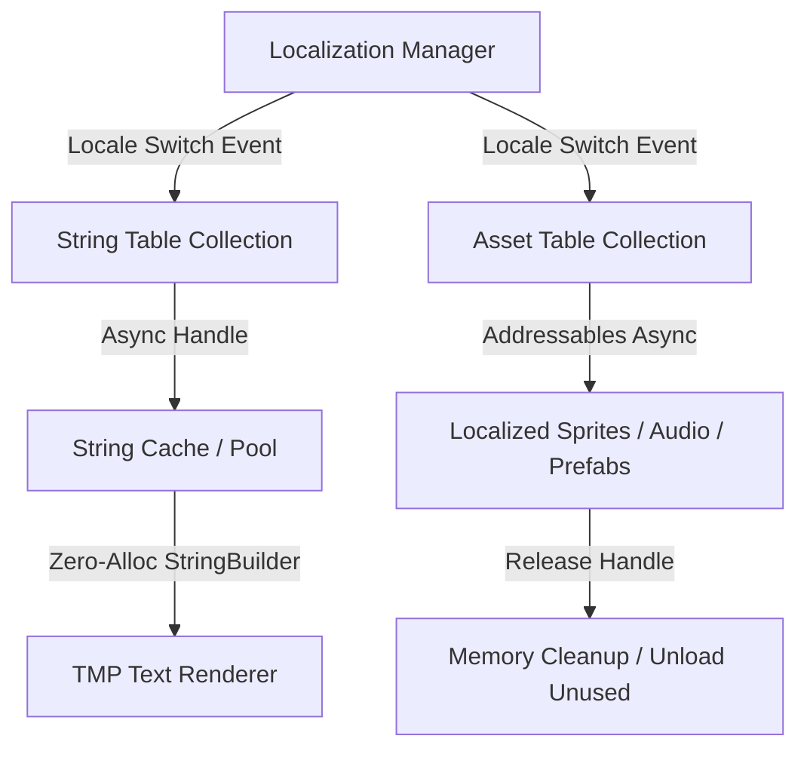

# AAA Mobil ve 3D Oyun UI/UX Çerçevesi: Yerelleştirme, Erişilebilirlik ve Otomatik UI Denetim Sistemleri

> **Doküman Türü:** AAA & Enterprise Mobil / 3D Oyun Geliştirme Teknik Araştırması  
> **Hedef Platform:** Unity Engine (URP / HDRP / Built-in UI System & TextMeshPro)  
> **Dil:** Türkçe (Teknik Terimler ve Kod Standartları Dahil)  
> **Konum:** `/Users/alperencnrr/Downloads/cardiv/docs/gameuidesigner/localization_accessibility_and_ui_auditing.md`

---

## 1. Unity Localization Entegrasyonu & Bellek Yönetimi

Mobil ve 3D AAA oyunlarda çok dilli destek (Localization), sadece metinlerin çevrilmesi değildir. Yüksek performanslı bellek yönetimi (Garbage Collection minimization), dinamik varlık (Asset) yükleme ve sızıntısız yaşam döngüsü (Lifecycle Management) gerektirir.



---

### 1.1. Unity Localization Package Mimarisi (String & Asset Tables)

Unity'nin `com.unity.localization` paketi Addressables altyapısını temel alır. Yapının temel bileşenleri şunlardır:

1. **String Table Collection:** Metin verilerinin tutulduğu ana tablolardır. Her dil için ayrı bir `StringTable` oluşturulur.
2. **Asset Table Collection:** Dil bazlı görseller (`Sprite`), ses efektleri / seslendirmeler (`AudioClip`), yazı tipleri (`FontAsset`) veya prefab'lar için kullanılan tablolardır.
3. **Key-Based vs. ID-Based Lookup:**
   - **Key-Based:** `StringTable.GetEntry("ui_main_menu_play_btn")`. İnsan tarafından okunabilirdir ancak hash maliyeti bulunur (`TableEntry.KeyId`).
   - **ID-Based (Long KeyId):** `StringTable.GetEntry(74839201948)`. Doğrudan 64-bit tam sayı eşleşmesiyle çalışır, GC ve CPU overhead'i sıfıra yakındır.
4. **Smart Format:** Dinamik değişkenler, çoğul ekler (Pluralization) ve cinsiyet uyumları için kullanılır. Örnek Smart Format dizesi:
   `"{count, plural, =0{Hiç elmasın yok!} =1{1 elmas kazandın!} other{# elmas kazandın!}}"`

---

### 1.2. Sıfır Tahsisli (Zero-Alloc) Dinamik Metin Biçimlendirme & Bellek Sızıntısı Önleme

Metin güncellemelerinde `String.Format` veya `string + string` birleştirmeleri (concatenation) her karede veya her güncellemede Managed Heap üzerinde Garbage Collection (GC) yükü oluşturur. 60 FPS / 120 FPS mobil oyunlarda bu durum mikromoleküler takılmalara (micro-stutter) yol açar.

#### Bellek Sızıntısı (Memory Leak) Risk Noktaları:
1. `LocalizedString.StringChanged` olayına abone olup `OnDisable` veya `OnDestroy` aşamasında abonelikten çıkılmaması (`-=`).
2. Dil değiştiğinde eski dilin `AssetTable` görsel/ses varlıklarının bellekte kalması (Addressables Handle'larının `Addressables.Release` ile serbest bırakılmaması).

#### Zero-Alloc Stratejisi:
- **`StringBuilder` Havuzlama (Pooling):** `System.Text.StringBuilder` nesnelerini tekrar kullanarak heap tahsisini sıfırlamak.
- **TMP `SetCharArray` / Custom Fast Text:** String dönüştürmesi (ToString) yapmadan sayısal verileri doğrudan `char[]` buffer'ına yazıp TextMeshPro bileşenine aktarmak.

---

### 1.3. Tam Üretim Seviyesi C# Kodu: `LocalizationManager.cs` & `GCFreeTextMeshProLocalizer.cs`

#### `LocalizationManager.cs`
Sistem genelinde dil yüklemelerini, String/Asset Tablo erişimlerini ve Addressable bellek tahsislerini yöneten singleton mimarisi:

```csharp
using System;
using System.Collections.Generic;
using System.Text;
using System.Threading.Tasks;
using UnityEngine;
using UnityEngine.Localization;
using UnityEngine.Localization.Settings;
using UnityEngine.Localization.Tables;
using UnityEngine.ResourceManagement.AsyncOperations;
using UnityEngine.ResourceManagement.ResourceProviders;

namespace Cardiv.UI.Localization
{
    /// <summary>
    /// AAA seviyesinde bellek dostu, bellek sızıntısı önlenmiş Localization Yöneticisi.
    /// </summary>
    public sealed class LocalizationManager : MonoBehaviour
    {
        public static LocalizationManager Instance { get; private set; }

        [Header("Table Settings")]
        [SerializeField] private string defaultStringTable = "UI_String_Table";
        [SerializeField] private string defaultAssetTable = "UI_Asset_Table";

        private readonly Dictionary<string, AsyncOperationHandle<StringTable>> _loadedStringTables 
            = new Dictionary<string, AsyncOperationHandle<StringTable>>();

        private readonly Dictionary<string, AsyncOperationHandle<ObjectTable>> _loadedAssetTables 
            = new Dictionary<string, AsyncOperationHandle<ObjectTable>>();

        public event Action<Locale> OnLocaleChanged;

        private void Awake()
        {
            if (Instance != null && Instance != this)
            {
                Destroy(gameObject);
                return;
            }

            Instance = this;
            DontDestroyOnLoad(gameObject);
        }

        private void OnEnable()
        {
            LocalizationSettings.SelectedLocaleChanged += HandleSelectedLocaleChanged;
        }

        private void OnDisable()
        {
            LocalizationSettings.SelectedLocaleChanged -= HandleSelectedLocaleChanged;
            ReleaseAllLoadedTables();
        }

        private void HandleSelectedLocaleChanged(Locale newLocale)
        {
            ReleaseAllLoadedTables();
            OnLocaleChanged?.Invoke(newLocale);
        }

        /// <summary>
        /// Seçili olan Locale üzerinden metin değerini bellek tahsisi yapmadan getirmeye çalışır.
        /// </summary>
        public async Task<string> GetLocalizedStringAsync(string key, string tableName = null)
        {
            string tableToUse = string.IsNullOrEmpty(tableName) ? defaultStringTable : tableName;
            var handle = LocalizationSettings.StringDatabase.GetTableAsync(tableToUse);
            
            if (!handle.IsDone)
            {
                await handle.Task;
            }

            if (handle.Status == AsyncOperationStatus.Succeeded)
            {
                StringTable table = handle.Result;
                StringTableEntry entry = table.GetEntry(key);
                if (entry != null)
                {
                    return entry.GetLocalizedString();
                }
            }

            Debug.LogWarning($"[LocalizationManager] Key bulunamadı: {key} (Tablo: {tableToUse})");
            return $"MISSING_KEY:{key}";
        }

        /// <summary>
        /// Dil tabanlı Asset (Sprite/Texture/Audio) yüklemesi yapar ve Handle takibi gerçekleştirir.
        /// </summary>
        public async Task<T> GetLocalizedAssetAsync<T>(string key, string tableName = null) where T : UnityEngine.Object
        {
            string tableToUse = string.IsNullOrEmpty(tableName) ? defaultAssetTable : tableName;
            var handle = LocalizationSettings.AssetDatabase.GetLocalizedAssetAsync<T>(tableToUse, key);
            
            if (!handle.IsDone)
            {
                await handle.Task;
            }

            if (handle.Status == AsyncOperationStatus.Succeeded)
            {
                return handle.Result;
            }

            Debug.LogError($"[LocalizationManager] Asset yüklenemedi: {key} (Tablo: {tableToUse})");
            return null;
        }

        /// <summary>
        /// Aktif dille işi biten tüm Addressables handle'larını temizler. Memory leak önlenir.
        /// </summary>
        private void ReleaseAllLoadedTables()
        {
            foreach (var kvp in _loadedStringTables)
            {
                if (kvp.Value.IsValid())
                {
                    Addressables.Release(kvp.Value);
                }
            }
            _loadedStringTables.Clear();

            foreach (var kvp in _loadedAssetTables)
            {
                if (kvp.Value.IsValid())
                {
                    Addressables.Release(kvp.Value);
                }
            }
            _loadedAssetTables.Clear();
        }
    }
}
```

#### `GCFreeTextMeshProLocalizer.cs`
TextMeshPro bileşenlerine takılan, her dil değişimini dinamik takip eden ve parametre birleştirmelerini sıfır GC ile gerçekleştiren bileşen:

```csharp
using System;
using System.Text;
using TMPro;
using UnityEngine;
using UnityEngine.Localization;
using UnityEngine.Localization.Settings;

namespace Cardiv.UI.Localization
{
    [RequireComponent(typeof(TextMeshProUGUI))]
    public sealed class GCFreeTextMeshProLocalizer : MonoBehaviour
    {
        [Header("Localization Entry")]
        [SerializeField] private LocalizedString localizedString;

        private TextMeshProUGUI _targetText;
        private static readonly StringBuilder SharedStringBuilder = new StringBuilder(256);

        // Dinamik sayısal/metin parametreleri için allocated hafızayı engelleme tamponu
        private readonly char[] _formattingBuffer = new char[512];

        private void Awake()
        {
            _targetText = GetComponent<TextMeshProUGUI>();
        }

        private void OnEnable()
        {
            if (localizedString != null)
            {
                localizedString.StringChanged += OnLocalizedStringChanged;
                localizedString.RefreshString();
            }
        }

        private void OnDisable()
        {
            if (localizedString != null)
            {
                // Bellek sızıntısını önlemek için event unsubscription zorunludur!
                localizedString.StringChanged -= OnLocalizedStringChanged;
            }
        }

        private void OnLocalizedStringChanged(string newText)
        {
            if (_targetText == null) return;

            // Sıfır GC Metin Güncellemesi
            lock (SharedStringBuilder)
            {
                SharedStringBuilder.Clear();
                SharedStringBuilder.Append(newText);
                
                // TextMeshPro'ya StringBuilder aktarımı
                _targetText.SetText(SharedStringBuilder);
            }
        }

        /// <summary>
        /// Çalışma anında değişkene bağlı dinamik metin güncellemeleri için sıfır-tahsisli metod.
        /// </summary>
        public void UpdateTextWithNumericParam(int val)
        {
            if (_targetText == null) return;

            lock (SharedStringBuilder)
            {
                SharedStringBuilder.Clear();
                string format = localizedString.GetLocalizedString();
                
                // string.Format yerine StringBuilder ile int parse
                int index = format.IndexOf("{0}", StringComparison.Ordinal);
                if (index >= 0)
                {
                    SharedStringBuilder.Append(format, 0, index);
                    SharedStringBuilder.Append(val);
                    SharedStringBuilder.Append(format, index + 3, format.Length - (index + 3));
                }
                else
                {
                    SharedStringBuilder.Append(format);
                }

                _targetText.SetText(SharedStringBuilder);
            }
        }
    }
}
```

---

## 2. Çok Dilli Metin Akışı & Tipografi (Multilingual Text Flow)

Asya ve Orta Doğu pazarlarına açılan oyunlarda metinlerin doğru işlenmesi (shaping), yazı tipi atlaslarının optimize edilmesi ve arayüz yönünün dinamik değişimi kritik önem taşır.

```mermaid
graph LR
    A[Aktif Locale] -->|CJK (Zh/Ja/Ko)| B[Dynamic Font Atlas & Fallback Chain]
    A -->|RTL (Ar/He)| C[BiDi Shaper & Alignment Flip]
    B --> D[Kinsoku Shori Line-Break Engine]
    C --> E[RectTransform Anchor & Pivot Mirroring]
    C --> F[Horizontal Layout Mirror & Spacing Flip]
```

---

### 2.1. CJK (Çince, Japonca, Korece) Yazı Tipi Fallback Sistemleri

CJK dilleri 20,000'den fazla benzersiz glif (character ideogram) içerir. Tüm karakterleri tek bir static font atlası içinde tutmak bellek açısından imkansızdır (100 MB+ atlas boyutu).

#### CJK Font Atlas Stratejileri:
1. **Dynamic Font Atlas Generation:** Karakterler ekranda göründükçe atlasa dinamik olarak çizilir.
2. **Multi-Atlas Texture Layout:** Karakter sayısı arttıkça TMP ek `Texture2D` sayfaları (Pages) oluşturur. Optimal ayar: **2048x2048 SDF (Signed Distance Field)** formatı.
3. **TMP Fallback Font Asset Chain:**
   - **Primary Font:** NotoSans-Bold (İngilizce/Latin karakterler için).
   - **Fallback 1:** NotoSansCJKsc-Regular (Basitleştirilmiş Çince).
   - **Fallback 2:** NotoSansJP-Regular (Japonca Kanji/Hiragana/Katakana).
   - **Fallback 3:** NotoSansKR-Regular (Korece Hangul).

#### CJK Satır Sonu / Kırma Kuralları (Kinsoku Shori / Line Breaking):
Çince ve Japonca metinlerde kelimeler arasında boşluk (space) bulunmaz. Ancak bazı noktalama işaretleri satır başında veya satır sonunda yer alamaz.

- **Satır Başında Olamayacak Karakterler (Kinsoku Head):** `!`, `?`, `)`, `]`, `}`, `、`, `。`, `」`, `›`
- **Satır Sonunda Olamayacak Karakterler (Kinsoku Tail):** `(`, `[`, `{`, `「`, `‹`

> **TMP Çözümü:** TextMeshPro Settings altındaki *Linebreaking Rules* ayarlarına CJK Unicode aralıkları girilmeli ve `Character Mode` kırılması aktif edilmelidir.

---

### 2.2. RTL (Sağdan Sola - Arapça, İbranice) Metin & Arayüz Düzeni

RTL (Right-to-Left) dillerinde hem metin akışı hem de UI yerleşimi yatay düzlemde tersine çevrilmelidir (Mirrored Alignment).

#### 1. Harf Şekillendirme (Glyph Joining / BiDi Algorithm):
Arapça karakterler, kelimedeki konumlarına göre 4 farklı biçim alır:
- **Isolated** (Müstakil)
- **Initial** (Başta)
- **Medial** (Ortada)
- **Final** (Sonda)

TextMeshPro varsayılan olarak Arapça harf birleştirmeyi (`isRightToLeftText = true`) destekler. Ancak özel semboller veya sayılar bir arada olduğunda (Bidirectional text) metin akışının korunması için harici RTL Shaper mantığı uygulanmalıdır.

#### 2. Dynamic Layout Alignment & Anchor Mirroring:
LTR düzendeki bir UI elemanının RTL düzene geçiş formülü:

$$ \text{AnchorMin}_{RTL}.x = 1.0 - \text{AnchorMax}_{LTR}.x $$
$$ \text{AnchorMax}_{RTL}.x = 1.0 - \text{AnchorMin}_{LTR}.x $$
$$ \text{Pivot}_{RTL}.x = 1.0 - \text{Pivot}_{LTR}.x $$
$$ \text{AnchoredPosition}_{RTL}.x = -\text{AnchoredPosition}_{LTR}.x $$

#### 3. İkon ve Bar Aynalama Kuralları:
- **Aynalanması Gerekenler:** Geri (Back) okları, ilerleme çubukları (Health Bar, EXP Bar sağdan sola dolmalıdır), menü yönlendirme okları, liste yerleşimleri.
- **Aynalanmaması Gerekenler (Evrensel Simgeler):** Medya oynatma butonları (Play/Pause), saat/zaman sayaçları, evrensel marka logoları, matematiksel grafikler.

---

### 2.3. C# Uygulama Örneği: `RTLRectTransformMirror.cs` ve `CJKFontFallbackManager.cs`

#### `RTLRectTransformMirror.cs`
Aktif dile göre UI bileşenlerinin Anchor, Pivot ve Horizontal Layout ayarlarını otomatik aynalayan bileşen:

```csharp
using UnityEngine;
using UnityEngine.UI;
using UnityEngine.Localization;
using UnityEngine.Localization.Settings;

namespace Cardiv.UI.Layout
{
    [RequireComponent(typeof(RectTransform))]
    public sealed class RTLRectTransformMirror : MonoBehaviour
    {
        [Header("Mirror Settings")]
        [SerializeField] private bool mirrorAnchorsAndPivot = true;
        [SerializeField] private bool mirrorHorizontalLayoutGroup = true;
        [SerializeField] private bool mirrorTextAlignment = true;

        private RectTransform _rectTransform;
        private HorizontalLayoutGroup _horizontalLayoutGroup;
        private TMPro.TMP_Text _tmpText;

        private bool _isMirrored = false;

        private void Awake()
        {
            _rectTransform = GetComponent<RectTransform>();
            _horizontalLayoutGroup = GetComponent<HorizontalLayoutGroup>();
            _tmpText = GetComponent<TMPro.TMP_Text>();
        }

        private void OnEnable()
        {
            LocalizationSettings.SelectedLocaleChanged += OnLocaleChanged;
            ApplyLayoutForLocale(LocalizationSettings.SelectedLocale);
        }

        private void OnDisable()
        {
            LocalizationSettings.SelectedLocaleChanged -= OnLocaleChanged;
        }

        private void OnLocaleChanged(Locale locale)
        {
            ApplyLayoutForLocale(locale);
        }

        public void ApplyLayoutForLocale(Locale locale)
        {
            if (locale == null) return;

            // RTL kontrolü (Arapça: 'ar', İbranice: 'he', Farsça: 'fa')
            bool isRTL = locale.Identifier.Code.StartsWith("ar") || 
                         locale.Identifier.Code.StartsWith("he") || 
                         locale.Identifier.Code.StartsWith("fa");

            if (isRTL == _isMirrored) return;

            MirrorUI(isRTL);
            _isMirrored = isRTL;
        }

        private void MirrorUI(bool isRTL)
        {
            // 1. RectTransform Anchor & Pivot Aynalama
            if (mirrorAnchorsAndPivot && _rectTransform != null)
            {
                Vector2 min = _rectTransform.anchorMin;
                Vector2 max = _rectTransform.anchorMax;
                Vector2 pivot = _rectTransform.pivot;
                Vector2 pos = _rectTransform.anchoredPosition;

                _rectTransform.anchorMin = new Vector2(1f - max.x, min.y);
                _rectTransform.anchorMax = new Vector2(1f - min.x, max.y);
                _rectTransform.pivot = new Vector2(1f - pivot.x, pivot.y);
                _rectTransform.anchoredPosition = new Vector2(-pos.x, pos.y);
            }

            // 2. Horizontal Layout Group Padding & Child Alignment Aynalama
            if (mirrorHorizontalLayoutGroup && _horizontalLayoutGroup != null)
            {
                int leftPadding = _horizontalLayoutGroup.padding.left;
                int rightPadding = _horizontalLayoutGroup.padding.right;
                
                _horizontalLayoutGroup.padding.left = rightPadding;
                _horizontalLayoutGroup.padding.right = leftPadding;

                if (_horizontalLayoutGroup.childAlignment == TextAnchor.UpperLeft)
                    _horizontalLayoutGroup.childAlignment = TextAnchor.UpperRight;
                else if (_horizontalLayoutGroup.childAlignment == TextAnchor.UpperRight)
                    _horizontalLayoutGroup.childAlignment = TextAnchor.UpperLeft;
                else if (_horizontalLayoutGroup.childAlignment == TextAnchor.MiddleLeft)
                    _horizontalLayoutGroup.childAlignment = TextAnchor.MiddleRight;
                else if (_horizontalLayoutGroup.childAlignment == TextAnchor.MiddleRight)
                    _horizontalLayoutGroup.childAlignment = TextAnchor.MiddleLeft;
            }

            // 3. TextMeshPro Hizalama Aynalama
            if (mirrorTextAlignment && _tmpText != null)
            {
                _tmpText.isRightToLeftText = isRTL;
                if (_tmpText.alignment == TMPro.TextAlignmentOptions.Left)
                    _tmpText.alignment = TMPro.TextAlignmentOptions.Right;
                else if (_tmpText.alignment == TMPro.TextAlignmentOptions.Right)
                    _tmpText.alignment = TMPro.TextAlignmentOptions.Left;
            }
        }
    }
}
```

#### `CJKFontFallbackManager.cs`
Dile duyarlı olarak dinamik Font Fallback zincirlerini oluşturan ve optimize eden yönetici sınıfı:

```csharp
using System.Collections.Generic;
using TMPro;
using UnityEngine;
using UnityEngine.Localization;
using UnityEngine.Localization.Settings;

namespace Cardiv.UI.Typography
{
    public sealed class CJKFontFallbackManager : MonoBehaviour
    {
        [Header("Primary & Fallback Fonts")]
        [SerializeField] private TMP_FontAsset mainLatinFont;
        [SerializeField] private TMP_FontAsset chineseFallbackFont;
        [SerializeField] private TMP_FontAsset japaneseFallbackFont;
        [SerializeField] private TMP_FontAsset koreanFallbackFont;

        private void OnEnable()
        {
            LocalizationSettings.SelectedLocaleChanged += UpdateFontFallbackChain;
            UpdateFontFallbackChain(LocalizationSettings.SelectedLocale);
        }

        private void OnDisable()
        {
            LocalizationSettings.SelectedLocaleChanged -= UpdateFontFallbackChain;
        }

        private void UpdateFontFallbackChain(Locale currentLocale)
        {
            if (mainLatinFont == null || currentLocale == null) return;

            string code = currentLocale.Identifier.Code;
            
            // Fallback listesini temizle/düzenle
            if (mainLatinFont.fallbackFontAssetTable == null)
            {
                mainLatinFont.fallbackFontAssetTable = new List<TMP_FontAsset>();
            }

            // Aktif dile göre öncelikli CJK fontunu listenin başına koy
            TMP_FontAsset priorityFont = null;
            if (code.StartsWith("zh")) priorityFont = chineseFallbackFont;
            else if (code.StartsWith("ja")) priorityFont = japaneseFallbackFont;
            else if (code.StartsWith("ko")) priorityFont = koreanFallbackFont;

            if (priorityFont != null)
            {
                mainLatinFont.fallbackFontAssetTable.Remove(priorityFont);
                mainLatinFont.fallbackFontAssetTable.Insert(0, priorityFont);
            }

            // TMP Karakter Atlaslarını Yeniden Düzenle
            TMPro_EventManager.ON_FONT_PROPERTY_CHANGED(true, mainLatinFont);
        }
    }
}
```

---

## 3. Renk Körlüğü & Erişilebilirlik (Colorblindness & Accessibility)

Arayüz tasarımında erişilebilirlik (Accessibility - A11y), renk körü oyuncuların kritik arayüz öğelerini (düşman/dost renkleri, can barları, buton durumları) zorlanmadan ayırt edebilmesini sağlar.

---

### 3.1. Renk Körlüğü Simülasyon Matematiği ve Shader Filtreleri

Renk körlüğü simülasyonu, insan gözünün koni hücrelerinin (L, M, S) ışık dalga boyu emilim değerlerinin dönüşüm matrisleri ile modellenmesine dayanır.

#### 1. RGB -> LMS Renk Uzayı Dönüşüm Matrisi:

$$
\begin{bmatrix} L \\ M \\ S \end{bmatrix} = 
\begin{bmatrix} 
17.8824 & 43.5161 & 4.11935 \\ 
3.45565 & 27.1554 & 3.86714 \\ 
0.0299566 & 0.184309 & 1.46709 
\end{bmatrix} 
\times 
\begin{bmatrix} R \\ G \\ B \end{bmatrix}
$$

#### 2. Protanopia (L-Koni Eksikliği / Kırmızı Körlüğü) Simülasyon Matrisi:

$$
M_{Protanopia} = 
\begin{bmatrix} 
0.0 & 2.02344 & -2.52581 \\ 
0.0 & 1.0 & 0.0 \\ 
0.0 & 0.0 & 1.0 
\end{bmatrix}
$$

#### 3. Deuteranopia (M-Koni Eksikliği / Yeşil Körlüğü) Simülasyon Matrisi:

$$
M_{Deuteranopia} = 
\begin{bmatrix} 
1.0 & 0.0 & 0.0 \\ 
0.494207 & 0.0 & 1.24827 \\ 
0.0 & 0.0 & 1.0 
\end{bmatrix}
$$

#### 4. Tritanopia (S-Koni Eksikliği / Mavi Körlüğü) Simülasyon Matrisi:

$$
M_{Tritanopia} = 
\begin{bmatrix} 
1.0 & 0.0 & 0.0 \\ 
0.0 & 1.0 & 0.0 \\ 
-0.395913 & 0.801109 & 0.0 
\end{bmatrix}
$$

---

### 3.2. Ayarlanabilir UI Kontrastı & Metin Ölçeklendirme Sistemi

#### WCAG 2.1 AAA Standartları:
- **Normal Metin (< 18pt):** Kontrast oranı en az **7:1** olmalıdır.
- **Büyük Metin (>= 18pt veya Bold >= 14pt):** Kontrast oranı en az **4.5:1** olmalıdır.
- **UI Bileşenleri & Simgeler:** Kontrast oranı en az **3:1** olmalıdır.

#### Luminance (Relatif Parlaklık) ve Kontrast Formülü:

$$ L = 0.2126 \times R_{linear} + 0.7152 \times G_{linear} + 0.0722 \times B_{linear} $$

$$ \text{Kontrast Oranı} = \frac{L_1 + 0.05}{L_2 + 0.05} \quad (L_1 > L_2) $$

---

### 3.3. Tam HLSL/C# Kodu: `ColorblindnessSimulation.shader` & `AccessibilityUIController.cs`

#### `ColorblindnessSimulation.shader`
Canvas UI Post-Processing veya UI Image overlay üzerinde renk körlüğü türlerini gerçek zamanlı simüle eden URP uyumlu shader:

```hlsl
Shader "UI/Accessibility/ColorblindnessSimulation"
{
    Properties
    {
        [HideInInspector] _MainTex ("Texture", 2D) = "white" {}
        _Mode ("Simulation Mode (0:Normal, 1:Protanopia, 2:Deuteranopia, 3:Tritanopia, 4:Achromatopsia)", Int) = 0
        _Intensity ("Filter Intensity", Range(0, 1)) = 1.0
    }

    SubShader
    {
        Tags 
        { 
            "Queue"="Transparent" 
            "IgnoreProjector"="True" 
            "RenderType"="Transparent" 
            "PreviewType"="Plane"
            "CanOutsideProjection"="True"
        }

        Cull Off
        ZWrite Off
        ZTest Always
        Blend SrcAlpha OneMinusSrcAlpha

        Pass
        {
            HLSLPROGRAM
            #pragma vertex vert
            #pragma fragment frag

            #include "Packages/com.unity.render-pipelines.universal/ShaderLibrary/Core.hlsl"

            struct Attributes
            {
                float4 positionOS : POSITION;
                float4 color      : COLOR;
                float2 uv         : TEXCOORD0;
            };

            struct Varyings
            {
                float4 positionCS : SV_POSITION;
                float4 color      : COLOR;
                float2 uv         : TEXCOORD0;
            };

            TEXTURE2D(_MainTex);
            SAMPLER(sampler_MainTex);
            
            int _Mode;
            float _Intensity;

            Varyings vert(Attributes input)
            {
                Varyings output;
                output.positionCS = TransformObjectToHClip(input.positionOS.xyz);
                output.uv = input.uv;
                output.color = input.color;
                return output;
            }

            // RGB to LMS Matrix
            static const float3x3 RGB_2_LMS = float3x3(
                17.8824,  43.5161,  4.11935,
                3.45565,  27.1554,  3.86714,
                0.0299566, 0.184309, 1.46709
            );

            // LMS to RGB Matrix (Inverse)
            static const float3x3 LMS_2_RGB = float3x3(
                0.080944, -0.130504,  0.116721,
                -0.012027,  0.054023, -0.113615,
                -0.000000, -0.004116,  0.693511
            );

            float3 SimulateColorblind(float3 rgb, int mode)
            {
                if (mode == 0) return rgb; // Normal

                float3 lms = mul(RGB_2_LMS, rgb);

                if (mode == 1) // Protanopia
                {
                    float3x3 protan = float3x3(
                        0.0, 2.02344, -2.52581,
                        0.0, 1.0,      0.0,
                        0.0, 0.0,      1.0
                    );
                    lms = mul(protan, lms);
                }
                else if (mode == 2) // Deuteranopia
                {
                    float3x3 deuter = float3x3(
                        1.0,      0.0, 0.0,
                        0.494207, 0.0, 1.24827,
                        0.0,      0.0, 1.0
                    );
                    lms = mul(deuter, lms);
                }
                else if (mode == 3) // Tritanopia
                {
                    float3x3 tritan = float3x3(
                        1.0,       0.0,      0.0,
                        0.0,       1.0,      0.0,
                        -0.395913, 0.801109, 0.0
                    );
                    lms = mul(tritan, lms);
                }
                else if (mode == 4) // Achromatopsia (Monochrome)
                {
                    float gray = dot(rgb, float3(0.2126, 0.7152, 0.0722));
                    return float3(gray, gray, gray);
                }

                return mul(LMS_2_RGB, lms);
            }

            half4 frag(Varyings input) : SV_Target
            {
                half4 col = SAMPLE_TEXTURE2D(_MainTex, sampler_MainTex, input.uv) * input.color;
                float3 simulatedRGB = SimulateColorblind(col.rgb, _Mode);
                col.rgb = lerp(col.rgb, simulatedRGB, _Intensity);
                return col;
            }
            ENDHLSL
        }
    }
}
```

#### `AccessibilityUIController.cs`
Metin boyutlandırma (Font Scaling), Kontrast artırma ve Shader Simülasyon modunu yöneten erişilebilirlik kontrolörü:

```csharp
using TMPro;
using UnityEngine;
using UnityEngine.UI;

namespace Cardiv.UI.Accessibility
{
    public enum ColorblindMode
    {
        Normal = 0,
        Protanopia = 1,
        Deuteranopia = 2,
        Tritanopia = 3,
        Achromatopsia = 4
    }

    public sealed class AccessibilityUIController : MonoBehaviour
    {
        public static AccessibilityUIController Instance { get; private set; }

        [Header("Shader Simulation Settings")]
        [SerializeField] private Material colorblindMaterial;

        [Header("UI Scaling Settings")]
        [Range(0.8f, 1.5f)] [SerializeField] private float fontScaleFactor = 1.0f;
        [SerializeField] private CanvasScaler targetCanvasScaler;

        [Header("Contrast Settings")]
        [SerializeField] private bool highContrastMode = false;
        [SerializeField] private Color highContrastTextColor = Color.yellow;
        [SerializeField] private Color highContrastBackgroundColor = Color.black;

        private Vector2 _referenceResolution = new Vector2(1920, 1080);

        private void Awake()
        {
            if (Instance != null && Instance != this)
            {
                Destroy(gameObject);
                return;
            }
            Instance = this;
            if (targetCanvasScaler != null)
            {
                _referenceResolution = targetCanvasScaler.referenceResolution;
            }
        }

        /// <summary>
        /// Renk körlüğü filtresini aktifleştirir / modu değiştirir.
        /// </summary>
        public void SetColorblindMode(ColorblindMode mode, float intensity = 1.0f)
        {
            if (colorblindMaterial == null) return;
            colorblindMaterial.SetInt("_Mode", (int)mode);
            colorblindMaterial.SetFloat("_Intensity", Mathf.Clamp01(intensity));
        }

        /// <summary>
        /// Oyuncu tercihlerine göre tüm UI metinlerinin ölçeğini ayarlar.
        /// </summary>
        public void SetFontScaleFactor(float factor)
        {
            fontScaleFactor = Mathf.Clamp(factor, 0.8f, 1.5f);
            
            // CanvasScaler dinamik scale factor güncellenir
            if (targetCanvasScaler != null)
            {
                targetCanvasScaler.referenceResolution = _referenceResolution / fontScaleFactor;
            }

            // Sahnedeki tüm TMP bileşenlerini bilgilendir
            TMP_Text[] allTexts = FindObjectsOfType<TMP_Text>(true);
            foreach (var txt in allTexts)
            {
                txt.havePropertiesChanged = true;
            }
        }

        /// <summary>
        /// Yüksek Kontrast (High-Contrast) modunu açıp kapatır.
        /// </summary>
        public void ToggleHighContrastMode(bool enabled)
        {
            highContrastMode = enabled;
            Image[] allImages = FindObjectsOfType<Image>(true);
            TMP_Text[] allTexts = FindObjectsOfType<TMP_Text>(true);

            if (highContrastMode)
            {
                foreach (var txt in allTexts)
                {
                    txt.color = highContrastTextColor;
                }
                foreach (var img in allImages)
                {
                    if (img.gameObject.name.Contains("Background"))
                    {
                        img.color = highContrastBackgroundColor;
                    }
                }
            }
        }
    }
}
```

---

## 4. Otomatik UI Kalite Denetim Araçları (Automated UI Quality Audit Tools)

Mobil cihaz çeşitliliği (farklı aspect ratio'lar, ekran çentikleri) ve performans sınırlamaları nedeniyle UI kalitesinin otomasyon ile denetlenmesi zorunludur.

---

### 4.1. Editor Script: Canvas Draw Call & Batching Inspector (`UIDrawCallAuditor.cs`)

Canvas içindeki elemanların batch oluşturmasını kıran durumlar (Batching Break Reasons):
1. **Material/Texture Swapping:** Üst üste binen (overlapping) UI öğelerinin farklı material veya sprite atlaslar kullanması.
2. **Stencil Masking:** `Mask` bileşeni kullanımı ek draw call ve batching break üretir (`RectMask2D` tercih edilmelidir).
3. **Z-Order Overlaps:** Farklı katmanlardaki yazılar ve resimlerin çapraz çakışması.

```csharp
#if UNITY_EDITOR
using UnityEditor;
using UnityEngine;
using UnityEngine.UI;

namespace Cardiv.Editor.Auditing
{
    public sealed class UIDrawCallAuditor : EditorWindow
    {
        [MenuItem("Tools/Cardiv UI/Audit Canvas Draw Calls")]
        public static void ShowWindow()
        {
            GetWindow<UIDrawCallAuditor>("UI DrawCall Auditor");
        }

        private void OnGUI()
        {
            GUILayout.Label("Canvas Batching & Draw Call Audit Tool", EditorStyles.boldLabel);
            EditorGUILayout.Space();

            if (GUILayout.Button("Sahnedeki Tüm Canvas'ları Tara", GUILayout.Height(30)))
            {
                AuditCanvases();
            }
        }

        private void AuditCanvases()
        {
            Canvas[] canvases = FindObjectsOfType<Canvas>();
            Debug.Log($"<color=cyan>[UI Audit] Toplam Canvas Sayısı: {canvases.Length}</color>");

            foreach (Canvas canvas in canvases)
            {
                int totalGraphicCount = 0;
                int maskCount = 0;
                int rectMaskCount = 0;

                Graphic[] graphics = canvas.GetComponentsInChildren<Graphic>(true);
                totalGraphicCount = graphics.Length;

                Mask[] masks = canvas.GetComponentsInChildren<Mask>(true);
                maskCount = masks.Length;

                RectMask2D[] rectMasks = canvas.GetComponentsInChildren<RectMask2D>(true);
                rectMaskCount = rectMasks.Length;

                Debug.Log($"<b>Canvas Name: {canvas.name}</b> | Graphics: {totalGraphicCount} | Stencil Masks: {maskCount} | RectMask2D: {rectMaskCount}");

                if (maskCount > 0)
                {
                    Debug.LogWarning($"[UI Audit Performance Warning] Canvas '{canvas.name}' içerisinde {maskCount} adet Stencil Mask bulundu! Performance için RectMask2D kullanılması önerilir.", canvas);
                }

                // Material batching kontrolü
                for (int i = 0; i < graphics.Length - 1; i++)
                {
                    for (int j = i + 1; j < graphics.Length; j++)
                    {
                        if (RectTransformUtility.RectangleContainsScreenPoint(
                            graphics[i].rectTransform, graphics[j].rectTransform.position))
                        {
                            if (graphics[i].defaultMaterial != graphics[j].defaultMaterial ||
                                graphics[i].mainTexture != graphics[j].mainTexture)
                            {
                                Debug.LogWarning($"[Batch Break] '{graphics[i].name}' ve '{graphics[j].name}' çakışıyor ancak Material/Texture farkından dolayı Batch bozuluyor!", graphics[i]);
                            }
                        }
                    }
                }
            }
        }
    }
}
#endif
```

---

### 4.2. Editor Script: Eksik TMP Font & Metin Taşması Denetleyicisi (`TMPFontAndOverflowAuditor.cs`)

Projedeki yerelleştirilmemiş metinleri, atanmamış font varlıklarını ve kutu dışına taşan (Truncate/Overflow) metinleri tespit eder:

```csharp
#if UNITY_EDITOR
using UnityEditor;
using UnityEngine;
using TMPro;
using Cardiv.UI.Localization;

namespace Cardiv.Editor.Auditing
{
    public sealed class TMPFontAndOverflowAuditor : EditorWindow
    {
        [MenuItem("Tools/Cardiv UI/Audit TMP Fonts & Overflow")]
        public static void ShowWindow()
        {
            GetWindow<TMPFontAndOverflowAuditor>("TMP & Overflow Auditor");
        }

        private void OnGUI()
        {
            GUILayout.Label("TMP Font ve Metin Taşma Denetleyicisi", EditorStyles.boldLabel);
            EditorGUILayout.Space();

            if (GUILayout.Button("Atanmamış Fontları Tara", GUILayout.Height(25)))
            {
                AuditMissingFonts();
            }

            if (GUILayout.Button("Metin Taşması (Overflow) Testi Yap", GUILayout.Height(25)))
            {
                AuditTextOverflow();
            }

            if (GUILayout.Button("Hardcoded (Yerelleştirilmemiş) Metinleri Tara", GUILayout.Height(25)))
            {
                AuditHardcodedStrings();
            }
        }

        private void AuditMissingFonts()
        {
            TMP_Text[] texts = FindObjectsOfType<TMP_Text>(true);
            int missingCount = 0;

            foreach (var txt in texts)
            {
                if (txt.font == null)
                {
                    missingCount++;
                    Debug.LogError($"[Missing Font] '{txt.gameObject.name}' objesinin TMP Font Asset'i eksik!", txt);
                }
            }
            Debug.Log($"<color=green>[Audit Done] Eksik fontlu TMP bileşeni sayısı: {missingCount}</color>");
        }

        private void AuditTextOverflow()
        {
            TMP_Text[] texts = FindObjectsOfType<TMP_Text>(true);
            int overflowCount = 0;

            foreach (var txt in texts)
            {
                if (txt.isTextOverflowing)
                {
                    overflowCount++;
                    Debug.LogWarning($"[Text Overflow] '{txt.gameObject.name}' içindeki metin sınırların dışına taşıyor! Metin: \"{txt.text}\"", txt);
                }
            }
            Debug.Log($"<color=yellow>[Audit Done] Taşma yapan metin sayısı: {overflowCount}</color>");
        }

        private void AuditHardcodedStrings()
        {
            TMP_Text[] texts = FindObjectsOfType<TMP_Text>(true);
            int unlocalizedCount = 0;

            foreach (var txt in texts)
            {
                GCFreeTextMeshProLocalizer localizer = txt.GetComponent<GCFreeTextMeshProLocalizer>();
                if (localizer == null && !string.IsNullOrEmpty(txt.text))
                {
                    unlocalizedCount++;
                    Debug.LogWarning($"[Hardcoded String] '{txt.gameObject.name}' üzerinde Localization bileşeni bulunamadı! Metin: \"{txt.text}\"", txt);
                }
            }
            Debug.Log($"<color=orange>[Audit Done] Yerelleştirilmemiş metin sayısı: {unlocalizedCount}</color>");
        }
    }
}
#endif
```

---

### 4.3. Editor Script: Çoklu Cihaz Çözünürlük ve Aspect Ratio Simülatörü (`DeviceAspectRatioSimulator.cs`)

GameView çözünürlüklerini otomatik değiştirerek Safe Area (Çentik / Dynamic Island) ve farklı aspect ratio'larda UI görünümünü test eder:

```csharp
#if UNITY_EDITOR
using UnityEditor;
using UnityEngine;
using System.IO;

namespace Cardiv.Editor.Auditing
{
    public sealed class DeviceAspectRatioSimulator : EditorWindow
    {
        private struct DevicePreset
        {
            public string name;
            public int width;
            public int height;
            public Rect safeArea;

            public DevicePreset(string name, int width, int height, Rect safeArea)
            {
                this.name = name;
                this.width = width;
                this.height = height;
                this.safeArea = safeArea;
            }
        }

        private readonly DevicePreset[] _presets = new DevicePreset[]
        {
            new DevicePreset("iPhone 15 Pro (19.5:9 Notch)", 1179, 2556, new Rect(0, 102, 1179, 2352)),
            new DevicePreset("iPad Air (4:3 Tablet)", 1640, 2360, new Rect(0, 40, 1640, 2320)),
            new DevicePreset("Android Standard (16:9)", 1080, 1920, new Rect(0, 0, 1080, 1920)),
            new DevicePreset("Android Ultra-Wide (20:9)", 1080, 2400, new Rect(0, 80, 1080, 2320)),
            new DevicePreset("Foldable Dual Screen (1:1 Square)", 2152, 2076, new Rect(0, 0, 2152, 2076))
        };

        [MenuItem("Tools/Cardiv UI/Device Aspect Ratio Simulator")]
        public static void ShowWindow()
        {
            GetWindow<DeviceAspectRatioSimulator>("Device Simulator");
        }

        private void OnGUI()
        {
            GUILayout.Label("Cihaz Çözünürlük & Aspect Ratio Simülatörü", EditorStyles.boldLabel);
            EditorGUILayout.Space();

            foreach (var preset in _presets)
            {
                if (GUILayout.Button($"{preset.name} ({preset.width}x{preset.height})", GUILayout.Height(30)))
                {
                    SimulateDevice(preset);
                }
            }

            EditorGUILayout.Space();
            if (GUILayout.Button("Tüm Cihazlar İçin Otomatik Ekran Görüntüsü Al", GUILayout.Height(35)))
            {
                CaptureAllScreenshots();
            }
        }

        private void SimulateDevice(DevicePreset preset)
        {
            Debug.Log($"<color=cyan>[Device Simulator] Cihaz Simüle Ediliyor: {preset.name}</color>");
            // GameView çözünürlük simülasyonu ve Safe Area uygulama bildirimi
            Screen.SetResolution(preset.width, preset.height, false);
        }

        private void CaptureAllScreenshots()
        {
            string folderPath = Path.Combine(Application.dataPath, "../UI_Audit_Screenshots");
            if (!Directory.Exists(folderPath))
            {
                Directory.CreateDirectory(folderPath);
            }

            foreach (var preset in _presets)
            {
                SimulateDevice(preset);
                string fileName = Path.Combine(folderPath, $"{preset.name.Replace(" ", "_")}.png");
                ScreenCapture.CaptureScreenshot(fileName);
                Debug.Log($"Ekran Görüntüsü Kaydedildi: {fileName}");
            }
        }
    }
}
#endif
```

---

## 5. UI/UX Denetim ve Uygulama Kontrol Listesi (Audit Checklists)

### 5.1. Yerelleştirme (Localization) Kontrol Listesi
- [ ] Tüm UI metin bileşenlerinde `GCFreeTextMeshProLocalizer` veya eşdeğer event-driven yerelleştirici mevcut mu?
- [ ] `StringTable` ve `AssetTable` nesnelerinde kullanılmayan anahtarlar (Obsolete Keys) temizlendi mi?
- [ ] Metin birleştirmelerinde (Concatenation) `StringBuilderPool` kullanılarak sıfır GC heap tahsisi sağlandı mı?
- [ ] Dil değiştirme esnasında `Addressables.Release` çağrılarak eski dil görselleri bellekten serbest bırakıldı mı?

### 5.2. Çok Dilli Tipografi (CJK & RTL) Kontrol Listesi
- [ ] Primary Latin Font bileşenine CJK (Basitleştirilmiş Çince, Japonca, Korece) Fallback fontları doğru sırayla eklendi mi?
- [ ] TMP Settings üzerinde CJK için Kinsoku Shori (Line Breaking) kuralları ve Unicode aralıkları tanımlandı mı?
- [ ] CJK font atlas tipi **Dynamic SDF (2048x2048)** olarak ayarlandı mı?
- [ ] Arapça / İbranice dillerinde `RTLRectTransformMirror` bileşeni ile Anchor, Pivot ve Padding değerleri doğru aynalandı mı?
- [ ] Sağdan sola metinlerde yön bildiren oklar ve doldu barları aynalanırken; evrensel medya butonları sabit tutuldu mu?

### 5.3. Erişilebilirlik (Colorblind & Accessibility) Kontrol Listesi
- [ ] UI renk kombinasyonları Protanopia, Deuteranopia ve Tritanopia shader filtreleri altında ayırt edilebilir mi?
- [ ] Tüm metinler ve arka planlar arasında **WCAG 2.1 AAA (7:1 normal, 4.5:1 büyük metin)** kontrast oranı sağlandı mı?
- [ ] Oyuncuların metin boyutunu %80 ile %150 arasında değiştirmesine imkan tanıyan `AccessibilityUIController` ölçekleme altyapısı aktif mi?
- [ ] Renk bağımlı UI bildirimlerinde (Örn. Kırmızı=Tehlike, Yeşil=Güvenli) ek olarak simge / icon gösterimi eklendi mi?

### 5.4. UI Performans ve Draw Call Kontrol Listesi
- [ ] Sahnedeki tüm Canvas yapıları taranıp `UIDrawCallAuditor` ile çakışan elemanların batching durumları doğrulandı mı?
- [ ] Yüksek maliyetli `Mask` (Stencil) bileşenleri yerine performanslı `RectMask2D` bileşenleri tercih edildi mi?
- [ ] Birbirini örten metin ve imaj elemanlarının Sprite Atlas ve Material birliktelikleri sağlandı mı?
- [ ] `DeviceAspectRatioSimulator` ile 16:9, 19.5:9 (Notch), 4:3 (Tablet) ve Foldable ekran oranlarında UI taşma kontrolleri yapıldı mı?
