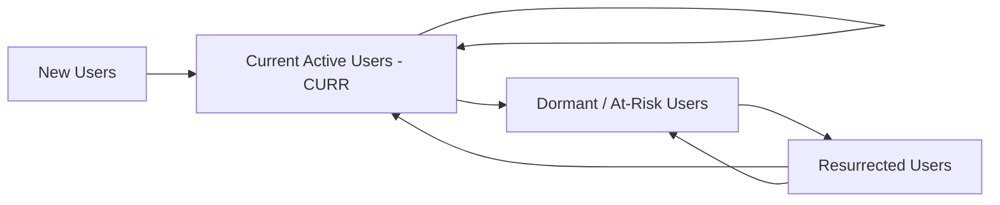

# /growth-retention — Mobile Retention, Lifecycle Engine & Habit Loops

This specialized sub-skill module is used to flatten asymptotic retention curves, mathematically discover Aha! moments via correlation coefficients, build multi-channel Push and iOS Live Activities engines, and optimize Markov chain user lifecycle states.

---

## 1. Asymptotic Retention Curves ("Flattening the Tail")

Sustainable mobile product growth requires establishing a stable, non-zero horizontal asymptote on D30–D360 cohorts:

```
Retention (%)
100% ──┐
 50%   │\
 30%   │ \
 15%   │  \_____________________________  <── FLATTENED TAIL (Sustainable Business)
  0%   │   \____________________________  <── ZERO ASYMPTOTE (Leaky Bucket / Churn Bleed)
       └───────────────────────────────────
       D0  D1   D7   D14  D30  D90  D360 (Days)
```

---

## 2. Mathematical Discovery of "Aha! Moments" (Phi Coefficient $\phi$)

Identify high-impact habit-forming behaviors using the **Phi Correlation Coefficient ($\phi$)**:

$$\phi = \frac{AD - BC}{\sqrt{(A+B)(C+D)(A+C)(B+D)}}$$

* $A$: Completed the action AND retained at D30
* $B$: Completed the action BUT churned before D30
* $C$: Did NOT complete the action BUT retained at D30
* $D$: Did NOT complete the action AND churned before D30

> **Empirical Rule:** Any in-app behavior with $\phi > 0.35$ represents an **Aha! Moment** (e.g., *"Completing 2 audio sessions in the first 72 hours"*). Re-architect the onboarding sequence to guide users to this action with minimal friction.

---

## 3. Duolingo-Style 7-State Markov Chain Model (CURR)

Segment and govern the entire user base through 4 active lifecycle states:



* **CURR (Current User Retention Rate):** The probability that a user active in week $W$ remains active in week $W+1$. CURR is the single highest-leverage driver of long-term active user growth.

---

## 4. Multi-Channel Lifecycle & iOS 18 Live Activities

### A. Two-Step Soft-Ask Push Priming
Never trigger the native iOS system permission dialog on first open (a `.denied` state is permanent).
1. Present a styled in-app modal: *"Would you like daily streak reminders to keep you on track?"*
2. If the user taps *"Yes, Remind Me"*, trigger native `UNUserNotificationCenter.requestAuthorization`. This lifts opt-in rates to **75%+**.

### B. iOS Live Activities (`ActivityKit`) Implementation
Keep users engaged directly from the Lock Screen and Dynamic Island:

```swift
import ActivityKit
import WidgetKit
import SwiftUI

struct HabitTrackerActivityAttributes: ActivityAttributes {
    public struct ContentState: Codable, Hashable {
        var currentStreak: Int
        var dailyTargetMinutes: Int
        var completedMinutes: Int
    }
    var habitName: String
}
```

---

## 5. iOS 18 StoreKit 2 Win-Back Offers

Present automated App Store-level discounts to lapsed or churning subscribers:

```swift
import StoreKit

func applyWinBackOffers(for product: Product) async {
    let eligibleOffers = await product.subscription?.winBackOffers
    if let bestOffer = eligibleOffers?.first {
        do {
            let result = try await product.purchase(confirmIn: nil, with: [
                .winBackOffer(bestOffer)
            ])
            // Win-Back transaction successfully completed!
        } catch {
            print("Win-Back error: \(error)")
        }
    }
}
```

---

## 📖 Reference Deep Research Documents
- [`01_mobile_growth_pm_anatomy_and_scaling.md`](../researches/01_mobile_growth_pm_anatomy_and_scaling.md)
- [`03_retention_lifecycle_and_experimentation_engine.md`](../researches/03_retention_lifecycle_and_experimentation_engine.md)
