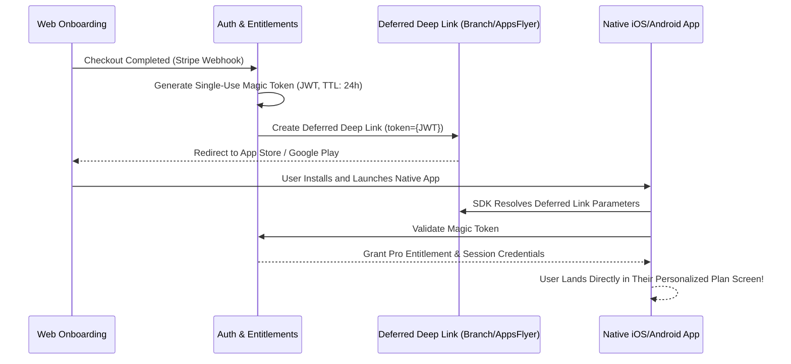

# /growth-web2app — Web-to-App Funnel Architecture & Fee Arbitrage

This specialized sub-skill module is used to architect Web-to-App funnels that bypass the 15%–30% Apple/Google store commission, leverage Stripe billing for accelerated cash flow, deploy 15–20 step psychometric quizzes, and execute frictionless native app handoffs via deferred deep linking.

---

## 1. Unit Economics & Commission Arbitrage

```
┌───────────────────────────────────────┬───────────────────────────────────────┐
│         NATIVE IN-APP BILLING         │           WEB-TO-APP FUNNEL           │
├───────────────────────────────────────┼───────────────────────────────────────┤
│ Store Fee: 15% - 30% (Apple/Google)   │ Processing Fee: ~2.9% + $0.30 (Stripe)│
│ Payout Horizon: Net-45 to Net-60 Days │ Payout Horizon: T+2 Rolling Payouts   │
│ Pixel Tracking: Severely constrained  │ Conversion API (CAPI): 100% Precision │
│ Onboarding: Constrained by HIG / GPBL │ Onboarding: Unrestricted 20-Step Quiz │
└───────────────────────────────────────┴───────────────────────────────────────┘
```

> **Financial Leverage:** On $1,000,000 in gross bookings, Web-to-App captures **$120,000 – $270,000 in incremental net cash**. This cash is immediately reinvested into Meta/TikTok paid UA campaigns, accelerating the compounding reinvestment loop.

---

## 2. The 15–20 Step Psychometric Quiz Funnel (Flo / Noom Model)

The 4-phase behavioral progression that converts cold paid ad traffic into committed subscribers:

```
[1. Low-Friction Priming] ──> [2. Pain & Goal Mapping] ──> [3. Synthetic Computation] ──> [4. Tailored Paywall]
 (Age, Gender, Activity)       (Weight Goal, Daily Target)    (Perceived Effort Loader)    (Stripe / Apple Pay)
```

### The Synthetic Computation Loader (Perceived Effort Heuristic)
Do not render the paywall immediately after the quiz. Display a 3.5-second animated computation progress bar:
* *"Analyzing metabolic parameters..."* (25%)
* *"Calibrating 90-day trajectory against 140,000 profiles..."* (65%)
* *"Projected Goal Success Probability: 91.4%!"* (100%)
* 👉 **Result:** Users perceive substantial algorithmic customization (The IKEA Effect), lifting paywall checkout conversion by **+18% to +24%**.

---

## 3. Stripe Checkout Session Integration (Node.js / TypeScript)

```typescript
import Stripe from 'stripe';
const stripe = new Stripe(process.env.STRIPE_SECRET_KEY!, { apiVersion: '2023-10-16' });

export async function createQuizCheckoutSession(userEmail: string, quizResults: any) {
  const session = await stripe.checkout.sessions.create({
    customer_email: userEmail,
    payment_method_types: ['card'],
    line_items: [
      {
        price: 'price_annual_pro_3999', // $39.99/year
        quantity: 1,
      },
    ],
    mode: 'subscription',
    subscription_data: {
      trial_period_days: 7,
      metadata: {
        quiz_id: quizResults.id,
        user_tier: quizResults.tier,
      },
    },
    success_url: `https://app.yourdomain.com/onboarding-complete?session_id={CHECKOUT_SESSION_ID}`,
    cancel_url: `https://yourdomain.com/quiz-review`,
  });

  return session.url;
}
```

---

## 4. Frictionless App Handoff via Deferred Deep Linking



---

## 📖 Reference Deep Research Documents
- [`02_subscription_monetization_paywalls_and_adtech.md`](../researches/02_subscription_monetization_paywalls_and_adtech.md)
- [`05_monetization_turnaround_case_study_and_experiments.md`](../researches/05_monetization_turnaround_case_study_and_experiments.md)
